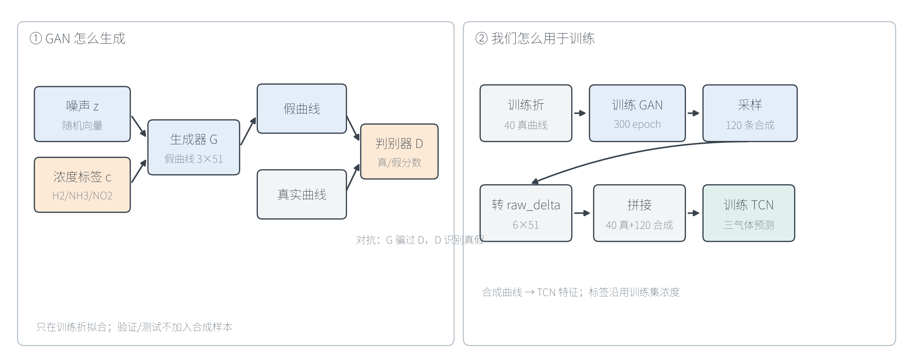
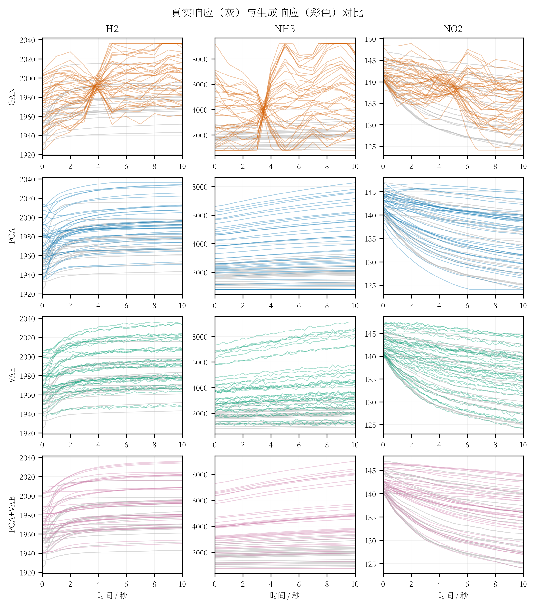
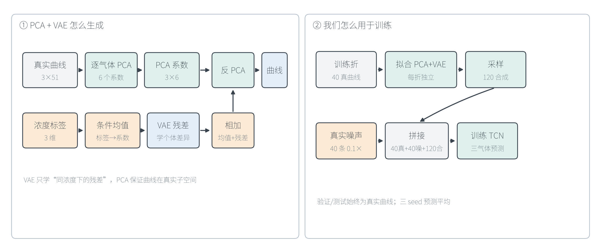

# GAN 与 PCA-VAE 数据增强：汇报稿

> 用途：向老师口头汇报，建议 5–7 分钟。  
> 原则：先讲“为什么”，再讲“怎么生成”，最后讲“为什么最后没选 GAN”。

---

## 0. 一页纸逻辑

```text
只有 50 个开发实验，10 秒模型容易过拟合
        ↓
想用生成式增强补充训练样本
        ↓
先试 GAN：直接生成曲线
        ↓
生成质量不合格，下游明显退化 → 放弃
        ↓
改成 PCA-VAE：先压缩，再学残差
        ↓
生成质量更稳，配合真实噪声后效果最好
```

---

## 1. 开场（约 30 秒）

> 我们的核心问题是小样本：开发集只有 50 个实验，每个实验只有一条 10 秒响应曲线。  
> 如果直接训练 TCN，模型很容易记住训练集，泛化不够稳。  
> 所以我们尝试了两类数据增强：一类是 GAN，直接生成响应曲线；另一类是 PCA-VAE，先把曲线压缩到低维，再学习低维系数。  
> 今天重点讲这两类方法的结构、生成过程，以及为什么最终选择 PCA-VAE，而不是 GAN。

---

## 2. GAN 是什么

### 2.1 一句话原理

GAN 由两个网络对抗训练：

- **生成器 G**：把随机噪声变成“假曲线”；
- **判别器 D**：判断曲线是真实的还是生成的。

```text
噪声 z → 生成器 G → 假曲线
真实曲线 ─────────→ 判别器 D → 真/假
```

G 想让 D 把假曲线判成真，D 想识别出假曲线；两者互相提高。

### 2.2 我们的 GAN 是条件 GAN

普通 GAN 只能随机生成，不能控制浓度。  
我们希望“给定 H2/NH3/NO2 浓度，生成对应曲线”，所以把浓度标签也输入进去：

```text
噪声 z + 浓度标签 c → 生成器 G → 曲线
曲线 + 浓度标签 c → 判别器 D → 分数
```

### 2.3 结构框图



> 图 1：左边是 GAN 的生成原理，右边是它在项目中的使用流程。

### 2.4 我们的生成器细节

- 输入：32 维噪声 + 3 维浓度标签；
- 先输出 **11 个控制点**；
- 再线性插值成 **51 个时间点**；
- 三个气体各一条曲线，输出 `3×51`。

为什么用控制点：

- 直接生成 51 个点自由度太高，容易抖动；
- 先生成少量控制点，再插值，可以强制曲线更平滑。

训练使用 **条件 WGAN-GP**：

- 判别器输出实数分数，不是 0/1 概率；
- 加梯度惩罚，让对抗训练更稳定；
- 额外加平滑惩罚和范围惩罚，减少锯齿和超范围值。

代码位置：

- 生成器：[tcn_union/gan.py:60](../tcn_union/gan.py#L60-L80)
- 判别器：[tcn_union/gan.py:82](../tcn_union/gan.py#L82-L99)
- 训练循环：[tcn_union/gan.py:215](../tcn_union/gan.py#L215-L315)

---

## 3. GAN 在项目中怎么用

流程只有五步：

1. **取训练折**：每折 40 个真实实验；
2. **拟合 GAN**：只用这 40 条真实曲线和标签；
3. **采样**：生成 120 条合成曲线（3×）；
4. **转特征**：把 `3×51` 曲线转成 TCN 的 `raw_delta 6×51`；
5. **拼接训练**：40 条真实 + 120 条合成 → 训练 TCN。

```text
训练折 40 条真实
→ 条件 WGAN-GP
→ 采样 120 条
→ raw_delta 特征
→ 和真实样本拼接
→ 训练 TCN
```

关键约束：

- **只在训练折上拟合 GAN**；
- 验证折、测试集始终是真实曲线；
- 合成样本的标签来自训练集浓度组合，不是新的浓度；
- 合成数据不参与测试集评估。

代码位置：

- 生成并转特征：[tcn_union/gan.py:317](../tcn_union/gan.py#L317-L332)
- 拼进训练集：[tcn_union/gan_train.py:87](../tcn_union/gan_train.py#L87-L131)

---

## 4. GAN 出了什么问题

### 4.1 生成曲线不自然



> 图 2：真实曲线、GAN、PCA、VAE、PCA+VAE 的生成曲线对比。GAN 曲线出现折线、交叉和不自然抖动。

### 4.2 条件关系没有学出来

第一轮质量检查中，控制点 GAN：

| 指标 | 真实曲线 | GAN |
|---|---:|---:|
| NH3 初值-标签相关 | 0.966 | **−0.075** |
| NH3 末端-标签相关 | 0.967 | **0.095** |

意思是：给不同的浓度标签，GAN 生成的曲线几乎一样。  
**条件信息没有真正进入生成结果。**

### 4.3 生成质量指标最差

| 方案 | Wasserstein ↓ | ACF ↓ | Pairwise Ratio →1 | NN Distance ↓ |
|---|---:|---:|---:|---:|
| **GAN** | **0.2299** | 0.0608 | 0.894 | **4.515** |
| PCA | 0.1302 | 0.0402 | 0.971 | 0.603 |
| VAE | 0.0793 | 0.0793 | 1.009 | 0.430 |
| PCA+VAE | **0.0711** | **0.0120** | **1.007** | **0.340** |

GAN 的 Wasserstein 和最近邻距离都最差，说明生成曲线整体偏离真实分布。

### 4.4 下游模型明显退化

| 方案 | OOF macro-NMAE | 测试 macro-NMAE | 测试 macro-MAPE |
|---|---:|---:|---:|
| Clean | **0.027097** | **0.024807** | **4.6476%** |
| GAN | 0.074704 | 0.060843 | 12.0365% |
| PCA+VAE（纯生成） | 0.029248 | 0.020694 | 3.5590% |

GAN 的 OOF 从 `0.0271` 退化到 `0.0747`，测试从 `0.0248` 退化到 `0.0608`。  
不是“生成得不够像”这么简单，而是**拿它训练 TCN 会把下游模型带坏**。

### 4.5 根本原因

- 50 个开发实验对 GAN 来说太少；
- 输出是 153 维曲线，自由度过高；
- 对抗训练本身不稳定，容易模式坍塌或条件忽略；
- 平滑惩罚、范围惩罚只能减少明显错误，不能保证传感器响应物理正确；
- 合成样本的“浓度—曲线”关系如果是错的，TCN 会学进去。

所以 GAN 没有进入最终方案。

---

## 5. PCA-VAE 是什么

### 5.1 一句话原理

PCA-VAE 不是直接生成 153 维曲线，而是：

```text
真实曲线 → PCA 压缩成 6 个系数
→ 条件均值学“浓度决定的主要趋势”
→ VAE 学“同浓度下剩余的个体差异”
→ 反 PCA 变回曲线
```

分工：

- **PCA** 负责“曲线长什么样”，保证生成曲线在真实响应子空间里；
- **条件均值** 负责“浓度决定的主趋势”；
- **VAE** 只负责“残差”，也就是同浓度下的一点点随机变化。

### 5.2 结构框图



> 图 3：左边是 PCA+VAE 的生成原理，右边是它在项目中的使用流程。

### 5.3 为什么这样更稳

直接让 GAN 学 153 维曲线，难度很大。  
PCA-VAE 把任务拆成三步：

1. **降维**：每气体 51 点 → 6 个系数，3 个气体共 18 个系数；
2. **学均值**：用浓度标签线性预测 18 个系数；
3. **学残差**：VAE 只学标签解释不了的部分。

生成时再把“条件均值 + VAE 残差”反 PCA 回曲线。

---

## 6. PCA-VAE 在项目中怎么用

1. 每折只用 40 个训练实验拟合 PCA、条件均值和 VAE；
2. 采样 120 条合成曲线（3×）；
3. 额外加入 40 条真实测量噪声视图（0.1×）；
4. 拼接成 `40 真 + 40 噪 + 120 合成`；
5. 训练 TCN；
6. 验证/测试仍然只用真实曲线；
7. 最终模型训练 3 个 seed，预测时做平均。

```text
40 真曲线
→ 每折拟合 PCA + 条件均值 + VAE
→ 120 条合成 + 40 条噪声
→ raw_delta 特征
→ 训练 TCN
```

最终方案：

```text
noise 0.1 + PCA-VAE 3× + 三 seed 平均
OOF macro-NMAE = 0.023672
测试 macro-NMAE = 0.017942
测试 macro-MAPE = 3.3927%
```

---

## 7. GAN 与 PCA-VAE 的对比

| 维度 | GAN | PCA-VAE |
|---|---|---|
| 生成方式 | 直接从噪声生成 153 维曲线 | 先压缩到 18 个系数，再生成系数 |
| 结构约束 | 靠判别器和平滑惩罚 | PCA 子空间 + 条件均值 + 残差 |
| 小样本稳定性 | 差 | 较好 |
| 条件控制 | 容易忽略标签 | 条件均值显式建模标签 |
| 生成质量 | Wasserstein、NN 最差 | Wasserstein、ACF 最好 |
| 下游 OOF | 0.074704，明显退化 | 0.023672（最终混合方案） |
| 下游测试 | 0.060843，明显退化 | 0.017942（最终混合方案） |

一句话：

> GAN 是“让两个网络直接对抗，硬生成曲线”；PCA-VAE 是“先把问题拆小，再分别学趋势和残差”。  
> 在小样本传感器数据上，后者更稳。

---

## 8. 可直接照读的口头稿（约 3 分钟）

> 老师，这一页讲我们怎么做数据增强。  
>   
> 我们的开发集只有 50 个实验，10 秒模型容易过拟合，所以想补充合成样本。  
> 最先尝试的是 GAN。GAN 的原理是生成器和判别器对抗：生成器把噪声变成假曲线，判别器判断真假，生成器努力骗过判别器。我们用的是条件 GAN，把三个浓度标签也输入进去，希望生成“给定浓度下的曲线”。  
>   
> 具体做法是：每折用 40 条真实曲线训练 GAN，生成器先输出 11 个控制点，再插值成 51 点；然后采样 120 条合成曲线，转成 TCN 输入，和真实样本拼在一起训练。验证集和测试集始终是真实曲线。  
>   
> 但 GAN 的结果不好。第一，生成曲线有明显折线和不自然抖动；第二，条件关系没学出来，给不同浓度，曲线几乎一样；第三，生成质量指标最差；第四，拿它训练 TCN 后，OOF 从 0.027 退化到 0.075，测试从 0.025 退化到 0.061。  
> 我们分析根本原因是 50 条真实样本太少，而 GAN 要直接生成 153 维曲线，对抗训练很容易不稳定，条件也容易被忽略。  
>   
> 所以我们换成了 PCA-VAE。它的思路不是直接生成曲线，而是先把每条 51 点曲线压缩成 6 个 PCA 系数，三个气体一共 18 个系数；然后用浓度标签线性预测这 18 个系数的条件均值，再用 VAE 学条件均值周围的残差。生成时把均值和残差相加，反 PCA 回曲线。  
> 这样 PCA 保证曲线在真实响应子空间里，条件均值保证浓度趋势，VAE 只学残差，任务比 GAN 简单得多，小样本下也更稳。  
>   
> 最终我们把 PCA-VAE 合成样本和真实测量噪声结合，三 seed 平均 OOF 是 0.0237，测试 macro-NMAE 是 0.0179，MAPE 是 3.39%。  
> 所以最终没有选 GAN，而是选了 noise + PCA-VAE。

---

## 9. 老师可能追问

### Q1：为什么 GAN 生成得不像，不能调一调吗？

> 我们调过控制点、平滑惩罚、范围惩罚和端点约束。曲线会变平滑，但容易变成不自然的折线；条件关系仍然很弱。更关键的是，50 条真实样本对条件 GAN 太少，继续调参的收益不如换一种更适合小样本的结构。

### Q2：为什么 PCA-VAE 的 6 个主成分够用？

> K=6 时三气体平均累计解释方差 99.998%，验证重构误差约量程的 0.094%；三种子下游 OOF 也最好、最稳。详细证据见 [PCA主成分数选择证据](PCA主成分数选择证据.md)。

### Q3：合成数据会不会泄漏测试集？

> 不会。GAN/PCA-VAE 都只在训练折上拟合；验证和测试始终是真实曲线；测试集只在方案冻结后评估。

### Q4：为什么最后还要加噪声？

> 噪声和 VAE 作用不同：噪声模拟测量不确定性，VAE 模拟样本间结构变化。单独 noise 已经有效，但三 seed 方差较大；noise + PCA-VAE 的三 seed 平均更稳，测试集成也略好。

### Q5：为什么不直接只用 PCA？

> 纯 PCA 只能压缩和还原，不能条件生成；直接对系数做线性插值多样性有限。条件均值和 VAE 残差分别补上了“浓度趋势”和“随机变化”。

---

## 10. 汇报时不要说的话

- 不要说“GAN 学会了传感器物理”——它只是学数据分布；
- 不要说“GAN 完全没用”——它帮我们确认了直接高维生成不适合当前小样本；
- 不要说“PCA-VAE 一定真实”——它只是形态约束下更合理，不能替代物理验证；
- 不要说“测试集显著优于所有方法”——测试集只有 12 个实验，且此前查看过；
- 不要把 62 点图说成“62 个独立测试”——其中 50 个是 OOF。

---

## 11. 结束语

> 总结一下：GAN 是直接对抗生成，想法很直接，但在我们 50 个实验的小样本上，生成质量和下游效果都不行；PCA-VAE 把生成任务拆成“PCA 压缩 + 条件均值 + VAE 残差”，结构更简单，也更适合小样本。最终我们选择 noise + PCA-VAE，并在开发集 OOF 和锁定测试集上都取得了比 clean 更好的结果。

---

## 12. 图表文件

- GAN 结构图：[fig_gan_flow.png](../artifacts/augmentation_manuscript/fig_gan_flow.png)
- PCA-VAE 结构图：[fig_pca_vae_flow.png](../artifacts/augmentation_manuscript/fig_pca_vae_flow.png)
- 生成曲线对比：[fig_generated_curves_comparison.png](../artifacts/generative_comparison/fig_generated_curves_comparison.png)
- 生成质量指标：[fig_generative_metrics.png](../artifacts/generative_comparison/fig_generative_metrics.png)
- 下游结果对比：[fig_downstream_comparison.png](../artifacts/downstream_comparison/fig_downstream_comparison.png)
