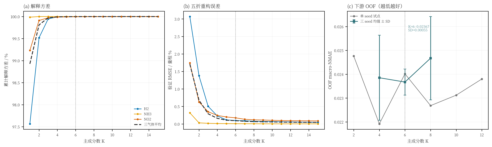
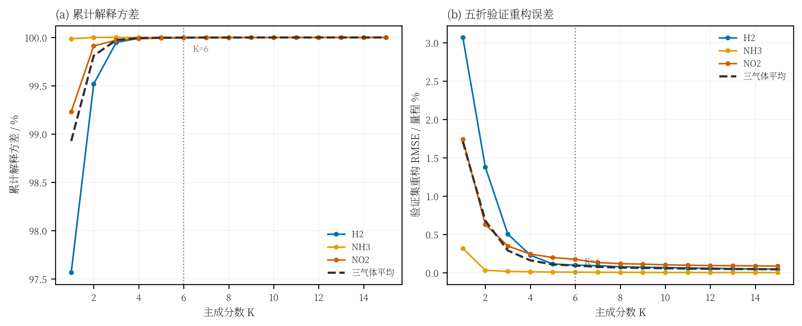

# PCA 为什么选 6 个主成分：证据与汇报口径

> 结论先说：**6 个主成分不是“重构误差最小”的点，而是在解释方差、重构误差和下游 OOF 稳定性之间的折中。**  
> 单 seed 上 K=4 更好；但三个 seed 平均后 K=6 更好且方差明显更小，所以最终保留 K=6。

---

## 1. 实验协议

- 数据：50 个开发实验，固定五折，每折 40 训练 / 10 验证；
- PCA：**每个气体单独拟合**，H2、NH3、NO2 各 6 个系数，共 18 个系数；
- 重构误差：只用训练折拟合 PCA，在验证折上反变换后计算；
- 下游模型：固定 `noise 0.1 + PCA-VAE 3× + 相同 TCN 训练协议`，只改变 PCA 主成分数 K；
- K 的选择只看开发集 OOF，测试集不参与。

---

## 2. 解释方差与重构误差





核心数值：

| K | 三气体平均累计解释方差 | 三气体平均验证重构 RMSE / 量程 |
|---:|---:|---:|
| 2 | 99.810% | 0.679% |
| 4 | 99.993% | 0.161% |
| **6** | **99.9981%** | **0.0937%** |
| 8 | 99.9992% | 0.0673% |
| 10 | 99.9995% | 0.0583% |
| 12 | 99.9997% | 0.0516% |

逐气体看 K=6：

| 气体 | 累计解释方差 | 验证重构 RMSE / 量程 |
|---|---:|---:|
| H2 | 99.9992% | 0.0987% |
| NH3 | 100.0000% | 0.0077% |
| NO2 | 99.9952% | 0.1746% |

直观解释：

- K=4 已经能解释 99.993% 的方差，但重构误差还有 0.161%；
- K=6 把重构误差压到 0.094%，已经进入“量程的千分之一”以内；
- K=8 之后继续增加主成分，重构误差只从 0.094% 降到 0.067%，收益快速变小；
- 原始曲线是 51×3 = 153 维，K=6 时只保留 18 个系数，压缩掉约 88% 的维度。

所以从“压缩是否够用”角度，**K=6 已经覆盖了绝大部分可解释结构**。

---

## 3. 下游 OOF 对比

单 seed（20260923）的 OOF：

| K | OOF macro-NMAE |
|---:|---:|
| 2 | 0.024764 |
| 4 | **0.021918** |
| 6 | 0.024015 |
| 8 | 0.022683 |
| 10 | 0.023121 |
| 12 | 0.023800 |

如果只看这一次 seed，K=4 最好，K=6 甚至比 K=4 差。  
但单 seed 的差距只有约 0.002，必须看 seed 稳定性。

对 K=4、6、8 各跑三个固定 seed：

| K | seed 23 | seed 24 | seed 25 | 三 seed 平均 | 标准差 |
|---:|---:|---:|---:|---:|---:|
| 4 | 0.021918 | 0.025430 | 0.024208 | 0.023852 | 0.001783 |
| **6** | **0.024015** | **0.023043** | **0.023957** | **0.023672** | **0.000545** |
| 8 | 0.022683 | 0.025383 | 0.025952 | 0.024673 | 0.001747 |

解释：

- K=4 的单 seed 最低，但三种子平均反而比 K=6 差；
- K=4 的 seed 间波动是 K=6 的 3 倍多；
- K=8 重构更好，但三种子平均最差，说明“多保留几个主成分”不一定让生成式增强更稳；
- K=6 在三种子平均和稳定性上都最好，是更可靠的折中。

因此汇报时不能说“K=6 是单次实验最优”，而应说：

> K=4 在单 seed 上略好；但三种子平均后 K=6 更好，且 seed 方差明显更小。考虑小样本下结果波动，最终选择 K=6。

---

## 4. 为什么不是 K=4 或 K=8

### 不是 K=4

- 重构误差 0.161%，比 K=6 高约 72%；
- 单 seed OOF 好，但三种子平均更差；
- seed 间标准差 0.00178，接近 K=6 的 3 倍，说明对初始化/数据顺序更敏感。

### 不是 K=8

- 重构误差只从 0.094% 降到 0.067%，边际收益小；
- 三种子 OOF 平均 0.024673，比 K=6 差；
- 多出的主成分可能开始编码个体实验的细节/噪声，VAE 要学的残差分布反而更难。

### 为什么不是 K=10/12

- 重构继续变好，但 OOF 变差；
- 主成分越多，VAE 的输入维度越高，小样本下越容易过拟合；
- PCA 的“结构约束”变弱，生成曲线可能更像在复制训练集细节。

---

## 5. 最终模型表现

K=6 的最终方案（noise 0.1 + PCA-VAE 3×，三 seed 预测平均）在锁定测试集上：

| 指标 | 数值 |
|---|---:|
| 测试 macro-NMAE | **0.017942** |
| 测试 macro-MAPE | **3.3927%** |
| H2 RMSE | 676.37 |
| NH3 RMSE | 0.645 |
| NO2 RMSE | 0.186 |

注意：测试集只用于最终报告，不参与 K 的选择。K=6 是基于开发集 OOF 和重构分析选出的，不是用测试集调出来的。

---

## 6. 汇报时可以直接用的一段话

> 我们比较了 K=2 到 K=12。K=6 时三个气体平均累计解释方差达到 99.998%，验证集重构误差只有量程的 0.094%；从 K=6 增加到 K=8，重构误差只再降到 0.067%，收益已经很小。下游三 seed OOF 上，K=6 的平均值是 0.02367，K=4 是 0.02385，K=8 是 0.02467；K=4 虽然单 seed 更好，但 seed 间波动接近 K=6 的三倍。因此我们选 K=6，作为重构精度、下游性能和稳定性的折中。  
> 需要说明的是，K=6 不是全局最优，也不是重构误差最小的点；它是一个由开发集证据支持的工程选择。

---

## 7. 局限与诚实说明

- 开发集只有 50 个实验，三种子结果仍有波动；
- K=4 与 K=6 的三 seed 均值只差约 0.00018，不能声称 K=6 有强统计显著性；
- 测试集只有 12 个实验，且此前已查看过，不能当作独立盲测；
- K=6 的证据是“当前数据、当前 VAE/TCN 配置下的折中”，不应外推成所有传感器数据都必须用 6。

---

## 8. 复现

```bash
# 解释方差 + 五折重构误差
uv run python -m tcn_union.analyze_pca_components \
  --manifest artifacts/splits/manifest.csv \
  --output-dir artifacts/pca_analysis

# 汇总图（含下游 OOF）
uv run python -m tcn_union.plot_pca_k_selection \
  --components artifacts/pca_analysis/pca_components.csv \
  --output-dir artifacts/pca_analysis

# 单个 K 的下游 OOF
uv run python -m tcn_union.gan_train \
  --manifest artifacts/splits/manifest.csv \
  --output-dir artifacts/pca_analysis/k4 \
  --modes noise_gan --generator vae --vae-components 4 \
  --noise-scale 0.1 --synthetic-ratio 3.0 \
  --gan-epochs 300 --max-epochs 500 --seed 20260923 --oof-only
```

产物：

- [fig_pca_k_evidence.png](../artifacts/pca_analysis/fig_pca_k_evidence.png)
- [fig_pca_k_evidence.pdf](../artifacts/pca_analysis/fig_pca_k_evidence.pdf)
- [pca_components.csv](../artifacts/pca_analysis/pca_components.csv)
