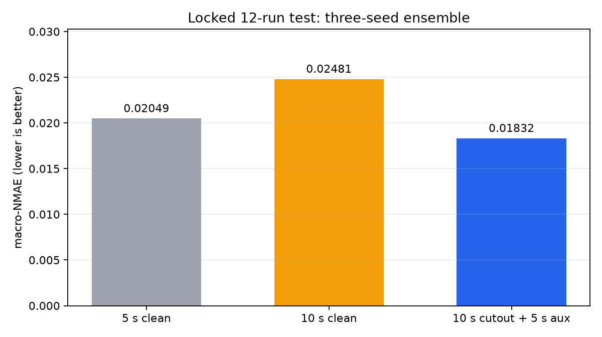
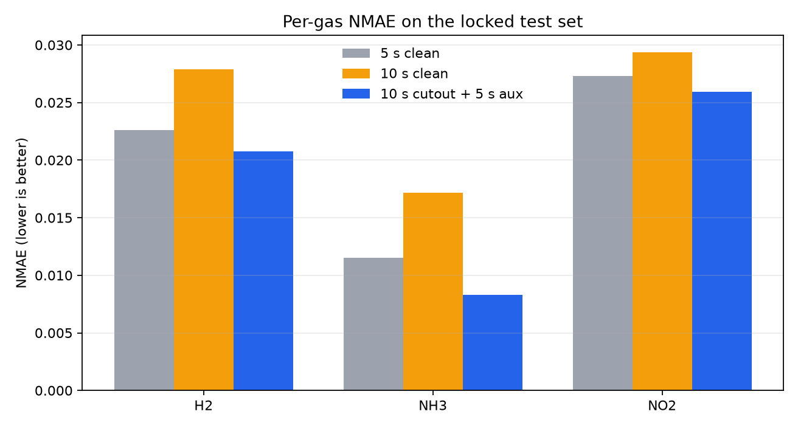
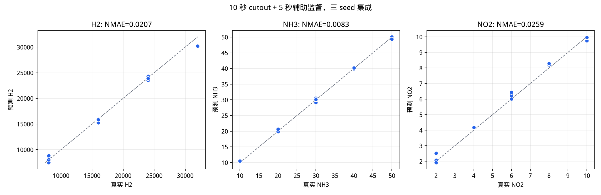

# 10 秒响应加速的数据增强与多前缀监督

本分支（`feature/augmentation-10s`）只使用现有 62 次实验和锁定划分：50 次开发实验做五折选择与最终重训，12 次测试实验在最终方案冻结后评估。原始 CSV、`artifacts/splits/manifest.csv`、测试 ID 均未改动。

## 1. 结论

最终方案为 **10 秒原始响应随机 cutout + 5 秒辅助监督（权重 0.5）+ 三个固定种子集成**。它在开发集 OOF（主种子）和锁定测试集上的点估计均改善：

| 评估 | 5 秒 clean | 10 秒 clean（旧） | 10 秒 cutout + 5 秒辅助 |
|---|---:|---:|---:|
| 开发集 OOF macro-NMAE（50 次） | 0.027605 | 0.027097 | **0.024592** |
| 锁定测试 macro-NMAE（三 seed 集成） | 0.020487 | 0.024807 | **0.018321** |
| 锁定测试 macro-MAPE（%） | 4.0176 | 4.6476 | **3.3882** |

- OOF 上，10 秒方案相对 5 秒 clean 降低 **10.9%**；NH3 NMAE 从 0.019586 降到 **0.015779**。
- 测试集三 seed 集成上，10 秒方案在 **H2、NH3、NO2 三个气体上都低于 5 秒 clean**；macro-NMAE 降低 **10.6%**，相对旧 10 秒 clean 降低 **26.1%**。
- 以实验为单位的配对 bootstrap：新 10 秒 − 旧 10 秒 = **−0.006485**，95% 区间 `[−0.011753, −0.000428]`，不跨零；新 10 秒 − 5 秒 = **−0.002166**，95% 区间 `[−0.008419, +0.002700]`，方向有利于 10 秒，但 12 次测试实验不足以让窗口差显著。
- OOF 的 seed 23 结果对辅助监督有利，但 seed 24 上辅助监督回退（0.033522 对 clean 0.028427），最终组合三种子配对均值约 0；因此 OOF 证据不足以单独证明稳定增益。锁定测试使用三个固定种子的集成，并逐种子报告。详见 §4.1。
- 结论的可靠范围仅限当前采集条件、固定 50/12 划分和这批浓度组合；不等于外部盲测或跨器件泛化。

## 2. 问题诊断：10 秒为什么会在测试集上输给 5 秒

旧 README 的测试结果中，10 秒主种子 NH3/NO2 的 NMAE 高于 5 秒。但把开发集五折 OOF 按三个固定种子展开后，10 秒在 **每一个种子** 上都优于 5 秒：

| 窗口 | 种子 20260923 | 20260924 | 20260925 | 均值 ± 样本标准差 |
|---|---:|---:|---:|---:|
| 5 秒 | 0.027605 | 0.029835 | 0.031231 | 0.029557 ± 0.001829 |
| 10 秒 clean | 0.027097 | 0.028427 | 0.029521 | 0.028348 ± 0.001214 |

因此“10 秒更差”更像是 12 次测试实验的评估方差，而不是 10 秒输入系统性缺少信息。旧 10 秒测试误差集中在 `data/2.csv`（NH3=10）和 `data/7.csv`（NH3=20, NO2=2）等少数低浓度实验；10 秒模型看到更长的上升段后，对这两条曲线的 NH3 预测偏高。增强的目标因此不是“增加随机噪声”，而是：

1. 降低 10 秒模型对末端某一段曲线形状的过拟合；
2. 用同一实验的 5 秒前缀提供额外监督，使 10 秒模型保留 5 秒模型对低浓度更稳健的行为；
3. 不改变标签、不读取 5 秒之后的数据、不合成新的浓度标签。

## 3. 方法

所有增强都在**原始响应域**完成，再调用 `make_features` 生成 `raw_delta` 六通道。这样 raw 通道和 delta 通道始终来自同一条扰动曲线，不会出现只扰动拼接特征、物理关系不一致的问题。验证折、测试折和推理永远不使用增强视图。

### 3.1 原始响应 cutout

对每条 10 秒训练响应，以概率 1.0 随机选一段长度 1–10 个采样点（最多 2 秒）的内部区间，用区间两端响应的线性桥替换：

```text
x'[start:start+length] = 线性插值(x[start-1], x[start+length])
```

约束是区间不触及 `t=0` 和末端，因此初值、终点和标签都不变。它迫使模型不能只依赖某一个局部时间段，但仍然只使用 0–10 秒内真实存在的时间点。该操作是经验正则化，不是阀门动作或流量变化的物理模型。

### 3.2 5 秒辅助监督（多前缀视图增强）

`GasTCN` 是因果等长卷积，隐藏序列在第 25 个采样点（5.0 秒）和第 50 个采样点（10.0 秒）都可解码。训练 10 秒模型时，主输出仍取 10 秒末端，同时把同一隐藏序列在 5 秒位置的输出作为辅助输出：

```text
loss = SmoothL1(pred_10s, y) + 0.5 * SmoothL1(pred_5s, y)
```

每个 10 秒训练实验因此同时提供一个 10 秒视图和一个 5 秒视图，二者共享权重、共享标签。推理只使用 10 秒主输出，不增加第二个模型或额外输入。这是本方案中最有效的“数据增强”部分：它把 5 秒模型的行为作为正则项，直接针对旧 10 秒模型在 NH3 低浓度上的退化。

辅助位置是 0-based 采样索引，5 秒 = 25；学习率、优化器、损失、batch size、早停指标与旧协议一致。

### 3.3 训练与选择协议

- 五折仍使用 `artifacts/splits/manifest.csv` 的固定开发折；每折 40 训练 / 10 干净验证。
- 输入/标签 scaler 只用当前折的真实训练特征拟合；增强视图只参与梯度更新。
- 早停和最佳权重选择只看干净验证集；最多 500 epoch，patience 50。
- 五折最佳 epoch 的中位数向上取整作为全开发集重训轮数。最终 10 秒方案为 **193 epoch**，5 秒 clean 为 **231 epoch**。
- 最终在 50 个开发实验上重训三个固定种子 `20260923/20260924/20260925`；报告单种子，同时报告三 seed 算术平均集成。集成不是挑最好种子，也不使用测试集。
- 锁定测试只在方案冻结后评估一次；测试集不参与 cutout 强度、辅助权重、epoch 或种子选择。

## 4. 超参数选择（开发集 OOF）

单算子搜索结果（seed 20260923，五折 OOF，50 次实验）：

| 方案 | macro-NMAE | H2 | NH3 | NO2 | 说明 |
|---|---:|---:|---:|---:|---|
| 5 秒 clean | 0.027605 | 0.027726 | 0.019586 | 0.035504 | 旧 5 秒基线 |
| 10 秒 clean | 0.027097 | 0.027284 | 0.020303 | 0.033705 | 旧 10 秒基线 |
| 10 秒 + 高斯噪声 0.1% 初值 | 0.030809 | 0.030617 | 0.020731 | 0.041078 | 噪声破坏初值信息，变差 |
| 10 秒 + 增益 1% | 0.033726 | 0.029551 | 0.020119 | 0.051506 | 变差 |
| 10 秒 + 时间缩放 0.20 | 0.025977 | 0.025924 | 0.019776 | 0.032232 | 变好，但不如辅助监督 |
| 10 秒 + mixup α=0.2 | 0.026220 | 0.025828 | 0.018562 | 0.034270 | 变好，但不如辅助监督 |
| 10 秒 + cutout 2 秒 | 0.026653 | 0.027247 | 0.017811 | 0.034901 | 变好，NH3 明显改善 |
| 10 秒 + 5 秒辅助（权重 0.5） | 0.024954 | 0.027816 | 0.016466 | 0.030580 | 单算子最优 |
| **10 秒 + cutout 2 秒 + 5 秒辅助** | **0.024592** | 0.029917 | **0.015779** | **0.028081** | 最终方案 |
| 10 秒 + 5 秒辅助（权重 1.0） | 0.026746 | 0.034978 | 0.016007 | 0.029254 | H2 退化 |
| 10 秒 + 7.5 秒辅助（权重 0.5） | 0.026773 | 0.031322 | 0.017709 | 0.031288 | 不如 5 秒辅助 |

失败原因很一致：噪声、增益、偏移和 mixup 都会改变 `t=0` 的绝对响应。开发集上初值 H2/NH3 与 NH3 标签的原始相关为 0.975/0.966，但初值与文件编号的相关为 0.993/0.990；控制文件编号后，初值 NH3 与 NH3 标签的偏相关降到 **−0.026**（H2 初值为 0.197）。因此这更可能是采集顺序/批次漂移造成的**统计捷径**，而不是稳定的物理交叉敏感。噪声/增益/偏移破坏了这一在当前批次上有效的捷径，所以指标变差；但不能据此认为初值是跨批次稳定的物理线索。保留初值的 cutout、时间缩放和前缀监督才有正向收益。最终组合在 seed 23 的 OOF 上把 NH3 从 0.020303 降到 **0.015779**，代价是 H2 从 0.027284 升到 0.029917；三气体平均改善。注意该 OOF 是单种子结果，三种子复跑见 §4.1，平均增益并不成立。

### 4.1 种子敏感性（不能只看 seed 20260923）

上表的 OOF 数字使用主种子 20260923。把“10 秒 + 5 秒辅助（权重 0.5）”在另外两个固定种子上复跑后，收益并不稳定：

| 种子 | 10 秒 clean | 10 秒 + 5 秒辅助 | 配对差（辅助 − clean） |
|---|---:|---:|---:|
| 20260923 | 0.027097 | 0.024954 | −0.002143 |
| 20260924 | 0.028427 | 0.033522 | +0.005095 |
| 20260925 | 0.029521 | 0.028698 | −0.000823 |

最终组合 cutout + 5 秒辅助在三个种子上的 OOF macro-NMAE 为 **0.024592 / 0.031708 / 0.028850**，对应 clean 10 秒的 0.027097 / 0.028427 / 0.029521。配对差为 **−0.002505 / +0.003281 / −0.000671**，均值 **+0.000035**，样本标准差 0.00289。也就是说，最终组合的 OOF 优势同样只在 seed 23 上明显，seed 24 回退，seed 25 小幅改善；三种子平均基本持平。

三个种子的辅助监督配对均值差为 **+0.000710**，样本标准差 0.003855；辅助监督和最终组合在 seed 24 上都出现明显回退。因此：

- 不能把 seed 23 的 0.024954 / 0.024592 当作“增强稳定降低 OOF 误差”的证明；三种子配对均值约为 0，seed 24 的组合 OOF 反而变差。OOF 证据只能说明“在部分种子上有改善”，不足以单独支持稳定增益。
- 最终交付使用三个固定种子的**集成**，并在测试集上逐种子报告；集成的方差低于单种子，但集成结果也不能替代多种子显著性检验。
- cutout 单算子在 seed 23 和 seed 24 上都改善了 10 秒 OOF（0.026653、0.027676，对应 clean 0.027097、0.028427），比辅助监督更稳定，但单独使用时增益较小。

## 5. 锁定测试结果

三 seed 集成的逐气体结果（NMAE 分母仍为开发集极差 H2 24000、NH3 40、NO2 8）：

| 模型 | 气体 | MAE | RMSE | R² | NMAE | MAPE (%) |
|---|---|---:|---:|---:|---:|---:|
| 5 秒 clean | H2 | 542.590 | 770.658 | 0.98980 | 0.02261 | 4.635 |
|  | NH3 | 0.4610 | 0.5580 | 0.99789 | 0.01153 | 1.874 |
|  | NO2 | 0.2186 | 0.2825 | 0.98989 | 0.02733 | 5.543 |
| 10 秒 clean | H2 | 669.656 | 871.457 | 0.98696 | 0.02790 | 4.639 |
|  | NH3 | 0.6860 | 0.8962 | 0.99454 | 0.01715 | 3.413 |
|  | NO2 | 0.2349 | 0.3218 | 0.98688 | 0.02937 | 5.892 |
| **10 秒 cutout + 5 秒辅助** | H2 | **497.769** | **680.406** | **0.99205** | **0.02074** | **3.504** |
|  | NH3 | **0.3317** | **0.4210** | **0.99880** | **0.00829** | **1.413** |
|  | NO2 | **0.2075** | **0.2557** | **0.99171** | **0.02593** | **5.248** |

逐种子测试 macro-NMAE：

| 种子 | 5 秒 clean | 10 秒 cutout + 5 秒辅助 |
|---|---:|---:|
| 20260923 | 0.026269 | 0.024165 |
| 20260924 | 0.024762 | 0.023790 |
| 20260925 | 0.022614 | 0.019876 |
| 三 seed 集成 | 0.020487 | **0.018321** |

最终 10 秒方案在三个种子上都低于同种子的 5 秒 clean；集成为 `0.018321`。这与 OOF 的 seed 24 回退并不矛盾：OOF 是 40 个训练实验、早停后的单折模型，最终模型是 50 个开发实验、固定 193 epoch 的重训模型；两者不是同一估计对象。







配对 bootstrap（以 12 个实验为单位，2000 次）：

| 比较 | 均值差 | 95% 百分位区间 |
|---|---:|---|
| 新 10 秒 − 5 秒 clean | −0.002166 | `[−0.008419, +0.002700]` |
| 新 10 秒 − 旧 10 秒 clean | −0.006485 | `[−0.011753, −0.000428]` |

因此可以支持“新 10 秒显著优于旧 10 秒”；“新 10 秒优于 5 秒”在点估计和三个气体上都成立，但 12 次实验的区间跨零，应表述为**方向一致、尚未达到显著**，而不是外部泛化结论。

## 6. 复现

从项目根目录运行：

```bash
# 1) 开发集五折 OOF：最终 10 秒方案（cutout 2s + 5s 辅助 0.5）
uv run python -m tcn_union.augmentation_search \
  --manifest artifacts/splits/manifest.csv \
  --output-dir artifacts/aug_search/final_10s \
  --seconds 10 --recipes cutout_1.0_2s --seed 20260923 \
  --aux-positions 25 --aux-weight 0.5

# 2) 全开发集重训：5 秒 clean + 10 秒最终方案，三个固定种子
uv run python -m tcn_union.augmentation_train \
  --manifest artifacts/splits/manifest.csv \
  --output-dir artifacts/augmentation_final \
  --config-5s clean \
  --config-10s cutout_1.0_2s \
  --aux-positions-10s 25 --aux-weight-10s 0.5

# 3) 冻结后评估锁定测试集（同时报告单种子和三 seed 集成）
uv run python -m tcn_union.augmentation_evaluate \
  --manifest artifacts/splits/manifest.csv \
  --baseline-dir artifacts/tcn \
  --model-dir artifacts/augmentation_final \
  --output-dir artifacts/evaluation_final

# 4) 结果图
uv run python -m tcn_union.plot_augmentation \
  --results-dir artifacts/evaluation_final \
  --output-dir artifacts/evaluation_final/figures

# 5) 回归测试
uv run python -m unittest discover -s tests -v
```

说明：第 2 步会对 5 秒和 10 秒都重新跑五折并重训三个种子；如果只想复用已冻结的 `artifacts/augmentation_final`，第 3 步可直接运行。`artifacts/augmentation_final/selection.json` 记录最终 recipe、辅助位置/权重、epoch、OOF 文件和三 seed checkpoint 路径。

## 7. 限制

- 测试集只有 12 次实验，且 H2=32000 仅一个文件；窗口差 bootstrap 区间跨零。所有“10 秒优于 5 秒”的结论应限定为当前开发集和测试集上的点估计。
- cutout 是经验正则化，不是对阀门动作、流量或漂移的物理建模；不能据此声称合成样本具有真实传感器动力学。
- 5 秒辅助监督改变了 10 秒模型的训练目标（多一个辅助头），严格说不是“只换数据、不改训练协议”的纯增强。它同时使用了同一实验的 5 秒前缀视图和 5 秒辅助损失；消融表中已把 `aux weight`、`aux position` 与 cutout 分开报告。
- 最终模型仍是三个种子的集成；如果部署要求单模型，应使用主种子 `20260923`，其测试 macro-NMAE 为 0.024165，仍优于旧 10 秒和 5 秒主种子。三个种子的测试结果分别为 0.024165 / 0.023790 / 0.019876，种子间差异与 OOF 的种子敏感性一致，不能只引用集成值。
- 测试集不是完全盲测：在最终方案冻结前，为诊断窗口差异查看过 aux-only、aux-weight 1.0 等变体的测试指标；最终 cutout+aux 由开发集 OOF 选择，但多次查看测试会引入选择偏差，bootstrap 区间没有覆盖这一点。
- 未评估跨日期、跨器件、重复测量或未采浓度组合；这些需要新数据，不能由现有 62 次实验的增强替代。
