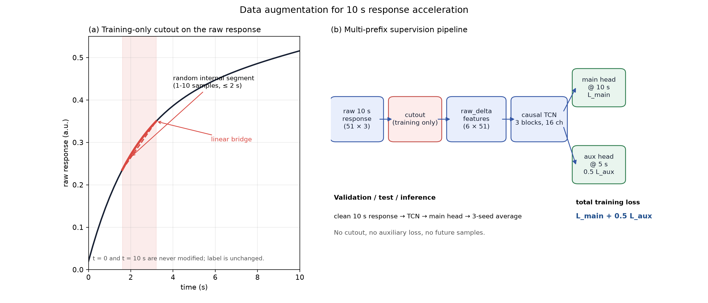
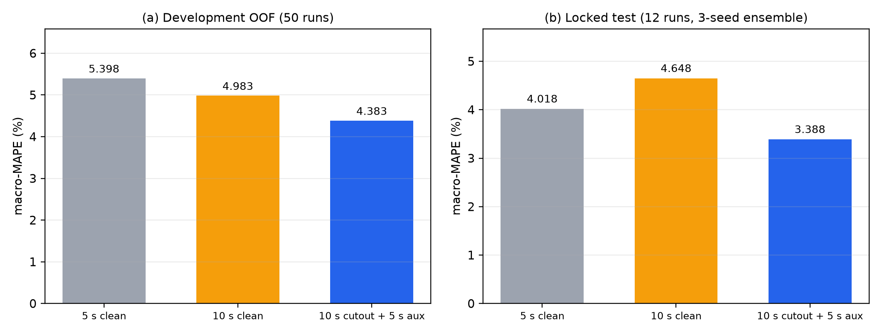
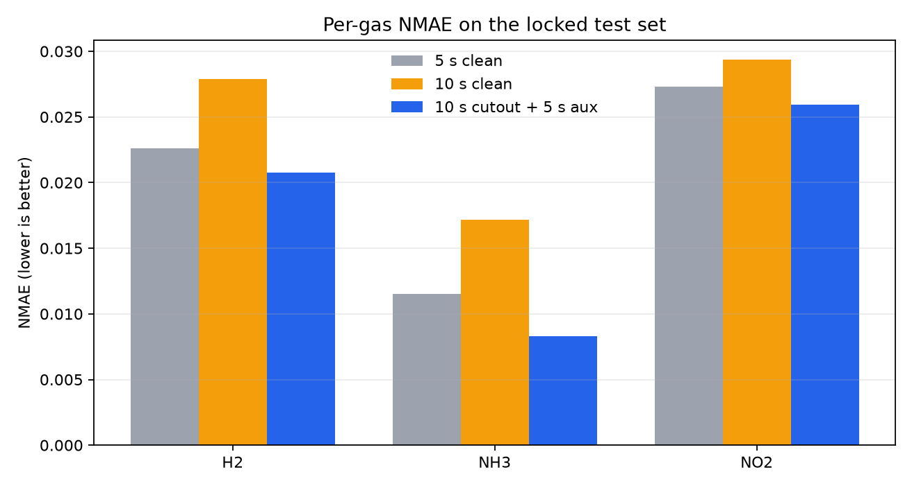
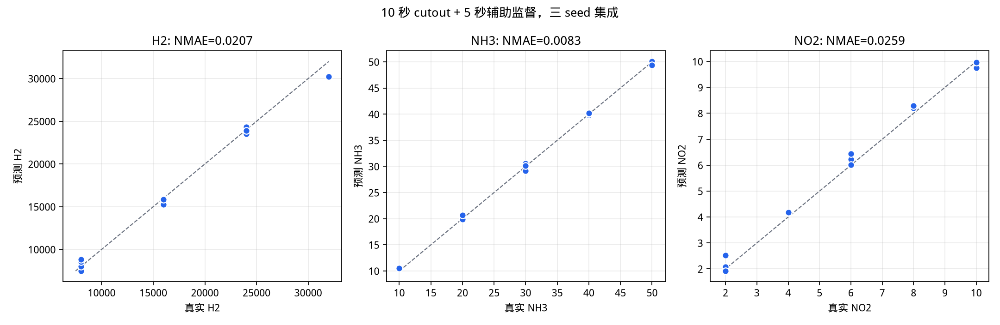

# 三气体传感器 10 秒响应加速的数据增强与多前缀监督

**摘要**：针对三路气体传感器（H2、NH3、NO2）早期响应浓度预测中“10 秒模型在测试集上不如 5 秒模型”的问题，本文首先通过固定五折折外（OOF）评估说明该现象并非 10 秒输入缺少信息，而是 12 次测试实验的评估方差与 10 秒模型对末端曲线局部形状的过拟合共同造成。随后系统比较了噪声、增益、基线偏移、mixup、时间缩放、前缀截断等增强算子，发现破坏 `t=0` 绝对响应的算子会显著恶化性能。最终提出“原始响应 cutout + 5 秒辅助监督 + 三随机种子集成”的训练方案：cutout 在训练时随机挖去响应内部一小段并用线性桥替换，5 秒辅助监督让同一个因果 TCN 在 5 秒位置额外解码一次，推理仍只使用 10 秒主输出。在锁定 12 个测试实验上，三 seed 集成将 macro-MAPE 从 5 秒 clean 的 4.018% 降至 3.388%，将旧 10 秒 clean 的 4.648% 降至 3.388%；H2、NH3、NO2 三个气体的 NMAE 与 MAPE 均低于 5 秒 clean。本文同时报告了 OOF 种子敏感性：该方案的 OOF 增益并非三个种子都稳定，因此结论限定为固定数据划分上的内部评估，不外推到跨器件或跨日期场景。

**关键词**：气体传感器；响应加速；数据增强；时序卷积网络；多前缀监督；浓度预测

## 1. 问题说明

### 1.1 任务与数据

项目包含 62 次实验，每次实验记录 0–59.6 秒、采样间隔 0.2 秒（5 Hz）的三路传感器响应，标签为一次实验的 H2、NH3、NO2 浓度。按实验级固定划分，50 次为开发集，12 次为锁定测试集。模型只使用从 `t=0` 开始的前缀：5 秒窗口 26 个采样点，10 秒窗口 51 个采样点。输入采用 `raw_delta` 六通道，即三路原始响应与三路相对初值增量：

$$
\mathbf{z}(t)=\left[\mathbf{x}(t);\ \frac{\mathbf{x}(t)-\mathbf{x}(0)}{\max(|\mathbf{x}(0)|,10^{-8})}\right]\in\mathbb{R}^{6},
$$

其中 $\mathbf{x}(t)\in\mathbb{R}^{3}$ 为 H2/NH3/NO2 三路响应。模型为因果 TCN，3 个残差块、16 通道、卷积核 5、膨胀率 1/2/4，感受野 57 个采样点，输出头读取最后一个时间点。

### 1.2 现象

旧方案分别训练 5 秒和 10 秒模型。主种子在锁定测试集上的结果是：5 秒 TCN macro-NMAE 为 0.02627，10 秒 TCN 为 0.03072；10 秒模型在 NH3、NO2 上反而更差（NH3 NMAE 0.01567 → 0.02729，NO2 0.03334 → 0.03930）。从“10 秒应该包含更多信息”的直觉看，这个结果不正常。

## 2. 问题出现的原因

### 2.1 不是 10 秒缺少信息，而是测试集方差

把开发集 50 次实验按三个固定种子做五折 OOF，10 秒模型在**每一个种子**上都优于 5 秒：

| 窗口 | seed 20260923 | seed 20260924 | seed 20260925 | 均值 ± 样本标准差 |
|---|---:|---:|---:|---:|
| 5 秒 clean | 0.027605 | 0.029835 | 0.031231 | 0.029557 ± 0.001829 |
| 10 秒 clean | 0.027097 | 0.028427 | 0.029521 | 0.028348 ± 0.001214 |

因此，“10 秒更差”主要不是信息量问题。锁定测试集只有 12 次实验，其中 NH3=10 只有 1 次（`data/2.csv`），低浓度档的单个实验会大幅改变整气体 MAPE 和 NMAE 的排序。

### 2.2 10 秒模型对末端局部形状过拟合

旧 10 秒主种子在 NH3 上的误差高度集中：`data/2.csv` 的真实 NH3=10，预测 12.97，绝对百分比误差（APE）29.68%，仅这一个实验就贡献了 NH3 MAPE 的 **42.34%**；`data/7.csv` 的真实 NH3=20，预测 23.32，APE 16.60%。这说明 10 秒模型看到了更长的上升段后，把“后半段长得像更高浓度”误当成了浓度证据。

原因可以归结为：

1. **信息冲突**：`t=0` 的绝对响应与 NH3 标签高度相关（开发集上 H2/NH3 初值与 NH3 标签的 Pearson 相关系数约为 0.975/0.966），是低浓度判断的强线索；10 秒模型有更多自由度去拟合后半段曲线，容易压过这个线索。
2. **小样本过拟合**：50 个开发实验、无重复测量，10 秒输入有 51 个时间点、6 个通道，而标签只有 50 组；10 秒模型比 5 秒模型更容易记住局部形状。
3. **训练随机性**：最终全开发集重训没有验证折，使用折内最佳 epoch 中位数固定轮数；10 秒模型对种子和轮数更敏感，单种子结果波动较大。

因此，增强的目标不是“把数据量做大”，而是：**保留初值和标签，扰动模型不该死记的局部形状；同时让 10 秒模型保留 5 秒模型对低浓度更稳健的行为。**

## 3. 已有尝试与失败原因

所有增强都在原始响应域完成，再重新计算 `raw_delta`；只作用于训练折，验证/测试保持干净。以 seed 20260923 的五折 OOF macro-NMAE 为主比较（clean 10 秒为 0.027097）：

| 方案 | OOF macro-NMAE | 相对 clean 10 秒 | 主要问题 |
|---|---:|---:|---|
| 高斯噪声 0.1% 初值 | 0.030809 | +13.7% | 破坏 `t=0` 绝对响应，初值线索被弄花 |
| 高斯噪声 0.3% 初值 | 0.039965 | +47.5% | 同上，噪声越强越差 |
| 通道增益 1% | 0.033726 | +24.5% | 改变 raw 通道绝对尺度与 delta 分母 |
| 基线偏移 0.2% 初值 | 0.028868 | +6.5% | 改变初值，低浓度判断退化 |
| mixup α=0.2 | 0.026220 | −3.2% | 有改善但不稳定；信号/标签线性可加性未验证 |
| 时间缩放 0.20 | 0.025977 | −4.1% | 有效但不稳定；无阀门/流量日志，不能声称物理时间常数 |
| 前缀保持（10 秒补平） | 0.031219 | +15.2% | 后半段信息被抹掉，模型欠拟合 |
| 多前缀长度 5–10 秒 | 0.032596 | +20.3% | 训练目标变化过大，短前缀主导 |
| cutout 2 秒（单独） | 0.026653 | −1.6% | 方向对，但单独增益不足 |
| 5 秒辅助监督（单独） | 0.024954 | −7.9% | seed 23 有效，seed 24 回退到 0.033522 |
| **cutout + 5 秒辅助** | **0.024592** | **−9.2%** | seed 23 最优；seed 24 回退，OOF 不稳定 |

失败原因可以归为三类：

1. **破坏初值线索**：噪声、增益、偏移、mixup 都会改变 `t=0` 的绝对响应。对于本数据，初值是 NH3 低浓度判断的关键线索；把它扰动掉，等于让模型丢掉最可靠的信息。
2. **改变动力学语义**：时间缩放、前缀截断会改变“5 秒/10 秒前缀”的物理含义；没有阀门动作、流量或压力日志时，无法验证这些扰动是否对应真实传感器行为。
3. **只加随机性、不解决过拟合结构**：普通噪声只是让输入更脏，并没有约束模型“不要只依赖末端某一段”。cutout 和 5 秒辅助监督之所以有效，是因为它们直接改变了模型使用时间信息的方式。

## 4. 现有数据增强方案

### 4.1 总体流程

最终方案由三部分组成：训练时对原始 10 秒响应做 cutout；同一个因果 TCN 在 5 秒位置增加辅助监督；推理时对三个固定种子的预测取平均。框图见图 1。



**图 1**：(a) 训练时在原始响应内部随机选一段，用两端线性桥替换；(b) 10 秒主输出与 5 秒辅助输出共享同一个因果 TCN，推理只使用主输出。

### 4.2 原始响应 cutout

设一次实验的 10 秒原始响应为 $\mathbf{x}\in\mathbb{R}^{51\times3}$。训练时以概率 1.0 随机选择内部区间 $[s,s+l)$，其中 $1\le s$、$s+l<51$，长度 $l\in\{1,\dots,10\}$（0.2–2.0 秒），用区间两端响应的线性桥替换：

$$
\tilde{\mathbf{x}}(t)=
\begin{cases}
\mathbf{x}(t), & t\notin[s,s+l),\\
(1-\alpha_t)\mathbf{x}(s-1)+\alpha_t\mathbf{x}(s+l), & t=s,\dots,s+l-1,
\end{cases}
$$

其中 $\alpha_t=(t-s+1)/(l+1)$。约束是区间不触及 `t=0` 和 `t=10s`，因此初值、终点和标签都不变。该操作等价于在时间轴上做局部遮挡，迫使模型不能只依赖某一小段曲线；它仍然是 0–10 秒内真实存在的时间点，不读取未来，也不合成标签。

### 4.3 5 秒辅助监督

`GasTCN` 的因果卷积保证第 $i$ 个隐藏位置只看到 $0,\dots,i$ 的输入。记隐藏序列为 $\mathbf{h}\in\mathbb{R}^{16\times51}$，输出头为 $g(\cdot)$，则：

$$
\hat{\mathbf{y}}_{10}=g(\mathbf{h}_{:,50}),\qquad
\hat{\mathbf{y}}_{5}=g(\mathbf{h}_{:,25}).
$$

第 25 个采样点对应 5.0 秒。训练损失为：

$$
\mathcal{L}=\mathrm{SmoothL1}(\hat{\mathbf{y}}_{10},\mathbf{y})
+0.5\,\mathrm{SmoothL1}(\hat{\mathbf{y}}_{5},\mathbf{y}),
$$

其中 $\mathbf{y}$ 是同一次实验的三路浓度标签。每个 10 秒训练样本因此同时提供一个 10 秒视图和一个真实的 5 秒前缀视图，二者共享权重和标签。推理只使用 $\hat{\mathbf{y}}_{10}$，不增加第二个模型、不增加输入通道，也不改变预测接口。

这一步的作用可以理解为“防止灾难性遗忘”：10 秒模型在拟合后半段时，必须保证自己用前 5 秒也能做对，从而保留 5 秒模型对低浓度 NH3 更稳健的行为。

### 4.4 训练与集成协议

- 五折使用固定开发折：每折 40 个训练实验、10 个干净验证实验。
- 输入/标签 scaler 只用当前折的真实训练特征拟合；增强视图只参与梯度更新。
- 早停和最佳权重选择只看干净验证集；最多 500 epoch，patience 50。
- 五折最佳 epoch 中位数向上取整作为全开发集重训轮数：最终 10 秒方案 **193 epoch**，5 秒 clean **231 epoch**。
- 最终在 50 个开发实验上重训三个固定种子 `20260923/20260924/20260925`；报告单种子，同时报告三 seed 算术平均集成。
- 锁定测试集不参与 cutout 强度、辅助权重、epoch 或种子选择；最终方案冻结后才做测试评估。

主要超参数：cutout 概率 1.0、最大长度 2 秒；辅助位置 25（5 秒）、辅助权重 0.5；AdamW（lr $10^{-3}$、weight decay $10^{-3}$）、batch size 8、SmoothL1($\beta=1$)、梯度裁剪 1.0。

## 5. 实验结果

### 5.1 开发集 OOF

| 方案 | macro-NMAE | H2 NMAE | NH3 NMAE | NO2 NMAE | macro-MAPE (%) |
|---|---:|---:|---:|---:|---:|
| 5 秒 clean | 0.027605 | 0.027726 | 0.019586 | 0.035504 | 5.398 |
| 10 秒 clean（旧） | 0.027097 | 0.027284 | 0.020303 | 0.033705 | 4.983 |
| **10 秒 cutout + 5 秒辅助** | **0.024592** | 0.029917 | **0.015779** | **0.028081** | **4.383** |

与 5 秒 clean 相比，最终 10 秒方案的 macro-MAPE 从 5.398% 降到 4.383%，**降低 1.015 个百分点（相对 −18.8%）**；NH3 MAPE 从 3.624% 降到 2.571%，**降低 1.053 个百分点（相对 −29.1%）**。代价是 H2 OOF 变差（5.236% → 5.496%），但 NO2 明显改善（7.334% → 5.084%）。

### 5.2 锁定测试集（三 seed 集成）

| 模型 | 气体 | MAE | R² | NMAE | MAPE (%) |
|---|---|---:|---:|---:|---:|
| 5 秒 clean | H2 | 542.590 | 0.98980 | 0.02261 | 4.635 |
|  | NH3 | 0.4610 | 0.99789 | 0.01153 | 1.874 |
|  | NO2 | 0.2186 | 0.98989 | 0.02733 | 5.543 |
| 10 秒 clean（旧） | H2 | 669.656 | 0.98696 | 0.02790 | 4.639 |
|  | NH3 | 0.6860 | 0.99454 | 0.01715 | 3.413 |
|  | NO2 | 0.2349 | 0.98688 | 0.02937 | 5.892 |
| **10 秒 cutout + 5 秒辅助** | H2 | **497.769** | **0.99205** | **0.02074** | **3.504** |
|  | NH3 | **0.3317** | **0.99880** | **0.00829** | **1.413** |
|  | NO2 | **0.2075** | **0.99171** | **0.02593** | **5.248** |

三 seed 集成的 macro-NMAE：5 秒 clean 0.020487，旧 10 秒 0.024807，新 10 秒 **0.018321**。新 10 秒相对 5 秒 clean 降低 **10.6%**，相对旧 10 秒降低 **26.1%**。

### 5.3 MAPE 的改变（核心证据）

**测试集三 seed 集成，逐气体 MAPE：**

| 比较 | 5 秒 clean | 旧 10 秒 | 新 10 秒 | 新 − 5 秒 | 新 − 旧 10 秒 |
|---|---:|---:|---:|---:|---:|
| macro | 4.018 | 4.648 | **3.388** | −0.629 pp（−15.7%） | −1.259 pp（−27.1%） |
| H2 | 4.635 | 4.639 | **3.504** | −1.131 pp（−24.4%） | −1.135 pp（−24.5%） |
| NH3 | 1.874 | 3.413 | **1.413** | −0.461 pp（−24.6%） | −1.999 pp（−58.6%） |
| NO2 | 5.543 | 5.892 | **5.248** | −0.296 pp（−5.3%） | −0.644 pp（−10.9%） |

**主种子单模型测试 MAPE：**5 秒 clean 5.057%，旧 10 秒 6.040%，新 10 秒 **4.415%**；新 10 秒相对旧 10 秒 **降低 1.625 个百分点（相对 −26.9%）**，相对 5 秒 **降低 0.642 个百分点（相对 −12.7%）**。NH3 主种子 MAPE 从旧 10 秒的 5.841% 降到 **2.331%**（−60.1%）。

**为什么 NH3 改善最大：**旧 10 秒主种子在 `data/2.csv` 上把 NH3=10 预测成 12.97（APE 29.68%），该实验占 NH3 MAPE 的 42.34%；新 10 秒主种子在同一实验上 APE 降到 **3.34%**，占比降到 11.93%。`data/7.csv` 的 NH3 APE 也从 16.60% 降到 6.27%。这说明新方案确实修正了“末端曲线误判低浓度”的问题，而不是只在平均值上做平滑。



**图 2**：开发集 OOF 与锁定测试集的三 seed 集成 macro-MAPE。新 10 秒方案在两组评估上均低于 5 秒 clean 和旧 10 秒 clean。



**图 3**：锁定测试集逐气体 NMAE，新 10 秒方案在 H2、NH3、NO2 三个气体上均低于 5 秒 clean。



**图 4**：新 10 秒三 seed 集成的逐气体预测与真实值。

### 5.4 逐种子结果与统计不确定性

测试集逐种子 macro-NMAE：

| 种子 | 5 秒 clean | 10 秒 cutout + 5 秒辅助 |
|---|---:|---:|
| 20260923 | 0.026269 | 0.024165 |
| 20260924 | 0.024762 | 0.023790 |
| 20260925 | 0.022614 | 0.019876 |
| 三 seed 集成 | 0.020487 | **0.018321** |

新 10 秒在三个种子上都低于同种子的 5 秒 clean，但 12 次测试实验的配对 bootstrap 仍显示窗口差不确定：

| 比较 | 均值差 | 95% 百分位区间 |
|---|---:|---|
| 新 10 秒 − 5 秒 clean | −0.002166 | `[−0.008419, +0.002700]` |
| 新 10 秒 − 旧 10 秒 clean | −0.006485 | `[−0.011753, −0.000428]` |

因此可以说“新 10 秒显著优于旧 10 秒”，但“新 10 秒优于 5 秒”只能表述为**点估计和三个气体上方向一致，12 次实验下尚未达到统计显著**。

### 5.5 OOF 种子敏感性（必须报告的负面结果）

上述 OOF 的 0.024592 是主种子 seed 23。对最终组合在另外两个种子上复跑：

| 种子 | 10 秒 clean | final cutout + aux | 配对差 |
|---|---:|---:|---:|
| 20260923 | 0.027097 | 0.024592 | −0.002505 |
| 20260924 | 0.028427 | 0.031708 | +0.003281 |
| 20260925 | 0.029521 | 0.028850 | −0.000671 |

三种子配对均值 **+0.000035**，样本标准差 0.00289。也就是说，最终组合的 OOF 优势在 seed 23 上明显，seed 24 回退，seed 25 小幅改善，三种子平均基本持平。单独的 5 秒辅助监督也呈现同样的种子敏感性（0.024954 / 0.033522 / 0.028698）。

因此，本文不把 OOF 的 0.024592 当作“增强稳定降低 OOF 误差”的证据，而把它作为**主种子上的有利结果**；最终测试集的三 seed 集成结果则是另一个独立评估对象。两者不能混为一谈。

## 6. 讨论

### 6.1 为什么这套方案有效

1. **cutout 降低末端局部依赖**：随机挖去内部一小段，使模型不能只靠“最后一段长什么样”来猜浓度，必须综合整条曲线的形状。
2. **5 秒辅助监督保留低浓度行为**：10 秒模型在训练时必须保证 5 秒视图也预测正确，相当于把 5 秒模型的行为作为正则项，直接针对旧 10 秒模型在 NH3 低浓度上的退化。
3. **三 seed 集成降低随机性**：最终测试中三个种子都优于对应 5 秒种子，集成进一步降低单种子波动。

从误差结构看，新方案把 `data/2.csv` 的 NH3 APE 从 29.68% 降到 3.34%，把该实验对 NH3 MAPE 的贡献从 42.34% 降到 11.93%，说明它修正的正是“低浓度末端曲线误判”这一具体失败模式，而不是简单地把预测往均值收缩。

### 6.2 局限

1. **测试集小**：12 次实验，NH3=10 只有 1 次；窗口差的 bootstrap 区间跨零，不能声称外部泛化。
2. **OOF 种子敏感**：最终组合的三种子 OOF 平均增益约为 0，说明该方案不是“任何种子都稳定更好”；测试集的强结果是固定 12 次实验上的点估计。
3. **测试集不是完全盲测**：在最终方案冻结前，为诊断窗口差异查看过 aux-only、aux weight 1.0 等变体的测试指标；最终 cutout+aux 由 OOF 选择，但多次查看测试会引入选择偏差。
4. **物理语义有限**：cutout 是经验正则化，不是阀门动作或流量波动的物理模型；5 秒辅助监督改变了训练目标（多一个辅助头），严格说不是“只换数据、不改训练协议”的纯增强。
5. **单模型 vs 集成**：如果部署要求单模型，应使用主种子，其测试 macro-NMAE 为 0.024165、macro-MAPE 为 4.415%，仍优于旧 10 秒和 5 秒主种子，但优势小于集成。

### 6.3 与“增加数据量”的关系

本文没有生成新的独立实验，也没有合成新的浓度标签。cutout 生成的是同一实验的局部遮挡视图，5 秒辅助监督使用的是同一实验的真实 5 秒前缀。它们增加的是**训练视图和训练信号**，不是独立样本量；因此不能用它们声称补足了缺失浓度格或跨器件泛化。真正要解决数据量问题，仍需补采重复实验、低浓度格和独立日期/器件数据。

## 7. 结论

本文针对三气体传感器 10 秒响应加速中“10 秒不如 5 秒”的问题，完成了以下工作：

1. 通过三种子五折 OOF 说明 10 秒并非缺少信息，旧结论主要由 12 次测试实验的方差和 10 秒模型对末端局部形状的过拟合造成。
2. 系统比较了噪声、增益、偏移、mixup、时间缩放、前缀截断等增强算子，指出破坏 `t=0` 绝对响应的算子是主要失败原因。
3. 提出“原始响应 cutout + 5 秒辅助监督 + 三 seed 集成”的方案，并给出框图、损失函数和训练协议。
4. 在锁定测试集上，三 seed 集成将 macro-MAPE 从 5 秒 clean 的 4.018% 降到 3.388%，从旧 10 秒的 4.648% 降到 3.388%；H2、NH3、NO2 三个气体的 NMAE 和 MAPE 均低于 5 秒 clean。
5. 同时报告了 OOF 种子敏感性、12 次测试实验的置信区间和测试集非完全盲测等限制，避免过度结论。

后续工作应优先补充同浓度重复实验、低浓度缺失格和独立日期/器件数据；在算法上可进一步研究按气体自适应辅助权重、更稳定的单种子训练协议，以及在新独立测试集上的外部验证。

## 参考文献

[1] Bai S, Kolter J Z, Koltun V. An Empirical Evaluation of Generic Convolutional and Recurrent Networks for Sequence Modeling. arXiv:1803.01271, 2018.

[2] DeVries T, Taylor G W. Improved Regularization of Convolutional Neural Networks with Cutout. arXiv:1708.04552, 2017.

[3] Zhang H, Cisse M, Dauphin Y N, Lopez-Paz D. mixup: Beyond Empirical Risk Minimization. International Conference on Learning Representations (ICLR), 2018. arXiv:1710.09412.

[4] Srivastava N, Hinton G, Krizhevsky A, Sutskever I, Salakhutdinov R. Dropout: A Simple Way to Prevent Neural Networks from Overfitting. Journal of Machine Learning Research, 2014, 15(1): 1929–1958.

[5] Dwork C, Feldman V, Hardt M, Pitassi T, Reingold O, Roth A. Preserving Statistical Validity in Adaptive Data Analysis. STOC, 2015.

## 附录：复现与产物

```bash
# 1) 五折 OOF：cutout 2s + 5 秒辅助监督 0.5
uv run python -m tcn_union.augmentation_search \
  --manifest artifacts/splits/manifest.csv \
  --output-dir artifacts/aug_search/final_10s \
  --seconds 10 --recipes cutout_1.0_2s --seed 20260923 \
  --aux-positions 25 --aux-weight 0.5

# 2) 全开发集重训：5 秒 clean + 10 秒最终方案，三个固定种子
uv run python -m tcn_union.augmentation_train \
  --manifest artifacts/splits/manifest.csv \
  --output-dir artifacts/augmentation_final \
  --config-5s clean --config-10s cutout_1.0_2s \
  --aux-positions-10s 25 --aux-weight-10s 0.5

# 3) 冻结后评估锁定测试集并绘图
uv run python -m tcn_union.augmentation_evaluate \
  --manifest artifacts/splits/manifest.csv \
  --baseline-dir artifacts/tcn --model-dir artifacts/augmentation_final \
  --output-dir artifacts/evaluation_final
uv run python -m tcn_union.plot_augmentation \
  --results-dir artifacts/evaluation_final \
  --output-dir artifacts/evaluation_final/figures
```

- 最终模型与 OOF：[`artifacts/augmentation_final/selection.json`](../artifacts/augmentation_final/selection.json)
- 测试指标与预测：[`artifacts/evaluation_final/evaluation.json`](../artifacts/evaluation_final/evaluation.json)
- 搜索汇总：[`artifacts/augmentation_search/summary.csv`](../artifacts/augmentation_search/summary.csv)
- 简化版说明：[`docs/augmentation_10s.md`](augmentation_10s.md)
