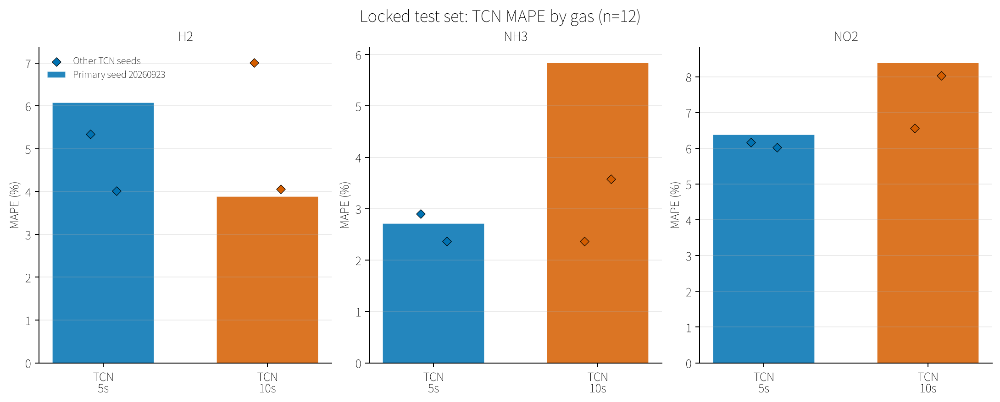

# 基于早期传感器响应的三气体浓度预测：项目进展与阶段性报告

> **汇报对象：** 研究生导师  
> **项目状态：** 已完成数据整理、固定划分、模型训练与测试评估；当前结果用于阶段性讨论，不构成外部泛化或应用精度结论。

## 摘要

本项目评估使用 H2、NH3、NO2 三路传感器响应的前 5 秒或 10 秒预测一次实验中三种气体浓度的可行性。已对 62 个实验 CSV 完成格式与数值校验，锁定 50 个开发实验和 12 个测试实验，并在开发集上通过五折验证选择输入形式。模型采用小型因果时序卷积网络（TCN），与标签均值、仅初始响应 Ridge 和早期特征 Ridge 进行比较。

在锁定测试集上，主种子 TCN 的 5 秒 macro-NMAE 为 0.02627，低于早期特征 Ridge 的 0.03422；10 秒 TCN 为 0.03072，略高于早期特征 Ridge 的 0.03003。三种子结果方向一致地显示 5 秒模型值得进一步验证，但测试集只有 12 次实验，且现有数据缺少重复组合、独立日期/器件和零浓度实验。因此目前结论仅支持在当前采集条件下继续研究，尚不能说明模型满足应用误差要求或具有外部泛化能力。

**关键词：** 早期响应；浓度回归；因果时序卷积网络；实验级划分；传感器阵列

## 1. 研究目标与项目进展

研究目标是检验：从 CSV 所记录的响应起点开始，仅使用前 5–10 秒的三路响应，能否估计同一次实验的 H2、NH3、NO2 浓度。CSV 起点被确认对应响应开始变化；每次实验之间充分清洗恢复。这里的 5 秒/10 秒从响应起点计，不包括通气至传感器出现响应的气路或感测延迟。`t=0` 只作为初始响应，不假设为纯空气基线。

| 阶段 | 当前完成情况 | 主要产物 |
|---|---|---|
| 数据盘点与校验 | 完成 62 个文件检查、列定义确认、时间与标签验证、文件哈希登记 | [`inventory.csv`](../artifacts/splits/inventory.csv)、[`manifest.csv`](../artifacts/splits/manifest.csv) |
| 划分与交叉验证 | 固定实验级开发/测试集合；开发集五折；测试集不参与模式选择 | [`cv_scores.csv`](../artifacts/tcn/cv_scores.csv)、[`selection.json`](../artifacts/tcn/selection.json) |
| 模型与基线 | 5 秒、10 秒 TCN 已完成训练；三个随机种子；Ridge 和标签均值基线已计算 | [`artifacts/tcn/`](../artifacts/tcn/) |
| 测试评估与作图 | 逐气体指标、逐实验预测、配对 bootstrap 和比较图已生成 | [`evaluation.json`](../artifacts/evaluation/evaluation.json)、[`test_metrics.csv`](../artifacts/evaluation/test_metrics.csv)、[`figures/`](../artifacts/evaluation/figures/) |
| 工程可复现性 | 提供数据划分、训练、评估、预测和绘图入口；CSV 读取已采用 pandas | [`README.md`](../README.md)；9 项回归测试通过 |

最近一次 CSV 读取实现调整后，使用既有 checkpoint 重新运行了评估与绘图；该次调整没有重新训练模型。当前 checkpoint、划分清单和评估结果均保存在项目的 `artifacts/` 中。

## 2. 数据与实验划分

### 2.1 数据概况

`data/0.csv` 至 `data/61.csv` 共 62 次实验。每个文件有 299 个采样点，记录时间为 0–59.6 秒，间隔 0.2 秒（5 Hz），合计 18,538 个采样行。每行列为 `time, H2, NH3, NO2, conc1, conc2, conc3`；前三路传感器响应作为输入，后三列分别作为 H2、NH3、NO2 标签。浓度和响应的物理单位在文件中没有说明，因此本文保留原始单位，不标为 ppm。

现有数据中 62 个浓度三元组互不相同，但没有零浓度、单气体实验或重复浓度组合。这意味着它可以用于评估已测混合浓度组合之外的部分预测表现，但不能用来量化重复性、零浓度响应、单气体识别或跨器件能力。

### 2.2 固定实验级划分

先以完整 CSV 为单位划分，再构造前缀特征，避免同一曲线的相邻时间点分散到训练与测试集合。测试集固定为 12 个文件：`2, 7, 15, 20, 23, 27, 31, 38, 41, 46, 55, 60`；其余 50 个文件为开发集。开发集分为 5 折，每折 10 个验证实验、40 个训练实验。完整归属和文件哈希见 [`manifest.csv`](../artifacts/splits/manifest.csv)。

测试实验的选取依据是三个气体各自浓度档位的覆盖，而不是响应曲线或模型测试误差。该设计使各边际浓度档位出现在测试集，但不保证测试浓度组合均位于开发集联合凸包内部。H2=32000 的测试集只有 1 个实验。

### 2.3 输入处理

对每种气体响应 $R_j(t)$，计算相对初值变化：

$$
d_j(t)=\frac{R_j(t)-R_j(0)}{\max(|R_j(0)|,10^{-8})}.
$$

分别建立 `delta`（仅三路 $d_j$）和 `raw_delta`（三路原始响应加三路 $d_j$）两种输入，用于检验模型是否依赖初始响应信息。输入只覆盖从 $t=0$ 到窗口终点的前缀：5 秒 26 点、10 秒 51 点；不使用全曲线末端、未来点插值或居中平滑。每个训练折、窗口和输入模式独立拟合输入通道均值/标准差及标签 z-score；验证集与测试集只应用训练集统计量，避免归一化泄漏。小于 $10^{-8}$ 的标准差置为 1，防止除零。

## 3. 模型与训练方案

### 3.1 TCN 结构

`GasTCN` 包含 3 个残差块，每块通道宽度为 16、卷积核长为 5，每块两层一维卷积，膨胀率依次为 1、2、4。卷积仅在左侧补零以保证因果性；每层后接 ReLU 和 Dropout(0.1)。首块用 1×1 卷积对齐残差通道，其余残差支路为恒等映射。模型只读取最后一个有效时间点，经 `Linear(16,16) → ReLU → Linear(16,3)` 输出三个标准化浓度。理论感受野为 57 个采样点，覆盖 10 秒的 51 点输入。

使用相对初值特征是为了表达响应变化并减弱不同初始幅度的尺度影响；同时保留 `raw_delta` 对照，是因为初始响应可能含有与浓度相关的信息。所有时序输入限于部署时可获得的前缀，以符合早期预测的因果约束。

### 3.2 训练和选型

开发阶段对 5 秒/10 秒与 `raw_delta`/`delta` 四种组合分别进行五折验证。输入和标签仅使用当前训练折拟合 z-score。网络以标准化标签上的 SmoothL1Loss 训练，使用 AdamW（学习率 $10^{-3}$、权重衰减 $10^{-3}$、batch size 8），梯度范数裁剪为 1，最多 500 轮；验证 macro-NMAE 连续 50 轮无改善时早停并恢复最佳权重。按五折平均 macro-NMAE 为每个窗口选定输入模式，同分时选 `delta`；然后以选中组合各折最佳 epoch 的中位数向上取整，在全部 50 个开发实验上重训三个种子（20260923、20260924、20260925）。主结果预先指定为 20260923，不对测试种子择优，也不做集成。

| 窗口 | `raw_delta` 五折平均 macro-NMAE | `delta` 五折平均 macro-NMAE | 选定模式 | 最终训练轮数 |
|---|---:|---:|---|---:|
| 5 秒 | 0.02761 | 0.04582 | `raw_delta` | 231 |
| 10 秒 | 0.02710 | 0.04172 | `raw_delta` | 174 |

两种时限下 `raw_delta` 的开发集交叉验证分数均较低，说明在当前实验中，原始响应通道提供了增量特征之外的预测信息；这不单独证明信息泄漏，也不能证明这种关联在新日期或新器件上稳定。

### 3.3 对照与评价指标

比较三类基线：开发集标签均值；只使用 $t=0$ 三路传感器响应的 Ridge；以及每个窗口的早期 Ridge（初值、窗口终点相对初值的增量、前缀线性斜率，共 9 个特征）。Ridge 正则系数在开发集五折上选取，再用全部开发集拟合。

测试指标逐气体报告 MAE、RMSE、R²、NMAE 和 MAPE，并提供 macro-NMAE 与 macro-MAPE。NMAE 为每气体 MAE 除以开发集该气体浓度极差，macro-NMAE 为三气体 NMAE 的平均。MAPE 按每个真实标签的绝对值归一化，因此低浓度样本相对权重较大；若真实标签为零则未定义。本次 12 个测试实验的三个真实浓度均非零。对主种子 TCN 与基线的 macro-NMAE 差值进行了 2000 次配对 bootstrap，重采样单位为实验。

## 4. 测试结果

### 4.1 主种子逐气体结果

下表为锁定的 12 个测试实验、主种子 20260923。MAE/RMSE 使用原始单位；浓度单位在数据中未注明。

| 窗口 | 气体 | MAE | RMSE | R² | NMAE | MAPE |
|---|---|---:|---:|---:|---:|---:|
| 5 秒 | H2 | 715.038 | 904.897 | 0.98594 | 2.979% | 6.0786% |
| 5 秒 | NH3 | 0.6267 | 0.7079 | 0.99660 | 1.567% | 2.7119% |
| 5 秒 | NO2 | 0.2668 | 0.3313 | 0.98609 | 3.334% | 6.3791% |
| 10 秒 | H2 | 613.504 | 766.884 | 0.98990 | 2.556% | 3.8875% |
| 10 秒 | NH3 | 1.0915 | 1.5034 | 0.98465 | 2.729% | 5.8410% |
| 10 秒 | NO2 | 0.3144 | 0.4075 | 0.97895 | 3.930% | 8.3910% |

### 4.2 与基线比较

| 方法 | 5 秒 macro-NMAE | 10 秒 macro-NMAE | 5 秒 macro-MAPE | 10 秒 macro-MAPE |
|---|---:|---:|---:|---:|
| 标签均值 | 0.27176 | 0.27176 | 52.07% | 52.07% |
| $t=0$ Ridge | 0.14907 | 0.14907 | 28.56% | 28.56% |
| 早期特征 Ridge | 0.03422 | 0.03003 | 7.09% | 6.17% |
| TCN 主种子 | **0.02627** | 0.03072 | **5.06%** | **6.04%** |

5 秒时 TCN 的 macro-NMAE 低于早期 Ridge；配对 bootstrap 差值（TCN−Ridge）为 −0.00795，95% 百分位区间为 [−0.01445, −0.00076]。10 秒时 TCN 的 macro-NMAE 略高于早期 Ridge，差值为 +0.00069，区间 [−0.00976, +0.01039]，包含 0。每个区间仅基于 12 次测试实验的重采样，尤其 H2=32000 只有一个测试点，不能据此作强泛化结论。

MAPE 排序与 NMAE 并不完全相同：10 秒 TCN 的 macro-MAPE 略低于早期 Ridge（6.04% 对 6.17%），但 macro-NMAE 略高。两者对误差和真实浓度的加权不同；MAPE 在接近零的真实浓度处尤其敏感，因此当前将其作为补充指标，不作为模型选型依据。

不同初始化下，5 秒 TCN 的 macro-NMAE 为 0.02627、0.02476、0.02261；10 秒为 0.03072、0.02831、0.03188。随机种子确实带来一定波动，报告主结论仍以预先指定的首个种子为准。

### 4.3 可视化



图中灰色为基线，彩色柱为主种子 TCN，菱形为另外两个种子的结果。其他图包括实测-预测散点、NMAE 对比和逐实验归一化残差，可从 [`artifacts/evaluation/figures/`](../artifacts/evaluation/figures/) 查看。

## 5. 结果解释与限制

1. **当前证据更支持继续验证 5 秒方案。** 5 秒 TCN 在这一测试集上优于两种 Ridge 基线和标签均值；10 秒 TCN 的 macro-NMAE 未超过早期特征 Ridge。不能将两个窗口都概括为 TCN 优于基线。
2. **初始响应存在重要混杂解释。** 对全部 62 个文件进行的探索中，初始 H2/NH3 响应与 NH3 标签的 Pearson 相关系数约为 0.9751/0.9652。两个窗口都选择包含原始响应的 `raw_delta`。这提示模型可能利用静态初值中的关联；需要在独立实验中复核，而不能仅由当前预测误差断定其来源或稳定性。
3. **测试集并非完全未查看的外部盲测。** 测试归属按浓度档位覆盖预先固定，没有按响应或模型误差筛选；训练时也没有用测试分数选模式、epoch 或种子。但 62 个文件均用于过数据质量审查和初始相关性探索，因此应披露这一限制。
4. **样本量和覆盖有限。** 测试只有 12 个不同浓度组合，H2=32000 只有 1 个；没有重复组合，无法估计测量重复性。没有零浓度、单气体、批次或器件标识，不能评估气体缺失识别、零浓度行为或跨器件/跨日期泛化。
5. **缩短记录窗口不等于相对稳态加速。** 相对 59.6 秒记录长度，5 秒和 10 秒分别缩短约 91.6% 和 83.2%；但记录末端未验证为稳态，故不能称为相对稳态响应的加速倍数。模型未截断预测；主种子测试未出现负浓度预测，但有少数结果超出已测浓度范围，不代表已验证外推能力。
6. **应用精度尚无判定阈值。** 尚未给定逐气体容许误差，也没有外部独立数据。因此不声称目前已达到部署或应用精度要求。

## 6. 后续工作建议

1. 在模型冻结后采集独立日期和/或器件的数据，进行真正的外部验证；按采集批次分组，避免同批次实验跨集合。
2. 增加重复浓度组合、边界浓度和零浓度/单气体对照，分别评价重复性、检测边界和混合气体条件下的可辨识性。
3. 与导师共同明确 H2、NH3、NO2 各自的可接受误差和评价单位，再判断 5 秒与 10 秒方案是否满足研究或应用要求。
4. 针对初始响应与标签的高相关性，预注册并比较 `raw_delta`、`delta`、仅初值 Ridge 和独立数据结果；检查初始响应关联在跨日期/器件采集中是否保持。
5. 若继续模型开发，应在新开发数据上完成方案选择，保留未触碰的独立测试集；现有 12 个测试实验不应用于反复调参。

## 7. 阶段性结论

项目已完成可复现的数据检查与固定实验级划分，构建了因果 TCN、Ridge 对照、训练/预测/评估接口，并对锁定测试集生成逐气体误差与可视化。现有结果显示 5 秒 TCN 在当前 12 个测试实验的 macro-NMAE 上优于早期特征 Ridge，10 秒结果则略逊；结论同时受到小样本、初始响应相关性和缺少独立批次验证的限制。建议将下一阶段重点放在独立采集验证和实验覆盖完善，而不是把当前测试分数解释为已具备部署能力。

## 8. 复现入口与结果文件

所有命令从项目根目录运行；训练已完成，复现实验时应遵守锁定测试协议。

```bash
uv run python -m tcn_union.cli.split --data-dir data --output-dir artifacts/splits
# 旧 clean 基线 checkpoint 已保存在 artifacts/tcn；
# 当前最终 10 秒模型训练入口为 gan_train（完整命令见 README 的复现命令）。
uv run python -m tcn_union.training.gan_train \
  --manifest artifacts/splits/manifest.csv \
  --output-dir artifacts/final_vae_hybrid \
  --modes noise_gan --generator vae \
  --noise-scale 0.1 --synthetic-ratio 3.0 \
  --gan-epochs 300 --max-epochs 500
uv run python -m tcn_union.evaluation.evaluate --manifest artifacts/splits/manifest.csv --model-dir artifacts/tcn --output-dir artifacts/evaluation --device cpu
uv run python -m tcn_union.visualization.plot_results --results-dir artifacts/evaluation --output-dir artifacts/evaluation/figures
uv run python -m unittest discover -s tests -v
```

主要结果：

- 划分与采样清单：[`manifest.csv`](../artifacts/splits/manifest.csv)、[`inventory.csv`](../artifacts/splits/inventory.csv)
- 交叉验证与选型：[`cv_scores.csv`](../artifacts/tcn/cv_scores.csv)、[`selection.json`](../artifacts/tcn/selection.json)
- 测试逐模型指标：[`test_metrics.csv`](../artifacts/evaluation/test_metrics.csv)
- 逐实验预测与 APE：[`test_predictions.csv`](../artifacts/evaluation/test_predictions.csv)
- 汇总指标、OOF 对比和 bootstrap：[`evaluation.json`](../artifacts/evaluation/evaluation.json)、[`oof_mode_comparison.json`](../artifacts/evaluation/oof_mode_comparison.json)
- 图片：[`test_mape_by_gas.png`](../artifacts/evaluation/figures/test_mape_by_gas.png)、[`test_nmae_by_gas.png`](../artifacts/evaluation/figures/test_nmae_by_gas.png)、[`test_predicted_vs_true.png`](../artifacts/evaluation/figures/test_predicted_vs_true.png)
