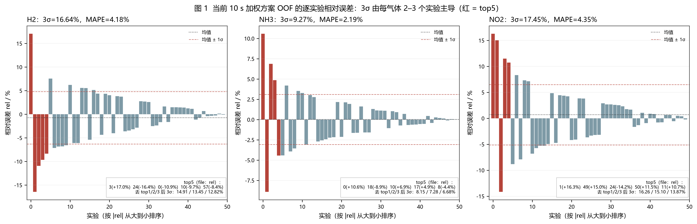
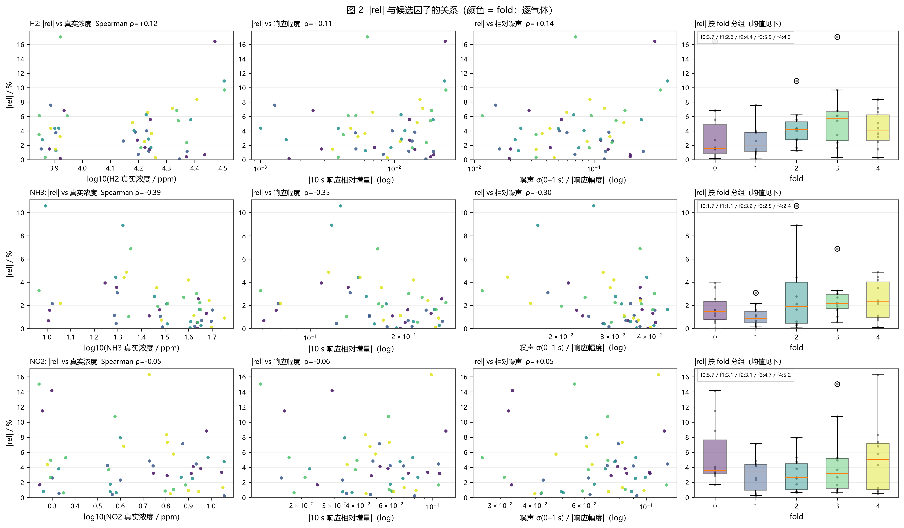
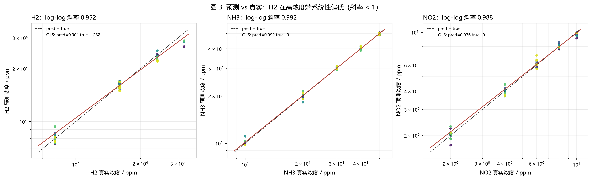
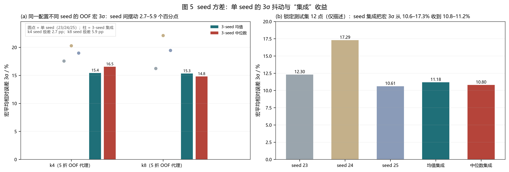
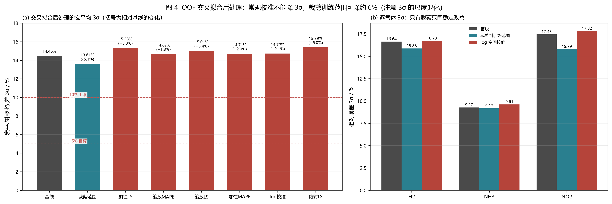

# 10 s 三气体浓度模型：相对误差 3σ 的误差结构诊断

> 分支：`experiment/3sigma-target`  
> 性质：**只读分析**。不训练新模型、不跑 GPU、不修改 `tcn_union/` 与 `tests/`，不提交 git。  
> 选型口径：**OOF（50 个开发实验，5 折交叉预测）用于结论与后处理选型**；12 个锁定测试点只做描述性统计，不参与任何方法选择。  
> 指标口径（与 `docs/误差方差优化.md` 一致）：逐气体
> `rel = 100 * (pred - true) / max(|true|, 1e-9)`，`3σ = 3 * std(rel, ddof=1)`，宏平均 = 三种气体 3σ 的算术平均。

---

## 0. 结论先行（TL;DR）

1. **当前方案基线**：OOF 逐气体 3σ = **H2 16.64% / NH3 9.27% / NO2 17.45%**，宏平均 **14.46%**（MAPE 4.18 / 2.19 / 4.35%，宏 3.57%）。锁定测试集（3 seed 均值集成，仅描述）逐气体 3σ = 10.75 / 6.65 / 16.14%，宏 11.18%。
2. **3σ 尾部被极少数实验决定**：每气体 top-3 实验贡献了该气体 rel 方差的 **44.2% / 50.9% / 40.4%**。按气体各自去掉 rel 最大的 top-1/2/3 后，宏平均 3σ 从 14.46% 依次降到 **13.11 / 11.94 / 11.13%**（−9.3% / −17.4% / −23.0%）。这说明"3σ"不是整体误差水平，而是 2–3 个尾部实验的放大镜。
3. **尾部来源分气体、且相当一部分是训练随机性**：
   - **H2**：尾部 = **高浓度端（32000 ppm）系统性低估**。3 个 32000 实验的 rel 为 −16.4 / −10.9 / −9.7%，占 H2 方差的 28.5%；所有 13 个方案/seed 在 32000 档都低估（−5.6% ~ −12.3%），加权方案（4,2,2）最严重。另有 1 个 8000 ppm 过预测（+17.0%，data/3）。
   - **NH3**：尾部 = **低浓度端小分母**。10/20 ppm 档平均 |rel| 为 3.41/3.88%，30–50 ppm 仅 1.24–1.59%；|rel| 与真实浓度 Spearman = −0.39（p=0.005），控制浓度后噪声/信噪比代理的解释力消失（偏相关 |ρ|≤0.16）。
   - **NO2**：**没有单一候选因子能解释**（所有 |Spearman|≤0.09）；尾部是 2 ppm 低浓度（3/5 个 top5）与个别实验（data/1、data/11）的混合。NO2 也是距离 10% 上限最远的气体（OOF 17.45%，测试 16.14%）。
   - **随机性占比**：同一配置在 k4/k8 两个代理方案上，3 个 seed 的 OOF 宏 3σ 摆动达 **2.7–5.9 个百分点**（单气体最高 13.9pp）；跨 seed 的逐实验 |rel| 排名 Spearman 只有 **0.30–0.44**。单次训练下大部分实验级误差排序不可复现；seed 集成实测能把宏 3σ 降 19–21%，说明其中相当一部分是随机分量，剩余则来自少数跨 seed 稳定复现的难例。
4. **简单后处理只有两类真正有效**（OOF 交叉拟合评估）：
   - **裁剪到训练浓度范围**：宏 3σ 14.46 → **13.61%**（−5.1%，MAPE −10.8%）；bootstrap 95% CI 为 Δ3σ = [−1.63, −0.29] 个百分点。OOF 上 17/150 个气体预测被裁剪，且裁剪对"真值在训练范围内"的样本保证不增大绝对误差。
   - **跨 seed 集成**：代理 OOF 上 3-seed 均值集成把宏 3σ 从单 seed 平均 18.94/19.27% 降到 **15.43/15.32%**（−19%/−21%）；测试集描述性结果也支持（单 seed 12.30/17.29/10.61% → 均值集成 11.18%）。
   - **常规校准（乘性缩放、加性偏置、log 空间线性、仿射）经交叉拟合后不但不能降 3σ，反而显著变差**（宏 +1.3% ~ +6.0%）。原因见 §5.2：① 用最小二乘拟合 `true = a·pred + b` 得到的 a>1（噪声方向相反），会放大相对误差；② **3σ 有尺度退化**：`3σ(a·pred) = a·3σ(pred)`，收缩预测可以线性压低 3σ，但偏差与 MAPE 同步恶化。
5. **训练侧优先级**（收益/成本排序，详见 §6）：① 多 seed OOF + 部署集成（低成本、宏 3σ 预计 −15%~−20%）；② 修 H2 高浓度端系统偏差（log/相对误差目标或更温和的低浓度加权，预期 H2 3σ −2~3pp）；③ 修指标与评估协议（最低成本、避免继续被单 seed 3σ 误导）；④ NO2 专项；⑤ 补充极端浓度真实实验。



---

## 1. 数据与口径

### 1.1 用到的材料

| 材料 | 用途 |
|---|---|
| `artifacts/variance_search/pg422_final/noise_gan/oof.csv` | **当前方案**（低浓度加权 4,2,2 + 3σ 早停，单 seed）的 50 条 OOF 预测 |
| `artifacts/variance_search/pg422_eval/test_predictions.csv` | 12 个锁定测试实验，3 seed + ensemble（**只做描述**） |
| `artifacts/final_vae_hybrid/noise_gan/oof.csv`、`artifacts/variance_search/p{1,2,3,4}*/noise_gan/oof.csv` | 6 个加权/验证指标变体，用于判断离群点跨方案稳定性 |
| `artifacts/pca_analysis/k4*`、`k8*` 的 3 seed OOF | 同配置 3 seed 代理（不同 VAE 分量数），用于量化 seed 方差与集成收益 |
| `artifacts/splits/manifest.csv` | file/fold/split/标签 |
| `data/0.csv .. 61.csv` | 原始时序，用于构造 10 s 前缀响应幅度与 0–1 s 噪声代理 |

### 1.2 指标定义与三个统计学事实

1. **3σ 是"尾部敏感"统计量**：定义上 `3σ = 3·std(rel, ddof=1)`，n=50 时标准差估计本身的相对标准误约 `1/√(2(n−1)) ≈ 10%`，因此 3σ 的 95% bootstrap CI 很宽（见 §5.5：H2 的 3σ CI 为 [12.3%, 20.8%]）。
2. **3σ 有尺度退化**：若把预测整体乘 a，则 `rel(a·pred) = a·rel(pred) + 100(a−1)`，因此
   ```
   3σ(a·pred) = a · 3σ(pred)   (a > 0)
   ```
   即 a→0 时 3σ 可以任意小，但平均相对偏差趋于 −100%。**在只看 3σ 的目标下，"整体收缩预测"是最优解**——这显然不是有意义的改进。报告 3σ 时必须同时报告平均相对偏差（本报告所有结论均同时看 MAPE/偏差）。
3. **当前 OOF 只有 1 个 seed**：加权方案的 OOF 是 seed=20260923 单次交叉验证，而部署模型是 3 seed 平均。两者口径不一致，且单 seed 的 3σ 抖动足以覆盖大部分"方案差异"（见 §5.4、§5.5）。k4/k8 的 3 seed OOF 是不同配置（VAE 分量 4/8，无加权），只作为 seed 方差的**量级代理**，不用于比较配置优劣。

### 1.3 交叉拟合与统计检验

- 所有"可拟合"的后处理参数都按 **fold 交叉拟合**：第 f 折的变换参数只用其余 4 折的 OOF 点拟合，再作用于第 f 折，避免同点自拟合。
- 显著性/不确定性：**实验级 paired bootstrap**（4000 次，同一组重采样实验同时用于三气体），对可拟合变换在每个重采样内重新交叉拟合；裁剪的浓度范围作为部署常量（开发集标签 min/max）不重生估计。同时给出 5 折"改善方向是否一致"的配对检查（每折仅 10 点，只做方向性参考）。

---

## 2. 当前方案基线

### 2.1 OOF（50 个开发实验，单 seed）

| 气体 | 3σ / % | MAPE / % | 平均相对偏差 / % | RMSE(rel) / % | 说明 |
|---|---:|---:|---:|---:|---|
| H2 | **16.64** | 4.18 | −0.74 | 5.54 | 高浓度端系统性低估（见下） |
| NH3 | **9.27** | 2.19 | +0.02 | 3.06 | 低浓度端小分母 |
| NO2 | **17.45** | 4.35 | +0.68 | 5.80 | 最大短板 |
| 宏平均 | **14.46** | 3.57 | — | — | — |

### 2.2 锁定测试集 12 点（仅描述，不用于选型）

逐气体 3σ / MAPE：

| 聚合方式 | H2 | NH3 | NO2 | 宏 3σ | 宏 MAPE |
|---|---:|---:|---:|---:|---:|
| seed 20260923 | 8.89 / 3.03 | 8.81 / 2.03 | 19.20 / 5.32 | 12.30 | 3.46 |
| seed 20260924 | 17.89 / 3.95 | 13.50 / 3.03 | 20.48 / 4.53 | 17.29 | 3.84 |
| seed 20260925 | 11.27 / 2.88 | 4.69 / 1.37 | 15.87 / 4.47 | 10.61 | 2.91 |
| **均值集成（部署）** | **10.75 / 2.85** | **6.65 / 1.59** | **16.14 / 3.48** | **11.18** | **2.64** |
| 中位数集成 | 9.26 / 2.72 | 6.16 / 1.59 | 16.97 / 3.92 | 10.80 | 2.74 |

> 测试集只有 12 个实验，单气体 3σ 的一个尾部点就能改变 2–4pp；上表只说明"当前部署模型在锁定集的描述水平"，不能用于比较方案或方法。

---

## 3. 问题 1：3σ 尾部在哪？

### 3.1 每气体 |rel| 最大的 5 个实验

| 气体 | 排名 | file | fold | true | pred | rel / % | z | 占该气体方差 |
|---|---:|---|---:|---:|---:|---:|---:|---:|
| H2 | 1 | `data/3.csv` | 3 | 8000 | 9363.6 | +17.04 | +3.21 | 21.0% |
| H2 | 2 | `data/24.csv` | 0 | 32000 | 26737.8 | −16.44 | −2.83 | 16.4% |
| H2 | 3 | `data/0.csv` | 2 | 32000 | 28504.7 | −10.92 | −1.84 | 6.9% |
| H2 | 4 | `data/10.csv` | 3 | 32000 | 28905.4 | −9.67 | −1.61 | 5.3% |
| H2 | 5 | `data/57.csv` | 4 | 24000 | 21993.0 | −8.36 | −1.37 | 3.9% |
| NH3 | 1 | `data/0.csv` | 2 | 10 | 11.058 | +10.58 | +3.42 | 23.8% |
| NH3 | 2 | `data/18.csv` | 2 | 20 | 18.217 | −8.91 | −2.89 | 17.1% |
| NH3 | 3 | `data/10.csv` | 3 | 20 | 21.375 | +6.88 | +2.22 | 10.0% |
| NH3 | 4 | `data/17.csv` | 4 | 20 | 20.972 | +4.86 | +1.57 | 5.0% |
| NH3 | 5 | `data/8.csv` | 4 | 20 | 19.114 | −4.43 | −1.44 | 4.2% |
| NO2 | 1 | `data/1.csv` | 4 | 6 | 6.976 | +16.27 | +2.68 | 14.7% |
| NO2 | 2 | `data/49.csv` | 3 | 2 | 2.301 | +15.04 | +2.47 | 12.4% |
| NO2 | 3 | `data/24.csv` | 0 | 2 | 1.717 | −14.17 | −2.55 | 13.3% |
| NO2 | 4 | `data/50.csv` | 0 | 2 | 2.230 | +11.48 | +1.86 | 7.0% |
| NO2 | 5 | `data/11.csv` | 3 | 4 | 4.429 | +10.72 | +1.73 | 6.1% |

- H2 的 top5 有 **3 个是 32000 ppm**，且全部是低估；top2 之后还有 24000 的 data/57。H2 = "高浓度端 3 个点 + 1 个低浓度过预测"。
- NH3 的 top5 全部在 **10 或 20 ppm**（最低两档，共 17/50 个点）。
- NO2 的 top5 有 3 个在 2 ppm（最低档），其余为 4/6 ppm。
- 每气体 top3 方差占比：**H2 44.2%、NH3 50.9%、NO2 40.4%**；top5：53.3% / 60.1% / 53.5%。

### 3.2 3σ 对"去掉 top-k"的敏感度

按各气体自己的 |rel| 排名去掉 top-k（同时给出宏平均）：

| 去掉 | H2 3σ | NH3 3σ | NO2 3σ | 宏平均 | 相对基线 |
|---|---:|---:|---:|---:|---:|
| 0（基线） | 16.64 | 9.27 | 17.45 | **14.46** | — |
| top1 | 14.91 | 8.15 | 16.26 | **13.11** | −9.3% |
| top2 | 13.45 | 7.28 | 15.10 | **11.94** | −17.4% |
| top3 | 12.82 | 6.68 | 13.87 | **11.13** | −23.0% |

若按"跨气体平均标准化 |rel|"整条实验一起删（三气体同步去掉），删 1/2/3 个实验（依次为 data/24、data/0、data/10，均为 H2 主导的极端实验）宏 3σ = 13.69 / 13.19 / 12.84%。

**结论**：3σ 不是一个平滑的整体指标，**2–3 个实验就能改变 10–23%**。任何"3σ 从 14.5 降到 14.0"级别的方案差异都必须先排除种子/抽样噪声（见 §5.4）。

### 3.3 离群点在不同方案 / seed 间是否复现？

在当前 top5 上统计 13 个 run（当前方案 + 6 个变体 + k4/k8 各 3 个 seed）中的排名（1 = 该 run 下 |rel| 最大；`n_top5` = 13 个 run 中进入前 5 的次数）：

| 气体 | file | 当前 \|rel\| | 13 run 中位排名 | 最好/最差排名 | n_top5（/13） | 13 run 平均 \|rel\| |
|---|---|---:|---:|---:|---:|---:|
| H2 | data/3 | 17.04 | 2 | 1 / 27 | **9/13** | 15.93 |
| H2 | data/24 | 16.44 | 26 | 2 / 36 | **1/13** | 5.05 |
| H2 | data/0 | 10.92 | 4 | 1 / 6 | **12/13** | 12.96 |
| H2 | data/10 | 9.67 | 14 | 2 / 46 | 3/13 | 6.23 |
| H2 | data/57 | 8.36 | 35 | 5 / 50 | **1/13** | 2.61 |
| NH3 | data/0 | 10.58 | 3 | 1 / 20 | **9/13** | 9.91 |
| NH3 | data/18 | 8.91 | 8 | 1 / 41 | 5/13 | 5.78 |
| NH3 | data/10 | 6.88 | 13 | 3 / 43 | 1/13 | 3.42 |
| NH3 | data/17 | 4.86 | 24 | 4 / 43 | 2/13 | 2.75 |
| NH3 | data/8 | 4.43 | 6 | 1 / 49 | 6/13 | 5.00 |
| NO2 | data/1 | 16.27 | 6 | 1 / 42 | 6/13 | 10.95 |
| NO2 | data/49 | 15.04 | 2 | 1 / 47 | **8/13** | 16.25 |
| NO2 | data/24 | 14.17 | 13 | 1 / 46 | 3/13 | 9.04 |
| NO2 | data/50 | 11.48 | 3 | 1 / 43 | **9/13** | 16.56 |
| NO2 | data/11 | 10.72 | 23 | 5 / 49 | 1/13 | 5.25 |

逐实验 |rel| 排名的跨 run 平均 Spearman 相关（各分组内部两两比较；1.0 表示完全复现）：

| 分组 | H2 | NH3 | NO2 |
|---|---:|---:|---:|
| 6 个加权/验证指标变体 + 当前 | 0.32 | 0.25 | 0.17 |
| k4 的 3 个 seed | 0.36 | 0.32 | 0.44 |
| k8 的 3 个 seed | 0.32 | 0.38 | 0.30 |

- **稳定复现的难例**：`data/0`（H2 12/13、NH3 9/13 都是 top5，三气体全在极端浓度）、`data/3`（H2 9/13）、`data/18`（NH3 5/13）、`data/49` 与 `data/50`（NO2 8–9/13）。这些更像**数据固有难度**（低灵敏度/跨敏感/异常采集条件），换模型/seed 也难消。
- **方案特定的离群点**：`data/24` 的 H2（仅 1/13 进 top5，中位排名 26）、`data/57`（1/13）、`data/10` 的 H2/NH3（各 3/13、1/13）、`data/11` 的 NO2（1/13）——它们在别的方案里是正常的。对这类点，调模型/集成比改进数据更有效。
- 跨 seed 排名相关只有 0.30–0.44，意味着**单次训练下大部分实验级误差排序不可复现**（同一实验在不同 seed 中可以从“正常”变成“离群”），这是本诊断最重要的定量事实之一。

---

## 4. 问题 2：相对误差与哪些因素有关？

### 4.1 预处理说明

对每个开发实验，从 `data/*.csv` 前 10 s（51 点，0.2 s 间隔）构造：

- 真实浓度（逐气体标签）；
- 10 s 响应相对增量 `delta10 = (resp(10 s) − resp(0 s)) / max(|resp(0 s)|, 1e-8)`（即模型 `raw_delta` 的增量通道；H2/NH3 为正响应，NO2 为负响应）；
- 5–10 s 均值相对增量（更稳的幅度代理）；
- 0–1 s 噪声 σ（前 6 点标准差）；
- 相对噪声代理 `relnoise = σ_noise(0–1 s) / |10 s 响应变化量|`（即任务要求的"噪声/响应幅度"比，1/SNR 意义）；
- t=0 基线响应、实验编号（采集顺序）、fold。

注意：响应幅度与真实浓度强共线（H2/NH3 的 `|响应幅度|` 与浓度 Spearman > 0.95），因此同时报告**控制真实浓度后的偏相关**，避免把"浓度效应"误读成"幅度/噪声效应"。

### 4.2 相关系数（OOF，n=50）

| 因子 | H2 Spearman（偏相关*） | NH3 Spearman（偏相关*） | NO2 Spearman（偏相关*） |
|---|---:|---:|---:|
| 真实浓度 | +0.12（—） | **−0.39**（—） | −0.05（—） |
| log 真实浓度 | +0.12（—） | −0.39（—） | −0.05（—） |
| 10 s 响应幅度 | +0.11（−0.01） | −0.35（+0.14） | +0.06（+0.03） |
| 5–10 s 均值幅度 | +0.11（+0.01） | −0.35（+0.12） | +0.04（0.00） |
| 0–1 s 噪声 σ | +0.11（+0.02） | **−0.42**（−0.16） | −0.01（+0.05） |
| 噪声/幅度（1/SNR 代理） | +0.14（+0.08） | −0.30（−0.10） | +0.05（+0.13） |
| 该气体基线响应 | 0.00（+0.01） | −0.39（−0.04） | +0.08（+0.07） |
| 实验编号（采集顺序） | +0.01（+0.02） | −0.39（−0.04） | −0.01（0.00） |
| fold | +0.28（+0.28） | +0.26（+0.33） | −0.01（−0.01） |

\* 偏相关 = 控制 log(真实浓度) 后的秩偏相关。

- **NH3**：真实浓度是最强且方向明确的因子（ρ=−0.39，p=0.005）；噪声、基线、实验编号的 |ρ|≈0.39–0.42 与浓度完全共线（NH3 浓度随采集顺序上升），控制浓度后偏相关 |≤0.16。即 **NH3 的 |rel| 尾部是"低浓度小分母"，不是"噪声大"**。
- **H2**：单变量相关都很弱（|ρ|≤0.28，其中 fold 的 ρ=0.28 最接近显著）；但只要看"尾部 vs 其余"（§4.3），H2 尾部的响应幅度/相对噪声/真实浓度全部显著偏大。**H2 是"端点系统偏差 + 高噪实验"，不是全样本的单调规律。**
- **NO2**：所有候选因子都解释不了（|ρ|≤0.09，p>0.3），fold 也无差异。

### 4.3 尾部（每气体 top5 |rel|）vs 其余

AUC > 0.5 表示尾部该因子值更大；p 为 Mann–Whitney 检验：

| 因子 | H2 AUC (p) | NH3 AUC (p) | NO2 AUC (p) |
|---|---:|---:|---:|
| 真实浓度 | 0.82 (0.015) | 0.16 (0.013) | 0.24 (0.053) |
| 10 s 响应幅度 | **0.84 (0.011)** | 0.20 (0.027) | 0.32 (0.203) |
| 噪声/幅度（1/SNR） | 0.82 (0.016) | 0.23 (0.050) | 0.35 (0.281) |
| 0–1 s 噪声 σ | 0.82 (0.018) | 0.13 (0.005) | 0.32 (0.214) |
| 实验编号 | 0.29 (0.132) | 0.15 (0.007) | 0.44 (0.660) |
| fold | 0.59 (0.520) | 0.72 (0.102) | 0.50 (1.000) |

- H2 尾部：响应幅度/浓度/相对噪声三类信号一致且显著（AUC≈0.82–0.84），因为 H2 尾部就是 32000 的 3 个点 + 1 个低浓度点；这三个高浓度实验的 0–1 s 噪声也异常大（15–19 ppm vs 其余中位 1.4 ppm），所以噪声在 Pearson 上显著（0.41，p=0.003）但秩相关不显著（0.11）。
- NH3 尾部：浓度、噪声、基线、实验编号的 AUC 都显著偏小（0.13–0.20），四个量互相共线，控制浓度后只有浓度方向明确。
- NO2 尾部：没有任何因子显著（p≥0.053）。

### 4.4 绝对误差结构：为什么 H2 和 NH3 的机理相反

| 气体 | corr(\|AE\|, 真实浓度) Pearson / Spearman | 平均绝对误差随浓度档 | 含义 |
|---|---|---:|---|
| H2 | **0.66 / 0.43** | 337 → 490 → 911 → **3951** ppm（8000→32000） | 绝对误差随浓度增大 → 相对误差在高浓度端也大（**系统偏差主导**） |
| NH3 | 0.08 / 0.08 | 0.34 → 0.78 → 0.48 → 0.50 → 0.70 ppm | 绝对误差近似与浓度无关 → rel ∝ 1/true（**小分母主导**） |
| NO2 | 0.41 / 0.44 | 0.11 → 0.16 → 0.30 → 0.27 → 0.35 ppm | 绝对误差随浓度增大，但相对误差近似平坦 → 两端都有贡献，无单一机理 |

**逐浓度档平均相对误差**（OOF，当前加权方案）：

| 气体 | 档位 | n | 平均 \|rel\| / % | 平均 rel（偏差） / % |
|---|---|---:|---:|---:|
| H2 | 8000 | 18 | 4.22 | +0.85 |
| H2 | 16000 | 19 | 3.06 | +0.55 |
| H2 | 24000 | 10 | 3.80 | −2.55 |
| H2 | 32000 | 3 | **12.35** | **−12.35** |
| NH3 | 10 | 6 | 3.41 | +1.93 |
| NH3 | 20 | 11 | **3.88** | −1.27 |
| NH3 | 30 | 11 | 1.59 | +0.81 |
| NH3 | 40 | 11 | 1.24 | +0.45 |
| NH3 | 50 | 11 | 1.39 | −0.94 |
| NO2 | 2 | 13 | **5.23** | +1.40 |
| NO2 | 4 | 10 | 3.93 | +0.09 |
| NO2 | 6 | 11 | **5.02** | +2.63 |
| NO2 | 8 | 9 | 3.39 | +1.19 |
| NO2 | 10 | 7 | 3.50 | −3.50 |

### 4.5 fold / 采集顺序 / SNR 四分位

- **fold**：H2 fold3 平均 |rel| 5.89% vs fold1 2.63%；NH3 fold2 3.18% vs fold1 1.11%；NO2 fold0/4 约 5.7/5.2% vs fold1/2 约 3.1%。但 fold 是随机划分的（每个 fold 约 10 个实验），差异来自"哪些实验恰好在该折"，没有独立机制，也不构成可操作因素。
- **实验编号（采集顺序）**：H2/NO2 几乎无关；NH3 的 −0.39 完全由"NH3 浓度随采集顺序升高"的设计导致，控制浓度后消失（偏相关 −0.04）。**没有独立的"采集漂移"证据。**
- **SNR 四分位**：NH3 的 |rel| 从 Q1 到 Q4 为 1.05→1.65→2.72→3.34%，但这是浓度共线（低浓度实验的 0–1 s 噪声反而更小），不是"低 SNR 导致大误差"；H2/NO2 的分组均值无单调关系。





### 4.6 哪个因素最能解释尾部？

| 气体 | 最能解释尾部的因素 | 证据 | 解释力评估 |
|---|---|---|---|
| H2 | **真实浓度处于 32000 端点（+ 该实验相对噪声偏大）** | 32000 档 3 点平均 rel −12.35%；尾部 vs 其余 AUC 0.82–0.84（p≈0.011–0.018）；3 点占 H2 方差 28.5% | 系统性偏差可解释约 1/3 方差；剩余为训练随机性 |
| NH3 | **低浓度小分母（10–20 ppm）** | Spearman −0.39（p=0.005）；10/20 ppm 平均 \|rel\| 3.4–3.9% vs 30–50 ppm 1.2–1.6%；绝对误差与浓度无关 | 中高：是真实机理，但 17/50 个点都在低档，属"结构性"而非个别离群 |
| NO2 | **无明显单因子**；低浓度端 + 个别实验混合 | 所有 \|ρ\|≤0.09；尾部 AUC 最高仅 0.35（p>0.2）；fold/采集顺序无关 | 低：需要模型/损失侧或更多数据解决 |
| 全体 | **训练随机性（seed 方差）** | 同配置 3 seed 宏 3σ 摆动 2.7–5.9pp；跨 seed \|rel\| 排名相关仅 0.30–0.44；3-seed 集成降 19–21% | **相当一部分（集成可消掉约 20% 宏 3σ）** |

---

## 5. 问题 3：简单后处理能降多少 3σ？

### 5.1 交叉拟合后的逐气体结果（OOF）

`Δ` 为相对基线的 3σ 变化；负值 = 改善。`changed` 为被变换改动预测值的气体-实验数（共 150 个气体预测）。

| 变换 | H2 3σ（Δ） | NH3 3σ（Δ） | NO2 3σ（Δ） | 宏 3σ（Δ） | 宏 MAPE（Δ） | changed |
|---|---:|---:|---:|---:|---:|---:|
| 基线 | 16.64 | 9.27 | 17.45 | **14.46** | 3.57 | 0 |
| 乘性缩放（LS） | 17.71 (+6.4%) | 9.32 (+0.5%) | 18.01 (+3.2%) | 15.01 (+3.4%) | 3.90 (+7.8%) | 150 |
| 乘性缩放（最小 MAPE） | 17.37 (+4.4%) | 9.29 (+0.2%) | 17.34 (−0.6%) | 14.67 (+1.3%) | 3.68 (+2.7%) | 150 |
| 加性偏置（LS） | 18.67 (+12.2%) | 9.36 (+1.0%) | 17.95 (+2.9%) | 15.33 (+5.3%) | 3.85 (+6.7%) | 150 |
| 加性偏置（最小 MAPE） | 17.17 (+3.1%) | 9.56 (+3.1%) | 17.39 (−0.3%) | 14.71 (+2.0%) | 3.68 (+3.1%) | 150 |
| 加性偏置（最小 3σ） | 16.63 (−0.1%) | 9.27 (+0.0%) | 17.45 (−0.0%) | 14.45 (−0.0%) | 3.57 (−0.0%) | 150 |
| 仿射 a·pred+b（LS） | 18.46 (+10.9%) | 9.56 (+3.1%) | 18.15 (+4.0%) | 15.39 (+6.0%) | 3.89 (+8.5%) | 150 |
| log 空间线性校准 | 16.73 (+0.5%) | 9.61 (+3.7%) | 17.82 (+2.1%) | 14.72 (+2.1%) | 3.69 (+3.8%) | 150 |
| **裁剪到训练浓度范围** | **15.88 (−4.6%)** | **9.17 (−1.1%)** | **15.79 (−9.5%)** | **13.61 (−5.1%)** | **3.16 (−10.8%)** | 7 / 6 / 4 |

要点：

1. **唯一稳定降低 3σ 的是裁剪**：H2 −4.6%、NO2 −9.5%、NH3 −1.1%，宏 −5.1%（MAPE 也同步下降 10.8%）。
2. **除裁剪外，其余变换无一能稳定降低 3σ**：乘性缩放/仿射/加性 LS 的宏 3σ 反而 +3.4%~+6.0%，MAPE 也变差。原因是它们拟合的是 `true ≈ a·pred + b`（误差在主变量方向上），在 `R²<1` 时得到 a>1（本 OOF 的 H2 乘性缩放 a≈1.02–1.04、仿射 a≈1.08–1.10），把预测进一步放大，而 3σ 随乘数线性放大——“越校准越差”。
3. “最小化 3σ 的加性偏置”几乎无效（−0.03%）：因为 3σ 已是对该参数的最优，说明加性平移方向没有可利用的系统偏差。

### 5.2 必须交叉拟合：自欺上界 vs 交叉拟合

同样的变换若在全部 50 点上拟合（自欺上界），宏 3σ 看起来更好：

| 变换 | 自欺上界（in-sample）宏 3σ | 交叉拟合宏 3σ | 3σ 绝对差 | 相对变化口径差 |
|---|---:|---:|---:|---:|
| 乘性缩放（LS） | 14.63 (+1.1%) | 15.01 (+3.4%) | 0.38pp | 2.3pp |
| 乘性缩放（MAPE） | 14.41 (−0.2%) | 14.67 (+1.3%) | 0.25pp | 1.5pp |
| 加性偏置（LS） | 14.91 (+2.8%) | 15.33 (+5.3%) | 0.42pp | 2.5pp |
| 仿射（LS） | 14.93 (+2.7%) | 15.39 (+6.0%) | 0.46pp | 3.3pp |
| log 空间校准 | **14.22 (−1.5%)** | **14.72 (+2.1%)** | **0.50pp** | **3.6pp** |
| 裁剪范围 | 13.61 (−5.1%) | 13.61 (−5.1%) | 0（无拟合参数） | 0 |

log 空间校准在自欺口径下把宏 3σ 降 1.5%（scale_mape / bias_mape 仅 −0.2%），交叉拟合后实际是 **+2.1%（变差）**。这直接回答了任务里的疑问：**在 50 点 OOF 上，任何"校准→3σ 下降"的结论都必须交叉拟合，否则在相对变化口径上会系统性高估 1.5–3.6 个百分点。** 本报告所有后处理结论均采用交叉拟合。

### 5.3 为什么"乘性缩放/加性偏置"救不了 3σ：尺度退化

由于 `rel = 100(r − 1), r = pred/true`，对任意 a>0：

```
rel(a·pred) = a·rel(pred) + 100(a−1)
3σ(a·pred)  = a·3σ(pred)
平均相对偏差(a·pred) = a·(平均 rel + 100) − 100
```

数值验证（OOF，逐气体/MAPE 见 `scale_degeneracy.csv`）：

| a | 宏 3σ | H2 MAPE | H2 平均偏差 | 说明 |
|---:|---:|---:|---:|---|
| 0.80 | 11.56 | 20.59% | −20.59% | 3σ “降 20%”，但偏差/ MAPE 爆炸 |
| 0.90 | 13.01 | 10.88% | −10.66% | 3σ −10%，代价是 10% 系统偏差 |
| 0.95 | 13.73 | 6.30% | −5.70% | 3σ −5%，MAPE 从 4.18→6.30 |
| 1.00 | 14.46 | 4.18% | −0.74% | 基线 |
| 1.05 | 15.18 | 5.82% | +4.23% | 3σ 变大 |
| 1.10 | 15.90 | 9.62% | +9.19% | — |

**如果只盯 3σ，把预测乘 0.9 就能"降 10%"，但这是指标退化，不是误差变小。** 合理用法是：把 3σ 与平均相对偏差（或 RMSE(rel)）一起报告；或者先把偏差约束在可接受范围再比较 3σ。

### 5.4 裁剪到训练浓度范围：机制、显著性、风险

**机制**：对任意 `true ∈ [lo, hi]`，`clip(pred, lo, hi)` 到范围的投影不会让 `|pred − true|` 变大，因此**逐点保证相对误差不增大**（在"真实浓度覆盖在训练范围内"这一前提下）。OOF 中 150 个气体预测有 **17 个**越界（H2 7 个、NH3 6 个、NO2 4 个），全部发生在浓度档边界（H2 8000、NH3 10/50、NO2 2），裁剪把它们拉回边界 → 误差下降。这也是为什么它的收益集中在边界样本。

**显著性**（bootstrap 95% CI，Δ3σ = 裁剪 − 基线）：

| 气体 | Δ3σ 点估计 | 95% CI | P(Δ<0) |
|---|---:|---:|---:|
| H2 | −0.77 | [−1.85, −0.10] | 99.2% |
| NH3 | −0.10 | [−0.28, −0.004] | 98.4% |
| NO2 | −1.66 | [−4.32, −0.008] | 98.4% |
| 宏平均 | **−0.84** | **[−1.63, −0.29]** | **100%** |

逐折方向一致性：H2 2/5 折改善、NH3 3/5、NO2 3/5（每折仅 10 点，单折 3σ 噪声很大；整体点估计改善主要来自 1–2 折）。结合 bootstrap，可以认为**宏层面的 −0.8pp 是真实的，但幅度不大**。

**测试集描述性**（方法由 OOF 决定后，仅看锁定集表现）：均值集成 3σ H2 10.75→10.62、NH3 6.65→6.64、**NO2 16.14→11.55**（NO2 只改了 1 个点，恰好是 2 ppm 边界样本），宏 11.18→9.60。**这个数字不能当作方法收益**：越界样本恰好落在标签网格边界时，裁剪收益被放大；在真实连续浓度场景，只有"预测越界且真值接近边界"时才有收益。

**风险**：若部署浓度可能超出训练范围，该先验不成立，裁剪会引入偏差；且收益上限就是越界点的数量。把它作为**免费的部署安全夹**合理，但不要计入"3σ 攻坚"的主要手段。

### 5.5 跨 seed 聚合：OOF 代理与测试描述

**OOF（代理配置 k4/k8，同配置 3 seed；当前加权方案没有多 seed OOF）**：

| 配置 | seed 23 | seed 24 | seed 25 | 单 seed 平均 | 3-seed 均值集成 | 3-seed 中位数集成 |
|---|---:|---:|---:|---:|---:|---:|
| k4 宏 3σ | 17.55 | 20.29 | 18.99 | 18.94 | **15.43（−18.6%）** | 16.54（−12.7%） |
| k8 宏 3σ | 16.22 | 22.11 | 19.46 | 19.27 | **15.32（−20.5%）** | 14.81（−23.1%） |

单气体看抖动更大：k4 的 NO2 为 17.58/30.69/31.52%，k8 的 H2 为 15.89/23.47/20.24%。**seed 方差就是 3σ 指标噪声的主要来源之一。**

**测试集（仅描述）**：单 seed 宏 3σ 12.30/17.29/10.61%，均值集成 **11.18%**，中位数集成 10.80%。均值集成相对三个单 seed 的平均 13.40% 降低 **16.6%**；中位数集成与均值接近（单气体互有胜负，12 点下不可区分）。



### 5.6 显著性 / 可泛化判断汇总

- **单 seed OOF 的 3σ 置信区间**（bootstrap 95%）：H2 [12.31, 20.85]、NH3 [6.51, 11.81]、NO2 [13.05, 21.20]，宏 [11.83, 16.63]；按半宽/点估计，单气体的 CI 约 ±23–29%、宏平均约 ±17%。**因此 14.46% 与 18.42% 这种"方案差异"在单 seed OOF 上不可区分**（见 §3.3/§5.5 的 seed 抖动）。
- 常规校准的变差在 bootstrap 下多数显著（scale_ls 宏 +0.56 [0.36, 1.57]、affine +0.93 [0.58, 3.12]、bias_ls +0.87 [0.41, 2.68]）——**不是抽样噪声，是确实变差**。
- 裁剪的宏改善 CI 不含 0（[−1.63, −0.29]），但幅度小、依赖"训练范围覆盖真实范围"的前提；跨折一致性只有 2–3/5 折。
- seed 集成收益在 OOF 代理与测试描述上方向一致、幅度 15–21%，是本报告中**最稳健**的后处理类结论。



---

## 6. 问题 4：训练侧下一步建议（按预期收益 / 实现成本排序）

> 排序依据：预期对宏 3σ 的改善幅度 × 证据强度 ÷ 实现成本。金额/时间成本按本仓库现状估计（CPU 分析；训练为 5 折 + 3 seed 的 TCN + VAE 增强）。

### ① 低成本、最高优先级：把评估协议改成多 seed，并把"训练 3 seed 平均"作为默认部署形态

- **做什么**：OOF 对同一配置跑 3 个 seed（每折或全 dev 各 3 份），**先在预测层做 seed 平均再算 3σ**；部署保持 3 seed 集成。历史方案（p1–p4 等）用新口径重评一次。
- **依据**：同配置 3 seed 的 OOF 宏 3σ 摆动 2.7–5.9pp（k4：17.55/20.29/18.99；k8：16.22/22.11/19.46）；3-seed 均值集成把宏 3σ 降 18.6%/20.5%；锁定测试描述 13.40→11.18（−16.6%）。当前 `variance_search` 中 6 个方案的宏 3σ 差异（14.46–18.42%）与 seed 噪声同量级，**"4,2,2 最优"的结论很可能不成立**。
- **成本/风险**：训练时间 ×3（无新依赖、无模型改动）；风险是重评后旧结论被推翻——但这正是需要知道的。

### ② 中成本、针对最大结构性偏差：修 H2 高浓度端系统性低估

- **做什么**：在目标/损失层给高浓度端加权，例如 ① 目标变换 `log(true)`（或相对误差型目标）让损失对相对误差更均匀；② 继续用低浓度加权但给权重设**更温和的上下限**（当前 H2 的 p=4 把 32000 的权重压到下限 0.1、8000 压到上限 10，相差 100 倍）；③ 对 32000 档重采样/补充真实实验。
- **依据**：H2=32000 的 3 个 OOF 点全部低估（rel −16.4/−10.9/−9.7%，占 H2 方差 28.5%），且**所有 13 个方案/seed 都低估**（−5.6%~−12.3%），其中加权方案最差（unweighted −5.8%，p2 −5.6%，当前加权 −12.3%）；锁定测试 H2=32000 的 data/38 在 3 个 seed 下也一致低估（−6.6/−5.7/−7.2%）。这是系统性成分，不是噪声。
- **预期收益**：若把 32000 档从 −12% 修到 −5%，按方差占比估算 H2 3σ 可降约 2–3pp（16.6→13.5~14.5%）；同时不牺牲低浓度端（NH3=10 ppm 的加权收益 +4.3%→+1.9% 需要保留，故建议按气体设权，而非全局取消加权）。
- **成本/风险**：中（训练 + 多 seed OOF 验证）；风险是低浓度端的方差收益回退，需要 ① 的多 seed 口径来判定。

### ③ 极低成本、必做：修 3σ 指标定义与报告方式

- **做什么**：报告 3σ 的同时报告**平均相对偏差**与 **RMSE(rel)**（或把 3σ 定义在"去偏后"的相对误差上）；评估时报告 bootstrap 95% CI；单 seed OOF 的 3σ 不再用于超参/加权选择。
- **依据**：`3σ(a·pred) = a·3σ(pred)` 的尺度退化（§5.3：a=0.9 就能"降 10%"但引入 10% 偏差）；单 seed 3σ 的 95% CI 对单气体约 ±23–29%（H2 [12.3, 20.8]），而 6 个加权变体的宏 3σ 极差只有 4pp；bootstrap 也说明常规校准的"改善"在交叉拟合下全部反转（§5.2）。
- **成本**：改评估脚本/报告模板，几乎为零。**不做这一条，后续所有 3σ 优化都可能是在拟合噪声。**

### ④ 中成本：NO2 专项（当前最大短板）

- **做什么**：对 NO2 单独设置目标/损失（或独立输出头/校准），并优先补 NO2 低浓度（2 ppm）真实实验；在评估中按气体报告，不用宏平均掩盖 NO2。
- **依据**：NO2 3σ 在 OOF 17.45%、锁定测试 16.14%，是距 10% 上限最远的气体；其后部无法用浓度/幅度/噪声/顺序/fold 任一因素解释（|ρ|≤0.09）；但存在**跨 seed 稳定的系统点**——测试 data/2（NO2=6 ppm）三个 seed 的 rel 一致为 +10.7/+11.0/+13.0%，data/38（NO2=2 ppm）一致为 −13.2/−17.0/−6.1%，说明不是纯噪声，值得专门建模或校准（校准需按 ③ 的多 seed 口径验证）。
- **成本/风险**：中；12 点测试样本太少，不能按测试集挑 NO2 方案。

### ⑤ 高成本、真正的数据侧解法：补充极端浓度实验并复测稳定难例

- **做什么**：补充 H2=32000（当前 dev 仅 3 个点）、NO2=10（7 个点）、NH3=10（6 个点）等档位的真实实验；对跨方案稳定难例（`data/0`、`data/3`、`data/18`、`data/49`、`data/50`）检查采集条件（灵敏度、0–1 s 噪声、串扰），必要时复测。
- **依据**：H2 绝对误差随浓度强烈增长（8000 档 337 ppm → 32000 档 3951 ppm，corr 0.66），而 32000 只有 3 个训练点；NO2/NH3 低浓度档样本少且 |rel| 最大；`data/0` 在三个气体上都是跨方案 top5（H2 12/13、NH3 9/13），属数据固有难度，模型/集成无法根治。
- **成本**：高（新实验）；但这是唯一能降低"不可约误差"的路径，前四条主要是在现有数据上降方差。

### 可立即用于部署端的两个小动作（非训练侧）

1. **冻结范围裁剪**：若业务保证真实浓度在训练覆盖范围内，对预测做范围裁剪是零成本、逐点不增大绝对误差的安全操作（OOF 宏 3σ −0.84pp，bootstrap CI [−1.63,−0.29]）。
2. **seed 均值集成**：现有 3 seed 集成已经优于单 seed（测试描述 11.18% vs 12.30/17.29/10.61），建议继续保持，并避免改回单 seed 部署。

---

## 7. 局限与注意事项

1. **OOF 单 seed**：当前加权方案只有 1 个 seed 的 OOF；seed 方差分析使用 k4/k8（不同 VAE 分量、无加权）作代理，绝对值不可直接迁移，只用于量级/方向判断。**结论 ① 的核心动作就是补多 seed OOF。**
2. **12 个锁定测试点只做描述**：本报告没有用测试集选择任何方法；测试描述（如裁剪后 NO2 16.14→11.55）只用于说明机制，不应作为收益承诺。
3. **3σ 定义敏感**：`std(rel, ddof=1)` 在 n=50 下对 2–3 个点极度敏感（§3.2），且分母 `max(|true|,1e-9)` 与气体量纲无关；跨气体宏平均会掩盖 H2 与 NO2 的不同机理。
4. **因子分析为相关性/分组描述**，不是因果；响应幅度与浓度强共线，已用偏相关控制，但 n=50 下对非线性/交互作用检验力有限。
5. **bootstrap**：按实验级 paired 重采样；对可拟合变换在重采样内重新交叉拟合（参数不确定性），对裁剪使用固定范围（部署常量）。50 点的 bootstrap CI 可能仍偏窄（未覆盖数据生成过程的漂移）。
6. **字体**：环境未安装 `Noto Serif CJK SC`，绘图按该字体 → Microsoft YaHei / Source Han Sans CN → DejaVu Sans 的顺序回退（脚本自动选择），中文渲染正常；输出仍为 PNG + SVG（无 PDF），符合 AGENTS.md。

---

## 8. 复现与产物

### 8.1 一键复现（只读分析，无需 GPU）

```bash
cd /home/mrawa/code/deep-learning/tcn_union
MPLCONFIGDIR=/tmp/mplconfig .venv/bin/python \
  artifacts/3sigma_diagnosis/scripts/diagnose_3sigma.py
```

### 8.2 产物清单（`artifacts/3sigma_diagnosis/`）

| 文件 | 内容 |
|---|---|
| `scripts/diagnose_3sigma.py` | 本报告全部分析与绘图的脚本（只读输入，输出到本目录） |
| `baseline_summary.csv` | OOF 逐气体/宏基线指标 |
| `oof_error_detail.csv` | 50 个 OOF 实验 × 逐气体 rel/absrel/z/方差占比 + 响应幅度/噪声/SNR 特征 |
| `top_outliers.csv` | 每气体 \|rel\| top5（file/fold/true/pred/rel/z/方差占比） |
| `outlier_stability.csv` | top5 实验在 13 个 run（当前 + 6 变体 + 6 seed）中的排名、出现次数、均值 |
| `tail_sensitivity.csv` / `tail_sensitivity_union.csv` | 去 top-k 后 3σ（逐气体 / 宏 / 整实验） |
| `rank_consistency.csv` | 跨 run 的 \|rel\| 排名相关（seed/方案） |
| `scheme_comparison.csv` / `scheme_level_bias.csv` | 13 个方案/seed 的 3σ/MAPE/斜率与逐浓度档平均偏差 |
| `factor_correlations.csv` | \|rel\| 与真实浓度、幅度、噪声、SNR 代理、顺序、fold 的 Pearson/Spearman/偏相关 |
| `factor_group_means.csv` | 逐浓度档 / fold / SNR 四分位的分组均值 |
| `tail_vs_rest.csv` | 尾部 vs 其余：AUC 与 Mann–Whitney p |
| `abs_error_by_level.csv` | 绝对误差与浓度的关系（H2 系统偏差 vs NH3 小分母） |
| `postprocess_metrics.csv` | 8 种后处理（+ 基线）× 3 气体的交叉拟合与自欺口径 3σ/MAPE |
| `postprocess_fold_params.csv` | 交叉拟合逐折参数（参数稳定性） |
| `postprocess_fold_consistency.csv` / `..._summary.csv` | 逐折方向一致性 |
| `bootstrap_ci.csv` | 配对 bootstrap 的 Δ3σ 95% CI |
| `scale_degeneracy.csv` | a·pred 的 3σ/MAPE/偏差退化表 |
| `seed_variance_proxy.csv` | k4/k8 3 seed 的 OOF 3σ 与均值/中位数集成 |
| `test_descriptive.csv` / `test_oof_like_detail.csv` | 锁定测试集描述性统计（per seed / 均值 / 中位数集成）与逐点明细 |
| `test_clip_descriptive.csv` | 测试集上裁剪的描述性效果（不用于选型） |
| `summary.json` | 关键数字汇总（供程序读取） |
| `figs/fig_tail_outliers.{png,svg}` | 图 1：逐实验 rel、top5 标注、去 top-k 后 3σ |
| `figs/fig_factor_relations.{png,svg}` | 图 2：\|rel\| vs 浓度/幅度/相对噪声/fold |
| `figs/fig_calibration.{png,svg}` | 图 3：预测 vs 真实（H2 高浓度端斜率 < 1） |
| `figs/fig_postprocess.{png,svg}` | 图 4：交叉拟合后处理 3σ 对比 |
| `figs/fig_seed_variance.{png,svg}` | 图 5：seed 方差与集成收益 |

> 说明：本诊断不训练模型、不运行 GPU；未修改 `tcn_union/`、`tests/`、`pyproject.toml`、`uv.lock`；未提交 git、未 push。
