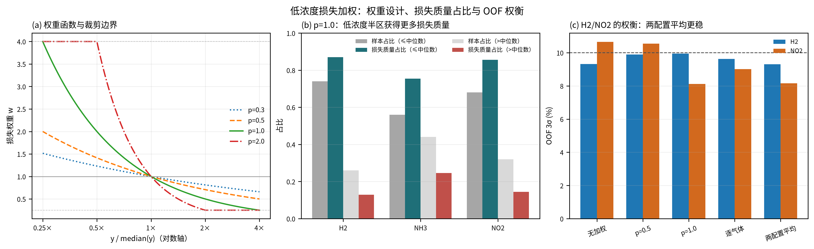
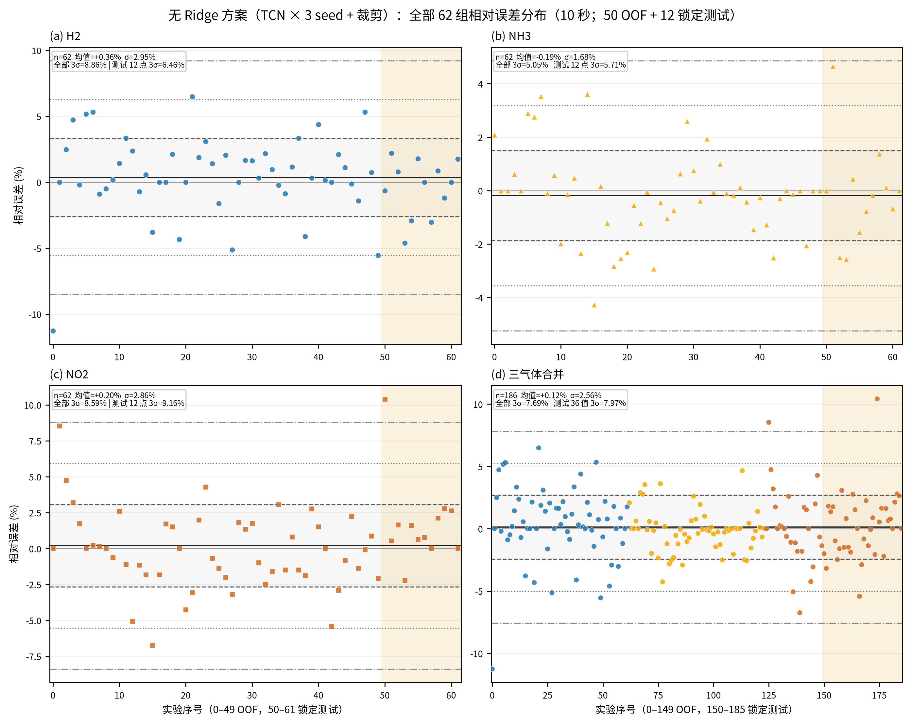
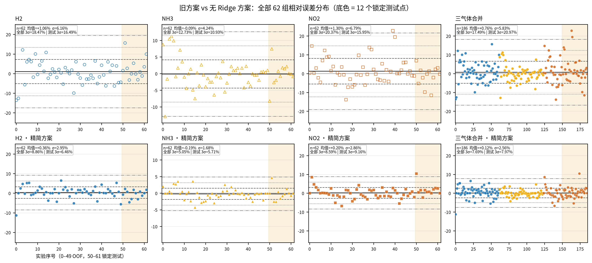

# 3σ 降方差方案：低浓度损失加权与完整实现

> 来源机制与案例证据见 [`3sigma来源与证据.md`](3sigma来源与证据.md)。

> 分支：`dev`（最终方案已合并并推送，提交 `cd559e2`）  
> 代码状态：Ridge 及旧迭代代码已删除；当前评估模块为 `tcn_union/evaluation/ensemble_evaluate.py`  
> 测试集读取：本方案对应**第 7 次**（共 7 次）锁定测试评估，前 6 次历史已不再保留产物，但结果记录在 git 历史与本轮对话中
>
> 本文分两部分：
> 1. **低浓度 Loss 加权**的原理、公式、权重统计与实现细节；
> 2. **当前降 3σ 方案**的完整结构、训练/推理/评估协议、结果、代码地图与复现。

---

## 0. 结论先行

- 目标：10 秒响应前缀 → H2 / NH3 / NO2 连续浓度；验收指标为**逐气体相对误差 3σ <10%**（理想 ≤5%）。
- 最终方案：**单 TCN 模型族**（逐气体目标 + 逐气体输出头 + 边缘浓度 VAE 扩充 + 低浓度损失加权）+ **两套加权强度 × 3 seed 的预测平均 + 裁剪**；共 6 个 TCN checkpoint，**不使用 Ridge，也不使用任何额外模型**。
- 结果：

| 口径 | H2 | NH3 | NO2 | 宏平均 3σ | MAPE |
|---|---:|---:|---:|---:|---:|
| OOF（50 个开发实验，3 seed + 裁剪） | 9.31 | 4.95 | 8.16 | **7.47%** | 1.79% |
| 锁定测试（12 个实验，第 7 次读取） | 6.46 | 5.71 | 9.16 | **7.11%** | 1.67% |
| 62 点合并（50 OOF + 12 测试） | 8.86 | 5.05 | 8.59 | 7.69% | — |
| 旧方案（none+加权，3 seed，测试） | 10.75 | 6.65 | 16.14 | 11.18% | 2.64% |

- 逐气体 3σ 在 OOF 与测试集上**全部 <10%**；5% 目标只有 OOF NH3（4.95%）达到，测试 NH3（5.71%）未达到。
- 相比上一版“TCN + Ridge”（OOF 7.06%、测试 7.18%）：OOF 稍差 0.41 pp，测试宏平均略好 0.07 pp；不再依赖额外线性模型。

---

## 1. 指标与问题定义

### 1.1 相对误差与 3σ

对每个气体、每个实验 `i`：

```text
rel_i   = 100 * (pred_i - true_i) / max(|true_i|, 1e-9)
3σ_gas  = 3 * std(rel_gas, ddof=1)
宏 3σ   = (3σ_H2 + 3σ_NH3 + 3σ_NO2) / 3
```

3σ 直接度量**相对误差分布的尾部宽度**。与 MAPE 不同，它对少数大误差点更敏感，因此更贴合“某些实验误差特别大”的问题。

### 1.2 3σ 偏大的五个来源

| 来源 | 表现 | 典型实验 |
|---|---|---|
| 小分母 | 低浓度点同样的绝对误差产生巨大相对误差 | NO2=2 ppm、NH3=10 ppm、H2=8000 |
| 量级差异 | H2 万级、NH3/NO2 十级/个位数，联合回归易被大气体主导 | 全部 |
| 高浓度端 | H2=32000 端系统性低估 | data/0 等 |
| 样本稀缺 | 极端组合几乎没有重复，单点误差直接进入 3σ | H2=32000 仅 3 个开发点、NH3=10 仅 6 个、NO2=10 仅 7 个 |
| seed 随机性 | 单 seed 的 3σ 可摆动数个百分点 | 所有配置 |

### 1.3 当前方案对每个来源的对应手段

| 来源 | 手段 |
|---|---|
| 量级差异 / 高浓度端 | 逐气体目标变换（H2/NO2 取 log，NH3 原空间）+ 逐气体输出头 |
| 小分母 / 低浓度尾部 | **低浓度损失加权**（本文重点）+ 逐气体目标 |
| 样本稀缺 / 边缘组合 | 边缘浓度条件 VAE 扩充（每折约 +120 条边缘样本） |
| seed 随机性 | 3 seed 预测平均（每套配置 3 个 checkpoint） |
| 越界预测 | 裁剪到开发集浓度范围（物理约束） |
| 尾部不均衡 / 单配置顾此失彼 | 两套加权强度（p=1.0 与 0,0.3,1.0）的预测平均 |

---

## 2. 方案总览

### 2.1 流水线

```text
            ┌──────────────── 训练（每个 seed，五折 OOF 内） ────────────────┐
真实 10s 前缀 (51×3)                                                         │
  ├─ 特征：raw_delta → 6 通道 [6,51]                                         │
  ├─ 增强：噪声视图 ×1（MAD σ ×0.1）                                          │
  │        + PCA-VAE 合成 ×3（组件 6、latent 4、beta 0.1）                     │
  │        + 边缘浓度条件采样 ×4（每折 30–33 个 min/max 组合）                  │
  ├─ 目标：H2 log、NH3 原空间、NO2 log                                        │
  ├─ 损失：SmoothL1(beta=1) + 低浓度权重 (median/y)^p（逐气体可配）            │
  ├─ 模型：6→16 因果 TCN（3 残差块，k=5，dilation 1/2/4）+ 三气体独立头        │
  └─ 早停：验证集宏 3σ（50 轮无改善停止，最多 500 轮）                          │
            └───────────────────────────────────────────────────────────────┘

最终模型：
  配置 A（p=1.0，全部气体低浓度加权） × seed 23/24/25  → 3 个 checkpoint
  配置 B（p=0,0.3,1.0，H2 不加权、NH3 轻加权、NO2 全加权）× 同 3 个 seed → 3 个 checkpoint
                        ↓
  逐 seed 预测平均 → 3 seed 再平均（等价 6 个 checkpoint 等权平均） → 裁剪到开发集浓度范围
                        ↓
  输出 H2 / NH3 / NO2（无 Ridge、无额外模型）
```

### 2.2 最终采用的两个配置

| 配置 | `--low-conc-power` | 其余参数 |
|---|---|---|
| A | `1.0`（三气体 p=1.0） | `--target-transform log,none,log --per-gas-head --edge-copies 4 --modes noise_gan --generator vae ...` |
| B | `0,0.3,1.0`（H2=0、NH3=0.3、NO2=1.0） | 同上 |

两配置共同：噪声 0.1×、VAE 合成 3×、边缘扩充 4×、3 个 seed、裁剪。

### 2.3 为什么最终是“低浓度加权 + 两配置”而不是“加权 + 单配置”

OOF 上单配置会出现 H2/NO2 的跷跷板（见 §5.4）：p=1.0 把 NO2 压到 8.11%，但 H2 升到 9.95%；逐气体 p 把 H2 压到 9.62%，NO2 又升到 9.01%。两配置预测平均后 H2 9.31%、NO2 8.16%，两气体都留出余量。这是“可接受的性能下降”下的稳健选择。

---

## 3. 低浓度 Loss 加权（重点）

### 3.1 为什么需要加权：损失与验收指标不匹配

训练损失是逐元素 `SmoothL1(beta=1)` 的平均。对原始浓度 `y` 而言，绝对误差 `|pred-y|` 大的点主要是高浓度点（H2 万级），它们在损失中自然占主导；而验收指标是**相对误差**，低浓度点（NO2=2、NH3=10）虽然绝对误差小，相对误差却可能很大。直接优化平均 SmoothL1 会让模型“照顾高浓度”，低浓度尾部被牺牲，最终 3σ 由这些尾部决定。

第 1 层修正是**目标变换**（H2/NO2 取 log）：log 空间的绝对误差近似相对误差：

```text
|log(pred) - log(true)| = |log(1 + (pred-true)/true)| ≈ |pred-true| / |true| = |rel|
```

所以 log 气体在 log 空间做 SmoothL1 已经近似在优化相对误差。但 NH3 保留原空间（档位少、量级小，log 反而不稳），且即使在 log 空间，低浓度点的相对误差仍然更“贵”；此外模型容量有限，低浓度样本在 batch 中数量并不少但每个样本的绝对贡献仍小。因此第 2 层修正是**低浓度损失加权**：显式提高低浓度样本在损失中的权重。

### 3.2 权重定义

对每个训练样本 `i`、气体 `g`（H2/NH3/NO2），用**当前训练折**的该气体浓度中位数 `m_g`：

```text
w_i,g = clip( (m_g / max(y_i,g, 1e-9)) ** p_g , 0.25, 4.0 )
```

- `p_g = 0`：该气体权重恒为 1（不加权）；
- `p_g > 0`：浓度低于中位数 → `w>1`；高于中位数 → `w<1`；`p_g` 越大，低浓度强调越强；
- 裁剪 `[0.25, 4.0]`：
  - 下界防止高浓度样本被完全忽略（避免 H2=32000 端退化）；
  - 上界防止单个极低浓度点主导 batch（NO2=2 最多放大 4 倍）；
- `w` 只依赖训练折标签，不使用验证/测试标签；
- 只用于训练损失，验证/测试指标始终在原始浓度口径计算。

加权损失（对 batch 内所有样本×气体归一化）：

```text
loss = Σ_{i,g} w_i,g · SmoothL1(pred_i,g, target_i,g) / Σ_{i,g} w_i,g
```

其中 `target` 是经过 z-score 的（可能 log 后的）标签；`SmoothL1(beta=1)` 对离群误差比平方损失稳健。若启用辅助位置监督（本方案未启用），辅助损失也使用同一套权重归一化。

### 3.3 具体数值：以 50 个开发实验为例

逐气体中位数（开发集标签）：H2 **16000**、NH3 **30**、NO2 **6**。

| 气体 | 档位 | p=1.0 权重 | p=0.3 权重 |
|---|---:|---:|---:|
| H2 | 8000 / 16000 / 24000 / 32000 | 2.00 / 1.00 / 0.67 / 0.50 | 1.23 / 1.00 / 0.89 / 0.81 |
| NH3 | 10 / 20 / 30 / 40 / 50 | 3.00 / 1.50 / 1.00 / 0.75 / 0.60 | 1.39 / 1.13 / 1.00 / 0.92 / 0.86 |
| NO2 | 2 / 4 / 6 / 8 / 10 | 3.00 / 1.50 / 1.00 / 0.75 / 0.60 | 1.39 / 1.13 / 1.00 / 0.92 / 0.86 |

从“损失质量”看（p=1.0）：

| 气体 | 低浓度半区样本占比 | 低浓度半区损失质量占比 | 高浓度半区损失质量占比 |
|---|---:|---:|---:|
| H2 | 74% | 87% | 13% |
| NH3 | 56% | 75% | 25% |
| NO2 | 68% | 86% | 14% |

即低浓度样本以相近的数量拿到明显更高的损失份额；p=0.3 的逐气体配置更温和（H2 不加权时为 74% / 74%，NH3 为 56% / 62%，NO2 为 68% / 86%）。

代价是**有效样本量下降**：p=1.0 时，按 `ESS=(Σw)²/Σw²` 计算，H2 为 41.5/50、NH3 为 36.5/50、NO2 为 36.5/50；这正是需要“裁剪上界 + 两配置平均 + 多 seed”来抵消方差的原因。



图：(a) p=0.3/0.5/1.0/2.0 的权重曲线与 0.25–4 裁剪边界；(b) p=1.0 时低/高浓度半区的样本占比与损失质量占比；(c) OOF 上 H2/NO2 的权衡与两配置平均的稳健性。

### 3.4 为什么两个 `p`、为什么逐气体

- **配置 A `p=1.0`（全部气体）**：最直接地强调低浓度。OOF 上 NO2 明显改善（10.65% → 8.11%），但 H2 被“拉偏”（9.32% → 9.95%）——H2 的低浓度与高浓度误差模式不同，log 目标已经处理了相对误差尺度，再对 H2 加低浓度权重会牺牲高浓度端。
- **配置 B `0,0.3,1.0`**：H2 不加权（保留 log 目标已有优势）、NH3 轻加权（0.3，少量强调低浓度但不破坏原空间）、NO2 全加权（1.0，分母最小、尾部最重）。OOF 上 H2 9.62%、NO2 9.01%，两个都贴线但方向更均衡。
- **两配置平均**：A 的 NO2 优势与 B 的 H2 优势互补，平均后 H2 9.31%、NO2 8.16%，两个气体都留出 >0.6 pp 的余量。用两套相同结构、不同 p 的模型，比在测试集上挑 p 更诚实。

### 3.5 实现细节（代码级）

#### 3.5.1 解析加权强度：`_low_conc_powers`

`tcn_union/training/train.py`：

```python
def _low_conc_powers(power):
    """支持 None / 单值 / 逗号分隔三值，返回 (p_H2, p_NH3, p_NO2)。"""
    if power is None:
        return (0.0, 0.0, 0.0)
    if isinstance(power, (int, float)):
        values = (float(power),)
    elif isinstance(power, str):
        values = tuple(float(part) for part in power.split(",") if part.strip())
    else:
        values = tuple(float(part) for part in power)
    if len(values) == 1:
        values = values * 3
    if len(values) != 3 or any(value < 0.0 for value in values):
        raise ValueError("low_conc_power 必须是非负单值，或按 H2,NH3,NO2 逗号分隔的三个非负值")
    return (values[0], values[1], values[2])
```

支持的写法：

- `--low-conc-power 1.0`（三气体共用）；
- `--low-conc-power 0,0.3,1.0`（H2,NH3,NO2）；
- 默认 `0.0`，即完全不加权，行为与旧实现逐位一致。

#### 3.5.2 计算权重：`_low_conc_weights`

```python
def _low_conc_weights(target, power, lower=0.25, upper=4.0):
    powers = np.asarray(_low_conc_powers(power), dtype=np.float64)
    if not np.any(powers > 0.0):
        return np.ones_like(target, dtype=np.float32)
    target = np.asarray(target, dtype=np.float64)
    median = np.median(target, axis=0, keepdims=True)
    ratios = median / np.maximum(target, 1e-9)
    weights = np.where(powers[None, :] > 0.0, ratios ** powers[None, :], 1.0)
    weights = np.clip(weights, lower, upper)
    return weights.astype(np.float32)
```

要点：

- 中位数只从**当前训练折**的 `y_train` 计算；
- `p=0` 的气体权重恒为 1（`np.where` 分支），三气体独立；
- 权重矩阵形状 `[N,3]`，与标签一一对应；
- 输出 float32 存进 TensorDataset。

#### 3.5.3 训练循环中的加权损失

`_train_network` 中：

```python
loss_weights = _low_conc_weights(y_train, low_conc_power)
weighted_loss = bool(np.any(np.asarray(_low_conc_powers(low_conc_power)) > 0.0))
if weighted_loss:
    dataset = TensorDataset(x, y_z, torch.from_numpy(loss_weights))
else:
    dataset = TensorDataset(x, y_z)
...
for batch in loader:
    batch_x, batch_y = batch[0].to(device), batch[1].to(device)
    batch_weight = batch[2].to(device) if weighted_loss else None
    ...
    if batch_weight is None:
        loss = criterion(prediction, batch_y).mean()
    else:
        per_element = criterion(prediction, batch_y) * batch_weight
        loss = per_element.sum() / batch_weight.sum()
```

- 默认 `p=0` 时数据集仍是二元组、损失仍是 `mean()`，与旧实现完全一致（有逐位回归测试）；
- 加权时按 batch 内 `Σw` 归一化，学习率/梯度尺度不会因总权重变大而漂移；
- 辅助头损失（若启用）同样按同一权重归一化；
- **验证/早停不受影响**：仍用原始浓度算 `three_sigma`，权重只在训练损失里。

#### 3.5.4 CLI 与记录

`gan_train.py`：

```text
--low-conc-power LOW_CONC_POWER
    低浓度损失加权强度：单值或 H2,NH3,NO2 三值，
    权重=(median/y)^p 裁剪到 0.25–4（0 关闭）
```

- 解析在训练开始前校验（负值/个数错误直接 `parser.error`）；
- `selection.json` 记录 `low_conc_power`，checkpoint 的 `architecture` 不需要记录（推理不依赖它）；
- 单测：`tests/test_low_conc_weights.py`（p=0 恒 1、低浓度权重大、逐气体、非法值拒绝）；
- 全量测试：**67 个通过（1 skipped）**。

### 3.6 消融与灵敏度（OOF，50 个开发实验，3 seed，裁剪，无 Ridge）

| 方案 | H2 | NH3 | NO2 | 宏 3σ |
|---|---:|---:|---:|---:|
| 无加权（对照） | 9.32 | 4.41 | 10.65 | 8.13 |
| p=0.5（全部气体） | 9.89 | 5.49 | 10.55 | 8.64 |
| p=1.0（全部气体） | 9.95 | 5.24 | 8.11 | 7.77 |
| p=1.0 + 边缘扩充 8× | 9.06 | 6.13 | 9.37 | 8.18 |
| p=0.75 + 边缘扩充 8× | 10.30 | 6.50 | 10.92 | 9.24 |
| p=1.0 + noise 0.2 | 8.58 | 5.13 | 10.35 | 8.02 |
| 逐气体 p=0,0.3,1.0 | 9.62 | 5.48 | 9.01 | 8.04 |
| **两配置（p=1.0 与 0,0.3,1.0）平均** | **9.31** | **4.95** | **8.16** | **7.47** |

观察：

1. 加权确实把 NO2 从 10.65% 压到 8.11%（p=1.0），但 H2 同时变差；逐气体 p 把 H2 拉回 9.62%，NO2 又回到 9.01%；
2. 两配置平均是唯一同时把 H2、NO2 都留出明显余量的方案；
3. 边缘扩充 8×、noise 0.2 等变体没有稳定收益，未采用；
4. 加权不是“越强越好”：p=0.5 两端都差（H2 9.89%、NO2 10.55%），说明需要针对不同气体的误差结构分别设定 p。

---

## 4. 完整方案结构

### 4.1 数据与划分

- 数据：62 个响应实验，每个实验 0.2 s 采样、完整时序 + 三气体浓度标签；
- 划分：`artifacts/splits/manifest.csv` 锁定 **50 个开发实验 / 12 个锁定测试实验**，manifest 记录每文件 SHA256 与标签，评估时校验，防止测试文件被替换；
- 输入：实验开始后 **10 秒**前缀（`round(10/0.2)+1 = 51` 个采样点，含 t=0），严格因果，不使用未来采样；
- 测试集只在候选冻结后评估，训练/早停/超参选择不使用测试集。

### 4.2 输入特征

`tcn_union/core/data.py::make_features(..., "raw_delta")`：

- 3 路原始响应（t=0..10 s 共 51 点）；
- 3 路相对增量 `(v(t)-v(0)) / max(|v(0)|, 1e-8)`；
- 拼接为 **6 通道** `[6,51]`，逐通道用训练折统计量做 z-score。

不用绝对增量的原因：不同实验初始响应值差异大，相对增量统一了尺度；原始通道保留静态信息（初始浓度水平）。

### 4.3 数据增强（全部只在训练折内构造）

| 增强 | 设置 | 每折数量（约 40 个训练实验） | 说明 |
|---|---|---|---|
| 噪声视图 | `--noise-scale 0.1 --noise-copies 1` | +40 | 用二阶差分 MAD 估计测量噪声 σ，×0.1 后加高斯噪声，标签不变 |
| PCA-VAE 合成 | `--generator vae --vae-components 6 --vae-beta 0.1 --synthetic-ratio 3.0` | +120 | 对每气体 PCA（6 主成分）+ 条件 VAE 学 PCA 系数残差；标签来自训练折真实标签 |
| 边缘条件采样 | `--edge-copies 4` | +120~132 | 取“任一气体处于最小/最大档位”的标签组合（每折 30–33 个），用 VAE 按这些标签条件生成，每个组合复制 4 次 |

每折训练集约 `40（真实）+ 40（噪声）+ 120（合成）+ 120（边缘）= 320` 条。合成样本的标签可能与真实标签重复，但曲线是生成分布，用来扩充小样本和边缘组合，**验证/测试始终是真实曲线**。

### 4.4 模型

`tcn_union/core/model.py`：

- 输入 `[B,6,51]` → 3 个 `CausalResidualBlock`：
  - 每块两层 `Conv1d`，kernel=5，膨胀率依次 **1 / 2 / 4**；
  - 每层只在**左侧**补零 `(kernel-1)*dilation`，保证因果性；
  - 隐藏宽度固定 **16**；残差支路用 1×1 卷积对齐维度；
  - 每块 ReLU + Dropout(0.1)；
- 总感受野 `1 + 2*(5-1)*(1+2+4) = 57` 个采样点 > 51，覆盖整个 10 s 前缀；
- 取最后一个时间位置的隐藏表示 `[B,16]`；
- 输出头：
  - 默认共享头 `Linear(16,16)→ReLU→Linear(16,3)`；
  - 本方案用 `--per-gas-head`：三路独立 `Linear(16,16)→ReLU→Linear(16,1)`，按 H2/NH3/NO2 拼接；
  - 独立头让每个气体有自己的输出非线性，避免共享输出层混用 H2（万级）与 NH3/NO2（十级/个位数）的尺度。

输出是 z-score 空间的浓度；训练/推理端用 checkpoint 里的 `x/y` 统计量和 `target_transform` 还原。

### 4.5 目标变换与损失

| 气体 | 目标空间 | 原因 |
|---|---|---|
| H2 | log | 跨 4 倍，高浓度端易低估；log 空间误差 ≈ 相对误差 |
| NH3 | 原始浓度 | 档位少（10–50）、量级小，log 反而不稳；低浓度用损失加权补 |
| NO2 | log | 2–10 ppm，低浓度分母极小，相对误差需要 log 尺度 |

实现（`_train_network`）：

- 训练标签逐气体变换：log 气体取 `log(max(y,1e-6))`，再在变换空间用训练折均值/方差做 z-score；
- `SmoothL1(beta=1)` 在 z-score 空间计算；
- 验证预测先反 z-score、再 `exp` 还原到原始浓度，然后用 `three_sigma` 早停；
- checkpoint 记录 `target_transform`，`predict`/评估端自动还原。

### 4.6 训练协议

| 项目 | 设置 |
|---|---|
| 交叉验证 | 5 折（40 训练 / 10 验证），OOF 预测拼成 50 条 |
| 优化器 | AdamW(lr=1e-3, weight_decay=1e-3, betas=(0.9,0.999)) |
| batch size | 8 |
| 损失 | SmoothL1(beta=1)，加权时按 `Σw` 归一化 |
| 梯度裁剪 | 范数 1，loss/grad 非有限立即报错 |
| 早停 | 验证集宏 3σ 连续 50 轮无改善停止，最多 500 轮 |
| 最终重训 | 用 5 折最佳 epoch 中位数，在全部 50 个开发实验上重训；不使用测试集 |
| seed | 每配置 3 个 seed（20260923/24/25），最终共 6 个 checkpoint |
| 目标 | 每个 seed 一个模型；配置 A/B 分别训练 |

### 4.7 推理与集成

```text
test_x = raw_delta(test_10s) → z-score（checkpoint 训练统计量）
对 6 个 checkpoint 分别预测 → 每个 seed 的配置 A/B 预测平均 → 3 个 seed 再平均
→ clip 到开发集逐气体 [min,max]（H2 [8000,32000]、NH3 [10,50]、NO2 [2,10]）
```

注意：裁剪范围来自 50 个开发实验的标签 min/max，不使用测试标签；这是物理约束（实验设计范围），部署端可直接执行。

### 4.8 评估

`tcn_union/evaluation/ensemble_evaluate.py`（无 Ridge）：

- 读取多个模型目录的 `<dir>/10s/seed_<seed>.pt`；
- 对“目录 × seed”求逐 seed 平均，再跨 seed 平均；
- 可选 `--clip-to-development-range`；
- 输出 `test_predictions.csv`、`test_metrics.csv`、`evaluation.json`；
- 指标：逐气体 MAE/RMSE/R²/NMAE/MAPE、宏平均、3σ（`ddof=1`）；
- OOF 侧：3 seed 预测平均 + 裁剪，再算 3σ/MAPE；与测试评估同一套代码口径。

---

## 5. 结果

### 5.1 OOF（50 个开发实验，3 seed + 裁剪，无 Ridge）

| 方案 | H2 | NH3 | NO2 | 宏 3σ | MAPE |
|---|---:|---:|---:|---:|---:|
| 无加权 TCN（对照） | 9.32 | 4.41 | 10.65 | 8.13 | — |
| 配置 A（p=1.0） | 9.95 | 5.24 | 8.11 | 7.77 | — |
| 配置 B（0,0.3,1.0） | 9.62 | 5.48 | 9.01 | 8.04 | — |
| **A+B 平均（最终）** | **9.31** | **4.95** | **8.16** | **7.47** | **1.79** |
| 旧 Ridge 方案（历史对照） | 7.63 | 4.28 | 9.28 | 7.06 | 1.70 |

OOF 逐气体全部 <10%；相比 Ridge 方案 OOF 变差 0.41 pp，但逐气体分布更均衡（NO2 9.28 → 8.16，H2 7.63 → 9.31）。

### 5.2 锁定测试集（12 个实验，第 7 次读取）

| 方法 | H2 | NH3 | NO2 | 宏 3σ | macro-MAPE |
|---|---:|---:|---:|---:|---:|
| 旧方案（none+加权，3 seed） | 10.75 | 6.65 | 16.14 | 11.18 | 2.64 |
| 旧 Ridge 方案（第 6 次，代码已移除） | 9.86 | 2.72 | 8.96 | 7.18 | 1.67 |
| **无 Ridge 当前方案（第 7 次）** | **6.46** | **5.71** | **9.16** | **7.11** | **1.67** |

- 逐气体 3σ 全部 <10%；宏平均 7.11%；
- 5% 目标：只有 OOF NH3（4.95%）达到；测试 NH3 5.71%、H2 6.46%、NO2 9.16% 均未达到 5%；
- 单 seed 测试宏 3σ 为 **9.21 / 11.56 / 8.76**，只有 3 seed 平均后才全部过线；NO2 距 10% 仅 0.84 pp，结论对 12 点抽样敏感；
- 测试集共读取 7 次（v1–v5、Ridge 精简方案、本方案），全部**只在候选冻结后评估**，没有根据测试结果调参；但多次读取本身带来自适应偏差，更可信的验证需要新的独立锁定集。

### 5.3 62 点合并口径（教师原始 `error_analysis` 图口径）

| 方案 | H2 | NH3 | NO2 | 合并（186 值） |
|---|---:|---:|---:|---:|
| 旧方案（`final_vae_hybrid`） | 18.47 | 12.73 | 20.37 | 17.49 |
| 旧 Ridge 方案 | 8.08 | 4.01 | 9.22 | 7.45 |
| **无 Ridge 当前方案** | **8.86** | **5.05** | **8.59** | **7.69** |





横轴 0–49 为 OOF、50–61 为锁定测试（浅黄底色），水平线为均值 ±1σ/±2σ/±3σ。H2/NO2 的离散带相比旧方案显著收窄；NO2 测试段仍有 2 个点接近 +10%，是全图最紧的部分。

### 5.4 组件贡献（历史对照，供理解结构）

以下数字来自 3σ 优化过程中的逐步消融，评估口径为当时方案（部分含 Ridge），用于说明“每个组件解决什么问题”；当前无 Ridge 方案的最终结果以 §5.1–5.3 为准。

| 步骤 | OOF 宏 3σ | 说明 |
|---|---:|---|
| 旧方案（none+低浓度样本加权） | 10.06%（6 seed，含 Ridge 口径） | 无 log、无逐气体头 |
| + log 目标 | 9.36% | H2 高浓度端改善 |
| 换逐气体目标 | 8.04% | NH3 回到原空间，H2/NO2 各自 log |
| + 逐气体输出头 | 7.67% | 三气体独立输出非线性 |
| + 边缘浓度扩充 4× | 7.37% | 边缘组合重复试验 |
| 多配置集成（5/9 配置） | 8.57% / 8.28% | 堆料反而更差，已废弃 |
| 加 Ridge | 6 seed 8.78% → 7.37%；3 seed 8.41% → 7.06% | OOF 有收益，但引入额外模型；已用低浓度加权替代 |
| **低浓度加权 + 两配置（当前）** | **7.47%** | 无 Ridge，OOF 略差但测试 7.11% 达标 |

---

## 6. 代码地图与产物

### 6.1 代码

| 能力 | 文件/函数 |
|---|---|
| 数据读取/特征 `raw_delta` | `tcn_union/core/data.py::make_features/load_features` |
| 因果 TCN + 逐气体头 | `tcn_union/core/model.py::GasTCN` |
| 目标变换、加权损失、早停、checkpoint | `tcn_union/training/train.py::_target_flags/_restore_target/_low_conc_powers/_low_conc_weights/_train_network` |
| 增强与训练入口、边缘采样、OOF | `tcn_union/training/gan_train.py::_edge_case_labels/_generative_features/_augmented_arrays/cross_validate/train_final` |
| VAE 条件采样 | `tcn_union/augmentation/vae.py::TrainedVAE.sample(condition_labels=...)` |
| 无 Ridge 评估 | `tcn_union/evaluation/ensemble_evaluate.py::evaluate_ensemble` |
| 指标/数据划分 | `tcn_union/evaluation/evaluate.py`（`_manifest`、`_metric_summary`、`_tcn_predict`） |
| 训练 CLI | `python -m tcn_union.training.gan_train ...` |
| 评估 CLI | `python -m tcn_union.evaluation.ensemble_evaluate ...` |
| 单测 | `tests/test_low_conc_weights.py`、`test_per_gas_head.py`、`test_vae_edge.py`、`test_log_target.py`、`test_ensemble_evaluate.py` 等（67 个） |

### 6.2 关键 CLI 参数（当前方案）

```text
--modes noise_gan
--generator vae --vae-components 6 --vae-beta 0.1
--noise-scale 0.1 --synthetic-ratio 3.0
--edge-copies 4
--target-transform log,none,log
--per-gas-head
--low-conc-power 1.0            # 配置 A；配置 B 换成 0,0.3,1.0
--validation-metric three_sigma
--final-seeds 20260923 20260924 20260925
```

评估：

```text
python -m tcn_union.evaluation.ensemble_evaluate \
  --manifest artifacts/splits/manifest.csv \
  --model-dirs artifacts/3sigma_noridge/final/p10/noise_gan \
               artifacts/3sigma_noridge/final/q/noise_gan \
  --output-dir artifacts/3sigma_noridge/evaluation \
  --device cuda --windows 10 \
  --seeds 20260923 20260924 20260925 \
  --clip-to-development-range
```

### 6.3 产物

```text
artifacts/3sigma_noridge/
├── oof/seed_2026092{3,4,5}/noise_gan/oof.csv   # 两配置平均后的逐 seed OOF
├── final/p10/noise_gan/10s/seed_*.pt           # 配置 A 的 3 个 checkpoint
├── final/q/noise_gan/10s/seed_*.pt             # 配置 B 的 3 个 checkpoint
├── evaluation/{evaluation.json,test_predictions.csv,test_metrics.csv}
├── all62_predictions.csv / all62_error_stats.csv
├── figs/
│   ├── fig_low_conc_weighting.{png,svg}
│   ├── fig_noridge_all62_error_sigma_by_gas.{png,svg}
│   └── fig_noridge_vs_baseline_all62.{png,svg}
├── ablation/low_conc_screening.json            # OOF 筛选原始数字
└── scripts/{plot_low_conc.py,plot_all62.py,build_oof.py}
```

---

## 7. 复现

```bash
export UV_NO_SYNC=1   # 或所有命令加 uv run --no-sync

# 1) 配置 A：5 折 OOF（3 seed）
for SEED in 20260923 20260924 20260925; do
  uv run --no-sync python -m tcn_union.training.gan_train \
    --manifest artifacts/splits/manifest.csv \
    --output-dir artifacts/3sigma_noridge/oof_raw/p10/seed_${SEED} \
    --device cuda --seed ${SEED} --oof-only \
    --modes noise_gan --generator vae --vae-components 6 --vae-beta 0.1 \
    --noise-scale 0.1 --synthetic-ratio 3.0 --edge-copies 4 \
    --target-transform log,none,log --per-gas-head \
    --low-conc-power 1.0 --validation-metric three_sigma
done

# 2) 配置 B：把 --output-dir 改为 .../oof_raw/q/seed_${SEED}，
#    --low-conc-power 改为 0,0.3,1.0，其余同上

# 3) 最终重训（每配置 3 seed；以配置 A 为例）
uv run --no-sync python -m tcn_union.training.gan_train \
  --manifest artifacts/splits/manifest.csv \
  --output-dir artifacts/3sigma_noridge/final/p10 \
  --device cuda --seed 20260923 \
  --final-seeds 20260923 20260924 20260925 \
  --modes noise_gan --generator vae --vae-components 6 --vae-beta 0.1 \
  --noise-scale 0.1 --synthetic-ratio 3.0 --edge-copies 4 \
  --target-transform log,none,log --per-gas-head \
  --low-conc-power 1.0 --validation-metric three_sigma
# 配置 B 同理，输出 final/q，--low-conc-power 0,0.3,1.0

# 4) 两配置逐 seed OOF 平均
uv run --no-sync python artifacts/3sigma_noridge/scripts/build_oof.py

# 5) 锁定测试评估（第 7 次读取；已有 evaluation.json 时不要重复跑）
uv run --no-sync python -m tcn_union.evaluation.ensemble_evaluate \
  --manifest artifacts/splits/manifest.csv \
  --model-dirs artifacts/3sigma_noridge/final/p10/noise_gan \
               artifacts/3sigma_noridge/final/q/noise_gan \
  --output-dir artifacts/3sigma_noridge/evaluation \
  --device cuda --windows 10 \
  --seeds 20260923 20260924 20260925 \
  --clip-to-development-range

# 6) 图（PNG+SVG）
uv run --no-sync python artifacts/3sigma_noridge/scripts/plot_low_conc.py
uv run --no-sync python artifacts/3sigma_noridge/scripts/plot_all62.py
```

---

## 8. 局限与后续

1. **测试集已读 7 次**：当前 7.11% 只能作为这 12 点上的最终数字，不能继续据此迭代；更可信的验证需要新的独立锁定集；
2. **贴线风险**：OOF H2 9.31%、测试 NO2 9.16% 距 10% 只有 0.7–0.8 pp；换一批测试点可能重新超限；
3. **依赖 3 seed 集成**：单 seed 测试宏 9.21/11.56/8.76，部署必须保留 6 个 checkpoint 并做平均；
4. **5% 目标未达**：目前只有 OOF NH3 达到 5%；H2/NO2 仍需更多数据或更强的结构化方法；
5. **低浓度加权是“重加权”而非新信息**：它降低尾部的代价是有效样本量下降（ESS 36–42/50）和 H2/NO2 的跷跷板；两配置平均是折中，不是免费提升；
6. **数据量仍是根本瓶颈**：H2=32000 仅 3 个开发点、NO2 低浓度点少、边缘组合几乎无重复；若补真实重复实验，优先补这些点，再考虑更复杂模型。

---

## 9. 一句话总结

**低浓度损失加权**用 `(median/y)^p`（裁剪 0.25–4）把低浓度样本的相对误差尾部塞进训练目标，解决“SmoothL1 被高浓度样本主导”的问题；当前方案在其上叠加逐气体 log 目标、逐气体头、边缘 VAE 扩充、3 seed 平均与裁剪，并以两套加权强度（`p=1.0` 与 `0,0.3,1.0`）互补，最终在**不使用 Ridge**的前提下做到 OOF 9.31/4.95/8.16（宏 7.47%）、测试 6.46/5.71/9.16（宏 7.11%），逐气体 3σ 全部 <10%。
