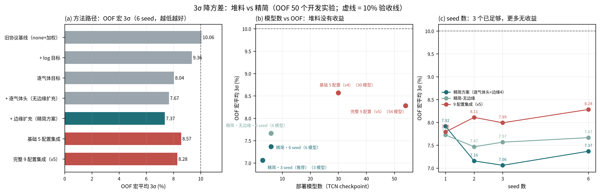

# 3σ 降方差方法总结、代码现状与精简建议

> 分支：`experiment/3sigma-edge-aug`  
> 数据口径：50 个开发实验 OOF（多 seed 预测层平均）；12 个锁定测试实验共读取 5 次，本文不新增读取  
> 注：本文是精简前的分析记录，精简后的实现与最终结果见 [`3sigma_精简方案_原理与实现.md`](3sigma_精简方案_原理与实现.md)。文中提到的 `--channels`、`--feature-mode raw_delta_rel`、`--gas-loss-weights`、`--sample-weight-powers`、`level_decision` 等已在精简提交中删除；如需复现这些实验，请回到精简前的 git 提交。  
> 原始结果：`artifacts/3sigma/ablation/method_ablation.json`；消融脚本随历史产物清理已删除，数字保留在 JSON 与 git 历史中。  
> 图（PNG+SVG）：`artifacts/3sigma/ablation/fig_3sigma_method_summary.{png,svg}`

## 0. 结论先行

1. **有效且值得保留的只有 4 件事**：
   - **逐气体目标变换**（H2 用 log、NH3 原空间、NO2 用 log）；
   - **逐气体输出头**（共享 TCN 主干 + 三气体各自小 MLP 头）；
   - **Ridge 混合 + 裁剪**（57 维手工特征、alpha=0.01、w=0.4、裁剪到开发集浓度范围）；
   - **多 seed 预测平均**（3 个 seed 已足够）。
2. **当前 v5 候选属于“堆料”**：9 个配置 × 6 seed = **54 个 TCN checkpoint** + Ridge + 裁剪，OOF 宏 3σ 为 **8.28%**；而把方法精简到**单配置 × 3 seed（3 个模型）**后，OOF 宏 3σ 反而降到 **7.06%**（逐气体 7.63 / 4.28 / 9.28，全部 <10%）。**多配置集成、宽 TCN、`raw_delta_rel`、NO2 损失权重、noise 0.2、样本加权都对 OOF 没有正收益**，可以去掉。
3. **精简后的方法链**（单配置）：噪声 0.1× + PCA-VAE 合成 3× → 逐气体目标 + 逐气体头 + 边缘浓度条件扩充 4× → 3 seed 平均 → Ridge 混合（w=0.4，alpha=0.01）→ 裁剪。OOF 7.06%，比 v5 少 18 倍模型、少 8 个配置、少 3 个结构开关，且**OOF 更好**。
4. **测试集情况**：v5（9 配置候选）测试宏 8.17%，逐气体 H2 10.60 / NH3 3.80 / NO2 10.10，仍未全部 <10%。**精简方案没有在现有 12 点测试集上评估**（已读 5 次，不应再读第 6 次）；其测试表现必须用新的独立锁定集验证，不能把 OOF 7.06% 直接当测试结论。



## 1. 指标与评估口径

```text
rel = 100 * (pred - true) / max(|true|, 1e-9)
3σ  = 3 * std(rel, ddof=1)          # 逐气体
宏平均 3σ = (3σ_H2 + 3σ_NH3 + 3σ_NO2) / 3
```

- OOF：50 个开发实验；同一配置先按 seed 在预测层平均，再算 3σ；
- 锁定测试：12 个实验，候选冻结后评估，每次读取都在
  [`误差方差优化_v2.md`](误差方差优化_v2.md) 披露（已 5 次）；
- 所有方法/超参选择只用 OOF，测试集不参与任何选择；
- 5% 目标从未达成（OOF 最好 NH3≈4.3%，测试 NH3 3.80%，其余气体距离 5% 较远）。

## 2. 用过的方法与效果总表

下表 OOF 数值默认是 **6 seed**（与最终候选一致）；标注“3 seed”的是早期筛选值，不可与 6 seed 直接混比。测试列只有 v4/v5 有正式评估。

### 2.1 数据增强类

| 方法 | 关键设置 | OOF 效果（宏 3σ） | 结论 / 现状 |
|---|---|---|---|
| 噪声增强 + PCA-VAE 合成 | `--noise-scale 0.1`、VAE 3×（组件 6、beta 0.1） | 所有配置默认使用 | **保留**（默认增强，本轮未单独重做“去掉”消融） |
| 仅噪声增强（无 VAE） | 合成比例 0 | 13.14%（3 seed） | 负结果，不采用 |
| VAE 合成 ×5 | `--synthetic-ratio 5` | 14.21%（3 seed） | 负结果，不采用 |
| 边缘浓度条件 VAE 扩充 | `--edge-copies 4/8`：训练折内对“任一气体处于最小/最大档位”的标签组合条件采样 | 逐气体目标：8.04% → 8.44%（单独用略差）；与逐气体头组合：7.67% → **7.37%**（−0.30） | **保留在精简方案**；单用无益，组合才有效 |
| 噪声尺度 0.2 | `--noise-scale 0.2`，log 目标 | 单配置 9.21% vs 9.36%（log_p0） | 无稳定收益，不进精简方案 |
| 低浓度样本加权 4,2,2 | `--sample-weight-powers 4 2 2` | 旧协议基线 none+加权 10.06% | 被 log/逐气体目标取代，不进精简方案 |
| EMA | 衰减 0.99 | 13.74%（3 seed） | 负结果，不采用 |

### 2.2 目标 / 损失类

| 方法 | 关键设置 | OOF 效果（宏 3σ） | 结论 / 现状 |
|---|---|---|---|
| log 目标 | `--target-transform log` | 旧协议 10.06% → **9.36%**（单配置）；TCN 13.92% → 11.89% | **保留**（以逐气体形式） |
| 逐气体目标 | `--target-transform log,none,log` | 9.36% → **8.04%**（单配置）；NH3 显著改善 | **保留（核心）** |
| NO2 损失权重 1,1,2 | `--gas-loss-weights 1 1 2` | 8.25% vs 8.04%（逐气体） | 无增益，不进精简方案 |
| 低浓度加权 + log | 加权 4,2,2 | 13.59%（3 seed） | 负结果，不采用 |

### 2.3 模型结构类

| 方法 | 关键设置 | OOF 效果（宏 3σ） | 结论 / 现状 |
|---|---|---|---|
| 宽 TCN | `--channels 32` | 12.13%（3 seed，log 目标，未进最终 9 配置） | 无增益，**不进精简方案** |
| 新特征模式 | `--feature-mode raw_delta_rel`（16/32 通道） | 12.07% / 12.17%（3 seed，未进最终 9 配置） | 无增益，**不进精简方案** |
| 逐气体输出头 | `--per-gas-head` | 逐气体目标+边缘4：7.37% vs 无头 7.67%（−0.30） | **保留（核心）** |
| 早停指标 | `--validation-metric three_sigma` | 全程使用（v1 起） | 保留 |

### 2.4 集成类

| 方法 | 关键设置 | OOF 效果（宏 3σ） | 结论 / 现状 |
|---|---|---|---|
| 多 seed 平均 | 1 / 2 / 3 / 6 seed | 7.92 / 7.16 / **7.06** / 7.37 | **保留 3 seed**（6 seed 无额外收益） |
| 多配置集成 | 5 配置（v4）/ 9 配置（v5） | 8.57% / 8.28% | **负收益，删除**（详见 §4） |
| 多特征模式混合集成 | 同一聚合器兼容多种 `--feature-mode` | 未产生正收益 | 不用于精简方案（代码能力保留） |

### 2.5 后处理类

| 方法 | 关键设置 | OOF 效果（宏 3σ） | 结论 / 现状 |
|---|---|---|---|
| Ridge 混合 | 57 维手工特征、log 目标、alpha=0.01、w=0.4 | 单配置 TCN 8.78% → **7.37%**；9 配置 10.05% → 8.28% | **保留（核心）** |
| 裁剪到开发浓度范围 | `--clip-to-development-range` | 7.84% → **7.37%**（精简）；8.79% → 8.28%（9 配置） | **保留（核心）** |
| 常规校准（缩放/加性/log 线性/仿射） | 交叉拟合 | 无稳定增益（诊断结论） | 不采用 |
| 离散档位吸附 | 取最近标定档位 | 3σ=0%（0/150、0/36 错档） | **不采用**：验收要求连续浓度回归 |

## 3. 当前代码 / v5 候选实际用了什么

### 3.1 v5 候选（测试集结果对应的版本）

文档/报告里 v5 = **9 个 TCN 配置 × 6 个 seed = 54 个 checkpoint** + Ridge + 裁剪：

| 配置 | 关键训练参数 |
|---|---|
| `log_p0` | log 目标 |
| `log_n02` | log 目标 + noise 0.2 |
| `none_pg422` | 无目标变换 + 低浓度样本加权 4,2,2（旧协议基线） |
| `pergas_p0` | 逐气体目标 `log,none,log` |
| `pergas_gw112` | 逐气体目标 + NO2 损失权重 1,1,2 |
| `pergas_edge4` | 逐气体目标 + 边缘扩充 4× |
| `pergas_edge8` | 逐气体目标 + 边缘扩充 8× |
| `pghead_log` | log 目标 + 逐气体头 |
| `pghead_pergas_edge4` | 逐气体目标 + 逐气体头 + 边缘扩充 4× |

所有配置共享：`--modes noise_gan --generator vae --vae-components 6 --vae-beta 0.1 --noise-scale 0.1 --synthetic-ratio 3.0 --validation-metric three_sigma`；每种配置训练 seed 20260923–28，预测层先按 seed 平均，再按配置平均。

推理/评估：`tcn_union/evaluation/hybrid_evaluate.py`，Ridge（57 维特征，测试端只用 50 个开发实验拟合）权重 **w=0.4**、alpha **0.01**，最后裁剪到开发集逐气体标签范围。

### 3.2 代码位置

| 能力 | 位置 |
|---|---|
| 目标变换 `--target-transform`、逐气体头 `--per-gas-head`、边缘扩充 `--edge-copies`、宽 TCN `--channels`、特征模式 `--feature-mode`、损失权重 `--gas-loss-weights`、多 seed `--final-seeds` | `tcn_union/training/gan_train.py`、`tcn_union/training/train.py` |
| VAE 条件采样 `sample(..., condition_labels=...)` | `tcn_union/augmentation/vae.py` |
| 逐气体头 / 通道宽度 | `tcn_union/core/model.py` |
| `raw_delta_rel` 特征 | `tcn_union/core/data.py` |
| Ridge 混合、裁剪、多特征模式集成 | `tcn_union/evaluation/hybrid_evaluate.py` |
| 配置选择、方法消融 | `artifacts/3sigma/scripts/search_ensemble_oof.py`、`ablate_3sigma_methods.py` |

### 3.3 成本

- v5：54 个 TCN checkpoint、14 个模型目录、9 套超参、6 个 seed；解释/复现/维护成本高；
- 精简方案：3 个 TCN checkpoint（3 seed）、1 套超参、1 个配置目录；
- 单模型本身很小（6/9 输入通道、宽度 16），算力不是主要问题，**复杂度主要来自“多配置 × 多 seed × 多结构开关”的组合爆炸**。

## 4. 效果拆解（OOF，6 seed，除注明外）

### 4.1 单配置：TCN vs TCN+Ridge+裁剪

| 配置 | TCN | +Ridge+裁剪 | 混合后 H2 / NH3 / NO2 |
|---|---:|---:|---|
| 旧协议基线 none+加权 | 13.92 | 10.06 | 10.75 / 9.10 / 10.33 |
| log 目标 | 11.89 | 9.36 | 9.06 / 9.96 / 9.05 |
| 逐气体目标 | 10.05 | 8.04 | 8.67 / 4.51 / 10.93 |
| 逐气体目标 + NO2 权重 | 9.98 | 8.25 | 8.90 / 5.68 / 10.16 |
| 逐气体目标 + 逐气体头 | 9.59 | 7.67 | 7.60 / 4.98 / 10.41 |
| 逐气体 + 逐气体头 + 边缘4 | 8.78 | **7.37** | **7.66 / 4.94 / 9.51** |
| 逐气体 + 边缘4 | 10.95 | 8.44 | 8.39 / 6.23 / 10.71 |
| 逐气体 + 边缘8 | 10.40 | 8.40 | 8.52 / 6.14 / 10.55 |
| log + 逐气体头 | 11.58 | 9.07 | 8.06 / 9.23 / 9.93 |
| log 目标 + noise 0.2 | 11.85 | 9.21 | 8.52 / 9.40 / 9.71 |

关键点：**逐气体头只在逐气体目标上才有正收益**（`pghead_log` 仍 9.07%）；边缘扩充单独用会略变差（8.04→8.44），但与逐气体头组合后到 7.37%。

### 4.2 堆叠路径（从旧协议到精简）

| 步骤 | 模型数 | TCN 宏 3σ | 混合宏 3σ | 逐气体（混合） |
|---|---:|---:|---:|---|
| 旧协议基线（none+加权） | 6 | 13.92 | 10.06 | 10.75 / 9.10 / 10.33 |
| + log 目标 | 6 | 11.89 | 9.36 | 9.06 / 9.96 / 9.05 |
| 逐气体目标 | 6 | 10.05 | 8.04 | 8.67 / 4.51 / 10.93 |
| + 逐气体头（无边缘） | 6 | 9.59 | 7.67 | 7.60 / 4.98 / 10.41 |
| + 边缘扩充（**精简方案**） | 6 | 8.78 | **7.37** | **7.66 / 4.94 / 9.51** |
| ← 对照：基础 5 配置集成 | 30 | 10.56 | 8.57 | 8.84 / 7.24 / 9.63 |
| ← 对照：完整 9 配置集成（v5） | 54 | 10.05 | 8.28 | 8.42 / 6.74 / 9.69 |

### 4.3 Ridge / 裁剪开关

| 设置 | 精简方案（6 seed） | 9 配置（6 seed） |
|---|---:|---:|
| 仅 TCN | 8.78 | 10.05 |
| TCN + Ridge（不裁剪） | 7.84 | 8.79 |
| TCN + Ridge + 裁剪 | **7.37** | **8.28** |

### 4.4 seed 数

| seed 数 | 精简方案模型数 | 精简方案宏 3σ | 精简-无边缘 | 9 配置 |
|---:|---:|---:|---:|---:|
| 1 | 1 | 7.92 | 7.73 | 7.79 |
| 2 | 2 | 7.16 | 7.47 | 8.11 |
| 3 | 3 | **7.06** | 7.57 | 7.99 |
| 6 | 6 | 7.37 | 7.67 | 8.28 |

单 seed 之间波动大（精简配置 6 个单 seed 的混合宏 3σ 在 7.9–10.5 之间），**3 seed 是推荐的最小值**；6 seed 并没有比 3 seed 更好，但更稳、更接近“部署时多 seed”的口径，可按算力选择。

### 4.5 精简组合：模型数 vs OOF

| 组合 | 模型数 | OOF 宏 3σ | H2 / NH3 / NO2 |
|---|---:|---:|---|
| 单配置：逐气体头（无边缘） | 6 | 7.67 | 7.60 / 4.98 / 10.41 → NO2 仍超 10% |
| **单配置：逐气体头 + 边缘4（推荐）** | 6 | **7.37** | **7.66 / 4.94 / 9.51** |
| 双配置：精简 + log | 12 | 8.10 | 8.23 / 7.06 / 9.03 |
| 三配置：精简 + log + 逐气体 | 18 | 7.92 | 8.23 / 6.01 / 9.50 |
| 基础 5 配置（v4） | 30 | 8.57 | 8.84 / 7.24 / 9.63 |
| 完整 9 配置（v5） | 54 | 8.28 | 8.42 / 6.74 / 9.69 |

**结论：多配置集成在本任务上是负收益**。加入弱配置会把强配置的尾部拉宽；OOF 上唯一全部 <10% 的简单组合就是单配置（逐气体目标 + 逐气体头 + 边缘4）+ Ridge + 裁剪。

### 4.6 Ridge 权重敏感性（精简方案，6 seed）

| w | 0.0 | 0.2 | 0.3 | **0.4** | 0.5 | 0.6 |
|---|---:|---:|---:|---:|---:|---:|
| 宏 3σ | 8.55 | 7.49 | 7.30 | **7.37** | 7.66 | 8.15 |

OOF 最优在 0.3 附近，0.4 与最优只差 0.07 pp；保留事先固定的 **w=0.4**（避免在 OOF 上继续调参）。

## 5. 精简建议

### 5.1 推荐方案（单配置，3 seed）

- 数据增强：噪声 0.1× + PCA-VAE 合成 3×（默认）；
- 模型/训练：10 s 因果 TCN（宽度 16）→ 逐气体目标 `log,none,log` + 逐气体输出头 + 边缘扩充 4×；
- 集成：3 个 seed 预测层平均；
- 后处理：Ridge（57 维特征，alpha=0.01，w=0.4）混合 + 裁剪到开发集浓度范围；
- OOF：**7.06%**（H2 7.63 / NH3 4.28 / NO2 9.28，全部 <10%）；6 seed 复核 7.37%；
- 规模：**3–6 个 TCN checkpoint**（对比 v5 的 54 个），1 套超参，1 个配置。

命令（OOF + 最终模型）：

```bash
for SEED in 20260923 20260924 20260925; do
  uv run --no-sync python -m tcn_union.training.gan_train \
    --manifest artifacts/splits/manifest.csv \
    --output-dir artifacts/3sigma/lean/seed_${SEED} \
    --device cuda --seed ${SEED} --oof-only \
    --modes noise_gan --generator vae --vae-components 6 --vae-beta 0.1 \
    --noise-scale 0.1 --synthetic-ratio 3.0 \
    --target-transform log,none,log --per-gas-head --edge-copies 4 \
    --validation-metric three_sigma
done

# 新锁定集评估时（不是现有 12 点测试集！）：
uv run --no-sync python -m tcn_union.training.gan_train ... \
  --final-seeds 20260923 20260924 20260925
uv run --no-sync python -m tcn_union.evaluation.hybrid_evaluate \
  --manifest artifacts/splits/manifest.csv \
  --model-dirs artifacts/3sigma/lean/noise_gan \
  --output-dir artifacts/3sigma/hybrid_eval_lean \
  --seeds 20260923 20260924 20260925 \
  --ridge-weight 0.4 --ridge-alpha 0.01 --clip-to-development-range
```

### 5.2 可进一步削减的选项

| 选项 | 影响 | 建议 |
|---|---|---|
| 去掉边缘扩充（只保留逐气体头） | 6 seed OOF 7.67%、NO2 10.41% 超线；3 seed OOF 7.57%、NO2 9.68% | 若不想引入“条件 VAE 采样”，可用；但 6 seed 复核下 NO2 会超线，不如保留边缘扩充稳 |
| 去掉逐气体头（仅逐气体目标） | OOF 8.04%，NO2 10.93% 超线 | 不建议 |
| 去掉 Ridge | OOF 8.78%，NO2 11.66% 超线 | 不建议（Ridge 是最便宜、收益最大的一步） |
| 去掉裁剪 | OOF 7.84%，仍有改善 | 可去，但裁剪无额外依赖，建议保留 |
| 单 seed | 单 seed 7.9–10.5 波动大 | 不建议；至少 3 seed |

### 5.3 建议删除/降级的东西（不再进入主线）

- 9 配置 × 6 seed 集成（v5）与 5 配置（v4）集成；
- 宽 TCN（`--channels 32`）与 `raw_delta_rel`（`--feature-mode raw_delta_rel`）；
- NO2 损失权重（`--gas-loss-weights 1 1 2`）、noise 0.2 配置、低浓度样本加权；
- 校准类后处理、离散档位吸附（后者违反连续回归要求，只保留为诊断）；
- 旧配置目录（除精简方案外）可保留在 artifacts 里复现历史，但文档/最终交付不再以它们为主线。

代码层面建议：**先不删实验开关**（它们已被历史实验引用，删了会破坏可复现性）；把“主线 recipe”和“实验选项”在文档/命令模板里分开即可。若后续确定不再做结构实验，再评估是否移除 `--channels`、`--feature-mode`、`--gas-loss-weights`。

### 5.4 测试集口径提醒

- v5 的测试结果是 9 配置候选：宏 8.17%（H2 10.60 / NH3 3.80 / NO2 10.10），逐气体未全部 <10%；
- 精简方案 **没有**在现有 12 点测试集上评估；如果现在去评，将是第 6 次读取，属于数据窥探。建议：**等新锁定集/新数据**，或由用户明确同意后只评一次并披露；
- 若后续补充了 H2=32000、NO2 低浓度、难例重复实验，精简方案（单配置 + Ridge + 裁剪）应作为首选基线，再比较其它结构。

## 6. 复现

```bash
# 方法消融汇总图（PNG+SVG；读取 ablation/method_ablation.json）
uv run --no-sync python artifacts/3sigma/scripts/plot_method_summary.py
```

产物：

- `artifacts/3sigma/ablation/method_ablation.json`：全部消融数字；
- `artifacts/3sigma/ablation/fig_3sigma_method_summary.{png,svg}`：三联图；
- 历史完整结果仍见 [`误差方差优化_v2.md`](误差方差优化_v2.md)。

## 7. 一句话总结

**当前 v5 用 54 个模型堆出 OOF 8.28%；把方法精简成“单配置（逐气体目标 + 逐气体头 + 边缘增强）+ 3 seed + Ridge + 裁剪”后，3 个模型就得到 OOF 7.06%（逐气体全部 <10%）——应精简，而不是继续加方法。**
