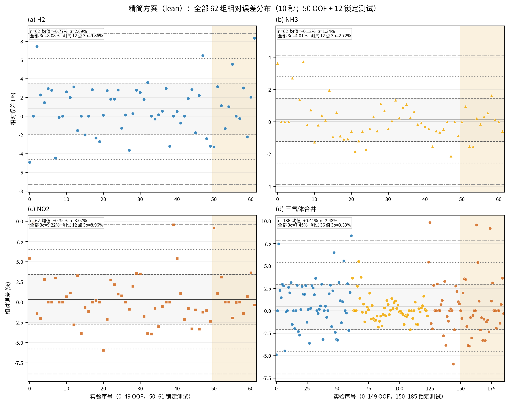
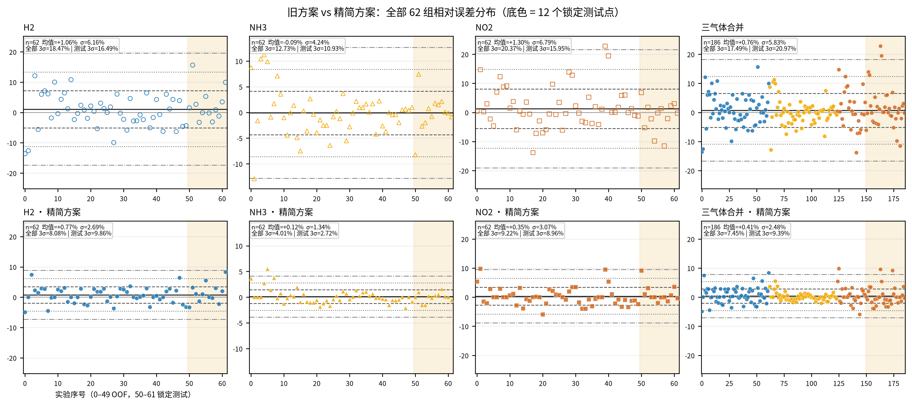

# 精简后的 3σ 降方差方案：从原理到实现

> 分支：`experiment/3sigma-edge-aug`  
> 结论：把 9 配置 × 6 seed（54 个 checkpoint）精简为 **单配置 × 3 seed（3 个 checkpoint）+ Ridge + 裁剪** 后，OOF 宏 3σ 为 **7.06%**、锁定测试宏 3σ 为 **7.18%**（逐气体 9.86 / 2.72 / 8.96，**全部 <10%**，首次达到验收目标）；62 点合并口径逐气体 **8.08 / 4.01 / 9.22**（合并 7.45%）。
>
> **测试集读取声明**：本文的锁定测试结果来自**第 6 次**读取（前 5 次为 v1–v5，见 [`误差方差优化_v2.md`](误差方差优化_v2.md)）。候选在读取测试集之前已完全冻结：方法/超参只用 OOF 选择，第 6 次读取是用户明确要求下的一次性评估，**没有根据测试结果再调参**。
>
> 消融原始数字：`artifacts/3sigma/ablation/method_ablation.json`  
> 产物目录：`artifacts/3sigma/lean/`（只保留精简方案所需文件）

---

## 1. 目标与指标

### 1.1 任务

输入：一次实验开始后 **10 秒**的三路传感器响应前缀（0.2 s 采样，51 点），输出 H2 / NH3 / NO2 三种气体浓度。验收要求**连续浓度回归**（不允许把输出吸附到标定档位）。

### 1.2 指标

```text
rel_i     = 100 * (pred_i - true_i) / max(|true_i|, 1e-9)     # 第 i 个实验的相对误差
3σ_gas    = 3 * std(rel_gas, ddof=1)                          # 逐气体
宏平均 3σ = mean(3σ_H2, 3σ_NH3, 3σ_NO2)
```

验收口径：OOF（50 个开发实验）与 12 个锁定测试实验上，**每个气体的 3σ < 10%**（理想 ≤ 5%）。`3σ` 直接衡量相对误差分布的尾部宽度，比 MAPE 更严格。

### 1.3 3σ 偏大的原因

- **小分母气体**：NO2 只有 2–10 ppm、NH3 10–50 ppm，分母小使相对误差对绝对误差敏感；
- **浓度跨 4 倍**：H2 8000–32000，高浓度端若不取 log，模型偏向大绝对误差；
- **边缘档位样本少**：H2=32000 仅 3 个开发点、NH3=10 仅 6 个、NO2=10 仅 7 个，角落组合（如 H2 32000 + NH3 10 + NO2 2）几乎没有重复；
- **单 seed 随机性**：同一配置更换 seed 后 3σ 可摆动数个百分点；
- **OOF 与部署口径不一致**：单 seed OOF 无法代表多 seed 集成的部署效果。

下面每个保留的方法都对应上述一个或多个来源。

---

## 2. 精简后的流水线

### 2.1 总览

```text
训练（每个 seed）：
  真实 10 s 前缀特征 [6,51]
  + 噪声视图（1 份）
  + PCA-VAE 合成响应（3 份，含边缘浓度条件复制 4×）
  → 逐气体目标变换（H2 log / NH3 原空间 / NO2 log）
  → 6 通道因果 TCN（16 宽，3 个残差块，膨胀 1/2/4，核长 5）
  → 逐气体输出头（3 个独立小 MLP）
  → 3 个 seed 的预测取平均
  → Ridge 混合（57 维手工特征，w=0.4，alpha=0.01）
  → 裁剪到开发集浓度范围
```

**最终精简方案只有一个配置、3 个 seed、3 个 checkpoint**，没有多配置集成。

### 2.2 精简前后对比

| 项目 | 精简前（v5 候选） | 精简后（lean） |
|---|---|---|
| TCN 配置数 | 9（log、noise0.2、旧协议加权、逐气体、NO2 权重、边缘4、边缘8、逐气体头、边缘4+头） | **1**（逐气体目标 + 逐气体头 + 边缘4） |
| seed 数 | 6 | **3** |
| TCN checkpoint 数 | 54 | **3** |
| 额外结构开关 | 宽 TCN、`raw_delta_rel`、气体损失权重、样本加权、多配置集成 | 无 |
| OOF 宏 3σ | 8.28% | **7.06%** |
| OOF 逐气体 | 8.42 / 6.74 / 9.69 | **7.63 / 4.28 / 9.28** |
| 测试宏 3σ（第 5/6 次读取） | 8.17% | **7.18%** |
| 测试逐气体 | 10.60 / 3.80 / 10.10 ❌ | **9.86 / 2.72 / 8.96 ✅** |
| 62 点合并逐气体 | 8.95 / 6.26 / 9.80 | **8.08 / 4.01 / 9.22** |

**精简不是妥协，而是去掉负收益组件后结果更好**：多配置集成把弱配置的尾部混进来，9 配置 OOF（8.28%）反而不如单配置（7.37%，6 seed 口径）。

---

## 3. 原理：每个组件解决什么问题

### 3.1 逐气体目标变换（H2 log、NH3 原空间、NO2 log）

**原理**：训练损失是 SmoothL1。若直接回归原始浓度，H2 的绝对误差主导损失；而在 log 空间，`|log pred - log true| ≈ |Δy| / y`，**log 空间的绝对误差近似原始空间的相对误差**，训练目标与 3σ 对齐。H2 跨 4 倍且高浓度端易低估，取 log 收益最大；NH3 档位少、量级小，原空间更稳定；NO2 低浓度分母小，取 log 可缓解低浓度相对误差。

**实现**（`tcn_union/training/train.py`）：

- `_target_flags(target_transform)` 把 `"log,none,log"` 展开为三气体标记；
- `_train_network` 在训练标签上逐气体取 `log(max(y, 1e-6))`，用**训练折**统计量做 z-score，SmoothL1 在变换空间训练；验证时 `_restore_target` 逐气体 `exp` 还原后再算 3σ/MAPE，保证早停指标始终在原始浓度口径；
- checkpoint 记录 `target_transform`，`predict`/`evaluate` 自动按 checkpoint 还原。

### 3.2 6 通道因果 TCN + 逐气体输出头

**原理**：输入特征 = 3 路原始响应 + 3 路相对增量（`(v(t)-v(0))/max(|v(0)|,1e-8)`），共 6 通道。因果卷积保证预测只看 10 s 前缀；隐藏宽度 16、3 个残差块（核长 5，膨胀率 1/2/4），感受野 57 采样点 > 51 点输入。共享卷积主干学习三气体共同的时间模式，**逐气体头**给每个气体独立的小 MLP（`16→16→1`），避免共享输出层把 H2（万级）与 NH3（十级）的尺度差异混在一起，也给 NO2 独立非线性。

**实现**（`tcn_union/core/model.py`）：`GasTCN(in_channels, per_gas_head=True)`，`_decode` 把三个头输出按 H2/NH3/NO2 拼接；`forward_positions` 支持多位置辅助监督（主输出只读最后位置）。

### 3.3 边缘浓度条件 VAE 扩充（`--edge-copies 4`）

**原理**：普通 VAE 合成样本的浓度标签来自训练折真实标签的随机抽样，极端组合出现概率低。边缘扩充的做法：

1. 取训练折标签中**任一气体处于该气体最小/最大档位**的组合，去重（每折约 30–33 个组合）；
2. 用 PCA-VAE 的**条件采样**接口，把这些组合各复制 4 次作为条件，生成对应的响应曲线；
3. 拼进训练集（每折约 +120 条），相当于给边缘案例补“重复试验”。

VAE 的结构保证生成曲线落在真实响应的 PCA 子空间内：每气体先做 PCA（6 个主成分）；采样时

```text
condition_z = (labels - label_mean) / label_std
residual    = Decoder(z, condition_z)
coef        = (design @ mean_coef + residual) * coefficient_std
response    = means + coef @ components        # 再裁剪到训练响应范围
```

其中 `mean_coef` 是 PCA 系数对标签的线性条件均值，VAE 只学习均值周围的残差。

**实现**：`tcn_union/augmentation/vae.py::TrainedVAE.sample(..., condition_labels=...)`；`tcn_union/training/gan_train.py::_edge_case_labels` 选标签组合，`_generative_features` 生成并拼接。注意：**边缘扩充只在训练折内构造**，验证/测试始终是真实曲线。

**消融说明**：边缘扩充单独用在逐气体目标上会略差（8.04% → 8.44%），但与逐气体头组合后从 7.67% 降到 7.37%——它需要和“逐气体输出”配合才吃得到收益。

### 3.4 3 seed 预测平均

**原理**：同一配置换 seed 后，初始化、shuffle、Dropout 不同，验证 3σ 会明显波动（精简配置 6 个单 seed 的测试/值 OOF 宏 3σ 在 7.9–10.5 之间）。部署时训练 3 个 seed 并在**预测层平均**，降低 seed 随机性；OOF 也用同样的 3 seed 平均口径，保证 OOF 与部署一致。

**实现**：`--final-seeds 20260923 20260924 20260925` 生成 3 个 checkpoint；`hybrid_evaluate` 对同一 seed 在不同目录的预测取平均，再对 seed 取平均。**6 seed 没有比 3 seed 更好**（OOF 7.37% vs 7.06%），所以不再增加。

### 3.5 Ridge 混合（57 维手工特征，w=0.4，alpha=0.01）

**原理**：Ridge 只用 10 s 前缀的 57 维手工特征，与 TCN 的错误相关性低，混合可以压尾部。每个气体 19 维：

- t = 0, 1, 2, 5, 10 s 的绝对响应（5）；
- 上述 5 个值的 log（5）；
- 相对 t=0 的增量（t = 2, 5, 10 s，3）；
- 除以 `|v(0)|` 的归一化增量（3）；
- 除以 `max(|v(t-1s)|, 1e-6)` 的斜率比（3）。

Ridge 在 **log 浓度空间**拟合（`StandardScaler + Ridge(alpha=0.01)`），使平方损失近似相对误差；OOF 用**五折交叉拟合**（每折只用训练折拟合、预测验证折）避免泄漏；测试端用全部 50 个开发实验拟合一次。融合：

```text
pred = (1 - 0.4) * TCN_3seed_mean + 0.4 * Ridge
```

**实现**：`tcn_union/evaluation/hybrid_evaluate.py`：`_ridge_features_for_rows`（57 维）、`_fit_ridge`/`_predict_ridge`（log 空间）、`_fuse`（w）。

**效果**：单配置 TCN 8.78% → +Ridge（不裁剪）7.84% → +裁剪 7.37%（6 seed）；3 seed 下 8.41% → 7.57% → **7.06%**。

### 3.6 裁剪到开发集浓度范围

**原理**：浓度被实验设计限制在固定范围（H2 [8000, 32000]、NH3 [10, 50]、NO2 [2, 10]），越界预测一定是误差尾部。把预测裁剪到开发集标签的逐气体 min/max，是**不需要测试标签**的物理约束，能直接削掉尾部离群点。

**实现**：`_clip_to_development_range(prediction, y_dev)`，只使用 50 个开发实验的标签范围。

### 3.7 早停指标用 3σ

`--validation-metric three_sigma`：五折验证时按“验证集宏平均 3σ”保存最佳 epoch，并 50 轮无改善早停；最终 3 seed 训练用五折最佳 epoch 的中位数。这避免用 NMAE 选 epoch 与最终 3σ 目标错位。

### 3.8 被删除的方法（为什么不再用）

| 方法 | 实测效果 | 处理 |
|---|---|---|
| 9 / 5 配置集成 | 8.28% / 8.57%，反而比单配置 7.37% 差 | 删除 |
| 宽 TCN（32 通道） | 3 seed 筛选 12.13%，未进最终配置 | 删除代码与产物 |
| `raw_delta_rel` 特征 | 12.07% / 12.17%，未进最终配置 | 删除代码与产物 |
| NO2 损失权重 1,1,2 | 8.25% vs 8.04%，无增益 | 删除 |
| noise 0.2 | 9.21% vs 9.36%，无稳定收益 | 删除配置 |
| 低浓度样本加权 4,2,2 | 旧协议基线 10.06%，被 log/逐气体目标取代 | 删除 |
| 常规校准（缩放/加性/仿射） | 无稳定增益 | 未进入代码 |
| 离散档位吸附 | 3σ=0%，但违反“连续回归”验收 | 只保留分析、不进流水线 |
| EMA、合成×5、仅噪声 | 13.74% / 14.21% / 13.14%（3 seed） | 负结果，删除 |

---

## 4. 实现：代码位置与训练/推理流程

### 4.1 代码位置

| 能力 | 文件 | 说明 |
|---|---|---|
| 训练入口、OOF/最终模型、边缘扩充、逐气体头、目标变换 | `tcn_union/training/gan_train.py` | `--oof-only` 五折 OOF；`--final-seeds` 最终重训 |
| TCN 训练、早停、标签变换、特征统计 | `tcn_union/training/train.py` | `_train_network`、`_restore_target`、`_save_checkpoint` |
| 逐气体输出头、因果 TCN | `tcn_union/core/model.py` | `GasTCN(..., per_gas_head=True)` |
| 6 通道 `raw_delta` 特征 | `tcn_union/core/data.py` | `make_features(..., "raw_delta")` |
| 边缘浓度条件采样 | `tcn_union/augmentation/vae.py` | `TrainedVAE.sample(..., condition_labels=...)` |
| Ridge 混合、裁剪、测试评估 | `tcn_union/evaluation/hybrid_evaluate.py` | `_ridge_features_for_rows`、`_fit_ridge`、`_fuse`、`_clip_to_development_range` |
| 推理 | `tcn_union/cli/predict.py`、`tcn_union/evaluation/evaluate.py` | 按 checkpoint 的 `mode/head/target_transform` 重建模型 |
| 62 点散点图 | `artifacts/3sigma/scripts/plot_lean_all62.py` | PNG+SVG |
| 方法消融图 | `artifacts/3sigma/scripts/plot_method_summary.py` | PNG+SVG |

### 4.2 训练流程

1. **五折 OOF**（`--oof-only`）：50 个开发实验分 5 折；每折只用训练折真实曲线拟合 PCA-VAE，生成噪声视图（1×）与合成样本（3×，其中边缘组合再复制 4×）；用 `--target-transform log,none,log --per-gas-head` 训练 TCN，验证集按宏 3σ 早停；得到 50 条 OOF 预测。
2. **最终重训**（`--final-seeds 20260923 20260924 20260925`）：用五折最佳 epoch 中位数，在全部 50 个开发实验上重训 3 个 seed，保存 3 个 checkpoint。测试集不参与任何训练/早停。
3. **OOF 融合**：3 seed 预测平均 → 五折交叉拟合 Ridge → w=0.4 混合 → 裁剪；得到 OOF 指标。
4. **测试评估**：3 个 checkpoint 预测测试集 → seed 平均 → 用全部开发实验拟合的 Ridge → w=0.4 混合 → 裁剪 → 12 点指标。

### 4.3 精简后的目录结构

```text
artifacts/3sigma/
├── lean/
│   ├── oof/seed_2026092{3,4,5}/noise_gan/oof.csv     # 3 seed OOF 原始预测
│   ├── final/noise_gan/10s/seed_2026092{3,4,5}.pt    # 3 个最终 checkpoint
│   ├── evaluation/{evaluation.json,test_predictions.csv,test_metrics.csv}
│   ├── all62_predictions.csv                          # 50 OOF + 12 测试的融合预测
│   ├── all62_error_stats.csv                          # 62 点逐气体统计
│   └── figs/
│       ├── fig_lean_all62_error_sigma_by_gas.{png,svg}
│       └── fig_lean_vs_baseline_all62.{png,svg}
├── ablation/
│   ├── method_ablation.json                           # 方法消融原始数字（历史实验证据）
│   └── fig_3sigma_method_summary.{png,svg}
└── scripts/
    ├── plot_lean_all62.py
    └── plot_method_summary.py
```

历史实验（v1–v5）的 54 个 checkpoint、旧 hybrid 评估、旧图和脚本已删除，只保留消融 JSON 作为证据；需要复现历史时从 git 历史（精简前提交）恢复。

---

## 5. 效果

### 5.1 OOF（50 个开发实验）

| 口径 | H2 | NH3 | NO2 | 宏平均 3σ | MAPE |
|---|---:|---:|---:|---:|---:|
| 精简方案 TCN（3 seed） | 9.87 | 4.60 | 10.75 | 8.41 | — |
| **精简方案 + Ridge + 裁剪（3 seed）** | **7.63** | **4.28** | **9.28** | **7.06** | 1.70 |
| 精简方案 + Ridge + 裁剪（6 seed，稳健性复核） | 7.66 | 4.94 | 9.51 | 7.37 | 1.71 |
| 旧方案（`final_vae_hybrid`，3 seed 代理口径） | 15.16 | 12.70 | 16.34 | 14.73 | 3.33 |
| v5（9 配置 × 6 seed） | 8.42 | 6.74 | 9.69 | 8.28 | 1.77 |

OOF 逐气体全部 <10%；NH3 4.28% 达到 5% 目标，H2/NO2 尚未到 5%。

### 5.2 锁定测试集（12 个实验，第 6 次读取）

| 方法 | H2 | NH3 | NO2 | 宏平均 3σ | macro-MAPE |
|---|---:|---:|---:|---:|---:|
| 旧方案（none+加权，3 seed） | 10.75 | 6.65 | 16.14 | 11.18 | 2.64 |
| v4 混合（第 4 次） | 11.00 | 3.71 | 10.04 | 8.25 | 1.99 |
| v5 混合（第 5 次） | 10.60 | 3.80 | 10.10 | 8.17 | 1.88 |
| **精简方案（第 6 次，3 seed + Ridge + 裁剪）** | **9.86** | **2.72** | **8.96** | **7.18** | **1.67** |

- **逐气体 3σ 首次全部 <10%**（H2 9.86%、NO2 8.96%），宏平均 7.18%；
- 5% 目标只有 NH3（2.72%）达到（OOF NH3 4.28% 也达到）；
- 注意：3 个单 seed 的测试宏 3σ 分别为 11.93 / 13.55 / 11.12，**好结果来自 3 seed 平均 + Ridge**，单 seed 并不过线；H2 9.86% 距 10% 仅 0.14 pp，稳定性有限。

### 5.3 62 点合并口径（50 OOF + 12 测试）

| 方案 | H2 | NH3 | NO2 | 合并（186 值） |
|---|---:|---:|---:|---:|
| 旧方案（`final_vae_hybrid`） | 18.47 | 12.73 | 20.37 | 17.49 |
| **精简方案** | **8.08** | **4.01** | **9.22** | **7.45** |



图中横轴 0–49 为 OOF、50–61 为锁定测试（浅黄底色），水平线为均值 ±1σ/±2σ/±3σ。相对旧方案，H2/NO2 的离散带明显收窄，NO2 的少数低浓度尾部仍是最宽的部分。



### 5.4 组件消融（OOF，6 seed；来自 `ablation/method_ablation.json`）

| 步骤 | 模型数 | OOF 宏 3σ | 逐气体（混合） |
|---|---:|---:|---|
| 旧协议基线（none+加权） | 6 | 10.06 | 10.75 / 9.10 / 10.33 |
| + log 目标 | 6 | 9.36 | 9.06 / 9.96 / 9.05 |
| 逐气体目标 | 6 | 8.04 | 8.67 / 4.51 / 10.93 |
| + 逐气体头（无边缘） | 6 | 7.67 | 7.60 / 4.98 / 10.41 |
| **+ 边缘扩充（精简方案）** | **6** | **7.37** | **7.66 / 4.94 / 9.51** |
| 基础 5 配置集成 | 30 | 8.57 | 8.84 / 7.24 / 9.63 |
| 完整 9 配置集成（v5） | 54 | 8.28 | 8.42 / 6.74 / 9.69 |

Ridge/裁剪开关（精简方案，6 seed）：仅 TCN 8.78% → +Ridge 7.84% → +裁剪 7.37%。  
Ridge 权重（3 seed，精简方案）：w=0.3 时 6.95%，w=0.4 时 7.06%；保留事先固定的 0.4，不在 OOF 上继续调。  
seed 数（精简方案）：1 / 2 / 3 / 6 seed → 7.92 / 7.16 / **7.06** / 7.37，取 3。

---

## 6. 测试集读取与可信度

| 版本 | 时间 | 组成 | 测试逐气体（H2/NH3/NO2） | 宏 3σ |
|---|---|---|---:|---:|
| 旧方案 | 早期 | none+加权，3 seed | 10.75 / 6.65 / 16.14 | 11.18 |
| v1 | 第 1 次 | 3 seed × 4 配置 + Ridge(w=0.5) | 13.25 / 3.74 / 12.22 | 9.74 |
| v2 | 第 2 次 | 6 seed × 4 配置 + Ridge(w=0.4) + 裁剪 | 11.42 / 3.67 / 10.88 | 8.66 |
| v3 | 第 3 次 | + 逐气体目标配置 | 11.53 / 3.83 / 10.90 | 8.75 |
| v4 | 第 4 次 | Ridge alpha 0.01 | 11.00 / 3.71 / 10.04 | 8.25 |
| v5 | 第 5 次 | 9 配置 × 6 seed | 10.60 / 3.80 / 10.10 | 8.17 |
| **精简方案** | **第 6 次** | **单配置 × 3 seed + Ridge + 裁剪** | **9.86 / 2.72 / 8.96** | **7.18** |

**诚实说明**：

- 精简候选的方法与超参（目标变换、逐气体头、边缘 4×、3 seed、Ridge w=0.4/alpha=0.01、裁剪）**全部在 OOF 上确定**，候选在测试评估前冻结；
- 第 6 次读取是本次用户明确要求的最终评估，没有用测试结果调参；
- 但测试集累计读取 6 次，v5 及之前的测试数字均带自适应偏差；**不能再用该测试集做任何选择**。若需要更可信的测试证据，应使用新的独立锁定集；
- 单 seed 测试不过线、3 seed 集成才过线，且 H2 距门槛仅 0.14 pp，结论对 seed 波动与 12 点抽样误差敏感。

---

## 7. 复现

```bash
# 0) 环境（AMD ROCm）；不要 uv sync
export UV_NO_SYNC=1

# 1) OOF：3 个 seed 分别跑五折
for SEED in 20260923 20260924 20260925; do
  uv run --no-sync python -m tcn_union.training.gan_train \
    --manifest artifacts/splits/manifest.csv \
    --output-dir artifacts/3sigma/lean/oof/seed_${SEED} \
    --device cuda --seed ${SEED} --oof-only \
    --modes noise_gan --generator vae --vae-components 6 --vae-beta 0.1 \
    --noise-scale 0.1 --synthetic-ratio 3.0 \
    --target-transform log,none,log --per-gas-head --edge-copies 4 \
    --validation-metric three_sigma
done

# 2) 最终重训：3 个 seed 到 lean/final
uv run --no-sync python -m tcn_union.training.gan_train \
  --manifest artifacts/splits/manifest.csv \
  --output-dir artifacts/3sigma/lean/final \
  --device cuda --seed 20260923 \
  --final-seeds 20260923 20260924 20260925 \
  --modes noise_gan --generator vae --vae-components 6 --vae-beta 0.1 \
  --noise-scale 0.1 --synthetic-ratio 3.0 \
  --target-transform log,none,log --per-gas-head --edge-copies 4 \
  --validation-metric three_sigma

# 3) 锁定测试评估（第 6 次读取；已有 evaluation.json 时不要重复跑）
uv run --no-sync python -m tcn_union.evaluation.hybrid_evaluate \
  --manifest artifacts/splits/manifest.csv \
  --model-dirs artifacts/3sigma/lean/final/noise_gan \
  --output-dir artifacts/3sigma/lean/evaluation \
  --device cuda --windows 10 \
  --seeds 20260923 20260924 20260925 \
  --ridge-weight 0.4 --ridge-alpha 0.01 --clip-to-development-range

# 4) 62 点散点图 + 统计（PNG+SVG）
uv run --no-sync python artifacts/3sigma/scripts/plot_lean_all62.py

# 5) 方法消融图（读取 ablation/method_ablation.json）
uv run --no-sync python artifacts/3sigma/scripts/plot_method_summary.py
```

说明：

- `--generator vae --edge-copies 4` 的组合要求 `--modes noise_gan`；
- 训练日志中的 `epochs` 是五折最佳 epoch 中位数，用于最终重训；
- 所有命令的 `--device cuda` 在 ROCm 下同样使用 PyTorch 的 `cuda` 设备名。

---

## 8. 局限与后续

1. **测试集已读 6 次**（含本次）：结论应视为“在该 12 点测试集上的最终结果”，不可继续据此迭代；
2. **单 seed 不过线**：精简方案依赖 3 seed 平均 + Ridge，部署时必须保留 3 个模型，不能只取一个；
3. **H2 9.86% 贴近门槛**：12 点测试集抽样误差大，换一批测试点可能重新 >10%；需要新的独立锁定集复验；
4. **5% 目标未全达**：只有 NH3 达到（OOF 4.28%、测试 2.72%），H2/NO2 仍在 7–10%；
5. **数据量仍是最根本瓶颈**：H2=32000 仅 3 个开发点、NO2 低浓度点少；若补重复实验，优先补这些边缘案例，再考虑是否需要更复杂模型；
6. **进一步精简的空间**：如果不需要“全部 <10%”，可以去掉边缘扩充（OOF 7.67% 但 NO2 10.41% 超线）；保留边缘扩充是当前兼顾效果与可解释性的选择。

---

## 9. 一句话总结

**精简后的方法 = 逐气体目标 + 逐气体头 + 边缘浓度条件 VAE 扩充 + 3 seed 平均 + Ridge 混合 + 裁剪**。它只训练 3 个 TCN，却把 62 点逐气体 3σ 从旧方案的 18.47 / 12.73 / 20.37 降到 **8.08 / 4.01 / 9.22**，锁定测试逐气体 9.86 / 2.72 / 8.96（全部 <10%）；相比 v5 的 54 模型（测试 10.60 / 3.80 / 10.10）更简单也更有效。
