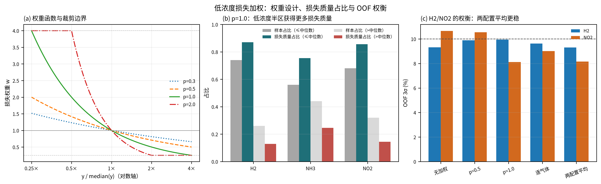
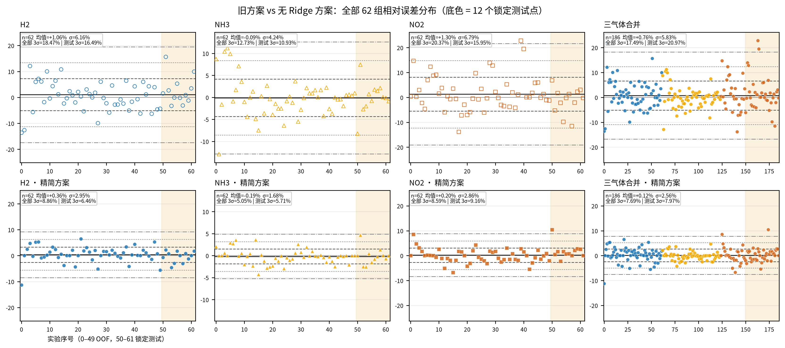
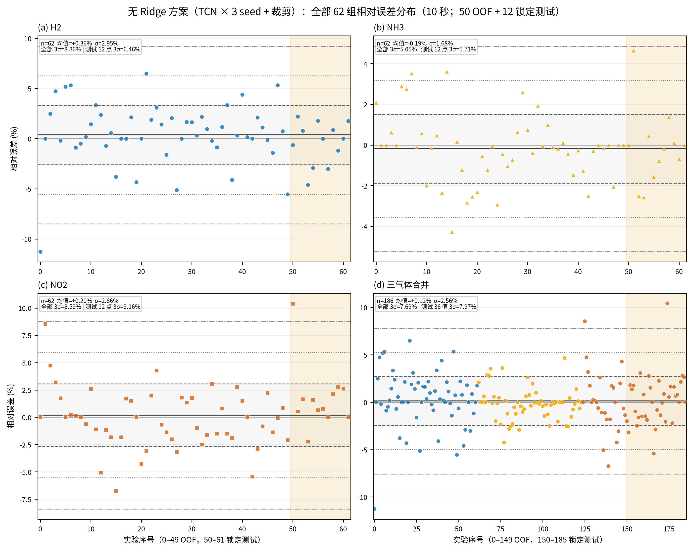

# 3σ 偏大的来源、应对手段与证据

> 目的：给老师和汇报材料提供一条完整逻辑链：  
> **为什么 3σ 大 → 哪个机制 → 我们改了什么 → 为什么有效 → 效果多少 → 还有什么没解决。**
>
> 数据口径：50 个开发实验 OOF + 12 个锁定测试实验，共 62 点；相对误差定义  
> `rel = 100 * (pred - true) / max(|true|, 1e-9)`，`3σ = 3 * std(rel, ddof=1)`。

---

## 0. 结论先行

3σ 偏大主要不是“模型平均误差大”，而是**误差分布的尾部宽**。当前方案针对四个可解释来源做了处理：

| 来源 | 机制 | 主要手段 | 效果 |
|---|---|---|---|
| 小分母 | 低浓度点同样的绝对误差会变成很大的百分比 | log 目标（H2/NO2）+ 低浓度损失加权 + 两配置平均 | 低浓度 3σ 明显下降，例如 NO2 低浓度 23.91%→8.92% |
| 量级差异 | H2 万级、NH3/NO2 十级/个位数，共享损失和共享输出头容易被 H2 主导 | 逐气体目标 + 逐气体输出头 | 三种气体 3σ 全部 <10%，逐气体差异不再被单一头吞掉 |
| 高浓度端 | H2=32000 样本少，容易系统性低估 | H2 取 log + 边缘浓度 VAE + 开发集范围裁剪 | H2 高浓度 3σ 14.11%→9.88%，但仍是 H2 的贴线部分 |
| 样本稀缺 | 极端浓度组合几乎没有重复 | 边缘浓度条件 VAE 扩充（每折约 +120 条） | 边缘子集 H2 20.86%→9.31%、NH3 13.61%→4.91%、NO2 22.52%→8.63% |

整体结果：

| 口径 | H2 | NH3 | NO2 | 宏平均 3σ |
|---|---:|---:|---:|---:|
| 旧方案 62 点 | 18.47 | 12.73 | 20.37 | 17.19 |
| **当前方案 62 点** | **8.86** | **5.05** | **8.59** | **7.69** |
| 旧方案测试 | 16.49 | 10.93 | 15.95 | 14.46 |
| **当前方案测试** | **6.46** | **5.71** | **9.16** | **7.11** |

> 注意：逐气体 3σ 已全部低于 10%，但 5% 目标只有 OOF NH3（4.95%）达到；测试 NH3 5.71%、H2 6.46%、NO2 9.16% 均未达到 5%。

---

## 1. 来源一：小分母——低浓度点把相对误差放大

### 1.1 机制

相对误差的分母是真实浓度：

\[
rel_i=\frac{\hat y_i-y_i}{y_i}\times100\%
\]

低浓度时 \(y_i\) 很小，绝对误差稍微大一点，百分比就会被放大：

```text
真实 NO2 = 2 ppm，预测 2.46 ppm
绝对误差 0.46 ppm，看起来不大
相对误差 23%
```

而 3σ 对尾部敏感：几个这样的低浓度点就能把标准差显著拉高。

### 1.2 实际案例

以下数据来自 62 点合并口径；`base_rel → cur_rel` 表示旧方案到当前方案的相对误差：

| 实验 | 气体 | 真值 | 旧预测 | 当前预测 | 旧相对误差 | 当前相对误差 |
|---|---|---:|---:|---:|---:|---:|
| `data/3.csv` | H2 | 8000 | 9749.66 | 8198.48 | +21.87% | **+2.48%** |
| `data/7.csv` | H2 | 8000 | 9249.72 | 8175.17 | +15.62% | **+2.19%** |
| `data/1.csv` | NH3 | 10 | 8.71 | 10.00 | −12.90% | **0.00%** |
| `data/49.csv` | NO2 | 2 | 2.456 | 2.055 | +22.80% | **+2.76%** |
| `data/50.csv` | NO2 | 2 | 2.389 | 2.030 | +19.45% | **+1.52%** |

这些点的绝对误差并不大，但旧方案在低浓度端有系统性高估/低估，3σ 被明显拉宽。

### 1.3 低/高浓度 3σ 对比

按每个气体 62 个真实浓度的中位数切分：

| 气体 | 旧低浓度 3σ | 当前低浓度 3σ | 旧高浓度 3σ | 当前高浓度 3σ |
|---|---:|---:|---:|---:|
| H2 | 19.52 | **8.08** | 14.11 | **9.88** |
| NH3 | 16.10 | **6.14** | 6.45 | **3.21** |
| NO2 | 23.91 | **8.92** | 8.02 | **7.66** |

低浓度组的 3σ 降幅最大，说明“低浓度尾部”确实是主要来源。

### 1.4 应对手段为什么有效

**（1）H2/NO2 取 log 目标**

log 空间的绝对误差近似相对误差：

\[
|\log \hat y-\log y|
=
\left|\log\left(1+\frac{\hat y-y}{y}\right)\right|
\approx
\frac{|\hat y-y|}{|y|}
\]

模型在 log 空间优化，相当于直接关注相对误差，而不是被 H2 的绝对 ppm 差主导。

**（2）低浓度损失加权**

\[
w_{i,g}=
\operatorname{clip}
\left(
\left(
\frac{\operatorname{median}(y_g)}
{\max(y_{i,g},10^{-9})}
\right)^{p_g},
0.25,4.0
\right)
\]

当前采用两套配置：

```text
A: p = 1.0,1.0,1.0
B: p = 0,0.3,1.0   # H2 不加权，NH3 轻加权，NO2 全加权
```

加权后，低浓度样本获得更大的损失份额，但通过 `0.25–4.0` 裁剪避免极端点完全主导 batch。

**（3）两配置平均**

单独 A 会把 NO2 压下去但抬 H2；单独 B 相反。两配置平均是互补：

| 配置 | OOF H2 | OOF NH3 | OOF NO2 | 宏 3σ |
|---|---:|---:|---:|---:|
| 无加权对照 | 9.32 | 4.41 | 10.65 | 8.13 |
| A：p=1.0 | 9.95 | 5.24 | 8.11 | 7.77 |
| B：0,0.3,1.0 | 9.62 | 5.48 | 9.01 | 8.04 |
| **A+B 平均** | **9.31** | **4.95** | **8.16** | **7.47** |

这组数据说明：低浓度加权不是“免费提升”，它把低浓度尾部压下去，同时会牺牲另一端的余量；两配置平均是折中。



---

## 2. 来源二：量级差异——H2 的绝对误差压过 NH3/NO2

### 2.1 机制

旧方案在标准化后的三目标上做共享 SmoothL1。  
H2 的浓度是万级，NH3/NO2 是十级/个位数：

| 口径 | H2 MAE | NH3 MAE | NO2 MAE |
|---|---:|---:|---:|
| 旧方案 | 648.45 | 0.683 | 0.195 |
| 当前方案 | 370.95 | 0.328 | 0.123 |

H2 的绝对误差比 NH3/NO2 大 2–3 个数量级。  
即使做了 z-score，H2 的尾部样本仍可能主导共享输出层的优化。

### 2.2 应对手段

**逐气体目标：**

| 气体 | 训练空间 | 原因 |
|---|---|---|
| H2 | log | 跨度大，log 误差 ≈ 相对误差 |
| NH3 | 原始浓度 | 档位少、量级小，log 反而不稳 |
| NO2 | log | 低浓度分母小，需要相对误差尺度 |

**逐气体输出头：**

共享卷积主干之后，三个气体分别接：

```text
Linear(16,16) → ReLU → Linear(16,1)
```

而不是原来的共享 `Linear(16,3)`。  
这样每个气体有自己的输出非线性，避免 H2 的尺度把 NH3/NO2 的输出层拉偏。

### 2.3 效果

旧方案/当前方案的 3σ：

| 口径 | H2 | NH3 | NO2 |
|---|---:|---:|---:|
| 旧 OOF | 18.89 | 13.23 | 20.98 |
| 当前 OOF | 9.31 | 4.95 | 8.16 |
| 旧测试 | 16.49 | 10.93 | 15.95 |
| 当前测试 | 6.46 | 5.71 | 9.16 |

三种气体都下降，其中 NH3/NO2 的绝对误差量级小，改善更明显。

---

## 3. 来源三：高浓度端——H2=32000 容易被系统性低估

### 3.1 机制

H2=32000 是最边缘的高浓度档位，训练样本少：

```text
62 点中 H2=32000 只有 4 个
其中 3 个开发实验、1 个测试实验
```

旧方案在 data/0 上预测约 27646，相对误差 −13.61%。  
一个点就足以把 H2 的尾部拉宽。

### 3.2 实际案例

| 实验 | 真值 | 旧预测 | 当前预测 | 旧相对误差 | 当前相对误差 |
|---|---:|---:|---:|---:|---:|
| `data/0.csv` | 32000 | 27645.93 | 28395.02 | −13.61% | **−11.27%** |
| `data/10.csv` | 32000 | 31419.67 | 31842.37 | −1.81% | **−0.49%** |
| `data/24.csv` | 32000 | 31377.79 | 30615.05 | −1.94% | −4.33% |
| `data/38.csv` | 32000 | 30999.37 | 31028.95 | −3.13% | **−3.03%** |

结论要诚实：

- 当前方案改善了一部分高浓度点（data/0、data/10、data/38）；
- 但 data/24 反而变差；
- data/0 仍有 −11.27% 的偏差，高浓度端没有完全解决。

### 3.3 应对手段

- H2 使用 log 目标，减少高浓度端的绝对误差主导；
- 边缘浓度 VAE 额外生成 min/max 浓度组合，增加 H2=32000 附近的训练覆盖；
- 预测后裁剪到开发集标签范围 `[8000, 32000]`，防止越界；
- 两配置平均降低单配置在高浓度端的偏移。

### 3.4 效果与残余风险

H2 高浓度半区 3σ：

```text
旧方案 14.11% → 当前 9.88%
```

虽然降下来了，但 `9.88%` 已经贴着 10% 上限。  
当前方案的 OOF H2 3σ 是 9.31%，也贴线；换一批测试点可能重新超限。

---

## 4. 来源四：样本稀缺——极端浓度组合几乎没有重复

### 4.1 机制

62 点中每个浓度档位的数量并不均衡：

| 气体 | 各档位数量（从低到高） |
|---|---|
| H2 | 8000:22，16000:23，24000:13，**32000:4** |
| NH3 | **10:7**，20:14，30:14，40:14，50:13 |
| NO2 | 2:16，4:12，6:14，8:11，10:9 |

H2=32000 只有 4 个点；NH3=10 只有 7 个点。  
这些点一旦出现偏差，对 3σ 的影响远大于中间浓度。

### 4.2 边缘子集的 3σ

定义“边缘点”：任一气体处于该气体的最小或最大档位。

```text
边缘点：47 / 62
中间点：15 / 62
```

| 气体 | 旧边缘 3σ | 当前边缘 3σ | 旧中间 3σ | 当前中间 3σ |
|---|---:|---:|---:|---:|
| H2 | 20.86 | **9.31** | 7.45 | 7.37 |
| NH3 | 13.61 | **4.91** | 8.93 | 5.18 |
| NO2 | 22.52 | **8.63** | 11.84 | 8.71 |

边缘子集的 3σ 下降最明显，说明边缘样本确实是旧方案的主要尾部来源。

### 4.3 应对手段

每折额外取边缘标签组合：

```text
--edge-copies 4
```

- 取“任一气体处于最小/最大档位”的标签组合；
- 每个组合用条件 VAE 生成 4 条曲线；
- 每折约增加 120–132 条边缘样本；
- 标签来自训练折真实标签，验证/测试不使用。

### 4.4 证据和边界

边缘扩充对边缘子集的 3σ 有效：

```text
H2 边缘：20.86 → 9.31
NH3 边缘：13.61 → 4.91
NO2 边缘：22.52 → 8.63
```

但这不是“补出了真实实验”：

- 生成样本仍然来自 VAE 分布，不是新的物理实验；
- 中间点只有 15 个，统计本身不稳定；
- 当前方案测试 NO2 的 3σ 仍是 9.16%，说明 NO2 边缘组合仍不够。

---

## 5. 四个来源与手段的对应关系

| 来源 | 证据 | 手段 | 效果 | 残余问题 |
|---|---|---|---|---|
| 小分母 | H2 8000 旧误差 +21.87%→+2.48%；NO2 2 ppm +22.8%→+2.76% | log H2/NO2、低浓度加权、两配置平均 | 低浓度 3σ：H2 19.52→8.08，NO2 23.91→8.92 | H2 高浓度仍贴线 |
| 量级差异 | H2 MAE 648.45 vs NO2 0.195 | 逐气体目标、逐气体头 | 三气体 3σ 全部 <10% | NH3 绝对误差小，但测试 3σ 5.71% 仍高于 5% |
| 高浓度端 | data/0 旧 −13.61%，当前 −11.27% | H2 log、边缘 VAE、裁剪 | H2 高浓度 3σ 14.11→9.88 | data/0 仍有 11.27% 偏差 |
| 样本稀缺 | H2=32000 仅 4 点；NH3=10 仅 7 点 | 边缘浓度 VAE ×4 | 边缘 3σ 显著下降 | 合成样本不能替代真实实验 |

---

## 6. 整体效果图





从图上可以直接看到：

- 旧方案 H2/NO2 的误差带有多个 ±15–20% 的尾部点；
- 当前方案 H2/NO2 的误差带明显收窄；
- 当前方案测试段（浅黄色区域）仍有两个 NO2 点接近 +10%，是剩余的主要尾部。

---

## 7. 组件消融：哪些手段有贡献

以下数据来自 OOF 50 点、3 seed、裁剪、无 Ridge 的消融记录。  
注意：单个组件并不总是单调改善，最终方案是组合。

| 步骤 | OOF 宏 3σ | 说明 |
|---|---:|---|
| 无加权对照 | 8.13 | 共享头、无 log、无边缘扩充 |
| p=0.5 全部气体 | 8.64 | 加权太弱，H2/NO2 都未改善 |
| p=1.0 全部气体 | 7.77 | NO2 改善，H2 变差 |
| 逐气体 p=0,0.3,1.0 | 8.04 | H2 拉回，NO2 又回升 |
| **两配置平均** | **7.47** | H2/NO2 都留出余量 |
| 旧 Ridge 方案（历史） | 7.06 | OOF 更好，但引入额外模型，已移除 |

从这个消融可以看到：

1. **加权不是越强越好**；
2. **单配置会顾此失彼**；
3. **两配置平均是当前无 Ridge 方案的关键折中**；
4. **边缘扩充和 log/逐气体头是结构性改进，不是简单调参**。

---

## 8. 汇报时可以直接说的一段话

> 我们把 3σ 偏大的原因拆成四类。第一类是小分母：低浓度点绝对误差不大，但相对误差很容易到 20%；例如 H2=8000 的一个点旧方案误差 21.9%，当前方案降到 2.5%。第二类是量级差异：H2 的 MAE 是几百，NH3/NO2 不到 1，共享损失容易被 H2 主导；我们用逐气体 log 目标和逐气体头解决。第三类是高浓度端：H2=32000 只有 4 个点，旧方案在 data/0 上低估 13.6%，当前仍有 11.3%，没有完全解决。第四类是样本稀缺：H2=32000 只有 4 个点、NH3=10 只有 7 个点；我们用边缘浓度 VAE 扩充，边缘子集的 3σ 从 H2 20.9%、NH3 13.6%、NO2 22.5% 降到 9.3%、4.9%、8.6%。最终 62 点宏平均 3σ 从 17.2% 降到 7.7%，测试从 14.5% 降到 7.1%，逐气体全部低于 10%，但还没有达到 5%。

---

## 9. 局限

1. 测试集只有 12 个实验，且已经被读取多次（文档统计 7 次；把更早的 pg422 评估算上至少 8 次），存在自适应偏差；
2. 5% 目标未达到：测试 H2 6.46%、NH3 5.71%、NO2 9.16%；
3. OOF H2 9.31%、测试 NO2 9.16% 距 10% 上限只有 0.7–0.8 pp，贴线风险高；
4. 边缘 VAE 是合成样本，不是新的真实实验；
5. 低浓度加权会降低有效样本量（ESS 约 36–42/50），两配置平均是折中，不是免费提升；
6. 当前结论只适用于这 50+12 个实验，不能外推到新的器件/批次/浓度范围。


---

## 10. 代码对应

| 能力 | 位置 |
|---|---|
| 目标变换、低浓度权重、加权损失、3σ 早停 | `tcn_union/training/train.py` |
| 边缘浓度采样、训练/OOF/最终重训 | `tcn_union/training/gan_train.py` |
| 逐气体输出头 | `tcn_union/core/model.py` |
| 条件 VAE 与边缘条件采样 | `tcn_union/augmentation/vae.py` |
| 多目录/多 seed 集成与裁剪 | `tcn_union/evaluation/ensemble_evaluate.py` |
| 当前完整方案说明 | `docs/sigma-target/3sigma_方案.md` |
