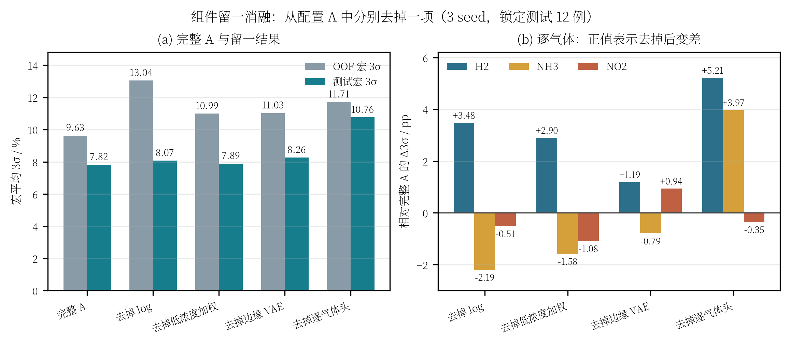

# 四组件留一消融：log 目标、低浓度加权、边缘浓度 VAE、逐气体头

> 目的：分别回答四个组件“在当前配置 A 中到底贡献了什么”，并展示最终组合的效果。
>
> 结论先行：**逐气体头的整体收益最大；log 目标主要救 H2；边缘 VAE 对 H2/NO2 有稳定收益；低浓度加权是“用均值换尾部”的组件，测试宏 3σ 几乎持平，但 OOF 和 H2 尾部明显受益。四个组件不是均匀提升，而是各自解决不同气体的不同误差。**

---

## 1. 实验设计：留一法

以当前**配置 A**为完整模型：

| 项目 | 设置 |
|---|---|
| 数据 | 50 个开发实验 / 12 个锁定测试实验 |
| 输入 | 10 s `raw_delta`，6×51 |
| 增强 | 测量噪声 0.1× + PCA-VAE 3× |
| 目标空间 | `log,none,log` |
| 低浓度加权 | 三气体 `p=1.0` |
| 边缘 VAE | 4× |
| 输出头 | 逐气体头 |
| 训练 | 5 折 OOF；3 seed（20260923/24/25）；3σ 早停 |
| 测试 | 3 seed 集成后裁剪到开发集逐气体范围 |

每次只去掉一个组件：

| 变体 | 唯一改动 |
|---|---|
| 完整 A | 不变 |
| 去掉 log | `--target-transform none` |
| 去掉低浓度加权 | `--low-conc-power 0` |
| 去掉边缘 VAE | `--edge-copies 0` |
| 去掉逐气体头 | 不传 `--per-gas-head` |

> 注意：这是**留一法**，不是从头逐项相加。组件之间有交互，所以“每项单独贡献”不能直接相加成最终总收益。
>
> 另：完整 A 的测试 7.82% 高于最终六 checkpoint 的 7.11%；最终方案是 A+B 两配置平均，本表固定 A 以隔离组件，不与最终集成数字混用。

---

## 2. 总表

| 变体 | OOF 宏 3σ / % | 测试宏 3σ / % | 测试 NMAE / % | 测试 MAPE / % |
|---|---:|---:|---:|---:|
| **完整 A** | **9.63** | **7.82** | 1.402 | 1.874 |
| 去掉 log | 13.04（+3.41） | 8.08（+0.26） | 1.660 | 2.218 |
| 去掉低浓度加权 | 10.99（+1.36） | 7.89（+0.08） | **1.173** | 1.933 |
| 去掉边缘 VAE | 11.03（+1.40） | 8.26（+0.45） | 1.397 | 2.057 |
| 去掉逐气体头 | 11.71（+2.08） | 10.76（+2.95） | 1.669 | 2.420 |

括号内为相对完整 A 的变化；正值表示**去掉后变差**。



图：(a) 完整 A 与四个留一结果的宏 3σ；(b) 测试逐气体 3σ 相对完整 A 的变化，正值表示去掉后变差。

---

## 3. 逐气体测试 3σ

| 变体 | H2 | NH3 | NO2 | 宏平均 |
|---|---:|---:|---:|---:|
| **完整 A** | **6.82** | **6.36** | 10.27 | **7.82** |
| 去掉 log | 10.30 | **4.17** | 9.76 | 8.08 |
| 去掉低浓度加权 | 9.72 | 4.78 | 9.18 | 7.89 |
| 去掉边缘 VAE | 8.01 | 5.57 | 11.21 | 8.26 |
| 去掉逐气体头 | 12.04 | 10.33 | 9.92 | 10.76 |

这张表比宏平均更能说明问题：

- 四个组件**都主要在压 H2**；去掉任何一个，H2 都会变差；
- 去掉 log/加权/边缘 VAE 时，NH3 或 NO2 反而会变好；
- 逐气体头对 H2/NH3 都是明显改善，但 NO2 反而略差；
- 完整 A 是四者折中后的结果，不是每一项都“单独最优”。

---

## 4. 四个组件分别解决什么

### 4.1 log 目标：主要救 H2，代价是 NH3

去掉 log 后：

- H2 测试 3σ：6.82% → **10.30%**（+3.48 pp）；
- NH3：6.36% → **4.17%**（−2.19 pp）；
- NO2：10.27% → 9.76%（−0.51 pp）；
- OOF 宏 3σ：9.63% → 13.04%（+3.41 pp）。

log 的作用是让 H2 的优化目标近似相对误差，压高浓度端的低估。它的收益集中在 H2；代价是 NH3 本来在原空间更稳，换成 log 后反而尾部变宽。

所以 log 不是“对所有气体都好”，而是**针对 H2 的相对误差结构**；当前保留 H2/NO2 log、NH3 原空间，就是这个折中。

### 4.2 低浓度损失加权：用均值换尾部

去掉低浓度加权后：

- H2 测试 3σ：6.82% → 9.72%（+2.90 pp）；
- NH3：6.36% → 4.78%（−1.58 pp）；
- NO2：10.27% → 9.18%（−1.09 pp）；
- 测试宏 3σ：7.82% → 7.89%（+0.08 pp，几乎持平）；
- OOF 宏 3σ：9.63% → 10.99%（+1.36 pp）；
- 但测试 NMAE：1.402% → **1.173%**（去掉后反而更好）。

这组结果很典型：

- 低浓度加权把损失质量挪到小分母样本，**压 H2 的 3σ 尾部**；
- 但整体平均误差（NMAE）会变差，NH3/NO2 也会被牵连；
- 在 12 个测试实验上，宏 3σ 的收益只有 0.08 pp，不能声称“测试集上显著更好”；
- 它在 OOF 和 H2 上的收益更明确，最终保留它主要是为了 H2 的尾部余量。

所以低浓度加权不是“越强越好”的普适提升，而是**有明确代价的尾部定向工具**。

### 4.3 边缘浓度 VAE：对 H2/NO2 有稳定收益

去掉边缘 VAE 后：

- H2：6.82% → 8.01%（+1.19 pp）；
- NH3：6.36% → 5.57%（−0.79 pp）；
- NO2：10.27% → **11.21%**（+0.94 pp）；
- 宏 3σ：7.82% → 8.26%（+0.45 pp）；
- OOF 宏 3σ：9.63% → 11.03%（+1.40 pp）。

边缘 VAE 补充的是稀疏浓度组合（如 H2=32000、NO2 高低端），所以它对 H2/NO2 的尾部帮助更明显；NH3 的浓度档位本身较均匀，额外边缘样本反而可能带来一点分布偏移。

这是四个组件里**测试宏 3σ 收益最稳定**的一个（+0.45 pp），但同样不是对所有气体都正收益。

### 4.4 逐气体输出头：整体收益最大

去掉逐气体头后：

- H2：6.82% → 12.04%（+5.22 pp）；
- NH3：6.36% → 10.33%（+3.97 pp）；
- NO2：10.27% → 9.92%（−0.35 pp）；
- 测试宏 3σ：7.82% → **10.76%**（+2.95 pp）；
- OOF 宏 3σ：9.63% → 11.71%（+2.08 pp）。

逐气体头是四个组件里对宏平均帮助最大的：共享输出层会把 H2 的尾部读出压力传给 NH3，拆成三路独立输出头后 H2/NH3 都明显改善。

但 NO2 反而略好，说明“独立头”也不是对每个气体都无代价；NO2 的测试样本少，独立头的方差可能更大。

---

## 5. 排序与最终展示

### 5.1 按测试宏 3σ 的收益排序

| 组件 | 去掉后测试宏 3σ 变化 | 主要受益气体 |
|---|---:|---|
| 逐气体头 | +2.95 pp | H2、NH3 |
| 边缘 VAE | +0.45 pp | H2、NO2 |
| log 目标 | +0.26 pp | H2 |
| 低浓度加权 | +0.08 pp | H2（但均值变差） |

### 5.2 按 OOF 宏 3σ 的收益排序

| 组件 | 去掉后 OOF 宏 3σ 变化 |
|---|---:|
| log 目标 | +3.41 pp |
| 逐气体头 | +2.08 pp |
| 边缘 VAE | +1.40 pp |
| 低浓度加权 | +1.36 pp |

OOF 和测试的排序不完全一致，说明：

- log 在 50 个开发实验上收益很大，但测试上被 NH3/NO2 的 trade-off 抵掉一部分；
- 逐气体头在 OOF 和测试上都稳定；
- 边缘 VAE 的测试收益比 OOF 小，但仍为正；
- 低浓度加权在 OOF 上有效，测试宏 3σ 几乎持平，是四个里最“依赖口径”的组件。

### 5.3 四个组件组合后的效果

完整 A 相对“去掉任一组件”的结果：

| 指标 | 完整 A | 最差留一变体 |
|---|---:|---:|
| OOF 宏 3σ | **9.63%** | 13.04%（去掉 log） |
| 测试宏 3σ | **7.82%** | 10.76%（去掉逐气体头） |
| 测试 NMAE | 1.402% | — |
| 测试 MAPE | **1.874%** | 2.420%（去掉逐气体头） |

当前最终六 checkpoint（A+B 集成）为测试宏 3σ **7.11%**、MAPE **1.67%**；本表固定 A，用于证明四个组件各自的贡献，不能把 7.82% 当成最终方案成绩。

---

## 6. 结论的边界

1. 这是**单配置 A、单次固定划分**的留一消融；测试只有 12 个实验；
2. 低浓度加权的测试宏 3σ 收益仅 0.08 pp，不能写成“测试集显著提升”；它的证据主要在 OOF 和 H2 尾部；
3. 每个组件都有气体间的 trade-off：log 伤 NH3，边缘 VAE 伤 NH3，逐气体头伤 NO2，低浓度加权伤 NMAE；
4. 四个组件不能简单相加解释，留一法只回答“在完整 A 中去掉它会怎样”；
5. 若要进一步做严谨的统计结论，需要更多 seed、重复划分或嵌套交叉验证。

---

## 7. 产物与复现

| 内容 | 路径 |
|---|---|
| 指标汇总 | `artifacts/component_ablation/component_ablation.csv` |
| 图 | `artifacts/component_ablation/fig_component_ablation.png` / `.svg` |
| 无 log 训练 | `artifacts/component_ablation/no_log/` |
| 无低浓度加权训练 | `artifacts/component_ablation/no_weight/` |
| 无边缘 VAE 训练 | `artifacts/component_ablation/no_edge/` |
| 无逐气体头训练 | `artifacts/per_gas_head_ablation/shared/` |
| 绘图脚本 | `tcn_union/plot_component_ablation.py` |

三个新变体的训练命令（在配置 A 基础上去掉对应项）：

```bash
COMMON="--manifest artifacts/splits/manifest.csv \
  --modes noise_gan --generator vae \
  --vae-components 6 --vae-beta 0.1 \
  --noise-scale 0.1 --synthetic-ratio 3.0 \
  --validation-metric three_sigma \
  --final-seeds 20260923 20260924 20260925"

# 去掉 log
.venv/bin/python -m tcn_union.training.gan_train $COMMON \
  --output-dir artifacts/component_ablation/no_log \
  --target-transform none --low-conc-power 1.0 --edge-copies 4 --per-gas-head

# 去掉低浓度加权
.venv/bin/python -m tcn_union.training.gan_train $COMMON \
  --output-dir artifacts/component_ablation/no_weight \
  --target-transform log,none,log --low-conc-power 0 --edge-copies 4 --per-gas-head

# 去掉边缘 VAE
.venv/bin/python -m tcn_union.training.gan_train $COMMON \
  --output-dir artifacts/component_ablation/no_edge \
  --target-transform log,none,log --low-conc-power 1.0 --edge-copies 0 --per-gas-head
```

测试评估与汇总图：

```bash
for name in no_log no_weight no_edge; do
  .venv/bin/python -m tcn_union.evaluation.ensemble_evaluate \
    --manifest artifacts/splits/manifest.csv \
    --model-dirs artifacts/component_ablation/$name/noise_gan \
    --output-dir artifacts/component_ablation/${name}_eval \
    --windows 10 --clip-to-development-range
done

.venv/bin/python -m tcn_union.plot_component_ablation
```
