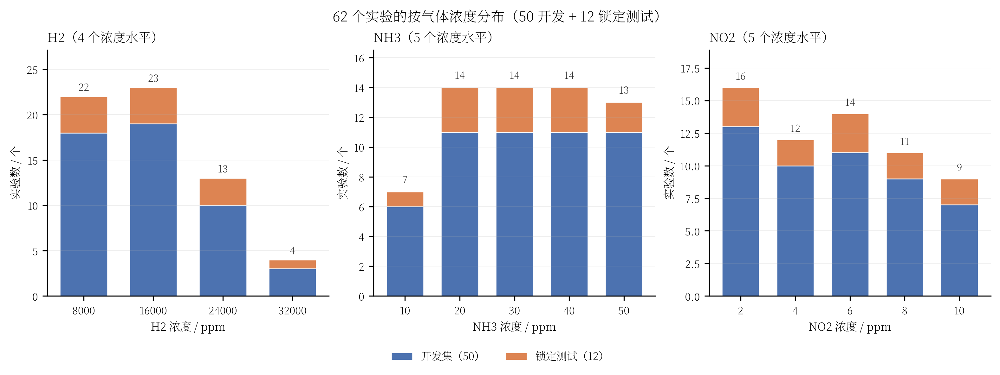

# 62 个实验的浓度分布与锁定测试覆盖

> 口径：本文的“62 个实验”指项目当前使用的 62 个实验级样本，即 **50 个开发实验 + 12 个锁定测试实验**。
> 每个实验对应一个 `data/<id>.csv` 文件；浓度取文件中的实验设计标签 `conc1/conc2/conc3`（对应 H2/NH3/NO2），不是传感器响应值。
> 划分来自 `artifacts/splits/manifest.csv`，测试集是固定的 12 个实验。

## 1. 结论先行

- **H2 范围**：8000–32000 ppm，共 4 个浓度水平（8000、16000、24000、32000）。
- **NH3 范围**：10–50 ppm，共 5 个浓度水平（10、20、30、40、50）。
- **NO2 范围**：2–10 ppm，共 5 个浓度水平（2、4、6、8、10）。
- 62 个实验是 **4×5×5=100** 个可能浓度组合中的 62 个，且 62 个组合互不重复。
- 12 个锁定测试实验的浓度范围与完整 62 个实验相同；**三气体的所有浓度水平都在测试集中出现过**。
- 但测试集在每个水平上的数量不均：H2=32000 只有 **1 个**测试实验，NH3=10 也只有 **1 个**；这两个水平上的测试结论要特别谨慎。
- 测试集不是“全新浓度水平的外推”，而是 **同一组浓度水平上的新组合外推**：12 个测试组合与 50 个开发组合没有重复。

## 2. 按气体的总体范围与水平

| 气体 | 单位 | 最小值 | 最大值 | 浓度水平数 | 水平列表 |
|---|---|---:|---:|---:|---|
| H2 | ppm | 8000 | 32000 | 4 | 8000、16000、24000、32000 |
| NH3 | ppm | 10 | 50 | 5 | 10、20、30、40、50 |
| NO2 | ppm | 2 | 10 | 5 | 2、4、6、8、10 |

## 3. 62 个实验的逐水平数量

| 气体 | 浓度水平 | 全部 62 个 | 开发集 50 个 | 锁定测试 12 个 |
|---|---:|---:|---:|---:|
| H2 | 8000 | 22 | 18 | 4 |
| H2 | 16000 | 23 | 19 | 4 |
| H2 | 24000 | 13 | 10 | 3 |
| H2 | 32000 | 4 | 3 | **1** |
| NH3 | 10 | 7 | 6 | **1** |
| NH3 | 20 | 14 | 11 | 3 |
| NH3 | 30 | 14 | 11 | 3 |
| NH3 | 40 | 14 | 11 | 3 |
| NH3 | 50 | 13 | 11 | 2 |
| NO2 | 2 | 16 | 13 | 3 |
| NO2 | 4 | 12 | 10 | 2 |
| NO2 | 6 | 14 | 11 | 3 |
| NO2 | 8 | 11 | 9 | 2 |
| NO2 | 10 | 9 | 7 | 2 |



> 图：蓝色为 50 个开发实验，橙色为 12 个锁定测试实验；柱顶数字为该浓度的全部实验数。

## 4. 12 个锁定测试实验的浓度组合

| 测试文件 | H2 / ppm | NH3 / ppm | NO2 / ppm |
|---|---:|---:|---:|
| `data/2.csv` | 16000 | 10 | 6 |
| `data/7.csv` | 8000 | 20 | 2 |
| `data/15.csv` | 16000 | 20 | 6 |
| `data/20.csv` | 16000 | 20 | 10 |
| `data/23.csv` | 24000 | 30 | 2 |
| `data/27.csv` | 24000 | 30 | 4 |
| `data/31.csv` | 8000 | 30 | 8 |
| `data/38.csv` | 32000 | 40 | 2 |
| `data/41.csv` | 24000 | 40 | 4 |
| `data/46.csv` | 16000 | 40 | 8 |
| `data/55.csv` | 8000 | 50 | 6 |
| `data/60.csv` | 8000 | 50 | 10 |

## 5. 有哪些浓度出现在测试集中

| 气体 | 测试集中出现的浓度水平 | 测试实验数 |
|---|---|---:|
| H2 | 8000、16000、24000、32000（全部 4 个水平） | 12 |
| NH3 | 10、20、30、40、50（全部 5 个水平） | 12 |
| NO2 | 2、4、6、8、10（全部 5 个水平） | 12 |

因此：

- 从“浓度水平覆盖”看，测试集覆盖了所有设计浓度，没有完全没见过的 H2/NH3/NO2 浓度。
- 从“浓度组合覆盖”看，测试集只覆盖 100 个可能组合中的 12 个；62 个实验总共覆盖 62 个组合。
- 12 个测试组合与 50 个开发组合**没有重复**，所以测试集检验的是组合层面的泛化，而不是新浓度水平的纯外推。

## 6. 对评估解释的影响

1. **H2=32000 的测试结论最脆弱**：12 个锁定测试中只有 `data/38.csv` 一个点，不能据此对 32000 ppm 的整体性能下强结论。
2. **NH3=10 也只有 1 个测试点**（`data/2.csv`），低 NH3 浓度的测试误差同样受单点影响。
3. **H2=24000、NH3=20/30/40 等水平有 3 个测试点**，相对更稳，但仍不足以做细粒度浓度段结论。
4. 由于浓度水平在开发/测试中都出现、只有组合不重复，模型不是完全外推到新浓度；汇报时应表述为“组合级留出测试”，不要表述成“全新浓度范围外推”。
5. 前面 3σ 和逐气体指标按 12 个测试实验计算，受这 12 个组合的具体抽样影响；尤其 H2=32000 和 NH3=10 两个单点水平。

## 7. 复现

- 浓度标签来源：`data/*.csv` 的 `conc1/conc2/conc3` 列；
- 划分来源：`artifacts/splits/manifest.csv`（50 development / 12 test）；
- 本文数据表：`artifacts/data_distribution/concentration_distribution.csv`；
- 绘图脚本：`tcn_union/visualization/plot_data_distribution.py`；
- 重新生成：

```bash
.venv/bin/python -m tcn_union.visualization.plot_data_distribution
```

脚本默认读取 `artifacts/3sigma_noridge/all62_predictions.csv` 中的真实浓度列和 `source` 字段；该文件的 62 行与 manifest 的 50+12 划分一致。
