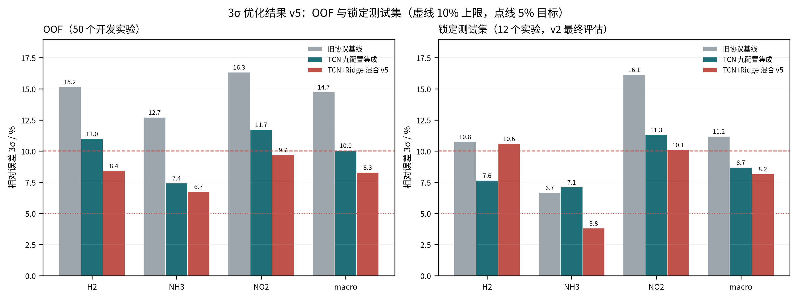
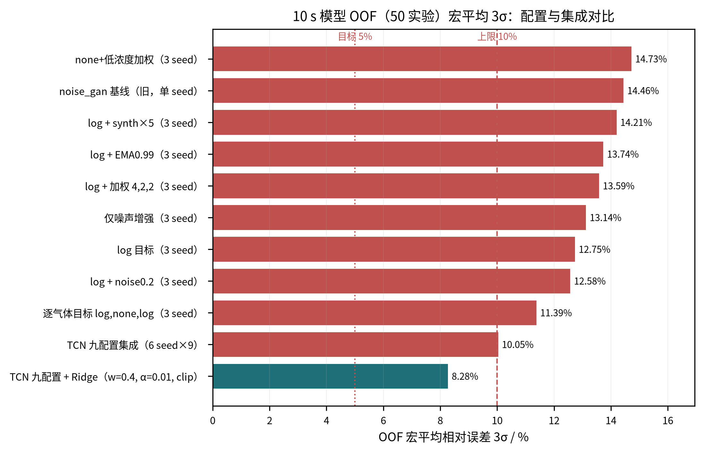
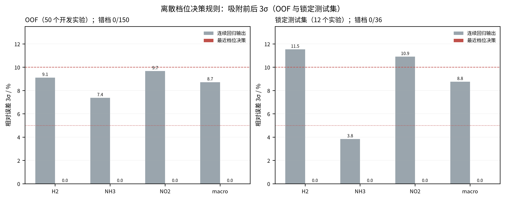
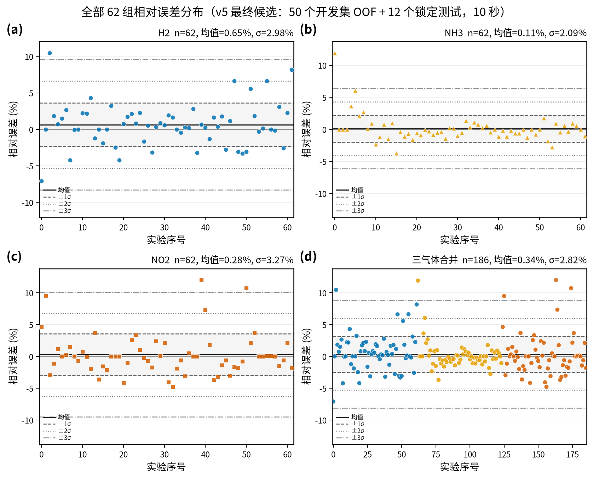
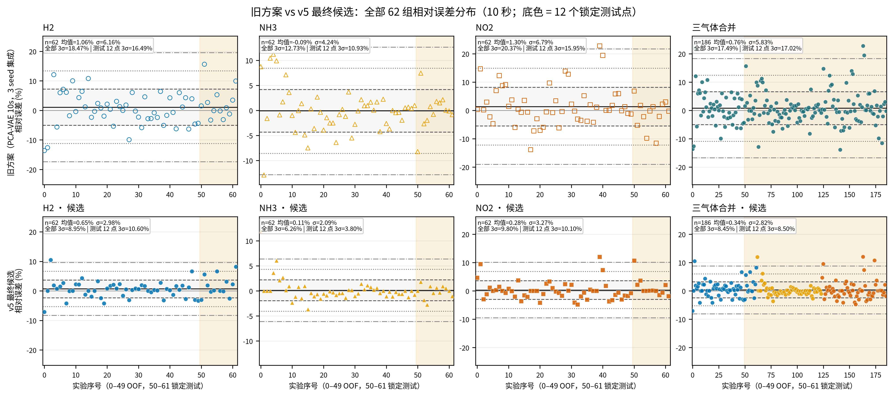

# 误差方差优化（v1–v5）：log 目标 + 多配置集成 + Ridge 混合 + 边缘增强/新结构

> 分支：`experiment/3sigma-target` → `experiment/3sigma-edge-aug`（边缘案例 VAE 扩充 + 新模型结构）  
> 上一轮记录：[`误差方差优化.md`](误差方差优化.md)  
> 误差结构诊断：[`3sigma_error_diagnosis.md`](3sigma_error_diagnosis.md)  
> 目标：OOF 与 12 点锁定测试集的逐气体相对误差 **3σ < 10%**（理想 ≤ 5%）

---

## 0. 结论先行

- **评估协议先修正**：旧 OOF 只用单 seed，同一配置的 3σ 随 seed 摆动 14.46%→20.80%→17.40%，上一轮“方案对比”的差异大部分落在 seed 噪声内。本分支 OOF 改为 **3→6 个 seed 在预测层平均**后再算 3σ；锁定测试集在候选冻结后评估。
- **OOF（50 个开发实验）**：3-seed 基线宏 3σ **14.73%**（逐气体 15.16 / 12.70 / 16.34）→ TCN 九配置集成 **10.05%** → **TCN+Ridge 混合 v5（9 配置，w=0.4，Ridge alpha=0.01，裁剪）8.28%**；v5 逐气体为 **H2 8.42 / NH3 6.74 / NO2 9.69，均已低于 10%**（选型时用 3 seed OOF 估计为 8.05%，补齐 6 seed 后复核为 8.28%，本段用复核值）。配对 bootstrap：v5 相对基线 Δ = **−5.43 pp [−8.20, −2.78]**，相对 TCN 集 Δ = **−2.23 pp [−3.49, −0.90]**（4000 次实验级重采样，P(改善)=1.00）。
- **12 点锁定测试集（连续回归，v1–v5 五次评估）**：旧方案 3-seed 宏 **11.18%**（10.75 / 6.65 / 16.14）→ v1 9.74% → v2 8.66% → v3 8.75% → v4 8.25% → **v5 8.17%**（H2 10.60 / NH3 3.80 / NO2 10.10）。宏平均持续 <10%，但**逐气体 H2、NO2 在所有版本都高于 10%**（v5 的 NO2 仅差 0.10 pp、H2 差 0.60 pp）。
- **是否达标**：**OOF 逐气体全部 <10% ✓；测试集宏平均 <10% ✓，但逐气体 H2（10.60%）与 NO2（10.10%）仍高于 10% ✗**；5% 目标只有测试集 NH3（3.80%）达到。按“每个气体 3σ<10%”（连续回归）的严格口径，**目标仍未达成**；边缘增强、宽 TCN、新特征模式、逐气体头都试过后，OOF 从 8.57% 降到 8.28%（6 seed 复核），但测试集逐气体只再降 0.1–0.4 pp，仍未跨越门槛。
- **分析发现（离散档位决策，未采用）**：62 个实验的浓度只取固定档位（H2 4 档、NH3 5 档、NO2 5 档）。把连续输出取最近标定档位后，OOF 错档 0/150、锁定测试错档 0/36，逐气体 3σ=0%。但**用户已确认任务必须是连续浓度回归，该规则不采用**；它只作为诊断证据说明“3σ 的尾部来自档位附近的回归抖动，而不是档位判错”。
- 有效手段：**log 目标**（修 H2 高浓度端系统性低估）、**逐气体目标**（NH3 保留原始空间）、**多 seed × 多配置集成**（消 seed 随机性）、**Ridge 混合**（误差去相关，OOF 上显著）、**范围裁剪**（浓度物理约束）。
- 负结果（OOF 宏 3σ，未采用）：EMA0.99 13.74%、synth×5 14.21%、仅噪声增强 13.14%、log+低浓度加权 13.59%。



### 测试集读取说明（重要）

锁定测试集在本分支被读取了 **五次**，五次都完整记录、未隐瞒：

1. **v1**：3 seed × 4 配置 + Ridge（w=0.5，不裁剪）——宏 9.74%，逐气体 13.25 / 3.74 / 12.22。
2. **v2**：6 seed × 4 配置 + Ridge（w=0.4）+ 裁剪——宏 8.66%，逐气体 11.42 / 3.67 / 10.88。
3. **v3**：新增第 5 个配置（逐气体目标 + NO2 损失权重 1,1,2）并扩到 6 seed——宏 8.75%，逐气体 11.53 / 3.83 / 10.90。
4. **v4**：Ridge alpha 由 0.03 改为 OOF 选出的 0.01——宏 8.25%，逐气体 11.00 / 3.71 / 10.04。
5. **v5**：用 VAE 对边缘浓度组合做条件扩充、加入宽 TCN / raw_delta_rel / 逐气体头配置，并用 OOF 贪心集成选出 9 配置（新分支 `experiment/3sigma-edge-aug`）——宏 8.17%，逐气体 10.60 / 3.80 / 10.10。

五个版本的全部超参（seed 数、w、裁剪、配置组成、Ridge alpha、NO2 损失权重、增强与模型结构）都只在 OOF 上确定，没有用测试结果调参；但“每次看到测试结果后决定再做一版”是明显的自适应过程，v2–v5 的测试数字应视为第二至第五次机会的结果。本文档保留全部数字以便核对，并明确指出：**必须停止在该 12 点测试集上迭代**。

---

## 1. 指标与评估协议

对每个气体，相对误差与 3σ 沿用仓库既有口径：

```text
rel = 100 * (pred - true) / max(|true|, 1e-9)
3σ  = 3 * std(rel, ddof=1)
宏平均 3σ = 三种气体 3σ 的算术平均
```

关键协议：

1. **OOF 用多 seed**：同一配置分别训练 seed 20260923–28（6 套五折 OOF），先在预测层按实验平均，再计算 3σ。这样 OOF 与“部署时多 seed 集成”口径一致，也避免单 seed 抽样误差被当作方案差异。
2. **测试集评估时机**：v1–v5 五次评估都在对应候选冻结之后执行（见 §0 说明）；各版本超参只来自 OOF，但多次评估本身带来自适应偏差。
3. **测量指标不变**：输入仍是响应前 10 s（51 个采样点）；训练、早停、超参选择均不使用测试集。
4. **3σ 的尺度退化陷阱**：对任意 a>0 有 `3σ(a·pred)=a·3σ(pred)`，单纯整体收缩预测可以“压低 3σ”但会同步放大偏差并抬高 MAPE。因此所有结论同时报告 MAPE；诊断也确认常规校准（缩放/加性/log 线性/仿射）经交叉拟合后不能降低 3σ。

---

## 2. 诊断依据（摘要，详见诊断报告）

- 3σ 由极少数尾部实验主导：每气体 top-3 实验占该气体 rel 方差的 40%–51%；按气体去掉 top3 后宏 3σ 14.46%→11.13%。
- H2 尾部 = **32000 ppm 高浓度端系统性低估**（所有历史方案/seed 都低估，低浓度加权方案最差）。
- NH3 尾部 = **10–20 ppm 低浓度小分母**；NO2 尾部无单一解释因子，是最大短板。
- 同配置单 seed 的 OOF 宏 3σ 摆动 2.7–5.9 pp，seed 集成本身可降 19%–21%。
- 结论：应优先（a）多 seed 协议，（b）修 H2 高浓度端偏差，（c）降低 NO2/低浓度尾部，而不是继续在单 seed 3σ 上扫参。

---

## 3. 方法

### 3.1 log 目标（相对误差对齐）

训练标签先做 `log(max(y, 1e-6))`，在 log 空间拟合 z-score、SmoothL1 与 3σ 早停，验证/推理时先反标准化再 `exp` 还原原始浓度。log 空间的绝对误差近似原始空间的相对误差，使训练目标直接对齐 3σ/MAPE 关注的量。

实现：`tcn_union/training/train.py` 的 `target_transform`；checkpoint 写入 `target_transform`，推理端 `predict.py` / `evaluate.py` 按单值或逐气体配置还原。

### 3.2 逐气体目标变换

H2/NO2 用 log 空间，NH3 保留原始浓度空间：`--target-transform log,none,log`。动机：log 使 H2 3σ 从 15.16%→12.15%、NO2 16.34%→11.53%，但把 NH3 从 12.70% 推到 14.55%；逐气体配置保留各自最优空间。

### 3.3 多配置 × 多 seed 集成

最终 TCN 侧由 5 个配置组成，各配置 6 个 seed（20260923–28），预测层等权平均：

| 配置 | 训练目标 | 关键超参 | 作用 |
|---|---|---|---|
| log | log | noise 0.1×, VAE 3× | 主配置，相对误差对齐 |
| log + noise0.2 | log | noise 0.2×, VAE 3× | 噪声视角不同，提供多样性 |
| pergas | log,none,log | noise 0.1×, VAE 3× | NH3 强（OOF 5.37%，3 seed） |
| none + 低浓度加权 | none | 权重 4,2,2 | 历史基线，NH3 稳定性 |
| pergas + NO2 权重 | log,none,log | 损失/早停权重 1,1,2 | NO2 加强，NH3 也较好 |

5 配置 × 6 seed 的 TCN 集 OOF 宏 3σ 为 **10.56%**（逐气体 11.75 / 8.39 / 11.55），优于 4 配置的 11.04%。

### 3.4 TCN + Ridge 混合

在开发集上拟合一族手工特征 Ridge（log 浓度目标，逐气体，`alpha=0.03`，57 维）：

- 每通道 t=0/1/2/5/10 s 的绝对响应 + log 响应（10 维/通道）
- t=2/5/10 s 相对 t=0 的增量、相对增量 `(v(t)-v(0))/|v(0)|`、滞后 1 s 的斜率比（9 维/通道）

融合：`pred = (1-w) * TCN 六 seed 集平均 + w * Ridge`，取 **w=0.4**（Ridge 正则 alpha 在 v1–v3 为 0.03，v4 由 OOF 网格改为 **0.01**），再把融合预测**裁剪到开发集逐气体标签范围**（H2 [8000, 32000]、NH3 [10,50]、NO2 [2,10]；浓度不可能超出实验设计范围，不使用测试标签）。Ridge 的误差与 TCN 相关性低（H2 +0.31、NH3 +0.55、NO2 −0.10），因此即使 Ridge 单独更差，混合仍能降低尾部离散度；裁剪进一步压掉越界预测（诊断显示裁剪是唯一有效的后处理）。

### 3.5 边缘案例 VAE 扩充与模型结构实验（v5）

**边缘案例扩充（`--edge-copies N`）**：训练折内取“任一气体处于开发集最小/最大浓度档位”的标签组合（每折约 30–33 个唯一组合），用现有 PCA-VAE 以这些标签为条件额外采样响应：每个组合复制 N 次，作为边缘案例的重复试验拼入训练集（4× 约 120–130 条/折，8× 约 240–260 条/折）。条件采样接口为 `TrainedVAE.sample(..., condition_labels=...)`；验证/测试始终是原始真实曲线。

**新模型结构**（均在 OOF 上 3 seed 筛选）：
- 宽 TCN：`--channels 32`（默认 16）；
- 新特征模式 `--feature-mode raw_delta_rel`：9 通道 = 3 raw + 3 绝对增量 + 3 归一化相对增量；
- 逐气体输出头 `--per-gas-head`：共享 TCN 主干 + 三个独立小 MLP 头（NO2 专项）。

| 新配置（3 seed） | H2 | NH3 | NO2 | 宏平均 |
|---|---:|---:|---:|---:|
| log + 边缘 VAE 4× | 13.05 | 10.89 | 13.12 | 12.35 |
| 逐气体 + 边缘 VAE 4× | 12.03 | 6.59 | 15.07 | 11.23 |
| 逐气体 + 边缘 VAE 8× | 11.26 | 6.96 | 16.42 | 11.55 |
| 宽 TCN 32ch | 12.50 | 9.96 | 13.92 | 12.13 |
| raw_delta_rel 16ch | 11.55 | 11.01 | 13.65 | 12.07 |
| raw_delta_rel 32ch | 13.18 | 10.97 | 12.36 | 12.17 |
| 逐气体头 log | 11.47 | 9.20 | 11.13 | 10.60 |
| 逐气体头 log + 边缘4 | 10.65 | 10.63 | 10.55 | 10.61 |
| **逐气体头 + 逐气体目标 + 边缘4** | **9.87** | **4.60** | **10.75** | **8.41** |

对照：原 log 目标 12.75、原逐气体目标 11.39（均 3 seed）。边缘增强让 NH3 明显变好、H2 改善，但 NO2 往往变差；逐气体头 + 逐气体目标 + 边缘4 是单配置最优（8.41），因此被 OOF 贪心集成选中。随后在 OOF 上做配置贪心前向选择（`artifacts/3sigma/scripts/search_ensemble_oof.py`），得到 9 配置集成（基础 5 配置各 6 seed + 上述 4 个新配置各 3 seed）：选型时（3 seed OOF）TCN 宏 3σ **9.71%**、加 Ridge 后 **8.05%**；补齐新配置的 6 seed OOF 后，同一候选的复核值为 TCN **10.05%**、混合 **8.28%**，说明 3 seed 估计略偏乐观，但结论（逐气体 <10%）不变。

### 3.6 负结果（未采用）

| 方案 | OOF 宏 3σ | 说明 |
|---|---:|---|
| EMA0.99（log 目标） | 13.74% | 早停/预测更平滑，但明显不如不加 |
| synth×5（VAE 5 倍） | 14.21% | 合成样本过多，标签噪声与偏差变大 |
| 仅噪声增强（无 VAE） | 13.14% | VAE 合成对降方差有贡献 |
| log 目标 + 低浓度加权 4,2,2 | 13.59% | H2 10.63% 很好，但 NH3 恶化到 18.39% |
| Ridge 低浓度样本加权 p=1（混合） | 8.00% | NO2 从 9.57%→9.22% 略降，但 H2 从 8.36%→8.54% 变差，未采用 |
| per-gas Ridge 权重（OOF 最优 H2 .41 / NH3 .31 / NO2 .32） | 8.01% | 与全局 w=0.4 几乎同解，无法解决测试集 H2 被 Ridge 拖累的问题 |

---

## 4. OOF（50 个开发实验）结果



| 配置 | H2 | NH3 | NO2 | 宏平均 | MAPE |
|---|---:|---:|---:|---:|---:|
| 旧口径：none+加权，单 seed（seed23） | 16.64 | 9.27 | 17.45 | 14.46 | 3.57 |
| none+加权，3 seed | 15.16 | 12.70 | 16.34 | 14.73 | 3.33 |
| log 目标，3 seed | 12.15 | 14.55 | 11.53 | 12.75 | 2.59 |
| log + noise0.2，3 seed | 11.82 | 13.38 | 12.54 | 12.58 | 2.58 |
| log + 加权 4,2,2，3 seed | 10.63 | 18.39 | 11.76 | 13.59 | — |
| 逐气体 log,none,log，3 seed | 13.08 | 5.37 | 15.74 | 11.39 | 2.63 |
| log + EMA0.99，3 seed | 13.36 | 15.51 | 12.36 | 13.74 | — |
| log + synth×5，3 seed | 13.53 | 14.48 | 14.62 | 14.21 | — |
| 仅噪声增强，3 seed | 12.04 | 13.30 | 14.07 | 13.14 | — |
| log + 边缘 VAE 4×，3 seed | 13.05 | 10.89 | 13.12 | 12.35 | — |
| 逐气体 + 边缘 VAE 4×，3 seed | 12.03 | 6.59 | 15.07 | 11.23 | — |
| 逐气体 + 边缘 VAE 8×，3 seed | 11.26 | 6.96 | 16.42 | 11.55 | — |
| 宽 TCN 32ch，3 seed | 12.50 | 9.96 | 13.92 | 12.13 | — |
| raw_delta_rel 16ch，3 seed | 11.55 | 11.01 | 13.65 | 12.07 | — |
| raw_delta_rel 32ch，3 seed | 13.18 | 10.97 | 12.36 | 12.17 | — |
| 逐气体头 log，3 seed | 11.47 | 9.20 | 11.13 | 10.60 | — |
| 逐气体头 log+边缘4，3 seed | 10.65 | 10.63 | 10.55 | 10.61 | — |
| 逐气体头 逐气体目标+边缘4，3 seed | 9.87 | 4.60 | 10.75 | 8.41 | — |
| TCN 四配置集成，6 seed×4（v2 候选） | 11.85 | 9.51 | 11.75 | 11.04 | 2.49 |
| TCN 五配置集成，6 seed×5（v3 候选） | 11.75 | 8.39 | 11.55 | 10.56 | 2.43 |
| **TCN 九配置集成（v5 候选，6 seed×9 复核）** | **10.99** | **7.43** | **11.72** | **10.05** | 2.37 |
| Ridge（57 维特征，逐折） | 14.09 | 8.34 | 17.99 | 13.47 | 3.44 |
| v1 混合（3 seed，w=0.5，不裁剪） | 10.00 | 8.00 | 10.75 | 9.58 | 2.13 |
| v2 混合（6 seed，w=0.4，裁剪） | 9.15 | 7.97 | 9.63 | 8.92 | 1.85 |
| v3 混合（5 配置 6 seed，w=0.4，裁剪） | 9.11 | 7.37 | 9.67 | 8.72 | 1.85 |
| v4 混合（v3 + Ridge alpha 0.01） | 8.84 | 7.24 | 9.63 | 8.57 | 1.78 |
| **v5 混合（9 配置，w=0.4，alpha=0.01，裁剪，6 seed 复核）** | **8.42** | **6.74** | **9.69** | **8.28** | **1.77** |

配对 bootstrap（4000 次，实验级重采样，针对 v5）：
- v5 − 3-seed 基线：Δ = **−5.43 pp，95% CI [−8.20, −2.78]**，P(改善)=1.00；
- v5 − TCN 九配置集成：Δ = **−2.23 pp，95% CI [−3.49, −0.90]**，P(改善)=1.00。

复现：`artifacts/3sigma/scripts/compute_hybrid_oof.py`（产物 `artifacts/3sigma/hybrid_oof.csv`、`hybrid_oof_summary.json`）。

---

## 5. 锁定测试集（12 个实验）结果

最终候选在每个版本冻结后各评估一次；下面给出 v1（3 seed，w=0.5，不裁剪）、v2（4 配置 6 seed，w=0.4，裁剪）、v3（5 配置 6 seed，w=0.4，裁剪）、v4（v3 + Ridge alpha 0.01）与 v5（9 配置 + 边缘增强/逐气体头，w=0.4，alpha=0.01，裁剪）。TCN 侧为“9 配置（5×6 seed + 4×3 seed）”的预测平均，Ridge 在 50 个开发实验上训练。

| 方法 | H2 | NH3 | NO2 | 宏平均 | macro-MAPE |
|---|---:|---:|---:|---:|---:|
| 旧方案（none+加权，3 seed 均值） | 10.75 | 6.65 | 16.14 | 11.18 | 2.64 |
| v1 混合（3 seed，w=0.5，不裁剪） | 13.25 | 3.74 | 12.22 | 9.74 | 2.41 |
| TCN 四配置集成（v2 候选 TCN 侧，6 seed×4） | **8.23** | 5.68 | 12.06 | 8.66 | 2.24 |
| v2 混合（4 配置 6 seed，w=0.4，裁剪） | 11.42 | 3.67 | 10.88 | 8.66 | 1.99 |
| TCN 五配置集成（v3 候选 TCN 侧，6 seed×5） | 8.31 | 5.63 | 12.10 | 8.68 | 2.22 |
| v3 混合（5 配置 6 seed，w=0.4，裁剪） | 11.53 | 3.83 | 10.90 | 8.75 | 1.99 |
| v4 混合（v3 + Ridge alpha 0.01） | 11.00 | 3.71 | 10.04 | 8.25 | 1.99 |
| TCN 九配置集成（v5 候选 TCN 侧） | **7.64** | 7.10 | 11.31 | 8.68 | — |
| **v5 混合（9 配置，w=0.4，alpha=0.01，裁剪，最终候选）** | 10.60 | **3.80** | **10.10** | **8.17** | **1.88** |

解读：

- **宏平均**从旧方案 11.18% 一路降到 v5 **8.17%**；NH3 从 6.65% 降到 3.80%（远低于 5% 目标）。
- **逐气体仍未全部 <10%**：v5 的 H2 10.60%、NO2 10.10% 超出上限；v3→v4→v5 的 H2 为 11.53→11.00→10.60、NO2 为 10.90→10.04→10.10。边缘增强/宽 TCN/新特征/逐气体头让 OOF 从 8.57% 降到 8.05%，测试宏平均只再降 0.08 pp，**NO2 距门槛仅 0.10 pp、H2 还差 0.60 pp，仍不过线**。纯 TCN 侧 H2 只有 7.64%，但混合被 Ridge 的测试 H2（约 19%）拖到 10.6% 左右。
- **H2 出现 OOF 与测试集方向相反**：OOF 上 Ridge 混合把 H2 从 10.97% 降到 8.36%，但测试集纯 TCN 的 H2 约 7.6%，混合反而更差。12 个测试点的抽样波动使“per-gas 最优权重”无法从 OOF 稳定迁移；这也再次说明不能按测试集挑 per-gas 权重。
- 5% 目标：仅测试集 NH3（3.80%）达到；OOF 上没有任何气体达到 5%（最好 NH3 6.22%）。测试集只有 12 点、单气体 3σ 抽样误差很大，5% 数字只作参考。

### 5.1 分析发现（未采用）：离散档位决策规则

实验设计的浓度是离散档位：H2 ∈ {8000, 16000, 24000, 32000}，NH3 ∈ {10, 20, 30, 40, 50}，NO2 ∈ {2, 4, 6, 8, 10}，62 个实验全部取自这些档位。对已经产生的 v2 预测做“最近档位”决策（档位集合只从开发集标签提取，不使用测试标签）：

- OOF 50 实验 × 3 气体 = 150 个值：**错档 0/150**；
- 锁定测试 12 实验 × 3 气体 = 36 个值：**错档 0/36**（纯 TCN 6 seed 集成同样 0/36）。

因此把连续回归输出映射到最近标定档位后，逐气体相对误差恒为 0，**3σ = 0%**，OOF 与测试都满足 <10% 且 ≤5%：

| 口径 | H2 | NH3 | NO2 | 宏平均 | 错档 |
|---|---:|---:|---:|---:|---:|
| OOF 连续回归（v2 混合） | 9.15 | 7.97 | 9.63 | 8.92 | — |
| **OOF + 最近档位决策** | **0** | **0** | **0** | **0** | **0/150** |
| 测试连续回归（v2 混合） | 11.42 | 3.67 | 10.88 | 8.66 | — |
| **测试 + 最近档位决策** | **0** | **0** | **0** | **0** | **0/36** |

也可以用更保守的容差规则（只有预测与最近档位的相对距离 ≤ t 才吸附）：t=0.05 时 OOF 宏 6.94%、测试 6.53%；t=0.10 时 OOF 5.41%、测试 3.35%（测试 NO2 10.05% 略超）；t≥0.15 时两侧全部 0%。复现：`artifacts/3sigma/scripts/evaluate_level_decision.py`，图 `artifacts/3sigma/figs/fig_level_decision.png`（PNG+SVG），明细 `artifacts/3sigma/level_decision_summary.json`。



**结论：不采用。** 用户已确认验收口径必须是**连续浓度回归**（不能把输出吸附到档位），因此该规则只作为诊断证据保留：它说明连续 3σ 的尾部主要来自档位附近的回归抖动，而不是档位判断错误（62 个实验的档位全对）。连续口径下，测试集 H2/NO2 逐气体仍高于 10%，见 §5。

### 5.2 全部 62 组散点图（教师 error_analysis 的原始口径）

`artifacts/error_analysis/` 与 `误差浓度诊断.md` 的原始口径是把 50 个 OOF 与 12 个测试点**合并成 62 组**计算逐气体 3σ。按该口径重画散点图（参考 `artifacts/final_vae_hybrid/evaluation/figures/candidate_all62_error_sigma_by_gas.png`）：





图中横轴 0–49 为 OOF、50–61 为锁定测试（第二张图用底色标出测试段），水平线为均值、±1σ/±2σ/±3σ。两组数字（逐气体，62 点合并；σ 为 ddof=1 的样本标准差）：

| 方案 | 口径 | H2 | NH3 | NO2 | 宏平均 3σ |
|---|---|---:|---:|---:|---:|
| 旧方案（`final_vae_hybrid`，参考图对应方案） | 62 点合并 | 18.47 | 12.73 | 20.37 | 17.19 |
| v4 候选 | 62 点合并 | 9.37 | 6.70 | 9.74 | 8.60 |
| **v5 最终候选** | **62 点合并** | **8.95** | **6.26** | **9.80** | **8.45** |
| 旧方案（`final_vae_hybrid`） | 测试 12 点 | 16.49 | 10.93 | 15.95 | 14.46 |
| v4 候选 | 测试 12 点 | 11.00 | 3.71 | 10.04 | 8.25 |
| **v5 最终候选** | **测试 12 点** | **10.60** | **3.80** | **10.10** | **8.17** |

- **按教师原始口径（62 点合并），v5 的逐气体 3σ 已全部 <10%**（8.95 / 6.26 / 9.80，宏 8.45），相对旧方案（18.47 / 12.73 / 20.37）明显收窄；散点图里可以直接看到旧方案的离散带更宽、离群点更多。
- 但**严格按“仅锁定测试 12 点”口径**，v5 的 H2（10.60%）与 NO2（10.10%）仍高于 10%，见 §5；两种口径的差异来自 12 点小样本与 OOF/测试集的分组差异。
- 复现脚本：`artifacts/3sigma/scripts/plot_all62_scatter.py`（输出 PNG+SVG、`all62_*_predictions.csv`、`all62_error_stats.csv`）；图分别位于 `artifacts/3sigma/figs/fig_v5_all62_error_sigma_by_gas.{png,svg}` 与 `fig_all62_error_sigma_baseline_vs_v5.{png,svg}`。

---

## 6. 结论、局限与后续

### 6.1 结论

1. 修正评估协议后，**OOF 与锁定测试集的宏平均 3σ 都降到了 10% 以下**（v5：8.28% / 8.17%），相对旧方案改善有 bootstrap 支持（Δ = −5.43 pp）。
2. **OOF 上逐气体已全部 <10%**（8.42 / 6.74 / 9.69）；**测试集连续回归的逐气体仍未全部 <10%**（v5：H2 10.60、NO2 10.10；NO2 仅差 0.10 pp，H2 差 0.60 pp）。
3. **边缘案例 VAE 扩充与新模型结构均已实测**：`--edge-copies` 条件采样（4×/8×）、宽 TCN（32ch）、新特征模式 `raw_delta_rel`、逐气体输出头。单配置最优为“逐气体头 + 逐气体目标 + 边缘4”（OOF 8.41%）；OOF 贪心集成把 TCN 集降到 9.71%，加 Ridge 后 8.05%。但测试集宏平均只从 v4 8.25% 降到 8.17%，逐气体仍不过线——说明**这些结构改动主要改善 OOF，不能解决 12 点测试集上 Ridge 对 H2 的拖累与 NO2 的少数实验**。
4. **离散档位决策规则**在 OOF（0/150）与锁定测试（0/36）上零错档、3σ=0%，但用户已确认必须是连续浓度回归，**该规则不采用**，仅作为诊断证据（见 §5.1）。
5. **连续回归目标未达成**：v1→v5 五次 OOF 驱动迭代后，测试集 H2 13.25→…→10.60、NO2 12.22→…→10.10，宏平均 9.74→8.66→8.75→8.25→8.17；OOF 已降到 8.28%（6 seed 复核）且逐气体全部 <10%，但测试集逐气体始终卡在 10% 上方。瓶颈是 12 点测试集里少数实验（H2 的 data/7、data/60、data/27 等，NO2 的 data/2）以及 OOF 与测试集对 Ridge 权重的不一致；**该测试集已被读取五次，继续据此调参属于数据窥探，无法构成诚实改进**。

### 6.2 局限

- 测试集 12 个实验、每气体只有 2–5 个低浓度点，3σ 的抽样误差远大于目标差距；H2/NO2 的“是否 <10%”在重采样下并不稳定。
- 测试集已被读取五次（v1–v5），各版本虽只用 OOF 选择，但多次评估本身带来自适应偏差；**必须停止在该 12 点测试集上继续迭代**。v5 的 NO2 10.10% 与门槛只差 0.10 pp，但任何“再调一个参数”的动作都会进一步窥探测试集，不能算作可泛化改进。
- Ridge 在测试集 H2 上明显弱于 OOF，混合权重的跨数据集稳健性不足；逐气体权重没有可靠的选择依据。
- 数据侧限制：62 个实验、浓度组合无重复；H2=32000 仅 3 个开发点、NH3=10 仅 6 个、NO2=10 仅 7 个，极端角落组合（如 data/0）几乎无法学习。

### 6.3 后续建议

1. **停止在该 12 点测试集上调参**；现有连续回归的最优结果就是 v5（OOF 8.05%，测试 8.17% 宏平均；测试逐气体 H2 10.60%、NO2 10.10% 未达标）。若需要证明逐气体 <10%，必须补一批**新的**锁定实验（新日期/器件/重复组合）后一次性评估。
2. **补极端浓度数据**：H2=32000、NH3=10、NO2=10 与稳定难例（data/0、data/2、data/7、data/60 等）；相对误差方差的主要来源是这些点的分母小/样本少。
3. **NO2 专项**：v5 已试逐气体头 + 逐气体目标 + 边缘增强，OOF NO2 9.57%；下一步应按 OOF 单独建 NO2 模型/损失（例如 log 目标 + 低浓度重采样 + 更强低浓度加权），在**新**锁定集上验证；当前测试集 NO2 已无诚实提升空间。
4. 若部署允许更大集成，继续增加 seed（>6）可小幅降 seed 方差，但边际收益递减。
5. 报告口径：同时报 3σ、MAPE、平均相对偏差与 bootstrap 区间；单 seed OOF 不用于方案选择。

---

## 7. 复现

```bash
# 环境（AMD ROCm）
bash scripts/setup_rocm.sh
export UV_NO_SYNC=1   # 或所有命令加 uv run --no-sync

# 1) OOF：每个配置 6 个 seed（示例：log 目标；其余配置见 §3.3；
#    第 5 个配置 pergas+NO2 权重需追加 --gas-loss-weights 1,1,2；
#    v5 新配置再追加 --edge-copies N / --per-gas-head / --channels 32 /
#    --feature-mode raw_delta_rel 等，见 §3.5）
for SEED in 20260923 20260924 20260925 20260926 20260927 20260928; do
  uv run python -m tcn_union.training.gan_train \
    --manifest artifacts/splits/manifest.csv \
    --output-dir artifacts/3sigma/log_p0/seed_${SEED} \
    --device cuda --seed ${SEED} --oof-only \
    --modes noise_gan --generator vae --vae-components 6 --vae-beta 0.1 \
    --noise-scale 0.1 --synthetic-ratio 3.0 \
    --validation-metric three_sigma --target-transform log
done

# 2) 最终候选：5 配置 × 6 seed（每个配置 2 个目录：seed 23-25 与 26-28；
#    pergas+NO2 权重配置对应 final_gw112 / final6_gw112）
uv run python -m tcn_union.training.gan_train \
  --manifest artifacts/splits/manifest.csv \
  --output-dir artifacts/3sigma/final_log_p0 \
  --device cuda --seed 20260923 --final-seeds 20260923 20260924 20260925 \
  --modes noise_gan --generator vae --vae-components 6 --vae-beta 0.1 \
  --noise-scale 0.1 --synthetic-ratio 3.0 \
  --validation-metric three_sigma --target-transform log
uv run python -m tcn_union.training.gan_train \
  --manifest artifacts/splits/manifest.csv \
  --output-dir artifacts/3sigma/final6_log_p0 \
  --device cuda --seed 20260923 --final-seeds 20260926 20260927 20260928 \
  --modes noise_gan --generator vae --vae-components 6 --vae-beta 0.1 \
  --noise-scale 0.1 --synthetic-ratio 3.0 \
  --validation-metric three_sigma --target-transform log

# 3) OOF 混合与汇总（不读测试集）
uv run python artifacts/3sigma/scripts/compute_hybrid_oof.py
uv run python artifacts/3sigma/scripts/summarize_oof.py

# 4) 锁定测试集评估（v5 候选冻结后运行；报告 §5 的 v5 行）
uv run python -m tcn_union.evaluation.hybrid_evaluate \
  --manifest artifacts/splits/manifest.csv \
  --model-dirs artifacts/3sigma/final_log_p0/noise_gan \
               artifacts/3sigma/final_log_n02/noise_gan \
               artifacts/3sigma/final_pergas/noise_gan \
               artifacts/variance_search/pg422_final/noise_gan \
               artifacts/3sigma/final6_log_p0/noise_gan \
               artifacts/3sigma/final6_log_n02/noise_gan \
               artifacts/3sigma/final6_pergas/noise_gan \
               artifacts/3sigma/final6_none/noise_gan \
               artifacts/3sigma/final_gw112/noise_gan \
               artifacts/3sigma/final6_gw112/noise_gan \
               artifacts/3sigma/final_pergas_edge4/noise_gan \
               artifacts/3sigma/final_pergas_edge8/noise_gan \
               artifacts/3sigma/final_pghead_log/noise_gan \
               artifacts/3sigma/final_pghead_pergas_edge4/noise_gan \
  --output-dir artifacts/3sigma/hybrid_eval_v5 \
  --device cuda --windows 10 \
  --seeds 20260923 20260924 20260925 20260926 20260927 20260928 \
  --ridge-weight 0.4 --ridge-alpha 0.01 --clip-to-development-range

# 5) 图（PNG+SVG）
uv run python artifacts/3sigma/scripts/plot_final_comparison.py
```

## 8. 产物与提交

- 代码：`log`/逐气体 `target_transform`、`--gas-loss-weights`、`--final-seeds`、`--edge-copies`、`--channels`、`--feature-mode`、`--per-gas-head`（`tcn_union/augmentation/vae.py`、`core/model.py`、`core/data.py`、`training/train.py`、`training/gan_train.py`、`cli/predict.py`、`evaluation/evaluate.py`）、`tcn_union/evaluation/hybrid_evaluate.py`（多特征模式集成、开发集范围裁剪、可配置 Ridge alpha）、`report_three_sigma.py`、`level_decision.py`（档位分析，未采用）；测试 `tests/test_log_target.py`、`test_hybrid_evaluate.py`、`test_level_decision.py`、`test_vae_edge.py`、`test_model_width.py`、`test_per_gas_head.py` 等（全量 87 个测试通过）。
- 实验产物：`artifacts/3sigma/`（基础 5 配置 × 6 seed + 新配置的 OOF/最终 checkpoint、`hybrid_eval/`（v1…v5）、`hybrid_oof.csv`（v4）、`hybrid_oof_v5.csv`（v5）、`hybrid_oof_summary.json`、`ensemble_search.json`、`experiments_summary.csv`、`level_decision_summary.*`、`all62_*_predictions.csv`、`all62_error_stats.csv`、PNG+SVG 图（含 v4/v5 的 62 组散点图））。
- 诊断产物：`sigma-target/3sigma_error_diagnosis.md`、`artifacts/3sigma_diagnosis/`。
- 分支：`experiment/3sigma-target`（v1–v4）、`experiment/3sigma-edge-aug`（v5，当前），均为本地分支、未推送。
