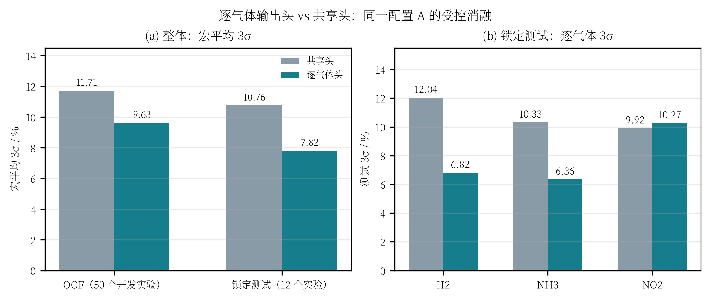

# 逐气体输出头消融：共享头 vs 三路独立头

> 目的：回答“逐气体输出头到底有没有用、是否常见”，并给出同一配置下的受控消融证据。
>
> 结论：**有用，但不是所有气体都提升**。在配置 A 上，逐气体头把 OOF 宏平均 3σ 从 **11.71%** 降到 **9.63%**，把锁定测试宏平均 3σ 从 **10.76%** 降到 **7.82%**；H2、NH3 改善明显，NO2 测试略差 0.35 pp。共享主干 + 逐任务输出头是多任务/多输出回归中的常见结构，不是本文新造的模块。

---

## 1. 两种输出头

当前模型 `tcn_union/core/model.py::GasTCN` 的卷积主干完全相同：3 个因果残差块，宽度 16，kernel 5，膨胀率 1/2/4，取最后时刻隐藏向量 `[B,16]`。

### 1.1 共享头（默认）

```text
h ∈ R^16
  → Linear(16,16) → ReLU → Linear(16,3)
  → [H2, NH3, NO2]
```

### 1.2 逐气体头（本方案）

```text
h ∈ R^16
  ├─ Linear(16,16) → ReLU → Linear(16,1) → H2
  ├─ Linear(16,16) → ReLU → Linear(16,1) → NH3
  └─ Linear(16,16) → ReLU → Linear(16,1) → NO2
```

两种模式的卷积主干、输入、损失、增强、训练轮数和 seed 完全一致，只切换 `--per-gas-head`。

参数量：

| 输出头 | 总参数量 | 输出头参数量 |
|---|---:|---:|
| 共享头 | 7411 | 323 |
| 逐气体头 | 7955 | 867 |

逐气体头只增加 **544 个参数（+7.3%）**，不是三个独立 TCN；三种气体仍共享绝大部分表示。

---

## 2. 实验设置

只做“输出头”一个变量的消融，其余全部固定为当前配置 A：

| 项目 | 设置 |
|---|---|
| 数据划分 | 50 个开发实验 / 12 个锁定测试实验（manifest 固定） |
| 输入 | 10 s 前缀，`raw_delta`，6×51 |
| 目标变换 | `log,none,log`（H2/NO2 取 log，NH3 原空间） |
| 增强 | 测量噪声 0.1× + PCA-VAE 合成 3× + 边缘浓度 VAE 4× |
| 低浓度加权 | 三气体 `p=1.0` |
| 训练 | 5 折 OOF；每折验证集选 epoch；3 个 seed（20260923/24/25） |
| 测试 | 3 seed 预测平均后裁剪到开发集逐气体范围 |
| 唯一变量 | `--per-gas-head` 开 / 关 |

未使用配置 B（逐气体 p）；未使用 Ridge；测试集不参与 epoch、超参或输出头选择。

> 说明：本实验的 OOF 汇总文件里字段名仍叫 `macro_nmae`，但当 `--validation-metric three_sigma` 时，该字段保存的是**验证集宏平均 3σ**。本文按实际含义写作“OOF 宏平均 3σ”。

---

## 3. 结果

### 3.1 整体

| 口径 | 共享头 | 逐气体头 | 变化 |
|---|---:|---:|---:|
| OOF 宏平均 3σ / %（50 个开发实验，5 折） | 11.71 | **9.63** | **−2.08 pp（−17.8%）** |
| 锁定测试宏平均 3σ / %（12 个实验，3 seed 集成） | 10.76 | **7.82** | **−2.95 pp（−27.4%）** |
| 锁定测试宏平均 NMAE / % | 1.669 | **1.402** | −0.267 pp |
| 锁定测试宏平均 MAPE / % | 2.420 | **1.874** | −0.546 pp |

逐 seed 的测试宏平均 3σ：

| seed | 共享头 | 逐气体头 |
|---|---:|---:|
| 20260923 | 14.58% | 9.68% |
| 20260924 | 15.95% | 12.29% |
| 20260925 | 11.79% | 10.19% |
| 平均 | 14.11% | **10.72%** |

三个 seed 上逐气体头都更低，说明整体改善不是某一个 seed 的偶然。

### 3.2 逐气体测试 3σ

| 气体 | 共享头 | 逐气体头 | 变化 |
|---|---:|---:|---:|
| H2 | 12.04% | **6.82%** | −5.21 pp |
| NH3 | 10.33% | **6.36%** | −3.97 pp |
| NO2 | **9.92%** | 10.27% | +0.35 pp |
| 宏平均 | 10.76% | **7.82%** | −2.95 pp |



图：左图为 OOF/测试宏平均 3σ；右图为锁定测试逐气体 3σ。逐气体头明显压低 H2、NH3 的尾部；NO2 略高。

### 3.3 OOF 逐折

| 折 | 共享头 | 逐气体头 |
|---|---:|---:|
| fold 0 | **8.86%** | 11.38% |
| fold 1 | 12.24% | **8.66%** |
| fold 2 | 12.13% | **10.56%** |
| fold 3 | 13.01% | **9.20%** |
| fold 4 | 12.34% | **8.35%** |
| 平均 | 11.71% | **9.63%** |

逐气体头在 5 折中的 4 折更好；fold 0 反而更差，说明它对具体划分仍敏感，不能写成“每一折都稳赢”。

---

## 4. 怎么解释

### 4.1 为什么逐气体头对 H2/NH3 有用

共享头把三种气体压到同一个 16→3 的线性层里，三种输出共享同一组隐藏→输出的仿射方向。H2 是万级、NH3/NO2 是十级/个位数，即使标签已经 z-score，H2 的标准化尾部仍更重（见 [`3sigma来源与证据.md`](3sigma来源与证据.md)）。共享输出层容易被 H2 的大残差牵引，H2 和 NH3 的尾部都更容易变宽。

逐气体头给每种气体独立的 16→1 非线性，相当于在共享表示之上允许三个不同的输出校准函数；H2 的尾部不再直接通过同一个输出矩阵挤压 NH3/NO2 的读出。

### 4.2 为什么 NO2 没有同步改善

NO2 的测试 3σ 从 9.92% 升到 10.27%，只差 0.35 pp；它的 OOF 逐气体 NMAE 其实是下降的（共享头 0.0280 → 逐气体 0.0231），说明问题更多在 12 个测试实验的划分/尾部样本，而不是逐气体头本身失效。

NO2 只有 6 个浓度档位（2–10），12 个测试点里每个档位约 2 个；逐气体头参数更多，在开发集上更容易贴合 NO2 的局部结构，测试端可能换来一点方差。这个差异不足以抵消 H2/NH3 的明显收益，但说明“逐气体头对所有气体都更好”是不成立的。

### 4.3 是否常见

是常见结构，属于**共享编码器 + 任务专属输出头**（shared trunk + task-specific heads）：

- 多任务学习里通常共享底层表示，每个任务一个输出头；
- 多输出回归里，各目标量纲/噪声结构不同，给每个目标独立输出层是常见做法；
- 传感器阵列/多气体电子鼻里，共享特征提取 + 多气体读出也很常见。

它不是本文的创新点，更像一个**低成本的工程选择**：只增加 544 个参数，避免训练三个独立 TCN（在 50 个开发实验上数据不够），又比完全共享输出层更灵活。

更激进的替代方案是“每种气体一个完整 TCN”。这也是常见 baseline，但需要更多数据/正则，且当前 50 个开发实验下不一定稳；本消融没有做这个对照，因此不能声称逐气体头优于“三套独立模型”。

---

## 5. 结论与边界

### 5.1 可以支持的结论

1. 在当前配置 A 下，逐气体头比共享头**整体更好**：OOF −2.08 pp，测试 −2.95 pp；
2. H2、NH3 的测试 3σ 改善明显（−5.21、−3.97 pp）；
3. 三个 seed 的测试宏平均 3σ 都更低；
4. 代价很小：只多 544 个参数，不增加模型族数量。

### 5.2 不能过度声称的结论

1. 不能说“逐气体头对每种气体都更好”：NO2 测试 3σ 反而高 0.35 pp；
2. 不能说“所有数据划分都稳赢”：OOF fold 0 共享头更好；
3. 不能说“逐气体头优于三套独立 TCN”：没有做这个对照；
4. 测试只有 12 个实验，结论仍应表述为“在当前锁定测试集上”的证据，不是外部泛化证明。

### 5.3 建议

保留逐气体头。若后续继续做消融，优先级建议：

1. 头宽度（8/16/32）与 dropout；
2. 三套独立 TCN（同参数量/同训练预算）作为更强 baseline；
3. 用更多 seed 或重复划分报告均值±标准差，而不是只看单次测试。

---

## 6. 产物与复现

| 内容 | 路径 |
|---|---|
| 共享头训练产物 | `artifacts/per_gas_head_ablation/shared/` |
| 共享头测试评估 | `artifacts/per_gas_head_ablation/shared_eval/evaluation.json` |
| 逐气体头测试评估 | `artifacts/per_gas_head_ablation/per_gas_eval/evaluation.json` |
| 指标汇总 | `artifacts/per_gas_head_ablation/ablation_metrics.csv` |
| 图 | `artifacts/per_gas_head_ablation/fig_per_gas_head_ablation.png` / `.svg` |
| 绘图脚本 | `tcn_union/plot_per_gas_head_ablation.py` |

共享头训练命令（在配置 A 的基础上只去掉 `--per-gas-head`）：

```bash
.venv/bin/python -m tcn_union.training.gan_train \
  --manifest artifacts/splits/manifest.csv \
  --output-dir artifacts/per_gas_head_ablation/shared \
  --modes noise_gan --generator vae \
  --vae-components 6 --vae-beta 0.1 \
  --noise-scale 0.1 --synthetic-ratio 3.0 --edge-copies 4 \
  --target-transform log,none,log --low-conc-power 1.0 \
  --validation-metric three_sigma \
  --final-seeds 20260923 20260924 20260925
```

测试评估：

```bash
.venv/bin/python -m tcn_union.evaluation.ensemble_evaluate \
  --manifest artifacts/splits/manifest.csv \
  --model-dirs artifacts/per_gas_head_ablation/shared/noise_gan \
  --output-dir artifacts/per_gas_head_ablation/shared_eval \
  --windows 10 --clip-to-development-range

.venv/bin/python -m tcn_union.evaluation.ensemble_evaluate \
  --manifest artifacts/splits/manifest.csv \
  --model-dirs artifacts/3sigma_noridge/final/p10/noise_gan \
  --output-dir artifacts/per_gas_head_ablation/per_gas_eval \
  --windows 10 --clip-to-development-range
```

汇总图：

```bash
.venv/bin/python -m tcn_union.plot_per_gas_head_ablation
```
