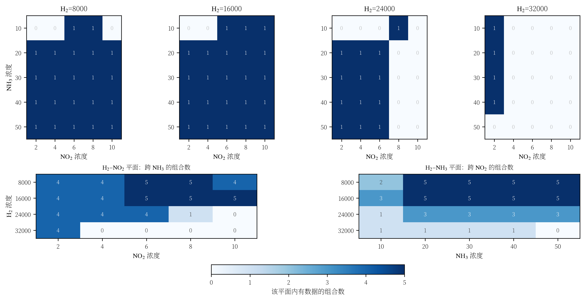
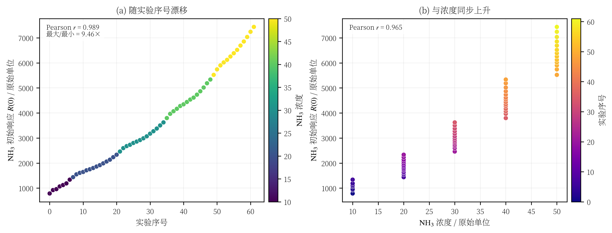
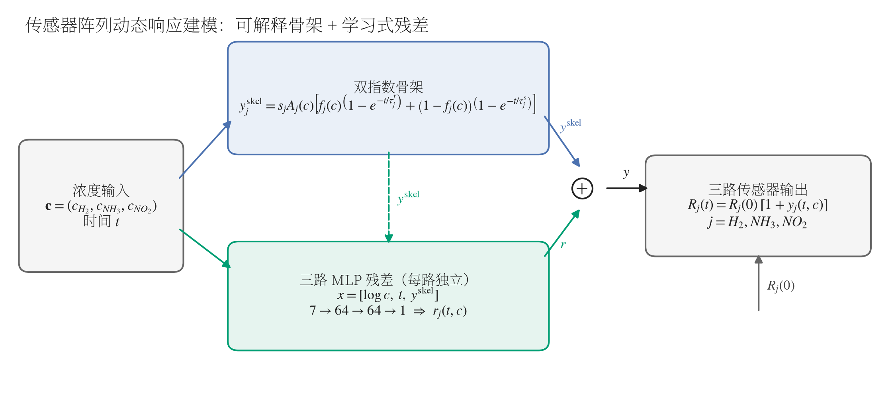
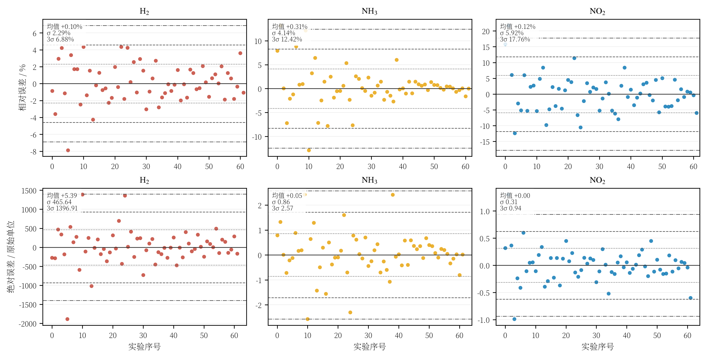
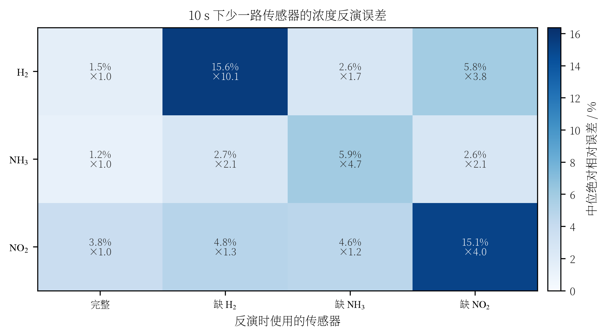

# 汇报说明：数据问题、正模型与 MAP 浓度估计

> 用途：面向导师汇报的讲稿提纲与支撑材料。主线是“数据有哪些硬约束 → 正模型做了什么 → 为什么自然要走到 MAP 反演 → MAP 实验说明了什么”。区间估计放在最后一节，建议只作备份页。

---

## 0. 一页结论

1. **数据不是“少”，而是“偏”**：62 条实验覆盖了 100 个理论浓度组合中的 62 个，每个组合只有 1 条；H₂=32000、NH₃=50 等边角大面积缺失，NH₃ 还与采集顺序绑在一起。
2. **正模型已经够用于“生成曲线”**：双指数骨架 + 三路 MLP 残差把留一曲线误差从 3.30% 降到 1.48%（宏平均 nRMSE）。
3. **但正模型的真正用途是反演**：给定实测响应，反推浓度。这一步就是 MAP 实验；它不是重复 TCN，而是对正模型的“下游压力测试”和误差诊断。
4. **MAP 的精度略逊于 TCN，但结构价值不同**：10 s 下 MAP 的逐文件宏误差中位约 2.14%，TCN 锁定 12 的 MAPE 为 1.67%；MAP 能解释误差来自哪里、能换时间窗/传感器子集、能给出协方差，TCN 不能。
5. **区间估计不建议作为主线**：当前 Laplace 区间严重欠覆盖，共形区间能覆盖但很宽；模型偏差和非可交换性使“ calibrated 90% 区间”暂不可信。汇报时讲经验 3σ/p90 即可，区间估计放备份页或后续工作。

---

## 1. 当前数据存在的问题

### 1.1 浓度组合覆盖不全

- 理论组合：H₂ 4 档 × NH₃ 5 档 × NO₂ 5 档 = **100** 个。
- 实际覆盖：**62** 个，每个已覆盖组合**只有 1 条实验**，没有重复。
- 缺失：**38** 个组合，集中在高 H₂ / 高 NH₃ / 高 NO₂ 的边角。

具体缺口（汇报时可直接说）：

| 区域 | 情况 |
|---|---|
| H₂=32000 | 只有 NO₂=2 这一列有数据（NH₃=10–40），NH₃=50 整行缺失 |
| H₂=24000 | NH₃=20–50 只覆盖 NO₂=2/4/6，NO₂=8/10 全缺；NH₃=10 只有 NO₂=8 |
| H₂=16000 | NH₃=10 只覆盖 NO₂=6/8/10；其余 NH₃ 档较全 |
| H₂=8000 | NH₃=10 只覆盖 NO₂=6/8；其余 NH₃ 档较全 |

**含义**：模型在 H₂=32000、高 NO₂、NH₃=50 这些区域没有足够数据做插值，更不能做外推。后面所有“留一档位/留一区块”的压力测试，都是为了把这一点量化，而不是掩盖它。

### 1.2 NH₃ 初值随采集顺序漂移，并与浓度档位混淆

- NH₃ 初始响应 \(R(0)\)：约 **786 → 7437**，最大/最小 = **9.46×**。
- 与实验序号：Pearson \(r=0.989\)。
- 与 NH₃ 设定浓度：Pearson \(r=0.965\)。
- NH₃ 浓度档位与实验序号：\(r=0.976\)（分块采集：0–6=10，7–20=20，21–34=30，35–48=40，49–61=50）。

**含义**：NH₃ 的“浓度效应”和“时间/老化/环境漂移”在设计上完全对齐。我们只能把 NH₃ 增益解释为**该采集顺序下的等效增益**，不能声称是纯浓度灵敏度。这不是换一个更强模型能修复的，是设计层面的不可辨识。

### 1.3 无重复、无独立正模型测试集

- 每个组合 1 条，没有重复实验，无法估计“同一组合的实验间方差”。
- 12 条锁定集在逆问题阶段已保留，正模型不能拿它调参；正模型最终用全部 62 条拟合，因此**没有独立的 blind test**，只有 62 折 LOGO。
- 62 折 LOGO 是“每条实验当一次测试”，但它不是独立盲测；NH₃ 与采集顺序的混淆仍然存在。

### 1.4 其他数据限制

- 没有温度、湿度、流量等环境变量；漂移只能通过时间/文件序号间接观察。
- H₂ 通道的逐点噪声很小（接近量化/平滑），NH₃、NO₂ 噪声更明显；不同通道的信噪比不同。
- 现有 62 条是唯一可用数据，后续分析都只能在这个范围内做建模、验证和仿真；这一点在汇报里要明确说，避免老师追问“为什么不再采一组”。

---

## 2. 正模型：双指数骨架 + MLP 残差

### 2.1 模型在做什么

- 输入：三气体浓度 \(\mathbf c=(c_{H_2},c_{NH_3},c_{NO_2})\) 与时间 \(t\)。
- 骨架：双指数（快/慢两个时间常数）描述阶跃响应的主趋势：
  \[
  y_j^{skel}(t,\mathbf c)=s_jA_j(\mathbf c)\left[f_j(\mathbf c)(1-e^{-t/\tau_j^f})+(1-f_j(\mathbf c))(1-e^{-t/\tau_j^s})\right]
  \]
  其中 \(A_j\)、\(\tau_j^f\)、\(\tau_j^s\)、\(f_j\) 都是 \(\log \mathbf c\) 的二次多项式；\(s_j=(+1,+1,-1)\) 是响应方向。
- 残差：三路独立 MLP，每路输入 \([\log \mathbf c, t, y^{skel}]\)，输出对骨架的修正 \(r_j(t,\mathbf c)\)。
- 绝对输出：\(R_j(t)=R_j(0)[1+y_j(t,\mathbf c)]\)；相对响应 \(y=(R-R(0))/R(0)\) 消除了乘性基线漂移。

### 2.2 结果

| 模型 | 留一曲线宏 nRMSE | 10 s 下游宏中位误差 | 5 s 下游宏中位误差 |
|---|---:|---:|---:|
| 双指数骨架 | 3.30% | 4.99% | 7.42% |
| 双指数 + 三路 MLP | **1.48%** | **2.14%** | **2.96%** |

- 曲线误差从 3.30% 降到 1.48%，说明残差确实学到了系统性的形状偏差（尤其是 NO₂ 的慢漂移和 H₂ 的平台形状）。
- 但“曲线拟合好”不等于“反演准”：10 s 下游宏中位误差 2.14%，比曲线误差大；5 s 更差。这正好引出 MAP 实验。

---

## 3. 从正模型到 MAP：为什么这是自然的下一步

### 3.1 逻辑递进

1. 正模型回答的是 **“给定浓度，响应长什么样”**：\(\mathbf c \rightarrow R(t)\)。
2. 实际测量问题反过来：**“给定响应，浓度是多少”**：\(R(t)\rightarrow \mathbf c\)。
3. 如果正模型不能反演，它只是一个曲线拟合器；能反演，才说明它抓住了可用于定量分析的结构。
4. 最自然的反演方式，不是再训一个黑盒，而是把正模型当作**前向解码器**，在噪声模型下做最大后验估计：
   \[
   \hat{\mathbf c}=\arg\min_{\log\mathbf c}\sum_{j\in S}\sum_{t\le T}\left(\frac{y_j^{obs}(t)-y_j^{model}(t;\mathbf c)}{\sigma_j}\right)^2+\sum_j\left(\frac{\log c_j-\log c_j^{ref}}{\sigma_{prior}}\right)^2
   \]
   这就是 MAP 浓度估计。完整的从零推导（测量方程 → 似然 → 先验 → 贝叶斯 → 残差形式）见 `sensor_array/docs/learning_guide.md` §7.3.1。逐项含义：

   - \(j\)：传感器/气体通道（H₂、NH₃、NO₂）；\(S\) 是当前可用的通道集合（全接时 3 路，少一路时 2 路）。
   - \(t\)：时间窗内的采样点；\(T\) 是窗口上限（5 s 或 10 s）。
   - \(y_j^{obs}(t)\)：实测相对响应 \((R_j(t)-R_j(0))/R_j(0)\)。
   - \(y_j^{model}(t;\mathbf c)\)：用候选浓度 \(\mathbf c\) 跑正模型得到的相对响应。
   - \(\sigma_j\)：第 \(j\) 路的有效噪声，代码里取 \(\sqrt{\sigma_{noise,j}^2+\sigma_{model,j}^2}\)；后者是正模型在训练折上的残差 RMS，所以数据项同时惩罚“测量噪声”和“模型偏差”。
   - 第二项：\(\log c\) 上的高斯先验；\(c_j^{ref}\) 是参考浓度 \((16000,30,6)\)，\(\sigma_{prior}=1.5\)。
   - 代码还加了软墙项（\(WALL=0.15\)），在接近设计域边界时给一个很小的二次惩罚，避免硬边界把估计钉死；它不改变“数据项 + 先验项”的主结构。

### 3.2 有了 TCN，为什么还需要 MAP

| 维度 | TCN 逆模型 | MAP + 正模型 |
|---|---|---|
| 训练对象 | 50 条实验的“响应前缀 → 浓度”映射 | 正模型（62 条曲线）+ 噪声/先验 |
| 输出 | 点估计 | 点估计 + 协方差/区间 |
| 浓度取值 | 设计档位内的插值 | 连续值，可在设计域内优化 |
| 时间窗 | 固定 5/10 s，换窗口要重训 | 任意窗口，换窗口不用重训 |
| 传感器子集 | 少一路要重训 | 少一路只需删残差项 |
| 可解释性 | 低 | 高：A、τ、延迟、残差 |
| 误差诊断 | 难 | 可分解为噪声/模型偏差/设计混淆 |
| 精度 | **更高**（10 s 锁定 MAPE 1.67%） | 略低（10 s 宏中位 2.14%） |

**一句话**：TCN 是“更准的黑盒”，MAP 是“能解释、能诊断、能换配置的白盒”。MAP 实验不是为了在精度上超过 TCN，而是为了回答：

1. 正模型是否好到可以反演？
2. 曲线误差 1.48% 传到浓度会放大多少？
3. 误差主要来自噪声、模型偏差还是设计混淆？
4. 换 5 s/10 s、少一路传感器，性能怎么变？
5. 能不能给出可信度/误差条？

### 3.3 MAP 实验的目的（汇报时逐条说）

- **验证正模型的下游可用性**：不是只看曲线 nRMSE，而是看反演后的浓度误差。
- **量化误差传播**：曲线 1.48% → 浓度约 2%；哪些气体/窗口放大最严重。
- **建立物理基线**：给 TCN 一个同协议的、可解释的对照；TCN 更好时，能说清“好在哪里”。
- **支持配置变化**：5 s/10 s、少传感器、不同时间窗，不需要重新训练。
- **为后续章节铺路**：误差预算、传感器降级、闭环合成增强、区间估计，都建立在“正模型可反演”这个前提上。

---

## 4. MAP 实验设计

- 数据：62 条实验；**62 折 LOGO**，每条实验当一次测试，其余 61 条训练正模型。
- 窗口：5 s 与 10 s（5 s 用于回答“更早行不行”）。
- 噪声：由训练折残差的二阶差分 MAD 估计，\(\sigma_j\) 按通道；不使用测试折信息。
- 先验：\(\log \mathbf c\) 上的弱高斯先验，中心取参考浓度 \((16000,30,6)\)，标准差 \(\sigma_{prior}=1.5\)；软墙约束（0.15）避免硬边界把估计“钉”在边界。
- 优化：多起点 `least_squares`，在 \(\log c\) 空间优化；每个窗口独立。
- 指标：逐文件/逐气体的绝对相对误差、中位、p90、宏平均；不把 12 条锁定集用于调参。
- 对照：同协议的 TCN（10 s 锁定 12 条：3σ 7.11%、MAPE 1.67%；5 s：3σ 11.85%、MAPE 2.65%）。

> 注意：MAP 的 2.14% 是“逐文件宏误差的中位”，TCN 的 1.67% 是“宏 MAPE 均值”；口径不完全相同，但量级可比。不要把它们说成完全同一指标。

---

## 5. MAP 结果与解读

### 5.1 数字

| 窗口 | H₂ 中位 | NH₃ 中位 | NO₂ 中位 | 逐文件宏中位 | 逐文件宏均值 | 宏 p90 |
|---|---:|---:|---:|---:|---:|---:|
| 10 s | 1.59% | 1.26% | 3.79% | **2.14%** | 2.92% | 6.93% |
| 5 s | 2.77% | 2.11% | 4.57% | **2.96%** | 4.31% | 9.51% |

- 10 s 明显好于 5 s，和 TCN 的结论一致：5 s 信息量不足。
- NO₂ 最差，因为它的响应幅度小、时间常数长、低浓度端信噪比低；H₂ 次之，因为相对变化只有 1% 量级；NH₃ 最好，但受采集顺序混淆影响，不能过度解释。
- MAP 与 TCN 同量级，但 TCN 仍然更准；MAP 的价值在结构、诊断和不确定性，不在“刷点”。

### 5.2 这个实验说明了什么

- 正模型不仅能把曲线画出来，还能反演浓度；10 s 的误差约 2%，说明它“可用于下游”。
- 5 s 的退化说明“早期响应”不是免费的：时间窗越短，低敏感通道越容易被模型偏差主导。
- MAP 的误差大于曲线误差，说明误差会从曲线传播到浓度；这不是 bug，是反问题的固有放大。
- 误差主要不是噪声：噪声下限对应的 CRLB 远小于实际误差（5 s 的 CRLB 在 0.03% 量级），实际误差 2–4% 主要来自模型偏差与设计混淆。

### 5.3 少一路传感器时模型的变化

**协议**：正模型和 MLP 仍用三路响应训练；只在 MAP 反演时把某一路从数据项中删掉。也就是说，这张图回答的是“部署时某一路失效，现有模型还能不能用”，不是“去掉一路重新训练一个模型”。后者没有做，不能从这张图外推。

| 反演使用的传感器 | H₂ 中位误差 | NH₃ 中位误差 | NO₂ 中位误差 | 三气体中位均值 |
|---|---:|---:|---:|---:|
| 完整三路 | 1.5% | 1.2% | 3.8% | 2.2% |
| 缺 H₂ | **15.6%（×10.1）** | 2.7%（×2.1） | 4.8%（×1.3） | 7.7% |
| 缺 NH₃ | 2.6%（×1.7） | **5.9%（×4.7）** | 4.6%（×1.2） | 4.4% |
| 缺 NO₂ | 5.8%（×3.8） | 2.6%（×2.1） | **15.1%（×4.0）** | 7.8% |

**怎么读**：

1. **缺哪一路，最伤哪一路。**  
   缺 H₂ 时 H₂ 误差从 1.5% 涨到 15.6%（×10.1）；缺 NH₃ 时 NH₃ 从 1.2% 涨到 5.9%（×4.7）；缺 NO₂ 时 NO₂ 从 3.8% 涨到 15.1%（×4.0）。这符合“本通道提供最强约束”的直觉。

2. **NO₂ 的缺失会跨通道伤 H₂。**  
   缺 NO₂ 时 H₂ 误差从 1.5% 涨到 5.8%（×3.8），比缺 NH₃ 时的 H₂（×1.7）更严重。原因是 H₂ 通道对 NO₂ 有强交叉敏感（前面增益分析里 H₂ 增益被 NO₂ 抑制），NO₂ 的观测同时帮助约束 H₂ 和 NO₂ 自身；少了它，H₂ 的增益/浓度方向变得不稳定。

3. **NH₃ 的缺失主要伤 NH₃ 自己，对 H₂/NO₂ 影响较小。**  
   缺 NH₃ 时 NH₃ ×4.7，但 H₂ 只 ×1.7、NO₂ 只 ×1.2。说明 NH₃ 通道对另外两路的交叉信息最少，它更像是“NH₃ 专用”通道。

4. **三路完整是必要的。**  
   三气体中位均值从 2.2% 涨到 4.4–7.8%；缺 H₂ 或 NO₂ 时接近 8%。这不是“少一路也能用”的结论，而是“少一路还能给出有偏但可用的粗估，精度明显下降”。

**为什么**：MAP 的数据项少了一路，等于少了一组方程；低敏感通道（NO₂、H₂ 的弱信号）本来就依赖交叉敏感和多时间点信息，少一路后先验收缩会更明显，估计更容易被模型偏差推着走。先验能防止跑飞，但不能凭空补回缺失的信息。

**汇报时的一句话**：

> 我们模拟了部署时一路传感器失效的情况。模型仍用三路训练，只在反演时删掉一路。结果是“缺哪一路，最伤哪一路”；缺 NO₂ 还会明显拖累 H₂，说明 H₂ 通道对 NO₂ 有强交叉敏感。三路完整时三气体中位误差约 2.2%，缺一路后升到 4.4–7.8%，所以当前方案不适合长期少一路运行，但可以作为故障时的降级估计。

### 5.4 这个实验没有说明什么

- 没有证明 MAP 比 TCN 准；相反，TCN 在 10 s/5 s 都更好。
- 没有解决 NH₃ 与采集顺序的混淆；LOGO 不能消除设计问题。
- 没有独立盲测；62 折是交叉验证，不是锁定测试。
- 没有证明区间估计可信（见第 7 节）。

---

## 6. 汇报建议：幻灯片顺序与口播

### 6.1 建议的 9 页

1. **数据与任务**：62 条、3 气体、5 Hz、60 s；一句话说清“要建模什么”。
2. **数据问题 1**：fig09 浓度组合覆盖，指出 62/100、边角缺失。
3. **数据问题 2**：fig10 NH₃ 初值漂移，指出 9.46×、r=0.989、与浓度档位混淆。
4. **正模型**：fig07 架构 + 曲线 3.30%→1.48%；强调“能生成曲线”。
5. **转折**：正模型是 c→R，实际问题是 R→c；自然引出 MAP。
6. **为什么不是 TCN 就够**：对比表 + MAP 的五个目的；强调“不是替代，是诊断/闭环”。
7. **MAP 结果**：fig08 + 10 s/5 s 表；TCN 对照；误差传播与 5 s 退化。
8. **少一路传感器**：fig11 + 缺哪一路最伤哪一路；缺 NO₂ 拖累 H₂；三路完整是必要的。
9. **结论与局限**：正模型可用、MAP 同量级但更可解释；边角/混淆/无盲测是限制；区间估计放备份。

### 6.2 从正模型转到 MAP 的口播（可直接念）

> 前面我们回答的是“给定浓度，响应长什么样”。但实际使用时的方向是反过来的：给定响应，浓度是多少。TCN 已经能直接做这个映射，而且精度更高；那为什么还要 MAP？因为 TCN 是一个数据驱动的黑盒，它不能告诉我们误差来自哪里，也不能在换时间窗、少一路传感器时不做重训。MAP 把正模型当作前向解码器，在噪声模型下反解浓度；它是对正模型的 downstream 压力测试，也是误差分解和不确定性分析的入口。所以这两个不是二选一：TCN 是更准的对照，MAP 是更能解释、更能诊断的基线。

### 6.3 可能的提问

- **“MAP 不如 TCN，为什么还要做？”**  
  答：MAP 的目的不是刷精度，而是验证正模型能否反演、量化误差传播、提供可解释的误差分解；TCN 更好这件事本身也是结论，说明数据驱动模型学到了正模型没有覆盖的实验特异性。
- **“为什么不把 12 条锁定集用来调 MAP？”**  
  答：12 条是逆问题的锁定集；正模型如果在上面调参，会通过闭环合成数据间接进入逆模型。MAP 严格遵守 62 折，不碰锁定集。
- **“2% 的误差够用吗？”**  
  答：取决于应用。10 s、NH₃ 1.26%、H₂ 1.59% 已经可用；NO₂ 3.79%、5 s 更差，说明低敏感通道和短窗口需要更多信息或更好的模型。
- **“为什么 5 s 差这么多？”**  
  答：5 s 时慢通道还没充分响应，低敏感通道的信噪比更低；模型偏差在短窗口占比更大。这也和 TCN 的 5 s 退化一致。

---

## 7. 区间估计：要不要汇报？

### 7.1 直接建议

**不作为主线，最多放一页备份。** 理由：

- 当前原始 Laplace 区间严重欠覆盖：10 s 开发集 90% 区间的覆盖率只有 32% / 30% / 6%（H₂/NH₃/NO₂）。
- 共形区间能到约 92%，但很宽：10 s 中位半宽约 3.5% / 3.4% / 8.7%；对 NO₂ 接近“没有信息量”。
- 剖面似然在 ±6 se 内近似平坦，覆盖率只有 21% / 39% / 29%；说明误差不是围绕真值的干净二次形，模型偏差主导。
- 62 条实验非可交换（NH₃ 分块、采集顺序），共形区间的 marginal coverage 也不完全可信。

如果你自己都不理解，现场讲公式只会放大风险；**讲结论**即可：

> 我们试过 Laplace、共形和剖面似然三种区间。由于模型偏差和非可交换性，原始区间明显欠覆盖；共形能覆盖但很宽。因此本章不把“ calibrated 区间”作为主要结论，只报告经验误差分布和 3σ 误差带；正式的不确定性量化留作后续工作。

### 7.2 这些词是什么意思（给你自己看）

- **区间估计**：给点估计配一个范围，例如“浓度 30，90% 区间 [27, 33]”。
- **覆盖率**：在很多次重复实验里，真值落在区间内的比例。名义 90% 应该接近 90%。
- **宽度**：区间有多宽；覆盖率高但区间很宽，说明“说了等于没说”。
- **Laplace 近似**：在 MAP 点把负对数后验近似成二次函数，用 Hessian 的逆当协方差；简单快，但模型偏差大时会过度自信。
- **共形（conformal）**：不假设高斯，用校准集上的实际误差分数取分位数，构造区间；理论上在可交换数据上覆盖率为名义值。
- **剖面似然**：固定一个气体，优化其余参数，画代价随该气体变化的曲线；曲线越陡，越可辨识。

### 7.3 如果老师追问“有没有置信区间”

可以答：

> 有点估计的渐近协方差（Laplace），也有经验 3σ 误差带；但严格 calibrated 的 90% 区间目前不可信，因为模型偏差大于噪声、且 62 条实验不是可交换的。我们选择在正文报告经验误差分布，把区间估计放到附录/后续工作，避免给出一个看起来精确但实际不覆盖的区间。

### 7.4 3σ 不是 95% CI

- 3σ 是**经验误差带**：在近似高斯下约覆盖 99.7%，但这里不假设高斯；它描述单次误差的离散程度，不是“均值”的置信区间。
- 95% CI of mean 会随着 \(n\) 变窄（\(s/\sqrt n\)），但单次预测的 95% 区间要宽得多；汇报时不要把两者混用。
- 建议口径：**中位绝对相对误差 + p90 + 3σ 误差带**；如果老师要“置信度”，再解释上面的限制。

---

## 8. 附：关键数字与文件

| 内容 | 数值/文件 |
|---|---|
| 实验数 | 62 条，5 Hz，0–59.6 s |
| 理论组合 / 覆盖 | 100 / 62；38 个缺失；每个已覆盖组合 1 条 |
| 浓度档位 | H₂ 8000/16000/24000/32000；NH₃ 10/20/30/40/50；NO₂ 2/4/6/8/10 |
| NH₃ 初值 | 786 → 7437，9.46×；\(r_{\text{file}}=0.989\)，\(r_{\text{conc}}=0.965\) |
| 正模型曲线 | 双指数 3.30%，+MLP 1.48%（留一宏 nRMSE） |
| MAP 10 s | 中位 1.59/1.26/3.79%；宏中位 2.14%，宏均值 2.92%，p90 6.93% |
| MAP 5 s | 中位 2.77/2.11/4.57%；宏中位 2.96%，宏均值 4.31%，p90 9.51% |
| TCN 10 s | 锁定 12：3σ 7.11%，MAPE 1.67% |
| TCN 5 s | 锁定 12：3σ 11.85%，MAPE 2.65% |
| 原始 Laplace 90% 覆盖（10 s 开发） | 32% / 30% / 6% |
| 共形 90% 覆盖/宽度（10 s 开发） | 约 92%；中位半宽 3.5% / 3.4% / 8.7% |

图件：

- `sensor_array/figures/model/fig09_concentration_design.png`
- `sensor_array/figures/model/fig10_nh3_initial_drift.png`
- `sensor_array/figures/model/fig07_model_architecture.png`
- `sensor_array/figures/model/fig08_downstream_error_scatter.png`

数据与结果：

- `sensor_array/artifacts/evaluation/curve_summary.csv`
- `sensor_array/artifacts/evaluation/downstream_summary.csv`
- `sensor_array/artifacts/calibration/summary.csv`
- `docs/tcn_5s_evaluation.md`
