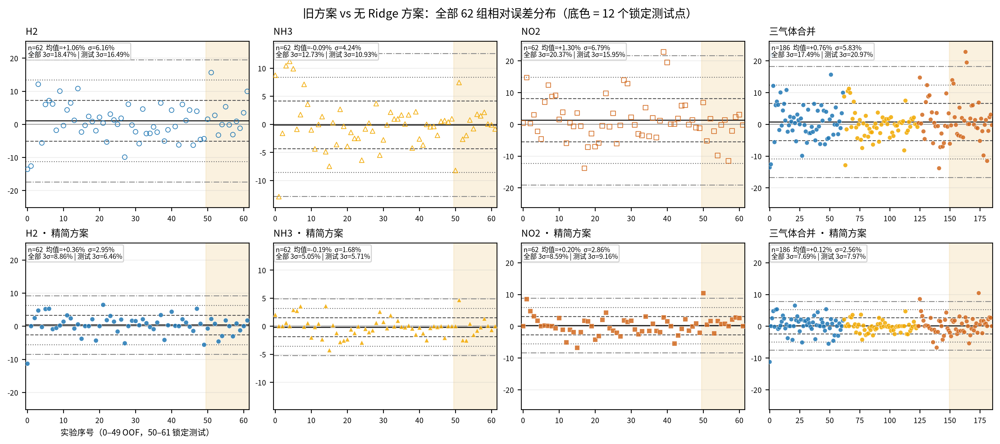
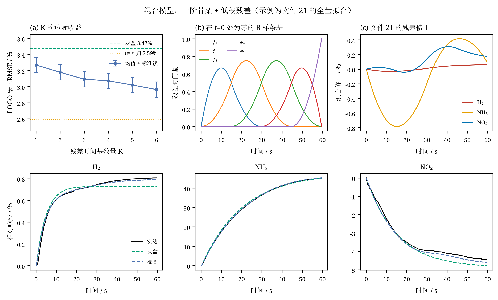
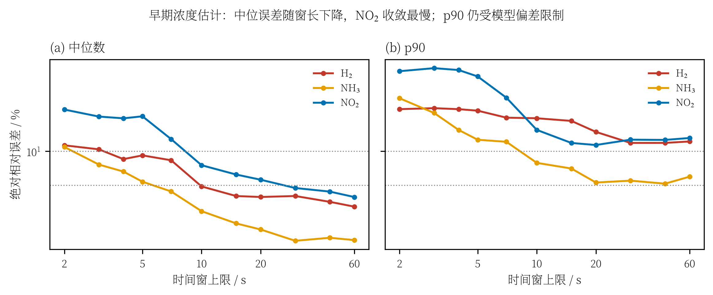

# 从响应加速到机理解释：三气体传感器阵列的早期浓度估计与动态响应建模

**——硕士课题阶段总结**

## 摘要

本文总结硕士课题的两个阶段。第一阶段面向应用：把三路气体传感器（H₂、NH₃、NO₂）的稳态测量缩短为 10 秒早期响应，用因果时序卷积网络（TCN）直接回归三种浓度，并通过逐气体目标变换、低浓度损失加权、边缘浓度条件 VAE 扩充、多种子/多配置平均与物理裁剪，把锁定测试集上的宏 3σ 从旧方案的 11.18% 降到 **7.11%**（OOF 7.47%）。第二阶段面向机理与可信度：在同样的 62 条实验上建立“浓度 → 三路 0–60 秒响应曲线”的动态正模型，用一阶惯性 + 纯延迟灰盒描述主趋势，用低秩时空残差修正系统偏差，得到 62 折 LOGO 宏 nRMSE **3.02%** 的混合模型；进一步用 Fisher 信息/CRLB 说明 5 秒窗口的噪声下限远小于实际误差，用 MAP + Laplace + CV+ 给出 10 秒中位浓度误差 **3.12/2.14/5.00%**，并用误差预算证明实际误差主要来自模型偏差与实验设计混淆，而不是传感器噪声。两个阶段不是两项互不相关的工作：第一阶段回答“10 秒够不够用”，第二阶段回答“为什么够用、误差从哪里来、还能不能更可信”；正模型进一步作为合成数据源反哺逆模型，形成“预测—解释—不确定性—闭环增强”的完整链条。

**关键词**：气体传感器阵列；响应加速；时序卷积网络；动态响应建模；可辨识性；不确定性量化；数据受限学习

---

## 1 引言

### 1.1 研究背景

三路气体传感器对 H₂、NH₃、NO₂ 的响应具有明显的交叉敏感和慢动态：一次实验需要记录 0–59.6 秒的完整曲线，气体浓度在一次实验内保持恒定。实际应用关心的往往不是“等 60 秒后标定”，而是**通气后最早什么时候能给出可信的浓度估计**。如果 10 秒甚至 5 秒的早期前缀已经包含足够信息，就可以把单次测量时间缩短约 6–12 倍，降低功耗、减少气体消耗，并为在线监测和闭环控制留出时间。

但“早期响应”并不是简单的截断。传感器响应由快速上升段、慢速漂移、实验间基线差异和测量噪声叠加而成；三路通道对三种气体都有不同程度的交叉敏感；实验设计又存在明显的采集顺序与浓度档位混杂。更困难的是，本课题的数据只有 **62 次实验**，传感器已经损坏，**不可扩充**，也没有重复测量。因此，问题不是“换一个更大的模型”，而是：**在固定的小样本上，如何把可用信息压榨出来，并且知道自己什么时候不可信。**

### 1.2 两个阶段、两个问题

课题沿着两个互补的问题展开。

**第一阶段（逆问题，响应加速）**：给定一次实验从 \(t=0\) 开始的 10 秒三路响应前缀，预测该次实验的 H₂、NH₃、NO₂ 浓度。它直接对应“把 60 秒测量缩短到 10 秒”的应用目标，评价指标是浓度相对误差的尾部宽度（3σ）和 MAPE。

**第二阶段（正问题，动态响应建模）**：给定浓度组合 \(\mathbf{c}=(c_{\mathrm{H2}},c_{\mathrm{NH3}},c_{\mathrm{NO2}})\)，预测三路传感器从 0 到 60 秒的完整响应曲线。它不直接输出浓度，而是解释“传感器在给定浓度下如何响应”，并进一步回答：10 秒窗口里到底有多少浓度信息？误差中噪声、模型偏差、实验设计各占多少？正模型能否生成合成数据，帮助第一阶段？

两个问题共享同一批实验与同一套实验级划分；第一阶段用含相对增量的 `raw_delta` 六通道，第二阶段用纯相对响应 \(y_j(t)\)。目标不同：第一阶段是**任务驱动的预测**，第二阶段是**机理驱动的解释**。把它们放在一起，才能构成一份完整的硕士课题，而不是两个孤立的调参报告。

### 1.3 本文贡献

1. **响应加速的可落地方案**：在 10 秒前缀上把三气体浓度预测的锁定测试宏 3σ 降到 7.11%，并给出逐气体结果、OOF 结果、旧方案对比和测试读取披露。
2. **可解释的动态正模型**：一阶惯性 + 纯延迟的 45 参数灰盒，配合 K=5 的低秩时空残差，把 62 折 LOGO 宏 nRMSE 从 3.47% 降到 3.02%，同时保留 \(A_j,\tau_j,d_j\) 的物理含义。
3. **可辨识性与误差分解**：用噪声估计、Fisher 信息/CRLB 和误差预算说明“噪声不是瓶颈，模型偏差与设计混淆才是”，并解释为什么不能做盲基线联合估计。
4. **不确定性感知的早期估计**：恒浓度 MAP + 软墙 + Laplace + CV+ + 自适应停止，给出 10 秒中位误差 3.12/2.14/5.00%，并诚实报告区间只能作诊断。
5. **正模型反哺逆模型的公平检验**：用正模型生成合成曲线，在 5 seed × 5 折的公平协议下把 10 秒宏 MAPE 从 5.71% 降到 4.98%/4.50%，同时指出 H₂ 的退化和“合成数据不是免费信息”的边界。
6. **数据受限条件下的系统验证**：62 折 LOGO、留一浓度档位、留一采集块、传感器降级、R0 扰动、噪声注入，所有结论都限定在现有 62 条能支持的范围内。

---

## 2 数据、表示与评价协议

### 2.1 数据事实

- 62 个 CSV，每个 299 行、7 列：`time,H2,NH3,NO2,conc1,conc2,conc3`；0–59.6 秒，步长 0.2 秒（5 Hz）；浓度在一次实验内恒定。
- 浓度设计：H₂ ∈ {8000, 16000, 24000, 32000}，NH₃ ∈ {10, 20, 30, 40, 50}，NO₂ ∈ {2, 4, 6, 8, 10}；62/100 个组合，无重复。
- **NH₃ 浓度与采集顺序完全混淆**：文件 0–6 为 NH₃=10，7–20 为 20，21–34 为 30，35–48 为 40，49–61 为 50；NH₃ 浓度与文件序号的相关系数约 0.976。NH₃ 的“浓度效应”只能解释为**该采集顺序下的等效增益**，不能解释为纯物理灵敏度。
- H₂=32000 只有 4 条，且都在 NO₂=2；NH₃=10 只有 7 条。边角组合的外推不可靠。
- 初始基线漂移很大：H₂ 的 \(R(0)\) 在 1924–2008 之间，NH₃ 在 786–7437 之间（约 9.5 倍），NO₂ 在 140.1–149.0 之间。
- 数据没有注明浓度与响应的物理单位；本文只写“原始单位”，不臆造单位。

### 2.2 相对响应表示

正模型不直接拟合绝对读数，而是拟合相对响应

\[
y_j(t)=\frac{R_j(t)-R_j(0)}{R_j(0)},\qquad j\in\{\mathrm{H2},\mathrm{NH3},\mathrm{NO2}\}.
\]

这样做有两个原因：第一，实验间基线漂移是乘性的，相对化可以消掉大部分公共尺度；第二，H₂ 的相对变化约 0.08%–2.6%，NH₃/NO₂ 约几%–十几%；直接拟合绝对量会让损失被基线量级主导。相对响应的符号由数据固定：H₂、NH₃ 上升，NO₂ 下降。

绝对输出由

\[
R_j(t)=R_j(0)\left[1+y_j(t)\right]
\]

重建。\(R_j(0)\) 作为**已知输入**；第 4.5 节会说明，把 \(R_j(0)\) 也当作未知量与浓度联合估计，会使问题近乎不可辨识。

### 2.3 评价协议

- **第一阶段**：固定 50 个开发实验、12 个锁定测试实验；开发集内五折 OOF；最终模型在 50 条上重训，12 条只在方案冻结后评估。主指标是逐气体相对误差 3σ：

\[
\mathrm{3\sigma}_g=3\cdot\mathrm{std}\left(\frac{\hat y_g-y_g}{\max(|y_g|,10^{-9})}\cdot 100,\ \mathrm{ddof}=1\right),
\]

宏 3σ 为三气体平均。它是**相对误差分布的尾部宽度**，不是置信区间；与 MAPE 相比，它对少数大误差实验更敏感。辅助指标为 MAPE、MAE、R²。
- **第二阶段**：62 折 LOGO（每次留一条实验）、留一浓度档位（14 折）、留一采集块（8 折）；主指标是相对响应曲线的 nRMSE：

\[
\mathrm{nRMSE}_j=\frac{\mathrm{RMSE}_j}{\mathrm{RMS}_{j,\mathrm{train}}},
\]

宏 nRMSE 为三通道平均。另看稳态增益、时间常数、末端误差和下游 5/10/20 秒浓度误差。
- 第二阶段的 12 条逆问题锁定测试**不参与**本章任何选择；第一阶段则明确报告测试集已被多次读取的历史，避免把 7.11% 当作完全盲测。

---

## 3 第一阶段：10 秒响应加速

### 3.1 问题定义

输入为 10 秒前缀（51 个采样点）的三路响应，构造 6 通道 `raw_delta` 特征：

\[
\mathbf z(t)=\left[\mathbf x(t);\ \frac{\mathbf x(t)-\mathbf x(0)}{\max(|\mathbf x(0)|,10^{-8})}\right]\in\mathbb R^6,
\]

其中 \(\mathbf x(t)\in\mathbb R^3\) 为三路响应。输出为三种浓度。选择 10 秒而不是 5 秒，是在“信息量、稳定性、可实现性”之间折中：5 秒更短，但早期信息更少，低浓度尾部更难稳定；10 秒多出的半段上升信息为低浓度判断提供了更多证据；第一阶段的最终方案固定在 10 秒。

### 3.2 方法

**（1）因果 TCN。** 3 个残差块、16 通道、卷积核 5、膨胀率 1/2/4，感受野 57 个采样点，覆盖完整 10 秒；只读取最后一个时间点，保证推理只使用前缀。逐气体输出头避免三种气体量级差异（H₂ 万级、NH₃/NO₂ 十级/个位数）互相干扰。

**（2）逐气体目标变换。** H₂、NO₂ 取 log 目标，使 log 空间的绝对误差近似相对误差；NH₃ 保留原空间（档位少、量级小，log 反而不稳）。

**（3）低浓度损失加权。** 训练损失是 `SmoothL1(beta=1)` 的加权平均：

\[
w_{i,g}=\mathrm{clip}\left[\left(\frac{m_g}{\max(y_{i,g},10^{-9})}\right)^{p_g},0.25,4.0\right],
\]

其中 \(m_g\) 是当前训练折该气体的浓度中位数，\(p_g\) 是逐气体加权强度。低浓度样本获得更大权重，高浓度样本的下界 0.25 防止 H₂=32000 端被完全忽略；上界 4.0 防止单个极低浓度点主导 batch。权重只依赖训练折标签，不碰验证/测试。

**（4）边缘浓度条件 VAE 扩充。** 每个训练折额外生成约 120 条边缘浓度组合的合成响应（组件 6、latent 4、beta 0.1），只用于训练，验证/测试保持干净。它针对的是“H₂=32000、NH₃=10、NO₂=2/10”等样本稀缺的边角。

**（5）两配置 × 三种子平均。** 配置 A：三气体 \(p=1.0\)；配置 B：H₂=0、NH₃=0.3、NO₂=1.0。每种配置训练 3 个固定种子，6 个 checkpoint 等权平均，最后裁剪到开发集浓度范围。两配置的作用是互补：A 压低 NO₂ 尾部，B 保住 H₂ 高浓度端，避免在测试集上挑配置。

### 3.3 结果

| 口径 | H₂ 3σ/% | NH₃ 3σ/% | NO₂ 3σ/% | 宏 3σ/% | MAPE/% |
|---|---:|---:|---:|---:|---:|
| OOF（50 条，3 seed + 裁剪） | 9.31 | 4.95 | 8.16 | **7.47** | 1.79 |
| 锁定测试（12 条，最终候选） | 6.46 | 5.71 | 9.16 | **7.11** | 1.67 |
| 62 点合并（50 OOF + 12 测试） | 8.86 | 5.05 | 8.59 | 7.69 | — |
| 旧方案（none + 加权，测试） | 10.75 | 6.65 | 16.14 | 11.18 | 2.64 |

**图 1**：3σ 降方差方案与旧方案的逐气体相对误差尾部对比。新方案在 H₂、NH₃、NO₂ 三路都缩短了尾部；NO₂ 的改善最大，因为它原来的 3σ 最高、低浓度样本最少。图来自 [`3sigma_noridge`](../artifacts/3sigma_noridge/figs/) 的冻结产物。

逐气体 3σ 在 OOF 与测试集上全部低于 10%；5% 目标只有 OOF NH₃（4.95%）达到，测试 NH₃（5.71%）未达到。测试集的 7.11% 是**第 7 次读取**的最终候选；此后组件/输出头消融又读取了 5 次，累计至少 12 次。因此它只能作为这 12 点上的内部结果，不能据此继续迭代，也不能声称外部泛化。

### 3.4 这一阶段解决了什么、没有解决什么

**解决了**：10 秒前缀确实可以支持三气体浓度估计；在小样本、低浓度尾部主导的情况下，通过“目标变换 + 低浓度加权 + 边缘 VAE + 多配置多种子”把宏 3σ 从 11.18% 降到 7.11%；逐气体结果、OOF 与测试的差异、测试读取历史都如实报告。

**没有解决**：
- 模型仍是黑盒。它不能回答“10 秒里到底有多少信息”“误差是噪声还是模型偏差”“换一个批次会不会崩”。
- 3σ 尾部集中在低浓度和边角组合，但无法判断这是传感器物理限制、模型外推失败，还是实验设计混杂。
- 早期 clean 模型出现过“10 秒测试反而差于 5 秒”的反常现象；OOF 显示 10 秒在每个种子上都更好，说明 12 点测试的方差和末端局部形状过拟合会影响排序。仅靠调模型无法解释这个现象。
- 没有正模型，就无法生成物理上可解释的合成数据，也无法做信息量分析。

这些缺口直接引出第二阶段。

---

## 4 第二阶段：传感器阵列动态响应建模

### 4.1 为什么从逆问题转向正问题

第一阶段的输入是响应、输出是浓度；它优化的是“预测得准”，但不知道传感器为什么这样响应。要回答“10 秒够不够、误差从哪里来、能不能更可信”，需要反过来：**给定浓度，传感器应该输出什么曲线？** 这就是动态正模型。

正模型的价值有三层：
1. **解释**：把曲线拆成稳态幅度 \(A_j\)、时间常数 \(\tau_j\)、纯延迟 \(d_j\)，让“哪一路气体、哪个浓度档位、哪个时间段”导致的误差可定位。
2. **信息量**：在正模型上算 Fisher 信息/CRLB，得到“在给定噪声下，浓度估计的理论下限”，从而判断第一阶段的 7.11% 是接近极限还是远远不够。
3. **数据源**：正模型可以生成任意浓度组合的合成曲线，用于训练逆模型、做传感器降级分析和不确定性评估；但合成数据是否真的有用，必须用公平实验检验。

### 4.2 一阶惯性灰盒

对每一路传感器 \(j\)，假设浓度阶跃后响应服从一阶惯性 + 纯延迟：

\[
\tau_j(\mathbf c)\frac{dy_j}{dt}=s_jA_j(\mathbf c)-y_j(t),\qquad t>d_j,
\]

解为

\[
y_j^{\mathrm{grey}}(t)=s_jA_j(\mathbf c)\left[1-\exp\left(-\frac{\max(t-d_j,0)}{\tau_j(\mathbf c)}\right)\right].
\]

其中 \(s_j\in\{+1,+1,-1\}\) 是响应方向（由数据固定）；\(A_j>0\) 是稳态幅度；\(\tau_j\) 是时间常数；\(d_j\) 是纯延迟。浓度跨了几个数量级，因此用对数浓度比

\[
\mathbf u=\log(\mathbf c/\mathbf c_{\mathrm{ref}}),\qquad \mathbf c_{\mathrm{ref}}=(16000,30,6)
\]

做参数化：

\[
\log A_j(\mathbf c)=X(\mathbf u)^\top\boldsymbol\alpha_j,\qquad
\log\tau_j(\mathbf c)=[1,\mathbf u^\top]\boldsymbol\gamma_j,
\]

\(X(\mathbf u)\) 为 10 个二次单项式（含交叉项）。每个传感器 10 个增益系数 + 4 个时间常数系数 + 1 个延迟，三路共 **45 个参数**。拟合采用联合加权最小二乘：三通道按 \(1/\overline{y_j^2}\) 等权，延迟约束在 0–2 秒，\(A_j,\tau_j\) 通过 exp 保证为正；不是“先逐条拟合、再回归参数”的两阶段，因为两阶段会把逐条拟合误差传播到参数回归（LOGO 5.68% vs 联合 3.47%）。

### 4.3 混合模型：灰盒 + 低秩残差

一阶灰盒已经能解释大部分曲线，但残差仍有结构：NO₂ 在起始 2–4 秒偏快、H₂ 在低增益端被高估、不同浓度下平台附近有系统性弯曲。只用一阶模型，LOGO 宏 nRMSE 停在 3.47%；换更大的黑盒（TCN 3.60%）并没有更好，因为 62 条数据不足以支撑高容量模型。

混合模型在灰盒上叠加低秩时空残差：

\[
\hat y_j(t,\mathbf c)=y_j^{\mathrm{grey}}(t,\mathbf c)+r_j(t,\mathbf c),
\]

\[
r_j(t,\mathbf c)=\sum_{k=1}^{K}\phi_k(t)\,X(\mathbf c)^\top\boldsymbol\beta_{jk},
\]

其中 \(\phi_k(t)\) 是 5 条在 \(t=0\) 处为零的二次 B 样条基，\(X(\mathbf c)\) 仍是 10 个 log 浓度二次单项式，\(\boldsymbol\beta_{jk}\in\mathbb R^{10}\)。矩阵形式为

\[
\mathbf R_j\approx\boldsymbol\Phi\mathbf B_jX^\top,\qquad \operatorname{rank}\le K.
\]

\(K=5\) 时三路共 150 个残差系数。求解分两步：先加权最小二乘拟合一阶骨架，再在残差上解一次岭回归（\(\lambda=10^{-2}\)），不需要交替优化。K 的敏感性很平（K=1..6 宏 3.27/3.18/3.09/3.07/3.02/2.96%），取 K=5 作为精度与复杂度的折中。

**图 2**：混合模型的结构与效果。(a) 残差基数量 K 的边际收益；K=5 后收益递减。(b) 在 \(t=0\) 处为零的 B 样条基，保证残差不破坏初值。(c) 文件 21 的残差修正量。(d–f) H₂/NH₃/NO₂ 的实测、灰盒与混合模型曲线；混合模型主要修正平台附近和末端漂移。

### 4.4 六模型对比与严格协议

62 折 LOGO 的相对响应曲线宏 nRMSE：

| 模型 | LOGO | 留一浓度档位 | 留一采集块 |
|---|---:|---:|---:|
| 全局平均曲线 | 31.92 | 34.97 | 32.91 |
| 两阶段（逐条拟合 + 回归） | 5.68 | 10.46 | 5.73 |
| 一阶灰盒（45 参数） | 3.47 | 6.01 | 3.62 |
| 前向 TCN（黑盒对照） | 3.60 | 4.92 | 3.47 |
| 直接岭回归（逐时间点） | 2.59 | 4.23 | 2.89 |
| **混合模型（K=5）** | **3.02** | **6.33** | **3.14** |
| 结构化残差（P3 消融） | 2.90 | 6.28 | 3.05 |

三个结论：
1. **浓度特征必须用**：平均曲线 31.92% 说明只学平均形状不够。
2. **联合拟合优于两阶段**：3.47% vs 5.68%，逐条拟合误差会传播到参数回归。
3. **精度与结构是两种目标**：直接岭回归插值最准（2.59%），但没有动态结构，只能在 299 个时间点取值，浓度二次外推不可控；混合模型稍差（3.02%），但保留 \(A_j,\tau_j,d_j\)、连续时间预测和机理分析能力。

**留一浓度档位是真正的短板**：混合模型从 LOGO 3.02% 升到 6.33%，而留一采集块只升到 3.14%。最差档位折是 H₂=32000（15.86%）和 NO₂=2（16.41%）。这说明“实验间漂移”不是主要敌人，“没见过的浓度档位外推”才是；这与第一阶段 3σ 尾部集中在低浓度/边角组合的现象一致。

### 4.5 可辨识性：10 秒里到底有多少信息

对正模型在实验 \(i\) 上计算绝对输出对 \(\log\mathbf c\) 的 Jacobian \(J_i(t)\)，按测量噪声 \(\sigma_j\) 归一化，累加 Fisher 信息：

\[
\mathcal I_i(T)=\sum_{t\le T}J_i(t)^\top\Sigma^{-1}J_i(t),
\]

其逆的对角线给出 CRLB（相对浓度标准差的下界）。噪声用二阶差分 MAD 估计（H₂ 通道被平滑得几乎无逐点噪声，设相对下限 \(10^{-5}\)），得到 \([\sigma_{\mathrm{H2}},\sigma_{\mathrm{NH3}},\sigma_{\mathrm{NO2}}]=[1.0\times10^{-5},2.91\times10^{-5},1.94\times10^{-5}]\)。

结果：5 秒窗口的 CRLB 中位数只有 **0.026/0.015/0.033%**，60 秒更低（0.005/0.001/0.003%）；即使最难的 H₂=8000、NH₃=50、NO₂=10 组合，5 秒条件数也只有约 539，CRLB 仍远小于 1%。而第一阶段的 3σ 是 7.11%，第二阶段 10 秒中位误差是 3–8%：**实际误差比噪声下限大两个数量级**。

**图 3**：10 秒窗内，中位误差已进入个位数百分比，但 p90 仍受模型偏差限制。噪声下限（第 4.5 节的 CRLB）远低于实际误差，说明瓶颈不是“传感器没有信息”，而是模型偏差、实验特异性与设计混淆。

进一步检查“盲基线”：如果把 \(R_0\) 也当作未知量和浓度一起估计，条件数会从 \(10^1\) 升到 \(10^5\)–\(10^6\)，浓度与基线近乎简并。因此本课题不做盲基线联合估计，\(R_0\) 作为已知/强先验输入；这不是回避问题，而是数据本身不支持同时辨识两者。

### 4.6 不确定性感知的早期浓度估计

正模型的用途不止“画曲线”。在正模型上做恒浓度 MAP：

\[
\hat{\boldsymbol\theta}=\arg\min_{\boldsymbol\theta}\ \sum_{t}\left\|\frac{\hat{\mathbf y}(t;\boldsymbol\theta)-\mathbf y(t)}{\boldsymbol\sigma}\right\|^2+\left\|\frac{\boldsymbol\theta-\boldsymbol\theta_0}{\sigma_{\mathrm{prior}}}\right\|^2,
\]

其中 \(\boldsymbol\theta=\log\mathbf c\)，先验中心取设计域 log 几何中心，边界用软墙（斜率 \(1/0.15\)）而不是硬截断，避免估计被钉在边界上。再用 Laplace 近似给出局部协方差，用 CV+ 用其余折的折外分数校准区间，用自适应停止决定“最早在哪个窗可以停”。

10 秒窗结果（62 折 LOGO，中位绝对相对误差）：

| 估计器 | H₂/% | NH₃/% | NO₂/% | 说明 |
|---|---:|---:|---:|---|
| 标量 MAP（点估计） | 4.89 | 2.95 | 7.53 | 主结果 |
| P4 残差协方差 MAP | **3.12** | **2.14** | **5.00** | 用残差协方差白化，非嵌套 |
| P4 嵌套协方差 | 3.59 | 1.97 | 5.16 | 外层 file 不进内层，更保守 |
| 直接岭回归（下游） | 3.69 | 2.81 | 4.60 | 精度基线 |

误差预算把 5 秒的误差拆开：真实曲线 9.20/5.38/20.42%，灰盒生成曲线 3.21/2.63/4.98%，混合模型自生成 0.07/0.03/0.09%。自生成误差接近零只说明“反推程序没有 bug”，不证明模型正确；真实与灰盒生成之间的 6/3/15 个百分点，才是模型错配、实验特异性和设计混淆的贡献。传感器降级实验进一步显示：去掉 H₂ 通道后 H₂ 的 10 秒误差从 4.89% 升到 50.64%，去掉 NO₂ 后 NO₂ 从 7.53% 升到 33.96%——三路通道各有不可替代的信息。

区间方面必须诚实：原始 Laplace 的 90% 覆盖率只有 16.1/59.7/32.3%，剖面似然只有 21.0/38.7/29.0%；CV+ 的总体覆盖率 91.9% 是校准后的结果，但宽度由少数大偏差实验决定，不能当作每个实验的运行级置信度。

### 4.7 正模型反哺逆模型：公平的合成增强

正模型可以生成任意浓度组合的响应曲线，最自然的想法是“拿合成数据训练逆模型”。但合成数据不是免费信息：如果正模型本身有 3% 偏差，合成曲线会把偏差教给逆模型；如果只做 1:1 混合，真实样本的曝光减半；如果预训练后只微调很少步，预算又不对称。

P5 用 5 个种子 × 5 折、5/10 秒两个窗口做公平比较：

| 10 秒方案 | 宏 MAPE/% | H₂/% | NH₃/% | NO₂/% | p（vs 仅真实） |
|---|---:|---:|---:|---:|---:|
| 仅真实 | 5.71 | 3.24 | 6.13 | 7.75 | — |
| 等曝光（8 真实 + 8 合成） | 4.98 | 4.20 | 3.89 | 6.84 | 0.0017 |
| 等真实预算（预训练 + 等量微调） | **4.50** | **3.18** | **4.20** | **6.13** | **<0.0001** |

5 秒窗口同向（6.47% → 5.66%/5.72%）。改善集中在 NH₃/NO₂，因为合成数据补了高浓度端和边角组合；但等曝光臂的 H₂ 从 3.24% 退化到 4.20%（p=0.006），说明合成残差方差会抵消 H₂ 已有的优势。等真实预算的 H₂ 基本不变，但它用了 2500 次更新，不能声称“每单位计算更优”。

这个结果既证明正模型有实际价值，也给出了边界：**合成数据可以帮助逆模型，但不能替代真实数据，也不能保证每个气体都变好。**

---

## 5 两个阶段如何递进构成一个完整课题

### 5.1 一条主线：从“能不能”到“为什么、多可信”

第一阶段回答的是**可行性**：10 秒前缀能不能给出可用浓度？答案是“能，但尾部还不够稳”。它交付了一个可部署的预测器，也暴露了三个问题：误差集中在低浓度/边角；10 秒与 5 秒的测试排序反常；黑盒无法解释误差来源。

第二阶段回答的是**机理与可信度**：给定浓度，传感器如何响应？10 秒里有多少信息？误差中噪声、模型偏差、设计混淆各占多少？它交付了一个可解释的正模型、一个可辨识性框架和一个不确定性感知的估计器。三个核心发现把两个阶段扣在一起：

1. **信息不是瓶颈**：5 秒 CRLB 已经远小于 1%，而两个阶段的实际误差都是百分之几。第一阶段的 3σ 尾部不是“传感器没信息”，而是模型偏差、低浓度小分母、边角外推和采集顺序混杂。
2. **外推才是短板**：正模型留一浓度档位从 3.02% 升到 6.33%，最差档位是 H₂=32000 和 NO₂=2；这正是第一阶段 3σ 尾部最重的区域。两个阶段从不同方向指向同一个薄弱点。
3. **误差可以拆开**：误差预算把“真实曲线—灰盒生成—混合自生成”三档拉开，证明第一阶段靠低浓度加权/VAE 压尾部，本质上是在对抗模型偏差和样本稀疏，而不是在对抗噪声。这解释了为什么更大的黑盒（TCN 3.60%）没有优于结构化的混合模型（3.02%）。

### 5.2 方法上的递进

| 维度 | 第一阶段 | 第二阶段 | 递进关系 |
|---|---|---|---|
| 问题 | 10 秒响应 → 浓度（逆） | 浓度 → 60 秒曲线（正） | 从“预测”到“解释” |
| 模型 | 因果 TCN + 逐气体头 | 一阶灰盒 + 低秩残差 | 从黑盒到结构/机理 |
| 训练 | 低浓度加权、VAE、多种子 | 加权最小二乘 + 岭回归 | 从“对抗尾部”到“拆解误差” |
| 验证 | 50/12、OOF、锁定测试 | 62 折 LOGO、留档位/留块 | 从单次划分到系统压力测试 |
| 输出 | 浓度点估计 + 3σ | 曲线 + A/τ/d + CRLB + 区间 | 从“结果”到“结果+可信度” |
| 作用 | 证明 10 秒可行 | 说明为什么可行、哪里不可信 | 应用目标 ↔ 机理解释 |

### 5.3 闭环：正模型如何回到逆模型

第二阶段的 P5 不是另起炉灶，而是把正模型作为**可控数据源**，重新检验第一阶段的核心假设：“更多数据能否让逆模型更好？”答案是：在公平协议下可以，但收益有限且有气体间的权衡。这个闭环使课题从“两个模型”变成“一个可迭代的研究框架”：

\[
\text{早期预测} \rightarrow \text{正模型解释} \rightarrow \text{可辨识性/误差预算} \rightarrow \text{不确定性估计} \rightarrow \text{合成增强} \rightarrow \text{回到早期预测}
\]

每一环都在回答上一环留下的问题，而不是换一个数据集或换一个更大的网络。

### 5.4 统一的研究问题

把两个阶段放在一起，课题的中心问题可以写成：

> 在只有 62 条、不可扩充、NH₃ 与采集顺序混淆的三气体传感器数据上，能否在 10 秒内给出可用的浓度估计？其误差由什么决定？在不增加数据的前提下，如何提高估计的可信度？

第一阶段给出“能”的经验证据；第二阶段给出“为什么能、为什么不够、如何变可信”的机理与统计证据。两者共同构成一份完整的硕士课题：既有面向应用的方法与结果，也有面向机理的分析与边界。

---

## 6 讨论

### 6.1 贡献

1. **应用贡献**：10 秒三气体浓度预测，锁定测试宏 3σ 7.11%，比旧方案 11.18% 明显下降；给出逐气体、OOF、62 点合并口径和测试读取披露。
2. **方法贡献**：一阶灰盒 + 低秩残差的可解释正模型，62 折 LOGO 3.02%；六模型同协议对比，说明“结构化模型在小样本上优于黑盒”。
3. **分析贡献**：CRLB/误差预算/传感器降级，把“误差大”拆成“噪声、模型偏差、设计混淆”三部分，并给出可复现的证据。
4. **闭环贡献**：公平合成增强把 10 秒宏 MAPE 从 5.71% 降到 4.98%/4.50%，同时报告 H₂ 退化，避免“合成数据万能”的过度声称。
5. **负结果与方法学贡献**：10 秒 vs 5 秒的测试排序反常、剖面似然的失败、旧 B 的种子噪声，都被保留下来，作为“小样本评估要谨慎”的证据。

### 6.2 限制与效度

- **数据限制**：62 条、无重复、不可扩充；所有结论都是内部验证，不能外推到跨器件、跨日期、跨批次。
- **设计混淆**：NH₃ 与采集顺序完全绑定（r≈0.976），NH₃ 的“浓度效应”只能解释为该顺序下的等效增益；三路交叉敏感系数也可能吸收时间漂移。
- **边角稀疏**：H₂=32000 只有 4 条且都在 NO₂=2；留一档位 6.33% 说明外推是真实短板。
- **测试读取**：第一阶段锁定测试被多次读取，7.11% 不是完全盲测；第二阶段不使用这 12 条，但不能消除第一阶段的选择历史。
- **正模型偏差**：混合模型仍有约 3% 曲线偏差；区间（Laplace/剖面）欠覆盖，CV+ 只是总体校准，不是运行级保证。
- **指标不可直接比较**：第一阶段 3σ 是相对误差尾部宽度，第二阶段 nRMSE 是曲线误差，第三阶段中位误差是浓度误差；文中只在各自口径内比较，跨阶段只做量级与趋势的对照。

### 6.3 能下的结论与不能下的结论

**能下**：10 秒前缀包含足够信息；结构化正模型比同数据黑盒更准、更可解释；误差主要不是噪声；低浓度/边角外推是主要风险；合成增强有有限但真实的收益。

**不能下**：不能声称跨批次泛化；不能声称 3σ 7.11% 是普适精度；不能声称正模型已经“物理正确”；不能把 0.07% 的自生成误差当作模型精度；不能把 NH₃ 的增益解释为纯物理灵敏度。

---

## 7 结论与展望

本文把“10 秒响应加速”和“传感器阵列动态响应建模”两项工作组织成一条完整的研究链：第一阶段用 TCN 证明 10 秒预测可行，并把宏 3σ 降到 7.11%；第二阶段用一阶灰盒 + 低秩残差解释传感器动态，用 CRLB 说明信息不是瓶颈，用 MAP/Laplace/CV+ 给出 10 秒 3.12/2.14/5.00% 的估计，并用误差预算把误差归因于模型偏差与设计混淆；最后用正模型做公平合成增强，把 10 秒宏 MAPE 从 5.71% 降到 4.98%/4.50%，同时指出 H₂ 的退化。两个阶段从“预测”走向“解释”，再走向“可信度与闭环”，共同构成一份数据受限条件下的传感器阵列硕士课题。

未来工作应优先解决“外推”而不是“再堆模型”：在现有数据内做更严格的分层/漂移建模、结构化残差和偏差感知估计；只有在出现“块内方差显著且与浓度不共线”的证据时，才值得重启分层模型。由于数据不可扩充，任何新结论都应先说明它依赖哪一部分实验、在哪种协议下成立，避免把内部验证包装成外部泛化。

---

## 资料索引

本文档是项目阶段总结，不替代正式学位论文；所有结果均来自现有 62 条实验的既有产物，方法细节与证据以项目内部技术文档为准。

- 第一阶段 3σ 方案、指标定义、OOF 筛选与测试读取披露：[`3sigma_方案.md`](sigma-target/3sigma_方案.md)
- 第一阶段误差来源与真实案例：[`3sigma来源与证据.md`](sigma-target/3sigma来源与证据.md)
- 第一阶段组件/输出头消融：[`四组件消融.md`](sigma-target/四组件消融.md)
- 第二阶段完整结果与复现：[`chapter_results.md`](../sensor_array/docs/chapter_results.md)
- 第二阶段路线图与 P2 暂缓理由：[`roadmap.md`](../sensor_array/docs/roadmap.md)
- 从零学习版（概念、公式、自测）：[`learning_guide.md`](../sensor_array/docs/learning_guide.md)
- 概念双解速查：[`beginner_guide.md`](../sensor_array/docs/beginner_guide.md)
- 代码入口：[`tcn_union/`](../tcn_union/)（第一阶段）、[`sensor_array/`](../sensor_array/)（第二阶段）
- 图件：[`artifacts/3sigma_noridge/figs/`](../artifacts/3sigma_noridge/figs/)、[`sensor_array/figures/`](../sensor_array/figures/)
