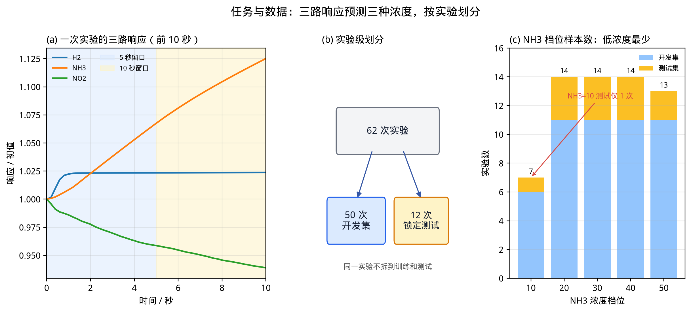
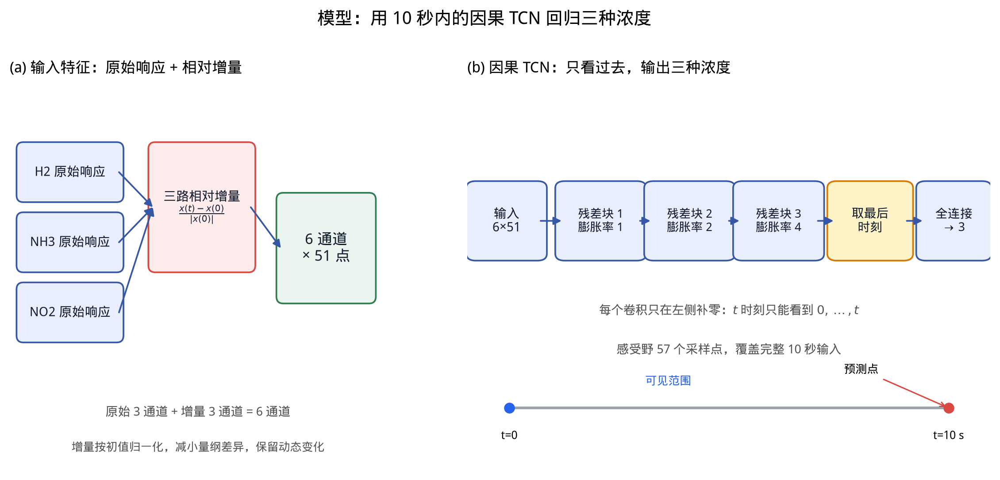
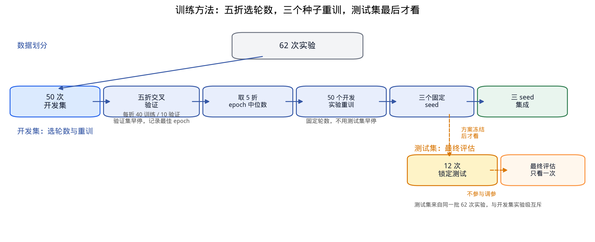
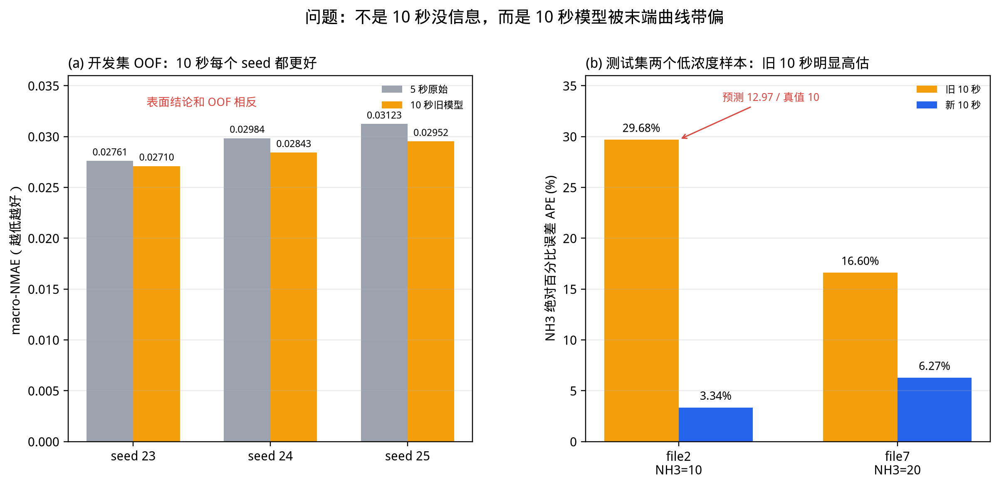
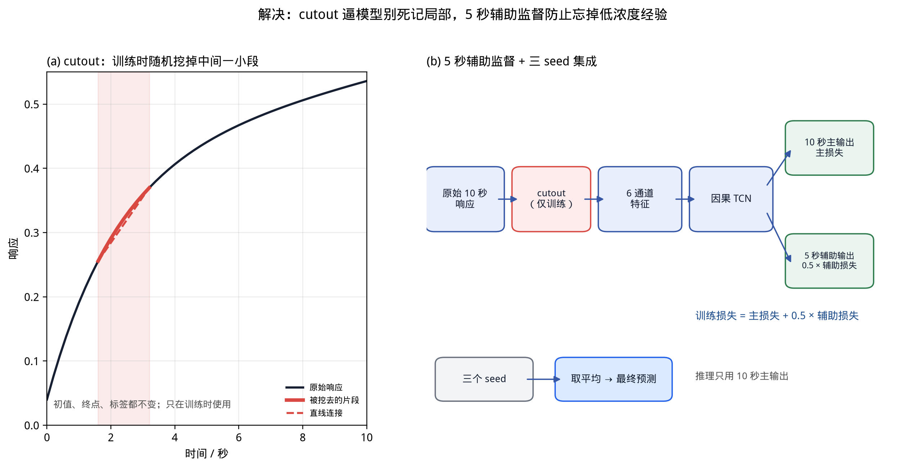
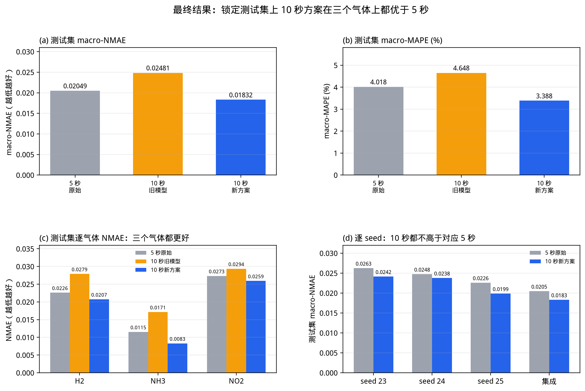
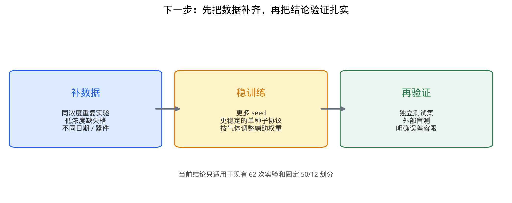

# 三路气体传感器响应加速：从 TCN 到 10 秒数据增强

**汇报人**：__________　　**日期**：__________

**术语说明**：下文“原始”指没有做数据增强的基线模型；“旧模型”指旧 10 秒方案；“新方案”指 cutout + 5 秒辅助监督 + 三 seed 集成。cutout、seed、epoch、OOF、MAPE、NMAE 等保留英文作为专业术语。

**汇报主线**：先讲清楚“我们在预测什么、模型长什么样、怎么训练”，再讲“10 秒模型为什么看起来不如 5 秒”，最后讲“我们怎么把它修好、现在效果如何、还有什么没解决”。

---

## 0. 一句话结论

我们在 62 次三气体传感器实验上，用 5 秒/10 秒早期响应预测 H2、NH3、NO2 浓度。旧 10 秒模型在 12 个测试实验上不如 5 秒；分析后发现不是 10 秒没信息，而是 10 秒模型被末端曲线带偏。最终用 **cutout + 5 秒辅助监督 + 三 seed 集成**，在锁定测试集上把 10 秒模型的 macro-MAPE 从旧 10 秒的 4.648% 降到 **3.388%**，三个气体都优于 5 秒原始；但 12 个测试实验仍然太少，10 秒相对 5 秒的差距还没有到统计显著，这一点要如实说明。

---

## 1. 任务与数据：我们到底在做什么

### 这一部分讲什么

输入是一次实验前 5 秒或前 10 秒的三路传感器响应，输出是这次实验的 H2、NH3、NO2 浓度。不是“分类”，是三个连续值的回归。



**图 0**：(a) 一次实验前 10 秒的三路响应，蓝底是 5 秒窗口，黄底是 10 秒窗口；(b) 62 次实验按实验级划分成 50 次开发集和 12 次锁定测试集；(c) NH3 各浓度档位的样本数，NH3=10 最少，测试集只有 1 次。

### 关键信息

- 数据：62 次实验，每次 0–59.6 秒，采样间隔 0.2 秒（5 Hz），三路响应 + 三个浓度标签。
- 划分：50 次开发 / 12 次测试；**按实验划分**，同一次实验的时间点不会同时出现在训练和测试里。
- 窗口：5 秒 = 26 个采样点；10 秒 = 51 个采样点。
- 低浓度是难点：NH3=10 在开发集只有 6 次，测试集只有 1 次（`data/2.csv`）。这一个小样本会明显影响整气体的 MAPE。

### 口播稿

“我们的任务不是给气体分类，而是根据一次实验前 5 秒或前 10 秒的三路响应，回归出这次实验的 H2、NH3、NO2 浓度。数据一共 62 次实验，我们固定了 50 次做开发、12 次做测试，而且按整次实验划分，避免同一条曲线的点泄漏到两边。这里先埋一个伏笔：NH3=10 在测试集里只有一次实验，后面 10 秒模型的‘翻车’就和它有关。”

---

## 2. 模型介绍：为什么用因果 TCN

### 这一部分讲什么

模型输入是 6 通道、51 个时间点的序列，输出是 3 个浓度。核心要求是**只能看过去，不能看未来**，因为实际使用时 10 秒之后的数据还没有。



**图 1**：(a) 三路原始响应 + 三路相对初值增量，拼成 6 通道；(b) 三个因果残差块，膨胀率 1/2/4，最后取 10 秒末端预测三种浓度。

### 输入特征

三路原始响应直接拼上三路“相对初值增量”：

$$
\text{增量}(t)=\frac{x(t)-x(0)}{\max(|x(0)|,10^{-8})}
$$

这样做的原因：三路传感器的绝对量纲差别很大（H2 是几千，NO2 是一百多），增量可以把动态变化拉到同一尺度；同时保留原始通道，让模型还能用初值信息。

### 网络结构

- 3 个残差块，每块两层因果卷积，卷积核 5，通道 16；
- 膨胀率 1、2、4，感受野 57 个采样点，覆盖完整 10 秒；
- 每个卷积只在左侧补零，所以 $t$ 时刻只能看到 $0,\dots,t$；
- 输出头只读最后一个时间点，接一个小 MLP，输出 H2/NH3/NO2 三个值。

### 为什么不用 LSTM / Transformer

这不是本文重点，但可以这样解释：我们的输入是固定长度的短序列，TCN 参数少、训练稳定、因果性容易保证，推理也简单；LSTM 也能做，但在这个小数据上不一定更好。我们先把“数据和训练协议”这一层做扎实。

### 口播稿

“模型本身不复杂，就是一个因果 TCN。输入是 6 通道：三路原始响应，加三路相对初值的变化。因果卷积的意思是，每个时刻只看它左边，不看右边，这样才符合‘只能用前 10 秒’的设定。三个残差块、膨胀率 1/2/4，感受野 57 个点，刚好覆盖 10 秒。最后只取第 10 秒的隐藏状态，回归三个浓度。”

---

## 3. 训练方法：五折选轮数，三个种子重训

### 这一部分讲什么

小数据最怕“拿测试集调参”。我们的做法是：开发集内部做五折交叉验证，测试集只在方案冻结后看一次。



**图 2**：62 次实验 → 50 次开发集做五折（每折 40 训练 / 10 验证）→ 每折早停记录最佳 epoch → 取中位数 → 50 个开发实验固定轮数重训 → 三个 seed → 集成；12 次测试集只在最后评估。

### 具体做法

- 损失：标准化标签上的 SmoothL1，对异常误差比 MSE 稳一些；
- 优化器：AdamW，学习率 $10^{-3}$，weight decay $10^{-3}$，batch size 8，梯度裁剪 1；
- 五折：每折 40 个训练实验、10 个验证实验；验证集只用来早停和选 epoch；
- 轮数：五折最佳 epoch 的中位数向上取整；最终 10 秒方案 193 epoch，5 秒原始 231 epoch；
- 种子：`20260923 / 20260924 / 20260925` 三个固定种子，分别重训，最后取平均；
- 测试集：不参与早停、不参与选增强参数、不参与选种子。

### 口播稿

“训练这一块，核心是防止测试集泄漏。我们先在 50 个开发实验里做五折，每折 40 训 10 验，验证集只负责早停和选轮数。然后取五折最佳 epoch 的中位数，在 50 个开发实验上固定轮数重训，跑三个固定种子，最后取平均。12 个测试实验是最后才看的，不参与任何调参。”

---

## 4. 存在的问题：10 秒为什么看起来不如 5 秒

### 这一部分讲什么

表面现象是：旧 10 秒模型在测试集上 macro-NMAE 0.03072，比 5 秒的 0.02627 还差，NH3 和 NO2 都变差。但我们不能只看这 12 个测试实验。



**图 3**：(a) 开发集 OOF 上，10 秒在三个 seed 上都比 5 秒低；(b) 测试集两个低浓度 NH3 样本上，旧 10 秒的 APE 明显高于新 10 秒。

### 现象一：OOF 和测试集结论相反

开发集五折 OOF，10 秒在三个种子上都优于 5 秒：

| 窗口 | seed 23 | seed 24 | seed 25 |
|---|---:|---:|---:|
| 5 秒原始 | 0.027605 | 0.029835 | 0.031231 |
| 10 秒旧模型 | 0.027097 | 0.028427 | 0.029521 |

所以“10 秒更差”不是 10 秒没有信息，更像是 12 个测试实验的评估方差。

### 现象二：旧 10 秒在低浓度 NH3 上高估

旧 10 秒主种子在 `data/2.csv`（NH3=10）上预测 12.97，APE 29.68%；这一个实验就占了 NH3 MAPE 的 **42.34%**。`data/7.csv`（NH3=20）预测 23.32，APE 16.60%。

为什么？10 秒模型看到了更长的上升段，把“后半段长得像更高浓度”当成了浓度证据。但 `t=0` 的绝对响应本来和 NH3 标签高度相关（开发集上 H2/NH3 初值与 NH3 标签的相关系数约 0.975/0.966），这是低浓度判断的强线索。10 秒模型自由度更大，容易压过这个线索。

### 原因总结

1. **测试集小**：12 次实验，NH3=10 只有 1 次，单个实验能改变整气体指标；
2. **模型学偏**：10 秒模型过度依赖末端局部形状；
3. **小样本过拟合**：50 个开发实验、无重复，10 秒输入 51 个时间点，比 5 秒更容易记住局部形状；
4. **种子波动**：最终重训没有验证折，固定轮数，10 秒对种子更敏感。

### 口播稿

“旧 10 秒在测试集上确实输了，但我们先别急着下结论。开发集五折 OOF 上，10 秒在三个 seed 上都比 5 秒好，所以不是 10 秒没信息。问题出在两个低浓度 NH3 样本上：旧 10 秒把 NH3=10 预测成 12.97，APE 接近 30%，这一个实验就占了 NH3 MAPE 的 42%。原因是它看到后半段曲线往上走，就以为浓度更高，把初值这个更可靠的线索给压过去了。再加上测试集只有 12 个实验，NH3=10 只有 1 个，指标就被这一个样本带偏了。”

---

## 5. 如何解决：cutout + 5 秒辅助监督 + 三 seed 集成

### 这一部分讲什么

我们先试了很多常规增强，发现大多数会破坏 `t=0` 的初值线索，越加越差。最后留下两个真正有效的操作：cutout 和 5 秒辅助监督，再加三 seed 集成。



**图 4**：(a) cutout 在训练时随机挖掉响应内部一小段，用两端直线连接；(b) 同一个因果 TCN 同时输出 10 秒主预测和 5 秒辅助预测，训练损失 = 主损失 + 0.5 × 辅助损失；推理只用 10 秒主输出。

### 5.1 先试过、但失败的方案

| 方案 | OOF macro-NMAE | 为什么失败 |
|---|---:|---|
| 高斯噪声 0.1% 初值 | 0.030809 | 把初值线索弄花，越加越差 |
| 高斯噪声 0.3% 初值 | 0.039965 | 同上，噪声越强越差 |
| 增益 1% | 0.033726 | 改变 raw 绝对尺度与 delta 分母 |
| 基线偏移 0.2% | 0.028868 | 改变初值，低浓度判断退化 |
| mixup α=0.2 | 0.026220 | 有改善但不够；信号/标签线性可加性未验证 |
| 时间缩放 0.20 | 0.025977 | 有效但不稳定；没有阀门/流量日志 |
| 前缀保持 | 0.031219 | 后半段信息被抹掉 |
| 多前缀长度 5–10 秒 | 0.032596 | 训练目标变化太大 |

一句话：**噪声、增益、偏移、mixup 都在破坏初值这条“身份证信息”；时间缩放/前缀截断又在改变动力学语义。** 所以它们不是“数据不够就加一点”的正确答案。

### 5.2 cutout：逼模型不要只盯着一小段

训练时，在 10 秒响应内部随机选 1–10 个采样点（最多 2 秒），把这一段用两端响应的直线连接替换。

- 不碰 `t=0`，不碰 `t=10s`，标签不变；
- 只用于训练，验证/测试保持原始曲线；
- 效果：模型不能只靠“最后一段长什么样”来猜浓度，必须综合整条曲线。

可以理解成：**考试时故意用纸遮住一道题，逼学生用其他信息推理，而不是背某一段。**

### 5.3 5 秒辅助监督：让 10 秒模型顺便做一道 5 秒“小测”

同一个 TCN，在 10 秒位置输出主预测，在 5 秒位置再输出一个辅助预测，两个预测都对着同一个浓度标签：

$$
\text{loss}=\text{主损失}(10\text{秒}) + 0.5\times\text{辅助损失}(5\text{秒})
$$

推理时只用 10 秒主输出，不增加第二个模型，也不增加输入通道。

可以理解成：**10 秒模型在学“大题”的同时，必须保证“5 秒小题”也做对。** 这样它就不会学了 10 秒之后，把 5 秒模型原本擅长的低浓度 NH3 判断给忘了。

### 5.4 三 seed 集成

三个固定种子各训一个模型，预测取平均。**就像三个学生分别考试，取平均分，避免某一个人刚好发挥失常。**

### 口播稿

“这一页是方法的核心。我们一开始也试了加噪声、加增益、mixup，结果都变差，原因是这些操作把 `t=0` 的初值弄花了，而初值恰好是判断 NH3 低浓度最可靠的线索。后来我们换成两个保留初值的操作：第一，cutout，训练时随机挖掉中间一小段，用直线连起来，逼模型别只盯末端；第二，5 秒辅助监督，同一个模型在 5 秒位置也做一次预测，主损失加 0.5 倍辅助损失，推理还是只用 10 秒输出。最后三个 seed 取平均，降低随机性。”

---

## 6. 最终结果：三个气体都更好，但别把话说满

### 这一部分讲什么

先看锁定测试集的三 seed 集成结果，再看逐气体和逐 seed，最后说清楚统计上的不确定性。



**图 5**：(a) 测试集 macro-NMAE；(b) 测试集 macro-MAPE；(c) 逐气体 NMAE；(d) 逐 seed 的 5 秒 vs 新 10 秒。

### 6.1 测试集总体结果（三 seed 集成）

| 方案 | macro-NMAE | macro-MAPE |
|---|---:|---:|
| 5 秒原始 | 0.020487 | 4.018% |
| 10 秒旧模型 | 0.024807 | 4.648% |
| **10 秒 cutout + 5 秒辅助** | **0.018321** | **3.388%** |

- 相对 5 秒原始：macro-NMAE 降低 **10.6%**，macro-MAPE 降低 **0.629 个百分点**（相对 −15.7%）；
- 相对旧 10 秒：macro-NMAE 降低 **26.1%**，macro-MAPE 降低 **1.259 个百分点**（相对 −27.1%）。

### 6.2 逐气体结果

| 气体 | 5 秒原始 NMAE | 旧 10 秒 NMAE | 新 10 秒 NMAE | 5 秒原始 MAPE | 旧 10 秒 MAPE | 新 10 秒 MAPE |
|---|---:|---:|---:|---:|---:|---:|
| H2 | 0.02261 | 0.02790 | **0.02074** | 4.635% | 4.639% | **3.504%** |
| NH3 | 0.01153 | 0.01715 | **0.00829** | 1.874% | 3.413% | **1.413%** |
| NO2 | 0.02733 | 0.02937 | **0.02593** | 5.543% | 5.892% | **5.248%** |

三个气体的 NMAE 和 MAPE 都低于 5 秒原始；NH3 的 MAPE 从旧 10 秒的 3.413% 降到 **1.413%**，是改善最大的。

### 6.3 为什么 NH3 改善最大

旧 10 秒在 `data/2.csv` 上把 NH3=10 预测成 12.97，APE 29.68%，占 NH3 MAPE 的 42.34%；新 10 秒在同一个实验上 APE 降到 **3.34%**，占比降到 11.93%。`data/7.csv` 的 NH3 APE 也从 16.60% 降到 6.27%。这说明新方案修正的正是“末端曲线误判低浓度”这个具体问题，而不是简单把预测往均值收缩。

### 6.4 逐 seed 结果

| 种子 | 5 秒原始 | 新 10 秒 |
|---|---:|---:|
| 20260923 | 0.026269 | 0.024165 |
| 20260924 | 0.024762 | 0.023790 |
| 20260925 | 0.022614 | 0.019876 |
| 三 seed 集成 | 0.020487 | **0.018321** |

三个种子上，新 10 秒都低于对应 5 秒。但 12 个测试实验的配对 bootstrap：

- 新 10 秒 − 旧 10 秒：`−0.006485`，95% 区间 `[−0.011753, −0.000428]`，不跨零；
- 新 10 秒 − 5 秒：`−0.002166`，95% 区间 `[−0.008419, +0.002700]`，跨零。

所以可以说“新 10 秒显著优于旧 10 秒”；“新 10 秒优于 5 秒”只能表述为**点估计和三个气体上方向一致，12 次实验下还没到统计显著**。

### 6.5 必须报告的负面结果：OOF 种子敏感

最终方案的 OOF 0.024592 是 seed 23 的结果。另外两个种子：

| 种子 | 10 秒旧模型 | 新 10 秒 | 配对差 |
|---|---:|---:|---:|
| 20260923 | 0.027097 | 0.024592 | −0.002505 |
| 20260924 | 0.028427 | 0.031708 | +0.003281 |
| 20260925 | 0.029521 | 0.028850 | −0.000671 |

三种子配对均值约 **+0.000035**，基本持平。也就是说，**OOF 的增益不是三个种子都稳定**；测试集三 seed 集成的强结果是另一个评估对象。这一点在汇报里主动说，比被老师问出来更好。

### 口播稿

“最终结果：三 seed 集成下，测试集 macro-NMAE 从 5 秒的 0.02049 降到 0.01832，macro-MAPE 从 4.018% 降到 3.388%；旧 10 秒是 4.648%。三个气体单独看，NMAE 和 MAPE 都低于 5 秒，NH3 的 MAPE 从 3.413% 降到 1.413%，改善最大。但是要如实说：12 个测试实验太少，10 秒相对 5 秒的 bootstrap 区间还是跨零的，所以我说的是‘方向一致、点估计更好’，不是‘已经统计显著’。另外 OOF 上 seed 24 有回退，三个种子平均基本持平，这个负面结果我们也保留在报告里。”

---

## 7. 诚实讨论与下一步

### 这一部分讲什么

这套方案解决了“10 秒模型被末端曲线带偏”的问题，但没有解决“数据量小、没有重复实验、没有外部验证”的根本问题。



**图 6**：下一步分三块：补数据、稳训练、再验证。

### 7.1 这套方案为什么有效

1. **cutout 降低末端局部依赖**：模型不能只靠最后一段，必须综合整条曲线；
2. **5 秒辅助监督保留低浓度行为**：10 秒模型必须保证 5 秒视图也预测对，相当于把 5 秒模型的行为当正则项；
3. **三 seed 集成降低随机性**：三个种子都优于对应 5 秒，集成进一步降低单种子波动。

### 7.2 局限

- 测试集只有 12 次实验，NH3=10 只有 1 次，窗口差 bootstrap 区间跨零；
- OOF 种子敏感，最终组合三种子平均增益约 0；
- 测试集不是完全盲测：方案冻结前看过一些诊断变体；
- cutout 是经验正则化，不是阀门/流量的物理模型；
- 5 秒辅助监督改变了训练目标（多一个辅助头），严格说不是“只换数据”的纯增强；
- 单模型部署要用主种子，测试 macro-MAPE 4.415%，仍优于旧 10 秒和 5 秒主种子，但优势小于集成。

### 7.3 下一步

1. **补数据**：同浓度重复实验、低浓度缺失格、不同日期/器件；
2. **稳训练**：更多 seed、更稳定的单种子协议、按气体调整辅助权重；
3. **再验证**：独立测试集、外部盲测、明确误差容限。

### 口播稿

“最后说局限和下一步。我们这套方法解决的是‘10 秒模型学偏’的问题，但没有解决‘数据少’这个根本问题。测试集只有 12 个实验，NH3=10 只有 1 个，所以 10 秒相对 5 秒的差距还不能说统计显著；OOF 上 seed 24 也有回退。下一步最优先的是补数据：同浓度重复、低浓度缺失格、不同日期或器件；然后再做更稳定的单种子训练和独立测试集验证。”

---

## 8. PPT 页纲与每页口播（可直接拆页）

| 页 | 标题 | 用哪张图 | 这一页只讲一句话 |
|---|---|---|---|
| 1 | 封面 | 无 | 三路气体传感器响应加速：从 TCN 到 10 秒数据增强 |
| 2 | 一页结论 | 可放图 5 缩略 | 旧 10 秒被末端曲线带偏；新方案测试集三个气体都更好，但 12 个样本还不够显著 |
| 3 | 任务与数据 | 图 0 | 62 次实验，50 开发 / 12 测试，NH3=10 测试只有 1 次 |
| 4 | 模型结构 | 图 1 | 6 通道输入 + 因果 TCN，只看过去，输出三个浓度 |
| 5 | 训练方法 | 图 2 | 五折选轮数，三个 seed 重训，测试集最后才看 |
| 6 | 问题现象 | 图 3 | OOF 上 10 秒每个 seed 都更好，测试集却被两个低浓度样本带偏 |
| 7 | 问题原因 | 图 3 右 | 旧 10 秒把 NH3=10 预测成 12.97，APE 29.68%，占 NH3 MAPE 42% |
| 8 | 失败尝试 | 表格 | 噪声/增益/mixup 破坏初值线索，越加越差 |
| 9 | 解决方案 | 图 4 | cutout 防死记局部，5 秒辅助监督防忘掉低浓度经验 |
| 10 | 最终结果 | 图 5 | 测试集 macro-MAPE 4.018%→3.388%，三个气体都更好 |
| 11 | 诚实讨论 | 图 5d + 表 | 12 个样本，10 秒 vs 5 秒还不显著；OOF seed 24 有回退 |
| 12 | 下一步 | 图 6 | 补数据、稳训练、再验证 |

### 每页建议时长

- 封面 + 结论：1 分钟；
- 任务与数据：1 分钟；
- 模型：1.5 分钟；
- 训练：1.5 分钟；
- 问题：2 分钟；
- 失败尝试 + 方案：2.5 分钟；
- 结果 + 讨论：2.5 分钟；
- 下一步：1 分钟；
- 总计约 13 分钟，留 5–10 分钟提问。

---

## 9. 老师可能追问的问题

**Q1：为什么 10 秒会不如 5 秒？不是信息更多吗？**

A：开发集 OOF 上 10 秒每个种子都更好，所以不是信息少。测试集上旧 10 秒变差，主要是两个低浓度 NH3 样本：`data/2.csv` 的 NH3=10 被预测成 12.97，APE 29.68%，单个实验占 NH3 MAPE 的 42.34%。10 秒模型看到后半段上升，把它误判成更高浓度；5 秒模型看得少，反而更多依赖初值。

**Q2：为什么不用更复杂的生成模型做数据增强？**

A：我们试过噪声、增益、偏移、mixup、时间缩放、前缀截断，发现破坏 `t=0` 初值的操作都会变差；生成模型更难验证合成曲线是否落在真实流形上。最后选择保留初值和标签的 cutout + 5 秒前缀辅助监督，至少每一步都能解释、能复现。

**Q3：5 秒辅助监督算数据增强吗？**

A：算“多前缀视图增强”：同一个 10 秒实验同时提供 10 秒视图和真实的 5 秒视图，两个视图共享权重和标签。严格说它也改变了训练目标（多一个辅助头），所以报告里把它和 cutout 分开消融，没有说成“只换数据”。

**Q4：为什么测试集 10 秒全面更好，你还说不显著？**

A：12 个测试实验太少。点估计和三个气体方向都支持 10 秒，但配对 bootstrap 的新 10 秒 − 5 秒区间是 `[−0.008419, +0.002700]`，跨零；新 10 秒 − 旧 10 秒的区间不跨零。所以“优于旧 10 秒”可以说显著，“优于 5 秒”只能说方向一致、尚未显著。

**Q5：OOF 上 seed 24 为什么回退？**

A：小数据 + 五折早停 + 固定轮数，单种子对折分和初始化敏感。最终交付用三个 seed 集成，测试集逐 seed 都优于对应 5 秒；但我们不把 seed 23 的 OOF 单点当作稳定收益，这一点报告里明确写了。

**Q6：最终部署用哪个模型？**

A：如果允许集成，用三个 seed 平均，测试 macro-NMAE 0.018321、macro-MAPE 3.388%；如果必须单模型，用主种子 `20260923`，测试 macro-NMAE 0.024165、macro-MAPE 4.415%，仍优于旧 10 秒和 5 秒主种子，但优势小于集成。

**Q7：下一步最值得做什么？**

A：补数据优先：同浓度重复实验、NH3=10 等低浓度缺失格、不同日期/器件。算法上再做更稳定的单种子训练和按气体自适应辅助权重，最后用独立测试集验证。

---

## 附录：关键指标表

> 所有图片的 PNG（220 dpi）和 PDF 在 `artifacts/report/ppt_figures/`，可直接拖进 PPT。


### A. 开发集 OOF（主种子）

| 方案 | macro-NMAE | H2 NMAE | NH3 NMAE | NO2 NMAE | macro-MAPE |
|---|---:|---:|---:|---:|---:|
| 5 秒原始 | 0.027605 | 0.027726 | 0.019586 | 0.035504 | 5.398% |
| 10 秒旧模型 | 0.027097 | 0.027284 | 0.020303 | 0.033705 | 4.983% |
| 10 秒 cutout + 5 秒辅助 | **0.024592** | 0.029917 | **0.015779** | **0.028081** | **4.383%** |

### B. 锁定测试集（三 seed 集成）

| 方案 | macro-NMAE | macro-MAPE | H2 NMAE | NH3 NMAE | NO2 NMAE |
|---|---:|---:|---:|---:|---:|
| 5 秒原始 | 0.020487 | 4.018% | 0.02261 | 0.01153 | 0.02733 |
| 10 秒旧模型 | 0.024807 | 4.648% | 0.02790 | 0.01715 | 0.02937 |
| 10 秒 cutout + 5 秒辅助 | **0.018321** | **3.388%** | **0.02074** | **0.00829** | **0.02593** |

### C. 主种子单模型测试

| 方案 | macro-NMAE | macro-MAPE |
|---|---:|---:|
| 5 秒原始 | 0.026269 | 5.057% |
| 10 秒旧模型 | 0.030718 | 6.040% |
| 10 秒 cutout + 5 秒辅助 | **0.024165** | **4.415%** |

### D. 复现入口

```bash
uv run python -m tcn_union.augmentation_search \
  --manifest artifacts/splits/manifest.csv \
  --output-dir artifacts/aug_search/final_10s \
  --seconds 10 --recipes cutout_1.0_2s --seed 20260923 \
  --aux-positions 25 --aux-weight 0.5

uv run python -m tcn_union.augmentation_train \
  --manifest artifacts/splits/manifest.csv \
  --output-dir artifacts/augmentation_final \
  --config-5s clean --config-10s cutout_1.0_2s \
  --aux-positions-10s 25 --aux-weight-10s 0.5

uv run python -m tcn_union.augmentation_evaluate \
  --manifest artifacts/splits/manifest.csv \
  --baseline-dir artifacts/tcn --model-dir artifacts/augmentation_final \
  --output-dir artifacts/evaluation_final
```

- 详细技术说明：[`docs/augmentation_10s.md`](augmentation_10s.md)
- 学术报告稿：[`docs/augmentation_10s_report.md`](augmentation_10s_report.md)
- 最终模型与 OOF：[`artifacts/augmentation_final/selection.json`](../artifacts/augmentation_final/selection.json)
- 测试指标与预测：[`artifacts/evaluation_final/evaluation.json`](../artifacts/evaluation_final/evaluation.json)
