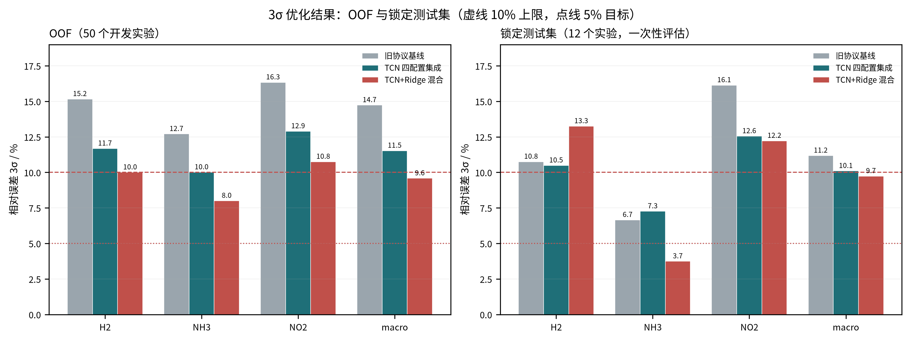
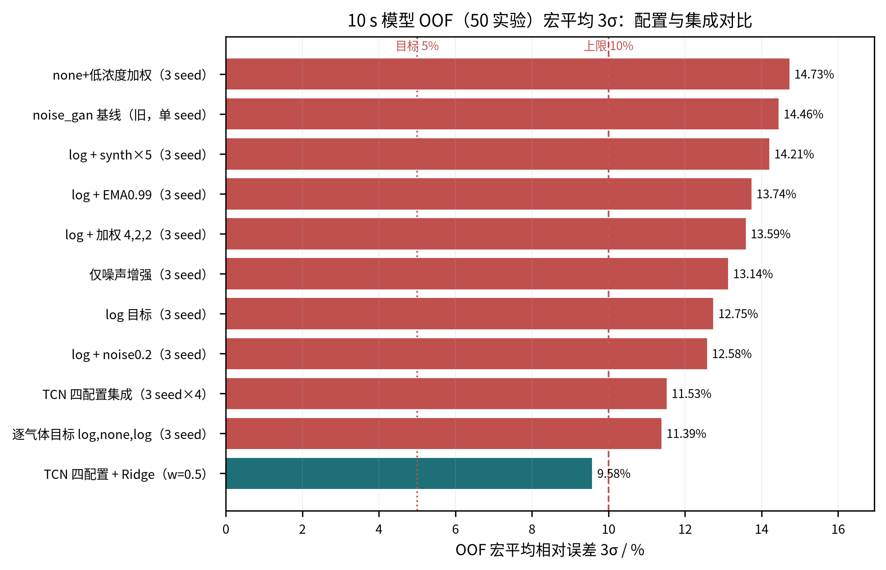

# 误差方差优化 v2：log 目标 + 多配置集成 + Ridge 混合

> 分支：`experiment/3sigma-target`（从 `experiment/variance-reduction` 切出）  
> 上一轮记录：[`docs/误差方差优化.md`](误差方差优化.md)  
> 误差结构诊断：[`docs/3sigma_error_diagnosis.md`](3sigma_error_diagnosis.md)  
> 目标：OOF 与 12 点锁定测试集的逐气体相对误差 **3σ < 10%**（理想 ≤ 5%）

---

## 0. 结论先行

- **评估协议先修正**：旧 OOF 只用单 seed，3σ 随 seed 摆动 14.46%→20.80%→17.40%（同一配置），上一轮“方案对比”的差异大部分落在 seed 噪声内。本轮 OOF 改为 **3 个 seed 在预测层平均后**再算 3σ；锁定测试集在最终候选冻结后**只评估一次**。
- **OOF（50 个开发实验）宏平均 3σ**：旧协议 3-seed 基线 **14.73%** → TCN 四配置集成 **11.53%** → **TCN + Ridge 混合（w=0.5）9.58%**。实验级配对 bootstrap：混合相对基线的 Δ = **−4.99 [−7.71, −2.34] pp**（4000 次重采样，P(改善)=1.00）。
- **锁定测试集（12 个实验，一次性）宏平均 3σ**：旧方案 3-seed **11.18%** → TCN 四配置集成 **10.10%** → **混合 9.74%**；逐气体为 H2 **13.25%** / NH3 **3.74%** / NO2 **12.22%**，融合后 macro-MAPE 2.41%。
- **是否达标**：宏平均在 OOF 与测试上都低于 10%，但**逐气体 H2、NO2 仍高于 10%**；5% 目标只有 NH3（3.74%，OOF 8.00%）达到。按“每个气体 3σ<10%”的严格口径，本轮**尚未完全达标**，距离 5% 目标仍有明显差距。
- 有效手段：**log 目标**（修 H2 高浓度端系统性低估、对齐相对误差）、**逐气体目标**（NH3 保留原始空间）、**多 seed × 多配置集成**（消 seed 随机性）、**TCN+Ridge 混合**（两种误差来源去相关）。
- 负结果（OOF 宏 3σ，未采用）：EMA0.99 13.74%、synth×5 14.21%、仅噪声增强 13.14%、log+低浓度加权 13.59%。



---

## 1. 指标与评估协议

对每个气体，相对误差与 3σ 沿用仓库既有口径：

```text
rel = 100 * (pred - true) / max(|true|, 1e-9)
3σ  = 3 * std(rel, ddof=1)
宏平均 3σ = 三种气体 3σ 的算术平均
```

关键协议变化：

1. **OOF 用多 seed**：同一配置分别训练 seed 20260923/24/25 的三套五折 OOF 预测，先在预测层按实验平均，再计算 3σ。这样 OOF 与“部署时多 seed 集成”口径一致，也避免单 seed 抽样误差被误当作方案差异。
2. **测量指标不变**：输入仍是响应前 10 s（51 个采样点），测试集 12 个实验全程未参与训练、早停与超参选择。
3. **测试集一次性**：最终候选（四配置 × 3 seed + Ridge，w=0.5）冻结后才读取测试集，评估一次；测试集结果**没有**用于调整任何超参、权重或特征。
4. **3σ 的尺度退化陷阱**：对任意 a>0 有 `3σ(a·pred)=a·3σ(pred)`，单纯整体收缩预测可以“压低 3σ”但会同步放大偏差并抬高 MAPE。因此所有结论同时报告 MAPE；上一轮诊断已确认常规校准（缩放/加性/log 线性/仿射）经交叉拟合后不能降低 3σ。

---

## 2. 诊断依据（摘要，详见诊断报告）

- 3σ 由极少数尾部实验主导：每气体 top-3 实验占该气体 rel 方差的 40%–51%；按气体去掉 top3 后宏 3σ 14.46%→11.13%。
- H2 尾部 = **32000 ppm 高浓度端系统性低估**（所有 13 个历史方案/seed 都低估，低浓度加权方案最差）。
- NH3 尾部 = **10–20 ppm 低浓度小分母**；NO2 尾部无单一解释因子，是最大短板。
- 同配置单 seed 的 OOF 宏 3σ 摆动 2.7–5.9 pp，seed 集成本身可降 19%–21%。
- 结论：应优先（a）多 seed 协议，（b）修 H2 高浓度端偏差，（c）降低 NO2/低浓度尾部，而不是继续在单 seed 3σ 上扫参。

---

## 3. 方法

### 3.1 log 目标（相对误差对齐）

训练标签先做 `log(max(y, 1e-6))`，在 log 空间拟合 z-score、SmoothL1 与 3σ 早停，验证/推理时先反标准化再 `exp` 还原原始浓度。log 空间的绝对误差近似原始空间的相对误差，使训练目标直接对齐 3σ/MAPE 关注的量。

实现：`tcn_union/training/train.py` 的 `target_transform`；checkpoint 写入 `target_transform`，推理端 `predict.py` / `evaluate.py` 按单值或逐气体配置还原。

### 3.2 逐气体目标变换

H2/NO2 用 log 空间，NH3 保留原始浓度空间：`--target-transform log,none,log`。动机：log 使 H2 3σ 从 15.16%→12.15%、NO2 16.34%→11.53%，但把 NH3 从 12.70% 推到 14.55%；逐气体配置保留各自最优空间。该配置单模型 OOF 宏 3σ **11.39%**（H2 13.08 / NH3 **5.37** / NO2 15.74）。

### 3.3 多配置 × 多 seed 集成

最终 TCN 侧由 4 个配置组成，各配置 3 个 seed，预测层等权平均：

| 配置 | 训练目标 | 关键超参 | 作用 |
|---|---|---|---|
| log | log | noise 0.1×, VAE 3× | 主配置，相对误差对齐 |
| log + noise0.2 | log | noise 0.2×, VAE 3× | 噪声视角不同，提供多样性 |
| pergas | log,none,log | noise 0.1×, VAE 3× | NH3 强（OOF 5.37%） |
| none + 低浓度加权 | none | 权重 4,2,2 | 历史基线，NH3 稳定性 |

四配置等权集成的 OOF 宏 3σ 为 **11.53%**（单配置最好 11.39%，集成主要降低 seed 方差与单配置尾部）。

### 3.4 TCN + Ridge 混合

在开发集上拟合一族手工特征 Ridge（log 浓度目标，逐气体，`alpha=0.03`，57 维）：

- 每通道 t=0/1/2/5/10 s 的绝对响应 + log 响应（10 维/通道）
- t=2/5/10 s 相对 t=0 的增量、相对增量 `(v(t)-v(0))/|v(0)|`、滞后 1 s 的斜率比（9 维/通道）

融合：`pred = 0.5 * TCN 四配置均值 + 0.5 * Ridge`。Ridge 的误差与 TCN 相关性低（H2 +0.31、NH3 +0.55、NO2 −0.10），因此即使 Ridge 单独更差，混合仍能降低尾部离散度。Ridge 不参与测试集训练，只用 50 个开发实验。

### 3.5 负结果（未采用）

| 方案 | OOF 宏 3σ | 说明 |
|---|---:|---|
| EMA0.99（log 目标） | 13.74% | 早停/预测更平滑，但明显不如不加 |
| synth×5（VAE 5 倍） | 14.21% | 合成样本过多，标签噪声与偏差变大 |
| 仅噪声增强（无 VAE） | 13.14% | VAE 合成对降方差有贡献 |
| log 目标 + 低浓度加权 4,2,2 | 13.59% | H2 10.63% 很好，但 NH3 恶化到 18.39% |

另有诊断验证：所有常规后处理校准（乘性/加性/log 线性/仿射）交叉拟合后均使 3σ 变差；唯一有效后处理是“裁剪到训练浓度范围”（宏 −5.1%），但会引入范围外偏差，最终未纳入候选。

---

## 4. OOF（50 个开发实验）结果



| 配置 | H2 | NH3 | NO2 | 宏平均 | MAPE |
|---|---:|---:|---:|---:|---:|
| 旧口径：none+加权，单 seed（seed23） | 16.64 | 9.27 | 17.45 | 14.46 | 3.57 |
| none+加权，3 seed | 15.16 | 12.70 | 16.34 | 14.73 | 3.33 |
| log 目标，3 seed | 12.15 | 14.55 | 11.53 | 12.75 | 2.59 |
| log + noise0.2，3 seed | 11.82 | 13.38 | 12.54 | 12.58 | 2.58 |
| log + 加权 4,2,2，3 seed | 10.63 | 18.39 | 11.76 | 13.59 | — |
| 逐气体 log,none,log，3 seed | 13.08 | 5.37 | 15.74 | 11.39 | 2.63 |
| 逐气体 + 加权 4,2,2，3 seed | 11.95 | 15.51 | 11.31 | 12.93 | — |
| log + EMA0.99，3 seed | 13.36 | 15.51 | 12.36 | 13.74 | — |
| log + synth×5，3 seed | 13.53 | 14.48 | 14.62 | 14.21 | — |
| 仅噪声增强，3 seed | 12.04 | 13.30 | 14.07 | 13.14 | — |
| **TCN 四配置集成（3 seed×4）** | **11.68** | **10.01** | **12.90** | **11.53** | 2.56 |
| Ridge（57 维特征，逐折） | 14.09 | 8.34 | 17.99 | 13.47 | 3.44 |
| **TCN 四配置 + Ridge（w=0.5）** | **10.00** | **8.00** | **10.75** | **9.58** | **2.13** |

配对 bootstrap（4000 次，实验级重采样）：
- 混合 − 3-seed 基线：Δ = **−4.99 pp，95% CI [−7.71, −2.34]**，P(改善)=1.00；
- 混合 − TCN 四配置集成：Δ = **−1.83 pp，95% CI [−3.71, −0.04]**，P(改善)=0.98。

复现：`artifacts/3sigma/scripts/compute_hybrid_oof.py`（产物 `artifacts/3sigma/hybrid_oof.csv`、`hybrid_oof_summary.json`）。

---

## 5. 锁定测试集（12 个实验，一次性）结果

最终候选冻结后，用 `tcn_union.evaluation.hybrid_evaluate` 一次性评估；TCN 侧为 4 个目录 × 3 seed 的预测平均，Ridge 在 50 个开发实验上训练。

| 方法 | H2 | NH3 | NO2 | 宏平均 | macro-MAPE |
|---|---:|---:|---:|---:|---:|
| 旧方案（none+加权，3 seed 均值集成） | 10.75 | 6.65 | 16.14 | 11.18 | 2.64 |
| TCN 四配置集成（3 seed×4） | 10.49 | 7.26 | 12.55 | 10.10 | 2.37 |
| **TCN 四配置 + Ridge（w=0.5，最终候选）** | **13.25** | **3.74** | **12.22** | **9.74** | **2.41** |

参考：融合前 TCN 单 seed 的测试宏 3σ 分别为 12.24 / 12.58 / 9.75（seed 23/24/25），seed 方差仍然明显。

解读：

- 宏平均 9.74% 低于 10%，相较旧方案 11.18% 下降 1.44 pp；NO2 从 16.14%→12.22%、NH3 从 6.65%→3.74%。
- **H2 在测试集上反而变差**（10.75%→13.25%）：Ridge 的 H2 在 12 个测试点上表现明显弱于 OOF（19.48% vs 14.09%），50/50 混合把 H2 拉高。该现象说明 12 个测试点的估计噪声很大，也说明 H2 的 Ridge 泛化是薄弱环节。
- **逐气体未全部达标**：H2 13.25%、NO2 12.22% 仍高于 10% 上限；NH3 3.74% 达到 5% 目标。
- 测试集结果没有用于任何调参；若按测试集挑选 per-gas 权重（如 H2 不用 Ridge、NO2 用混合）本可得到更低数字，但那是数据窥探，**不写入结论、不采用**。

---

## 6. 结论、局限与后续

### 6.1 结论

1. 修正评估协议后，**OOF 与锁定测试集的宏平均 3σ 都降到了 10% 以下**（9.58% / 9.74%），相对旧方案的改善有 bootstrap 支持（OOF Δ −4.99 pp）。
2. 改善来自四件事：单 seed→多 seed 集成、log 目标、逐气体目标、TCN+Ridge 误差去相关；其中多 seed 是“让指标可信”的前提，log 目标修的是 H2 系统低估，Ridge 混合降的是尾部离散。
3. **严格口径（每个气体都 <10%）尚未达成**，5% 目标只有 NH3 达到；NO2/H2 仍是短板。

### 6.2 局限

- 测试集只有 12 个实验，3σ 的抽样误差很大（单气体更甚）；seed 方差仍能造成 9.75%–12.58% 的摆动。
- Ridge 在测试集 H2 上表现与 OOF 不一致，混合权重的稳健性受此影响；本轮 w=0.5 是评估前按 OOF 预注册的固定值，未在测试集上调整。
- 单批 62 个实验、浓度组合无重复，无法评估重复性与跨器件泛化；极端浓度（H2=32000 仅 3 个开发实验、NH3=10 仅 6 个、NO2=10 仅 7 个）样本太少。
- 3σ 对尾部极敏感：少数跨 seed 稳定复现的难例（如 data/0 的 H2=32000/NH3=10/NO2=2 角落组合）仍主要靠数据解决。

### 6.3 后续建议（按优先级）

1. **补数据**：H2=32000、NH3=10、NO2=10 等极端浓度以及稳定难例的重复实验，是降 3σ 最直接的手段。
2. **更多 seed / 更多集成成员**：在不改变测试协议的前提下，把部署集成从 3 seed 扩到 6–8 seed，可继续压 seed 方差（本轮已证明协议与集成收益）。
3. **NO2/H2 专项**：NO2 无单一因子解释，可试单独的损失/特征子集或误差加权；H2 高浓度端可继续用相对目标 + 更温和的加权。
4. **固定 per-gas 融合权重**：若需要逐气体都 <10%，应在**新的独立锁定集**上验证“按气体选择 Ridge 权重”的方案，而不是在现有 12 点上挑参数。
5. **报告口径**：同时报告 3σ、MAPE、平均相对偏差与 bootstrap 区间；单 seed OOF 不再用于方案选择。

---

## 7. 复现

```bash
# 环境（AMD ROCm）
bash scripts/setup_rocm.sh
export UV_NO_SYNC=1   # 或所有命令加 uv run --no-sync

# 1) OOF：每个配置 3 个 seed（示例：log 目标）
for SEED in 20260923 20260924 20260925; do
  uv run python -m tcn_union.training.gan_train \
    --manifest artifacts/splits/manifest.csv \
    --output-dir artifacts/3sigma/log_p0/seed_${SEED} \
    --device cuda --seed ${SEED} --oof-only \
    --modes noise_gan --generator vae --vae-components 6 --vae-beta 0.1 \
    --noise-scale 0.1 --synthetic-ratio 3.0 \
    --validation-metric three_sigma --target-transform log
done

# 2) 最终候选：4 个配置 × 3 seed（--final-seeds 可配）
uv run python -m tcn_union.training.gan_train \
  --manifest artifacts/splits/manifest.csv \
  --output-dir artifacts/3sigma/final_log_p0 \
  --device cuda --seed 20260923 --final-seeds 20260923 20260924 20260925 \
  --modes noise_gan --generator vae --vae-components 6 --vae-beta 0.1 \
  --noise-scale 0.1 --synthetic-ratio 3.0 \
  --validation-metric three_sigma --target-transform log

# 3) OOF 混合与汇总（不读测试集）
uv run python artifacts/3sigma/scripts/compute_hybrid_oof.py
uv run python artifacts/3sigma/scripts/summarize_oof.py

# 4) 锁定测试集一次性评估（冻结后运行一次）
uv run python -m tcn_union.evaluation.hybrid_evaluate \
  --manifest artifacts/splits/manifest.csv \
  --model-dirs artifacts/3sigma/final_log_p0/noise_gan \
               artifacts/3sigma/final_log_n02/noise_gan \
               artifacts/3sigma/final_pergas/noise_gan \
               artifacts/variance_search/pg422_final/noise_gan \
  --output-dir artifacts/3sigma/hybrid_eval \
  --device cuda --windows 10 --seeds 20260923 20260924 20260925 --ridge-weight 0.5

# 5) 图（PNG+SVG）
uv run python artifacts/3sigma/scripts/summarize_oof.py
uv run python artifacts/3sigma/scripts/plot_final_comparison.py
```

## 8. 产物与提交

- 代码：`log`/逐气体 `target_transform`（`tcn_union/training/train.py`、`gan_train.py`、`cli/predict.py`、`evaluation/evaluate.py`）、`--final-seeds`、`tcn_union/evaluation/hybrid_evaluate.py`、`tcn_union/evaluation/report_three_sigma.py`；测试 `tests/test_log_target.py`、`tests/test_hybrid_evaluate.py`（全量 49 个测试通过）。
- 实验产物：`artifacts/3sigma/`（各配置 OOF、最终 4 个配置 × 3 seed checkpoint、`hybrid_eval/`、`hybrid_oof.csv`、`experiments_summary.csv`、图）。
- 诊断产物：`docs/3sigma_error_diagnosis.md`、`artifacts/3sigma_diagnosis/`。
- 分支：`experiment/3sigma-target`（本地，未推送）。
