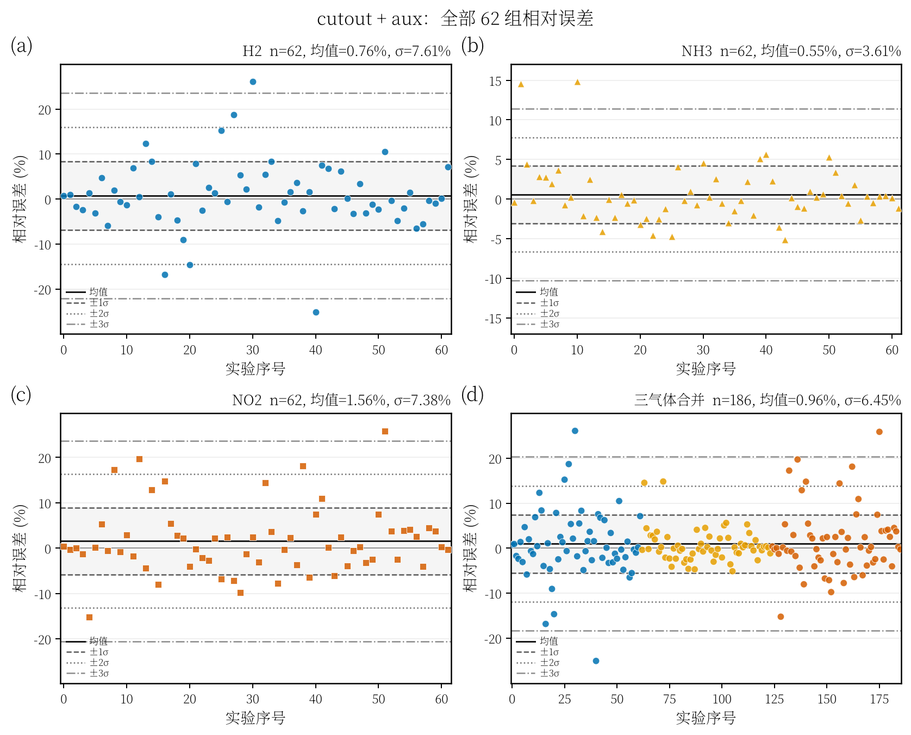
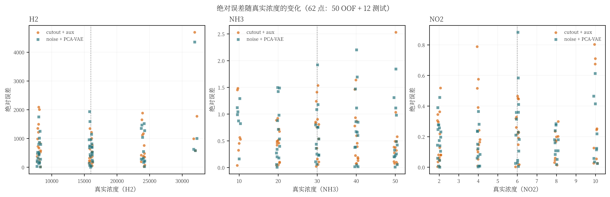
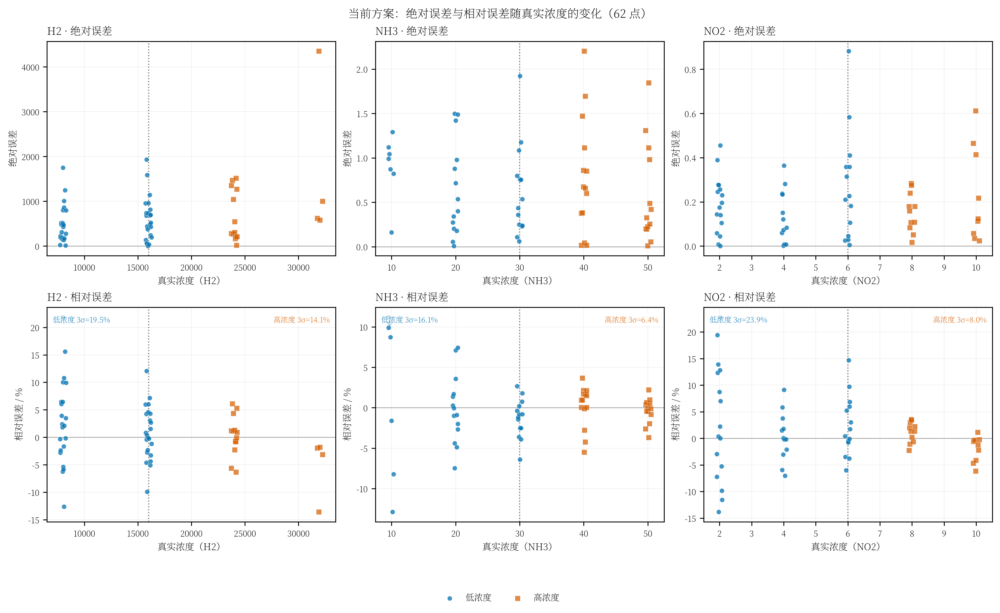
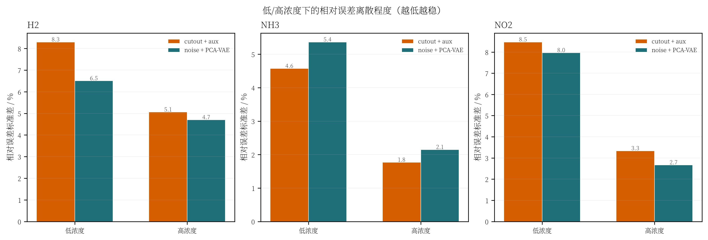

# 62 点误差诊断：低浓度还是高浓度导致大 3σ

## 1. 数据与口径

- 62 点 = 50 个开发集 OOF 预测 + 12 个锁定测试预测；
- 两个方案：
  - `cutout + aux`：历史 10 秒方案，`augmentation_final` 的 OOF + `evaluation_final` 的测试；
  - `noise + PCA-VAE`：当前最终方案；
- 低/高浓度按每个气体 62 个真实浓度的**中位数**切分：

| 气体 | 切分阈值 | 低浓度样本数 | 高浓度样本数 |
|---|---:|---:|---:|
| H2 | 16000 | 45 | 17 |
| NH3 | 30 | 35 | 27 |
| NO2 | 6 | 42 | 20 |

> 这里的“低/高”是固定数据划分，不是模型自己选的阈值。

---

## 2. cutout + aux 的 62 点相对误差



第一行三个面板是 H2、NH3、NO2，第四面板是三气体合并。  
横轴 0–49 是 OOF，50–61 是 12 个测试点；图只用于看分布，不重新计算 62 点“独立测试”指标。

## 3. 当前方案与 cutout+aux 的绝对误差



每个点是一条实验；横轴是真值，纵轴是绝对误差。  
注意：H2 的 ppm 量级远大于 NH3/NO2，所以三个面板的绝对误差纵轴不能直接横向比较。

### 当前方案单独的绝对/相对误差图



上排：绝对误差 vs 真实浓度；下排：相对误差 vs 真实浓度。  
低浓度用蓝色圆点，高浓度用橙色方块；虚线是中位数切分点；下排标出了低/高浓度各自的 3σ。

## 4. 低/高浓度下的相对误差标准差



数值越小越稳；括号中的 3σ 是 `3 × 相对误差标准差`。

| 气体 | 方案 | 低浓度 3σ | 高浓度 3σ |
|---|---|---:|---:|
| H2 | cutout + aux | 24.90% | 15.18% |
| H2 | noise + PCA-VAE | **19.52%** | **14.11%** |
| NH3 | cutout + aux | 13.72% | 5.31% |
| NH3 | noise + PCA-VAE | 16.10% | 6.45% |
| NO2 | cutout + aux | 25.42% | 10.01% |
| NO2 | noise + PCA-VAE | **23.91%** | **8.02%** |

对应的绝对误差标准差：

| 气体 | 方案 | 低浓度 std(AE) | 高浓度 std(AE) |
|---|---|---:|---:|
| H2 | cutout + aux | 503.6 | 1117.9 |
| H2 | noise + PCA-VAE | 459.8 | 1021.8 |
| NH3 | cutout + aux | 0.444 | 0.574 |
| NH3 | noise + PCA-VAE | 0.493 | 0.609 |
| NO2 | cutout + aux | 0.186 | 0.235 |
| NO2 | noise + PCA-VAE | 0.179 | 0.159 |

## 5. 结论

**相对误差的 3σ 主要是低浓度贡献的。**

- H2 低浓度 3σ 约 19.5%，高浓度约 14.1%；
- NH3 低浓度 3σ 约 16.1%，高浓度约 6.5%；
- NO2 低浓度 3σ 约 23.9%，高浓度约 8.0%。

原因是相对误差的分母是真实浓度：低浓度时同一个绝对误差会被放大成更大的百分比。  
从绝对误差看，H2 高浓度反而更大（绝对误差 std 约 1022 vs 低浓度 460），但这不代表相对误差更差；H2 高浓度的相对 3σ 反而更低。

因此老师看到的“3σ 接近 20%”主要来自：

1. H2/NO2 低浓度点的相对误差被小分母放大；
2. 少量低浓度点的偏差把尾部拉长；
3. 不是高浓度整体造成的。

## 6. 汇报时建议说

> 我们把 62 个点按每个气体的真实浓度中位数分成低浓度和高浓度。相对误差的 3σ 在低浓度组明显更大：H2 约 19.5% vs 14.1%，NH3 约 16.1% vs 6.5%，NO2 约 23.9% vs 8.0%。这主要是因为低浓度时分母小，同样的绝对误差会变成更大的百分比。绝对误差上 H2 高浓度更大，但相对误差的尾部主要来自低浓度，所以后续改进应优先针对低浓度样本，而不是简单地把整体模型再调一遍。

## 7. 复现

```bash
uv run python -m tcn_union.analyze_error_concentration \
  --root . \
  --output-dir artifacts/error_analysis
```

产物：

- `artifacts/error_analysis/cutout_aux_error_sigma_by_gas.png`
- `artifacts/error_analysis/current_error_sigma_by_gas.png`
- `artifacts/error_analysis/fig_abs_error_vs_concentration.png`
- `artifacts/error_analysis/fig_current_abs_rel_vs_concentration.png`
- `artifacts/error_analysis/fig_relative_error_std_low_high.png`
- `artifacts/error_analysis/low_high_error_stats.csv`
