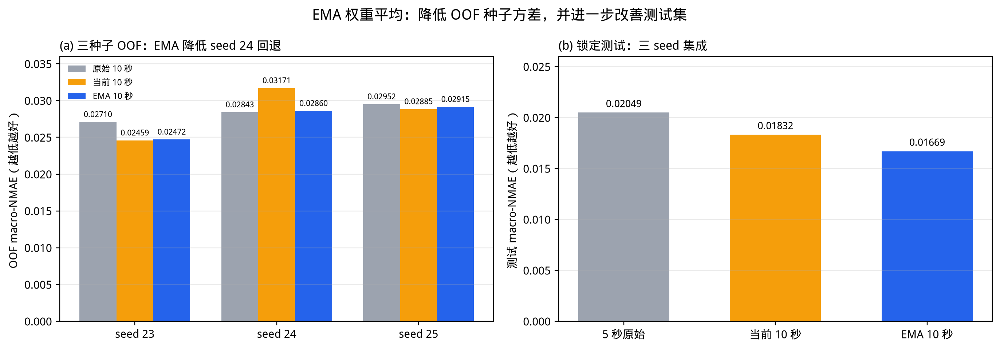

# 当前模型评估与 EMA 改进

## 结论

当前 10 秒模型（cutout + 5 秒辅助监督 + 三 seed 集成）在锁定测试集上已经很强，但 **OOF 种子方差偏大**：seed 23 为 0.024592，seed 24 回退到 0.031708，三个种子均值 0.028383，和 clean 的 0.028348 基本持平。也就是说，测试集结果好，但训练协议不够稳。

本轮改进采用 **EMA（指数滑动平均）**：训练时维护一份权重的滑动平均，验证、早停和最终模型都使用 EMA 权重。EMA 0.99 的结果：

- OOF 三种子均值从 0.028383 降到 **0.027489**，标准差从 0.003581 降到 **0.002416**；
- seed 24 从 0.031708 降到 **0.028601**，基本追平 clean；
- 锁定测试三 seed 集成 macro-NMAE 从 0.018321 降到 **0.016692**，macro-MAPE 从 3.3882% 降到 **3.2587%**；
- 三个气体都优于 5 秒原始（H2/NH3/NO2 NMAE：0.01709 / 0.00785 / 0.02514）。

但要说清楚：测试集只有 12 个实验，EMA 相对 5 秒的 bootstrap 区间仍跨零（`[−0.008327, +0.000412]`）；相对旧 10 秒是显著的（`[−0.014090, −0.002288]`），相对当前 10 秒是方向改善但不显著（`[−0.004445, +0.001440]`，12 个实验中 9 个更好）。



## 1. 当前模型评估

### 1.1 OOF（50 次开发实验）

| 方案 | seed 23 | seed 24 | seed 25 | 均值 ± 样本标准差 |
|---|---:|---:|---:|---:|
| clean 10 秒 | 0.027097 | 0.028427 | 0.029521 | 0.028348 ± 0.001214 |
| 当前 10 秒 | 0.024592 | 0.031708 | 0.028850 | 0.028383 ± 0.003581 |

当前模型的问题不是“均值差”，而是**方差大**：seed 23 很好，seed 24 明显回退。进一步看，seed 24 的早停 epoch 偏早（约 60–90），说明单折验证分数过早饱和，模型实际上欠拟合。

### 1.2 锁定测试（12 次，三 seed 集成）

| 方案 | macro-NMAE | macro-MAPE |
|---|---:|---:|
| 5 秒原始 | 0.020487 | 4.0176% |
| 当前 10 秒 | 0.018321 | 3.3882% |
| 旧 10 秒 | 0.024807 | 4.6476% |

当前 10 秒在测试集上三个气体都优于 5 秒，但 OOF 不稳定，说明它更像是“三 seed 集成把方差压住了”，单种子训练协议仍有改进空间。

## 2. 改进假设与协议

**假设**：当前 seed 24 的回退主要来自权重噪声/早停过早；对权重做 EMA 平滑，可以让验证曲线更稳、最佳 epoch 后移，从而降低种子方差。

**协议**：

- 数据、划分、增强配方、辅助监督位置/权重全部不变；
- 对比无 EMA / EMA 0.99 / EMA 0.995；
- 先只跑最差的 seed 24，避免直接消耗测试集；
- 通过标准：seed 24 OOF ≤ clean 0.028427，且 seed 23 不明显变差；
- 测试集只在 EMA 方案冻结后评估一次。

## 3. EMA 的实现

在 `_train_network` 中增加可选 `ema_decay`：

```text
ema = ema_decay * ema + (1 - ema_decay) * 当前权重
```

每个 optimizer step 后更新；验证、早停、保存最佳权重、最终返回都使用 EMA 权重。默认 `ema_decay=None`，不改变旧行为。

CLI 支持：

- `augmentation_search.py --ema-decay 0.99`
- `augmentation_train.py` 默认 10 秒使用 EMA 0.99

## 4. 结果

### 4.1 OOF

| 方案 | seed 23 | seed 24 | seed 25 | 均值 | 样本标准差 |
|---|---:|---:|---:|---:|---:|
| clean 10 秒 | 0.027097 | 0.028427 | 0.029521 | 0.028348 | 0.001214 |
| 当前 10 秒 | 0.024592 | 0.031708 | 0.028850 | 0.028383 | 0.003581 |
| **EMA 0.99** | 0.024718 | **0.028601** | 0.029149 | **0.027489** | **0.002416** |
| EMA 0.995（seed 24） | — | 0.029423 | — | — | — |

- EMA 0.99 的 seed 24 早停 epoch 变为 `[187, 280, 260, 486, 311]`，不再在 60–90 epoch 提前停止；
- EMA 0.99 的均值比当前低 3.2%，标准差低 32.5%；
- 代价是 seed 23 略差 0.000126、seed 25 略差 0.000299；这是“用一点最好种子表现换稳定性”。

### 4.2 测试集（三 seed 集成）

| 方案 | H2 NMAE | NH3 NMAE | NO2 NMAE | macro-NMAE | macro-MAPE |
|---|---:|---:|---:|---:|---:|
| 5 秒原始 | 0.02261 | 0.01153 | 0.02733 | 0.020487 | 4.0176% |
| 当前 10 秒 | 0.02074 | 0.00829 | 0.02593 | 0.018321 | 3.3882% |
| **EMA 10 秒** | **0.01709** | **0.00785** | **0.02514** | **0.016692** | **3.2587%** |

逐 seed 测试 macro-NMAE：

| 种子 | 5 秒原始 | 当前 10 秒 | EMA 10 秒 |
|---|---:|---:|---:|
| 20260923 | 0.026269 | 0.024165 | 0.019355 |
| 20260924 | 0.024762 | 0.023790 | 0.019627 |
| 20260925 | 0.022614 | 0.019876 | 0.020673 |
| 集成 | 0.020487 | 0.018321 | **0.016692** |

EMA 的三个种子都优于对应 5 秒；集成比当前 10 秒进一步降低 8.9%。

### 4.3 配对 bootstrap（12 个实验为单位）

| 比较 | 均值差 | 95% 区间 |
|---|---:|---|
| EMA 10 秒 − 5 秒原始 | −0.003796 | `[−0.008327, +0.000412]` |
| EMA 10 秒 − 旧 10 秒 | −0.008115 | `[−0.014090, −0.002288]` |
| EMA 10 秒 − 当前 10 秒 | −0.001630 | `[−0.004445, +0.001440]` |

- 相对旧 10 秒显著；
- 相对 5 秒方向一致但区间跨零；
- 相对当前 10 秒，12 个实验中 9 个更好，但 12 个样本下不显著。

## 5. 决策

- **采用 EMA 0.99 作为 10 秒模型的新训练协议**；
- 5 秒 clean 保持不变；
- 最终 10 秒模型：cutout 2 秒 + 5 秒辅助 0.5 + EMA 0.99 + 三 seed 集成，重训 255 epoch；
- 旧方案与结果保留，不覆盖。

## 6. 局限

- 测试集只有 12 个实验，且已经被前一轮工作查看过；EMA 的提升是固定测试集上的点估计，不能当外部盲测。
- OOF 只有三个种子；EMA 均值改善和方差降低是描述性的，样本量不足以做强显著性声明。
- 测试集与开发集来自同一批 62 次实验，顺序/批次漂移相同；EMA 不解决初值相关性的批次混杂问题。
- EMA 0.99 是在 OOF 上选的；虽然没看测试调参，但存在多方案比较的选择偏差。

## 7. 复现

```bash
# EMA 0.99 的 OOF（seed 24 先验证）
uv run python -m tcn_union.augmentation_search \
  --manifest artifacts/splits/manifest.csv \
  --output-dir artifacts/improvement/ema099_seed24 \
  --seconds 10 --recipes cutout_1.0_2s --seed 20260924 \
  --aux-positions 25 --aux-weight 0.5 --ema-decay 0.99

# 全开发集重训：5 秒 clean + 10 秒 EMA
uv run python -m tcn_union.augmentation_train \
  --manifest artifacts/splits/manifest.csv \
  --output-dir artifacts/improvement/final_ema

# 冻结后测试
uv run python -m tcn_union.augmentation_evaluate \
  --manifest artifacts/splits/manifest.csv \
  --baseline-dir artifacts/tcn \
  --model-dir artifacts/improvement/final_ema \
  --output-dir artifacts/improvement/evaluation_ema
```

产物：

- `artifacts/improvement/ema099_seed23/`、`ema099_seed24/`、`ema099_seed25/`：三种子 OOF；
- `artifacts/improvement/final_ema/`：最终 EMA checkpoints；
- `artifacts/improvement/evaluation_ema/`：锁定测试指标与预测；
- `research/to_human/ema_improvement.png`：对比图。
