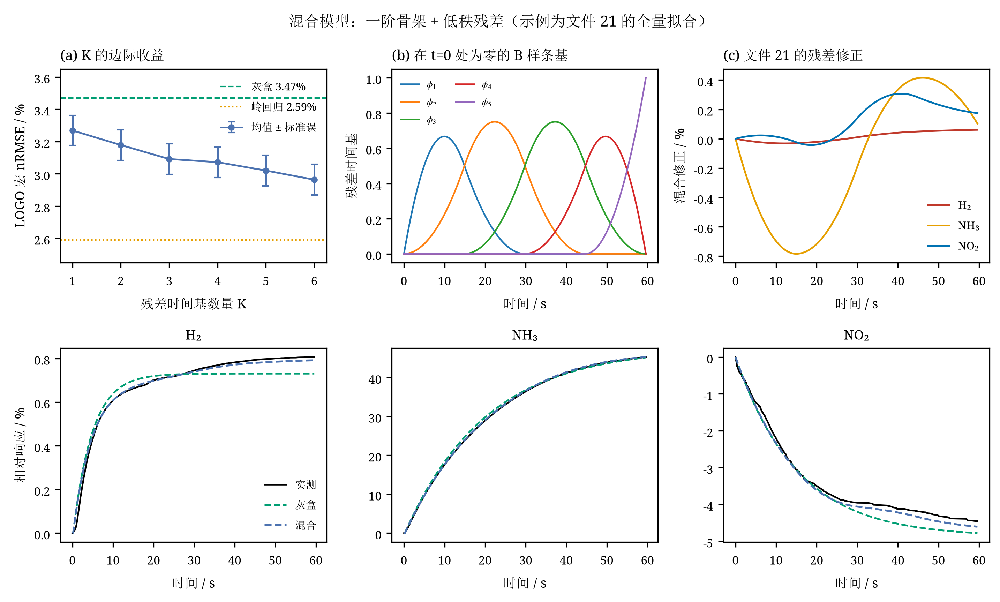
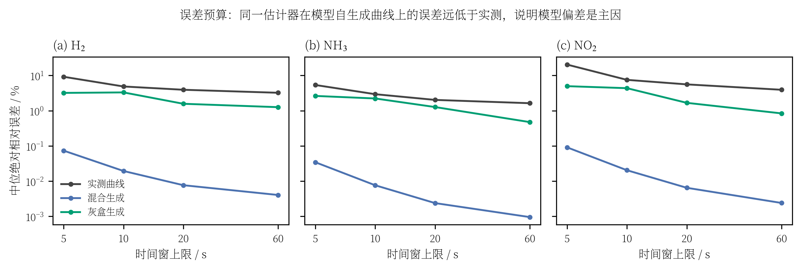
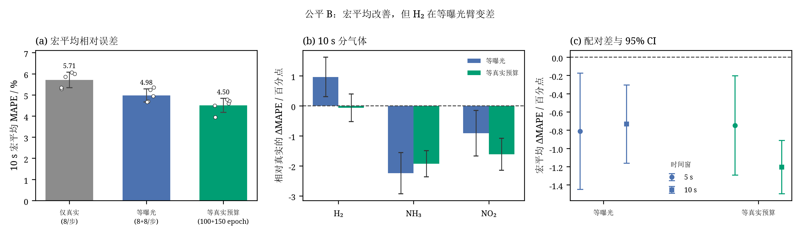

# 传感器阵列动态响应建模与早期浓度估计

*学习版：从一阶惯性到不确定性感知*

> **阅读说明**
>
> 这份文档按硕士论文一章的结构组织：绪论 → 数据与协议 → 基线与迭代 → 可辨识性 → 估计 → 下游验证 → 讨论 → 结论。
> 与论文正文不同的是，每一节都保留了“为什么这样做”“直观理解”“汇报时可以说”的说明，目的是让第一次接触这个课题的人能顺着一条线把项目讲清楚。
>
> - 所有数字默认来自现有 **62 条实验** 的留一实验交叉验证（LOGO），或明确标注的其他协议；**12 条逆问题锁定测试没有参与任何模型选择**。
> - 数据只含 H₂、NH₃、NO₂ 三种气体；浓度列没有注明单位，本文只写“原始单位”，不写 ppm。
> - 现有数据不可扩充，因此所有结论都限定在“现有 62 条能支持的范围内”，不依赖任何新实验。
> - 配套材料：完整结果见 [`chapter_results.md`](chapter_results.md)，路线图见 [`roadmap.md`](roadmap.md)，概念速查见 [`beginner_guide.md`](beginner_guide.md)，代码地图见本文附录 B。

---

## 1 绪论

### 1.1 一个电子鼻场景

设想一台电子鼻：腔体里有三块气体传感器，分别记为 H₂、NH₃、NO₂ 通道。把一袋混合气体通进去，三块传感器的读数会随时间变化，形成三条响应曲线。我们希望根据这几条曲线，判断袋子里三种气体各有多少。

这件事看起来只是“拟合一条曲线”，实际却很难，原因有四层：

1. **交叉敏感**：H₂ 通道不只对 H₂ 响应，NH₃、NO₂ 也会影响它；反过来说，任何一个通道的读数都不是某一种气体的“专用表”。
2. **动态**：传感器不是瞬间到达稳态，而是先快后慢地逼近一个平台。只看某一时刻的读数，信息量依赖于“看了多久”。
3. **漂移**：同一块传感器在不同实验开始时的基线可以差很多。NH₃ 通道的初始读数在 62 次实验里从 786 漂到 7437，差了约 9.5 倍。
4. **样本少且设计有混淆**：只有 62 条实验，没有重复；NH₃ 浓度和实验的采集顺序几乎完全绑定。

所以，这个课题的核心不是“再训练一个更大的网络”，而是回答一个测量学问题：

> 在现有数据条件下，传感器阵列的动态响应模型能支持多早、多准、多可信的浓度估计？误差中噪声、模型偏差、实验设计各占多少？

### 1.2 正问题与逆问题

先把两个问题分开：

- **正问题（forward problem）**：已知浓度组合 \(\mathbf c=(c_{H_2},c_{NH_3},c_{NO_2})\)，预测三路传感器在 \(0\le t\le 60\) s 的完整响应曲线 \(R_j(t)\)。
- **逆问题（inverse problem）**：只看到前 5 s 或 10 s 的响应前缀，反推浓度 \(\mathbf c\)。

逆问题更接近“电子鼻落地”的需求，也更难：不同浓度组合可能产生相似的早期曲线；传感器漂移会让同一条曲线对应不同的真实浓度。

项目此前已经用 TCN 做过逆问题：输入 10 s 前缀，输出三种浓度，12 条锁定测试上的宏 NMAE 约 2.46%、宏 MAPE 约 5.06%。这说明“用数据驱动模型做回归”是可行的。

那为什么还要单独做正问题？

1. **仿真**：在没有新实验的条件下，正模型可以回答“如果浓度是 X，曲线会是什么样”。
2. **可辨识性**：正模型能告诉我们“5 s 的曲线里到底有多少关于浓度的信息”，这是任何逆模型都无法单独回答的。
3. **不确定性**：有了正模型和噪声模型，才能把“估计误差”拆成噪声、模型偏差、设计混淆，而不是只报一个 MAPE。
4. **数据增强**：正模型可以生成合成数据，帮助逆模型利用未标注的浓度空间；但这件事有边界，第 8 节会看到它并不是“越多越好”。
5. **故障诊断/数字孪生**：正模型可以作为“正常响应”的参照，用于发现漂移、失效或通道异常。

本章的逆问题分析（第 7 节）不是为了替代 TCN，而是把正模型当作“测量仪器”的校准件，检验估计器能做到什么程度。

### 1.3 数据与约束

数据在 `data/0.csv`–`data/61.csv`，每条实验一条 CSV：

- 时长 60 s，采样 5 Hz，共 299 个时间点；
- 三列响应 `H2, NH3, NO2`；
- 三列浓度 `conc1, conc2, conc3`，在一次实验内恒定。

浓度档位：

| 气体 | 档位 |
|---|---|
| H₂ | 8000, 16000, 24000, 32000 |
| NH₃ | 10, 20, 30, 40, 50 |
| NO₂ | 2, 4, 6, 8, 10 |

完整网格是 \(4\times5\times5=100\) 个组合，实际只有 62 个；没有重复实验。两个关键缺口：

- **NH₃ 与采集顺序混淆**：62 条实验按 NH₃ 档位分块采集（文件 0–6 是 NH₃=10，7–20 是 20，21–34 是 30，35–48 是 40，49–61 是 50），NH₃ 浓度与文件序号的相关系数是 **0.976**。这意味着 NH₃ 的“浓度效应”与“时间漂移/老化/环境变化”无法分离。
- **H₂ 最高档覆盖不足**：H₂=32000 只有 4 条实验，而且都在 NO₂=2；H₂ 高端与 NO₂ 的交互几乎没有数据。

这两点不是“模型没调好”，而是数据采集方案决定的。它们决定了本章能下什么结论、不能下什么结论。

> **直观理解**
>
> 可以把 62 条实验想成 62 次“考试”。NH₃ 浓度高的那几次考试，恰好都安排在后面；如果传感器本身随着时间老化，那么“后几次考得好/差”既可能是 NH₃ 浓度造成的，也可能是老化造成的。只靠这 62 条数据，无法把两者拆开。

### 1.4 核心科学问题

本章围绕三个子问题展开：

1. **模型偏差**：一阶惯性骨架能解释多少？残差里有什么结构？混合模型能否在保留增益/时间常数解释的同时，把曲线误差从 3.5% 降到 3.0% 附近？
2. **可辨识性**：在 2/5/10/20/60 s 的时间窗内，三路传感器对三种气体分别能分辨到什么程度？噪声下限是多少？哪些误差是数据本身的上限？
3. **可信度**：给定一条新曲线，浓度估计的区间是否 calibrated？能否在“足够可信”时提前停止采样？固定 5 s/10 s 与自适应停止相比，时间-精度折中如何？

这三个问题对应三种“深度”：**拟合得更准 → 知道为什么能估 → 知道估得可不可信**。硕士章节的工作量主要在后两层。

### 1.5 技术路线与主要结果

本章的路线可以概括为“四级模型 + 三层验证”：

| 层次 | 做法 | 关键结果 | 作用 |
|---|---|---|---|
| 基线 | 全局平均曲线 | 31.92% | 说明“只学平均形状”不够 |
| 基线 | 逐条拟合一阶 + 两阶段回归 | 5.68% | 说明“先拟合再回归”会传播误差 |
| 主模型 | 一阶惯性灰盒（45 参数） | 3.47% | 有物理参数 A/τ/d，可解释 |
| 主模型 | 灰盒 + 低秩残差（混合模型） | 3.02% | 补系统偏差，保留 A/τ |
| 消融 | 结构化残差（5 条固定时段基） | 2.90% | 证明残差基不是主要瓶颈 |
| 对照 | 直接岭回归（逐时间点） | 2.59% | 插值最准，但没有动态结构 |
| 对照 | 前向 TCN（黑盒） | 3.60% | 数据量下不占优，且不可解释 |

“三层验证”是：

1. **LOGO**：留一条实验，用其余 61 条训练，重复 62 次；这是主协议。
2. **留一浓度档位 / 留一采集块**：留出整个浓度档位（14 折）或连续 8 条实验（8 折），检验外推与漂移。
3. **下游浓度指标**：不只看曲线 nRMSE，还看 5/10/20 s 窗口反演浓度的中位/p90 误差。

主要结论先放在这里，后文会逐条解释：

- 灰盒 3.47% → 混合模型 3.02%；结构化残差可到 2.90%，但默认仍用自由 B 样条，保证全章数字可比。
- 留一浓度档位是真正的短板：混合模型从 3.02% 升到 6.33%；留一采集块只升到 3.14%。所以主要敌人是“浓度档位外推”，不是“实验间漂移”。
- 噪声下限（CRLB）在 5 s 已经远小于 1%，而实际 10 s 中位误差是 3–8%；差距来自模型偏差和设计混淆，不是噪声。
- 用 MAP + Laplace + CV+ 做早期估计，10 s 标量版中位误差 4.89/2.95/7.53%（H₂/NH₃/NO₂）；P4 协方差版 3.12/2.14/5.00%，嵌套版 3.59/1.97/5.16%。
- 但 **区间目前只能作诊断**：原始 Laplace 的 90% 折外覆盖率只有 16.1/59.7/32.3%，剖面似然只有 21.0/38.7/29.0%。CV+ 的 91.9% 是校准后的总体覆盖率，不等于每个实验都可信。
- 合成数据增强在公平协议下把 10 s 宏 MAPE 从 5.71% 降到 4.98%（等曝光）或 4.50%（等真实预算），但等曝光臂的 H₂ 从 3.24% 退化到 4.20%；不是“全面更好”。

> **汇报时可以说**
>
> “我们做的不是又一个逆模型，而是一个可解释的正模型 + 可辨识性分析 + 不确定性评估。它回答的是：现有传感器阵列在现有数据下，最早能在几秒内、以多大误差、多可信地反推浓度；以及误差里哪些是噪声、哪些是模型偏差、哪些是实验设计的上限。”

### 1.6 与已有工作的关系

本章不声称提出了全新的传感器机理或 SOTA 逆模型。它的定位是“在受限数据上把测量学问题做完整”：

- **灰盒/一阶惯性**：传感器文献中常用一阶或二阶惯性描述阶跃响应；本章通过逐条拟合比较了一阶+延迟、stretched、双指数、一阶+漂移、二阶，发现一阶+延迟的性价比最高。
- **TCN/黑盒**：项目已有 TCN 逆模型；本章把前向 TCN 作为同协议对照，发现 62 条数据下它并不优于混合模型，且没有 A/τ 解释。TCN 的价值在逆问题端，不在正问题端。
- **直接岭回归**：逐时间点回归是强插值基线；本章不把它当主模型，因为它没有动态结构、不能回答任意时刻、也不能解释增益/时间常数。
- **合成数据增强**：已有工作常用“正模型生成合成数据”缓解小样本；本章用公平协议证明它有条件有效（NH₃/NO₂、预训练式），但不是无条件有效（H₂ 等曝光退化）。

### 1.7 章节安排

- 第 2 节：数据、设计矩阵、验证协议、指标。
- 第 3 节：从最简模型开始，说明为什么“平均曲线/两阶段/直接岭回归/TCN”都不够。
- 第 4 节：一阶惯性灰盒，45 参数，3.47%。
- 第 5 节：混合模型，低秩残差，3.02%；结构化残差 2.90%。
- 第 6 节：噪声、Fisher 信息、CRLB、盲基线问题。
- 第 7 节：MAP/Laplace/CV+/自适应停止/误差预算/降级。
- 第 8 节：正模型反哺逆模型（合成数据、循环一致性、公平实验）。
- 第 9 节：讨论、局限、为什么暂缓分层模型。
- 第 10 节：结论与展望。
- 附录：公式、代码/图、术语、自测题、5 分钟汇报提纲。

---

## 2 数据与评价协议

### 2.1 一条实验记录

每条实验可以写成

\[
\left\{R_j(t_k)\right\}_{j=1}^{3},\quad t_k=0,0.2,\ldots,59.6\ \text{s},
\]

其中 \(R_j(t)\) 是第 \(j\) 路传感器的原始读数。浓度 \(\mathbf c=(c_{H_2},c_{NH_3},c_{NO_2})\) 在一次实验内恒定。

原始读数不能直接拿来建模，因为每块传感器的初始基线不同，而且差异是**乘性**的：同一浓度下，基线高的实验，整条曲线也会按比例抬高。于是定义**相对响应**

\[
y_j(t)=\frac{R_j(t)-R_j(0)}{R_j(0)}.
\]

它表示“相对于自己刚开始时，变化了百分之几”。这样 \(y_j(0)=0\)，且乘性基线差异被消掉。绝对输出则通过

\[
R_j(t)=R_j(0)\left(1+y_j(t)\right)
\]

还原；\(R_j(0)\) 必须作为输入给出，不能由浓度唯一确定。

> **直观理解**
>
> 相对响应就像“看体重变化百分比”，而不是“看绝对体重”。两个人基础体重不同，但都增重 5% 时，相对曲线是可比的；绝对曲线不可比。

### 2.2 设计矩阵：覆盖与混淆

62 条实验的浓度组合不是完整因子设计，而是分块采集：

| 文件范围 | 条数 | NH₃ 档位 |
|---|---:|---:|
| 0–6 | 7 | 10 |
| 7–20 | 14 | 20 |
| 21–34 | 14 | 30 |
| 35–48 | 14 | 40 |
| 49–61 | 13 | 50 |

在每一块内部，H₂ 和 NO₂ 按循环方式变化；H₂=32000 只出现在 4 条实验里，且都在 NO₂=2。

这带来两个后果：

1. **NH₃ 与时间混淆**：NH₃ 浓度与文件序号的相关系数是 0.976；NH₃ 在块内恒定，所有 NH₃ 变异都在块间，而块与采集时间对齐。因此 NH₃ 的“浓度效应”无法与传感器老化、环境漂移分离。
2. **H₂ 高端与 NO₂ 的交互缺失**：H₂=32000 只有 NO₂=2 的 4 条；模型在 H₂ 高端对 NO₂ 的外推没有数据支撑。

> **常见误区**
>
> “只要模型足够强，就能把 NH₃ 的浓度效应和漂移分开。”不能。混淆是数据生成过程的性质，不是模型容量的问题。任何模型在 NH₃ 上的增益都只能解释为“该采集顺序下的等效增益”。

### 2.3 为什么用相对响应

三路传感器的初始基线：

| 通道 | \(R_j(0)\) 范围 | 与文件序号的相关 |
|---|---:|---:|
| H₂ | 1924–2008 | 0.993 |
| NH₃ | 786–7437 | 0.989 |
| NO₂ | 140.1–149.0 | 0.223 |

NH₃ 的基线漂了近 9.5 倍。如果直接对原始读数建模，模型会先学“这是第几次实验”，而不是学浓度。相对响应把乘性基线消掉，是本章能做下去的前提。

代价是：相对响应丢掉了绝对尺度；要预测绝对输出，必须额外提供 \(R_j(0)\)。这不是模型缺陷，而是“基线不可由浓度唯一确定”这一事实的体现。

### 2.4 验证协议

本章使用三种协议，全部是**实验级**划分，不随机拆时间点：

| 协议 | 做法 | 折数 | 回答的问题 |
|---|---|---:|---|
| LOGO | 留 1 条实验，其余 61 条训练 | 62 | 遇到一条新实验时表现如何 |
| 留一浓度档位 | 留出整个浓度档位（H₂ 4 档、NH₃ 5 档、NO₂ 5 档） | 14 | 外推到没见过的浓度水平 |
| 留一采集块 | 按采集顺序留连续 8 条（最后一折 6 条） | 8 | 外推到一段没见过的采集时段 |

为什么不能随机拆时间点？同一条曲线的相邻点几乎一样；随机拆会让测试点“夹”在训练点中间，严重高估性能。必须整条实验留出。

**12 条逆问题锁定测试没有参与本章任何选择。** 原因不是“正模型和逆模型无关”，而是：

- 正模型如果在 12 条上调参，就会学到这些实验的基线/漂移/浓度组合；
- 本章的 B 实验用正模型生成合成数据训练逆模型，正模型一旦见过 12 条，信息会间接进入逆模型；
- 因此保留 12 条不动，本章只用 62 条做 LOGO/留档位/留块；这也意味着本章没有“独立盲测”数字，只有折外结果。

### 2.5 指标

**曲线指标**（正模型）：

\[
\mathrm{nRMSE}_j=\frac{\sqrt{\frac{1}{T}\sum_t\left(\hat y_j(t)-y_j(t)\right)^2}}{\mathrm{RMS}^{\text{train}}_j},
\qquad
\mathrm{RMS}^{\text{train}}_j=\sqrt{\frac{1}{N_{\text{train}}T}\sum_{i,t}y_{ij}(t)^2}.
\]

- 分母是训练折上该通道相对响应的 RMS，不是测试集，避免用测试信息归一化；
- 每条实验、每个通道算一个 nRMSE，再对三通道等权平均得到 macro；
- 62 折再取均值/中位/p90；
- 另有 \(R^2\) 和末端误差作为辅助。

**浓度指标**（逆问题/估计器）：

- \(\mathrm{MAPE}=\mathrm{mean}\left(|\hat c/c-1|\right)\)，相对误差；
- \(\mathrm{NMAE}=\mathrm{mean}\left(|\hat c-c|\right)/\mathrm{range}(c_{\text{train}})\)，绝对误差占训练量程的比例；
- 中位绝对相对误差（median ARE）、p90；
- 区间覆盖率、区间宽度。

**指标陷阱**：旧逆模型常说的“2%”是 NMAE，不是 MAPE；同一个模型 MAPE 约 5%。两者分母不同，不能直接比较。本章第 8 节会专门讲这个坑。

### 2.6 数据事实清单

- 62 条，299 点，5 Hz，60 s；三气体，浓度单位未注明。
- 无重复；62/100 组合；H₂=32000 仅 4 条且都在 NO₂=2。
- NH₃ 与采集顺序 corr=0.976；file 序号与 H₂ 基线同秩。
- 基线漂移：NH₃ 约 9.5 倍，H₂ 约 4%，NO₂ 约 6%。
- 响应方向：H₂、NH₃ 上升，NO₂ 下降；相对幅度约 1%、22–58%、−3%–−15%。
- 三条 NH₃=50 实验（file 59/60/61）存在采集阶跃，占 NH₃ 残差能量 37.6%。

---

## 3 从最简模型开始

这一节按“先做最笨的，再看它缺什么”的顺序，建立四个基线。理解这些基线为什么失败，比直接看最终模型更重要。

### 3.1 基线 0：全局平均曲线

最简模型完全忽略浓度：

\[
\hat y_j(t)=\bar y_j(t),
\]

其中 \(\bar y_j(t)\) 是训练折上所有实验的平均相对曲线。

LOGO 宏 nRMSE = **31.92%**。它只能学到“平均形状”：H₂ 快速上升后缓慢爬升，NH₃ 缓慢上升，NO₂ 缓慢下降。它无法区分不同浓度，也无法解释实验间差异。

这个基线的作用是给出“没有任何浓度信息”的下限。任何模型如果只比它好一点，就说明浓度特征没被用起来。

### 3.2 基线 1：逐条拟合一阶 + 两阶段回归

第二版做法：

1. 对每条实验、每个通道单独拟合一阶+延迟，得到 \((A_i,\tau_i,d_i)\)；
2. 用 \(\log A_i\)、\(\log\tau_i\) 对 \(\log\mathbf c_i\) 做岭回归；
3. 预测时先由浓度算 \(A,\tau\)，再代回一阶曲线。

LOGO 宏 nRMSE = **5.68%**。比平均曲线好很多，但比后来的联合拟合（3.47%）差。

原因：第一阶段每条曲线只有 299 个点，噪声和模型偏差会让 \((A_i,\tau_i)\) 有误差；第二阶段把这些带误差的参数当标签回归，误差被传播并放大。统计上这叫“误差变量”（errors-in-variables）。

### 3.3 基线 2：逐时间点直接岭回归

第三版把每个时间点单独回归：

\[
\hat y_j(t)=\mathbf x(\mathbf c)^\top\boldsymbol\beta_{j,t},
\]

其中 \(\mathbf x(\mathbf c)\) 是 \(\log\mathbf c\) 的二次单项式（10 项），\(\boldsymbol\beta_{j,t}\) 是每个时间点、每个通道各自的一组系数。

LOGO 宏 nRMSE = **2.59%**，是六个模型里插值最准的。

但它不是“动态模型”：

- 只能预测 299 个离散时间点，不能回答任意 \(t\)；
- 每个时间点独立，曲线可能不光滑；
- 没有 \(A,\tau,d\)，不能解释物理量；
- 浓度二次项在边角外推不可控。

所以本章把它作为“精度基线”，而不是主模型。第 7 节会看到：在固定 10 s 窗口的浓度反演上，直接岭回归仍然优于混合模型（3.69/2.81/4.60% vs 4.89/2.95/7.53%）。这是一个必须诚实报告的负结果。

### 3.4 基线 3：前向 TCN

第四版用 TCN 做黑盒曲线预测：输入是浓度特征（\(\log c\) 的三个分量）和时间特征（\(t/60,(t/60)^2\)），输出三路相对响应。网络由 3 个因果残差块组成，kernel=3，dilation=1/2/4，hidden=24，训练 150 epoch。

LOGO 宏 nRMSE = **3.60%**，略差于灰盒（3.47%）和混合模型（3.02%）。

为什么 TCN 在正问题上不占优？

- 一次实验内浓度恒定，输入里没有真正的“历史序列”；时间卷积退化成 \((c,t)\) 的平滑函数逼近器，TCN 的结构优势用不上。
- 62 条实验、每条 299 点，对神经网络来说样本很少；它容易学到与采集顺序相关的伪特征。
- 它没有 \(A,\tau\)，不能回答“这个通道的增益是多少、时间常数是多少”。

TCN 在逆问题上更有价值：那里输入是真实的 5/10 s 序列，时序结构是真实存在的。

### 3.5 第一轮结论

六个模型在三种协议下的曲线误差（宏 nRMSE，%）：

| 模型 | LOGO | 留一档位 | 留一区块 |
|---|---:|---:|---:|
| 平均曲线 | 31.92 | 34.97 | 32.91 |
| 两阶段 | 5.68 | 10.46 | 5.73 |
| 灰盒 | 3.47 | 6.01 | 3.62 |
| TCN | 3.60 | 4.92 | 3.47 |
| 直接岭回归 | 2.59 | 4.23 | 2.89 |
| 混合模型 | 3.02 | 6.33 | 3.14 |

三条结论：

1. **浓度特征必须用**：平均曲线 31.92% 说明只学形状不够。
2. **联合拟合优于两阶段**：3.47% vs 5.68%，误差传播是真实存在的。
3. **精度与结构是两种目标**：直接岭回归插值最准，但没有动态结构；混合模型稍差，但保留 A/τ 和 ODE，可以写论文、做外推分析。

---

## 4 一阶惯性灰盒

### 4.1 物理图像与 ODE

把一次实验想成“在 \(t=0\) 时刻，把传感器从干净空气放进一袋固定浓度的气体”。传感器表面吸附/扩散需要时间，读数不会瞬间跳到新稳态，而是慢慢逼近。

最简单的近似是**一阶惯性**：

\[
\tau_j(\mathbf c)\frac{dy_j}{dt}=s_jA_j(\mathbf c)-y_j(t),\qquad t>d_j,
\]

其中：

- \(y_j(t)\) 是相对响应；
- \(s_j\in\{+1,-1\}\) 是响应方向，由数据固定：H₂、NH₃ 上升，NO₂ 下降；
- \(A_j(\mathbf c)>0\) 是稳态相对幅度（增益）；
- \(\tau_j(\mathbf c)>0\) 是时间常数；
- \(d_j\) 是纯延迟（死时间）。

初始条件 \(y_j(0)=0\)。解为

\[
y_j^{\text{grey}}(t)=s_jA_j(\mathbf c)
\left[1-\exp\left(-\frac{\max(t-d_j,0)}{\tau_j(\mathbf c)}\right)\right].
\]

这个式子有三层含义：

1. \(t<d_j\) 时响应为 0：气体还没到达传感器；
2. \(t=d_j\) 后按指数逼近平台；
3. 经过 \(\tau\) 秒，完成约 63% 的变化；经过 \(3\tau\)，完成约 95%。

### 4.2 参数的含义

| 参数 | 含义 | 典型范围 |
|---|---|---|
| \(A_j\) | 稳态幅度（正） | H₂ 0.08–2.6%；NH₃ 22–58%；NO₂ 3.2–14.6% |
| \(s_jA_j\) | 有符号的稳态响应 | H₂/NH₃ 为正；NO₂ 为负（−3.2%–−14.6%） |
| \(\tau_j\) | 完成 63% 变化的时间 | H₂ 1–15 s；NH₃ 5–40 s；NO₂ 3–25 s |
| \(d_j\) | 纯延迟 | 约 0–0.3 s |

注意：\(A_j\) 不是“最终平台”本身。混合模型会在骨架上加残差，最终平台是 \(s_jA_j+r_j(60\,\text{s})\)。灰盒的 \(A_j\) 是“一阶骨架的稳态幅度”，不是严格意义的最终读数。

### 4.3 增益和时间常数怎么随浓度变

浓度跨了几个数量级（H₂ 8000–32000，NH₃ 10–50，NO₂ 2–10），用原始浓度做多项式不稳定。定义对数浓度比

\[
u_i=\log\frac{c_i}{c_i^{\text{ref}}},\qquad
\mathbf c^{\text{ref}}=(16000,30,6).
\]

然后：

\[
\log A_j(\mathbf c)=X(\mathbf u)^\top\boldsymbol\alpha_j,
\qquad
\log\tau_j(\mathbf c)=[1,\mathbf u]^\top\boldsymbol\gamma_j,
\]

其中 \(X(\mathbf u)\) 是 10 项二次单项式：

\[
X(\mathbf u)=[1,u_1,u_2,u_3,u_1^2,u_2^2,u_3^2,u_1u_2,u_1u_3,u_2u_3].
\]

为什么这样选？

- **\(\log\) 保证正性**：\(A,\tau\) 都是正数，\(\exp\) 之后自动为正，不需要额外约束。
- **\(\log\) 让“翻倍”变成常数距离**：浓度跨数量级时，线性模型会在高端过于敏感、低端过于迟钝。
- **二次项允许交叉敏感**：比如 H₂ 的增益受 NO₂ 抑制，需要 \(u_{H_2}u_{NO_2}\) 这样的交互项。
- **\(\tau\) 只用线性**：数据量有限，\(\tau\) 的二次项容易过拟合；敏感性分析也显示线性够用。

参数数量：每个传感器 \(10\) 个增益系数 + \(4\) 个 \(\tau\) 系数 + \(1\) 个延迟 = 15；三路共 **45 个参数**。

### 4.4 联合拟合

两阶段做法是“先逐条拟合，再回归参数”。联合拟合则把所有 62 条曲线放在一起，直接最小化曲线误差：

\[
\min_{\boldsymbol\alpha,\boldsymbol\gamma,\mathbf d}
\sum_{i,j,t}w_j\left(\hat y_{ij}(t)-y_{ij}(t)\right)^2
+\lambda\left\|\boldsymbol\theta_{\text{non-int}}\right\|^2,
\]

其中

\[
w_j=\frac{1}{\frac{1}{NT}\sum_{i,t}y_{ij}(t)^2}
\]

是逐通道权重（再归一化到均值 1），目的是让 H₂ 这种幅度只有 1% 的通道不会被 NH₃ 的 40% 淹没。

实现细节：

- 初值由逐条拟合的 \((A_i,\tau_i,d_i)\) 取对数后岭回归得到；延迟取中位；
- 用 `scipy.optimize.least_squares` 联合优化；
- 只对延迟加 \([0,2]\) s 的边界；\(\tau\) 通过 \(\exp\) 保证正，不需要边界；
- 对非截距系数加很小的岭惩罚，防止共线导致的数值问题。

LOGO 结果：联合拟合 **3.47%**，两阶段 **5.68%**。

> **直观理解**
>
> 两阶段像“先让每个人自己估一个身高，再用这些身高去拟合年龄关系”；如果每个人的身高估计都有误差，第二层会把误差带进去。联合拟合像“所有人一起拟合一条曲线”，每个人的误差被平均掉。

### 4.5 形状选择：为什么是一阶+延迟

我们比较了五种形状，逐条拟合误差（占全幅值，%）：

| 形状 | 均值 | H₂ | NH₃ | NO₂ |
|---|---:|---:|---:|---:|
| 一阶+延迟 | 1.31 | 1.53 | 0.47 | 1.92 |
| stretched \(1-e^{-(t/\tau)^\beta}\) | 1.10 | 1.39 | 0.45 | 1.47 |
| 双指数 | 1.15 | — | — | — |
| 一阶+线性漂移 | 1.03 | — | — | — |
| 二阶 \(1-(1+t/\tau)e^{-t/\tau}\) | 3.95 | — | — | — |

stretched 的 \(\beta\) 中位数：H₂ 1.17、NH₃ 1.04、NO₂ 0.905，接近 1，说明它退化回一阶；双指数只比一阶好 0.16 个百分点，但参数翻倍；二阶明显更差。

所以一阶+延迟是性价比最高的骨架。它不是“完美”，但它把 96% 以上的形状解释掉了；剩下的系统偏差留给第 5 节的残差。

### 4.6 灰盒结果与诊断

62 折 LOGO（nRMSE，%）：

| 通道 | 均值 | 中位 | p90 | \(R^2\) 中位 |
|---|---:|---:|---:|---:|
| H₂ | 5.29 | 4.14 | 8.45 | 0.879 |
| NH₃ | 1.69 | 1.40 | 2.78 | 0.999 |
| NO₂ | 3.43 | 3.18 | 5.75 | 0.985 |
| 宏平均 | **3.47** | 3.27 | 4.77 | — |

H₂ 最差。两个原因：

1. H₂ 的相对幅度只有 1% 量级；同样的绝对偏差，除以很小的信号，相对误差就被放大。
2. H₂ 在 20 s 后还有缓慢上升，一阶骨架描述不了；低增益端（高 NO₂）模型系统性高估。

图 `fig05` 展示了 H₂ 增益被 NO₂ 强烈抑制：NO₂=2 时 H₂ 增益约 0.75→2.45%，NO₂=10 时只有 0.25→2.0%。这是真实的交叉敏感，不是噪声。

### 4.7 参数能解释什么、不能解释什么

**能解释**：

- 增益随浓度的主趋势（H₂ 随 H₂ 上升、NH₃ 随 NH₃ 上升、NO₂ 负响应随 NO₂ 增强）；
- 时间常数随浓度的变化（浓度越高，响应通常越快）；
- 通道间的交叉敏感（例如 NO₂ 抑制 H₂ 增益）。

**不能解释**：

- 纯灵敏度：NH₃ 与采集顺序混淆，\(A_{NH_3}\) 只能解释为“该顺序下的等效增益”；
- 最终平台：\(A\) 是骨架幅度，残差会改变末端；
- 基线：\(R_j(0)\) 不在模型里，绝对预测必须外部提供；
- 外推到未见过的浓度档位：留一档位 6.01%，比 LOGO 3.47% 明显变差。

### 4.8 第一版留下的问题

1. 残差不是白噪声：H₂ 在 20 s 后系统性偏低，NO₂ 尾部系统性偏高。
2. H₂ 低增益端的增益误差大，二次增益面不够。
3. 留一档位外推差：3.47→6.01%，说明参数化在边角不可靠。
4. 没有不确定性：只给点预测，不能回答“这个估计可不可信”。

---

## 5 混合模型：灰盒 + 低秩残差

### 5.1 残差诊断：先看“漏了什么”

对 62 条实验做折外预测，定义残差 \(r=\hat y-y\)，按训练折的相对幅度 RMS 归一化。P1 的诊断结果：

| 通道 | 中位 nRMSE/% | 增益占比/% | 形状占比/% | PC1 方差/% | PC2 方差/% |
|---|---:|---:|---:|---:|---:|
| H₂ | 3.34 | 84 | 16 | 92.5 | 2.6 |
| NH₃ | 1.20 | 67 | 33 | 66.6 | 18.5 |
| NO₂ | 2.88 | 42 | 58 | 61.8 | 30.2 |

- H₂ 的残差 84% 是“整体抬高/压低”（增益误差），PC1 解释 92.5%，形状近似平台；
- NH₃ 的 PC1 是一条缓慢上升的斜坡，并在 35.8 s 处有台阶（file 61 的采集跳变）；
- NO₂ 的残差 58% 是形状误差，PC2 解释 30.2%，且与 NO₂ 幅度 \(A\) 的 Spearman \(\rho=-0.95\)、与 \(\tau\) 的 \(\rho=+0.89\)。

残差能量高度集中在设计边角：

- H₂=32000 的 4 条实验占 H₂ 总残差能量的 45.5%；
- NH₃=10 的 7 条占 NH₃ 总残差能量的 65.1%；
- NO₂=2 的 16 条占 H₂ 总残差能量的 51.8%。

留一协议进一步说明问题：

- 留一采集块：3.14%，只比 LOGO 3.02% 差 0.12 个百分点；
- 留一浓度档位：6.33%，翻倍；最差的三折是 H₂=32000（15.86%）、NO₂=2（16.41%）、H₂=8000（12.26%）。

结论：残差是**低秩、有结构**的；主要短板是“浓度档位外推”，不是“实验间漂移”。

### 5.2 低秩残差模型

在灰盒上叠加一个修正项：

\[
\hat y_j(t,\mathbf c)=y_j^{\text{grey}}(t,\mathbf c)+r_j(t,\mathbf c),
\]

\[
r_j(t,\mathbf c)=\sum_{k=1}^{K}\phi_k(t)\,X(\mathbf u)^\top\boldsymbol\beta_{jk}.
\]

其中：

- \(\phi_k(t)\) 是第 \(k\) 条时间基函数，用 B 样条构造；
- \(X(\mathbf u)\) 是 10 项对数浓度二次特征；
- \(\boldsymbol\beta_{jk}\in\mathbb R^{10}\) 是第 \(j\) 个通道、第 \(k\) 条基的浓度系数；
- \(K=5\)。

矩阵形式：

\[
\mathbf R_j\approx \boldsymbol\Phi\mathbf B_j\mathbf X^\top,
\]

其中 \(\boldsymbol\Phi\in\mathbb R^{T\times K}\)，\(\mathbf B_j\in\mathbb R^{K\times10}\)，\(\mathbf X\in\mathbb R^{N\times10}\)。残差矩阵的秩不超过 \(K\)，所以叫“低秩”。

B 样条基的关键细节：先构造 \(K+1\) 条标准钳位基，再丢掉第一条。由于钳位基满足 \(B_0(0)=1\)、\(B_k(0)=0\)，丢掉 \(B_0\) 后所有剩余基在 \(t=0\) 都为零，因此残差在起点严格为零，不需要额外锚定项。

参数数量：

- 灰盒 45；
- 残差：3 通道 × 5 基 × 10 系数 = **150**；
- 总共 **195**。

为什么低秩？62 条曲线、299 个时间点，如果给每个时间点、每个浓度组合都配自由参数，会严重过拟合；低秩把残差限制在“少数时间形状 × 少数浓度项”，参数少、可外推、可解释。

### 5.3 怎么求解

由于时间基固定，模型对 \(\boldsymbol\beta\) 是线性的。给定灰盒后，残差 \(r=y-y^{\text{grey}}\)，对每个通道解一个岭回归：

\[
\min_{\boldsymbol\beta_j}
\left\|\sqrt{w_j}\left(\mathbf F_j\boldsymbol\beta_j-\mathbf r_j\right)\right\|^2
+\lambda\|\boldsymbol\beta_j\|^2,
\]

其中 \(\mathbf F_j\) 是 \(\phi_k(t)X(\mathbf u)^\top\) 展平后的设计矩阵，\(\lambda=10^{-2}\)，\(w_j=1/\overline{y_j^2}\)。

解法是一次线性最小二乘，不需要交替优化。步骤：

1. 用全部训练实验拟合一阶灰盒（45 参数）；
2. 计算训练残差；
3. 对每个通道解一次岭回归，得到 \(5\times10\) 的 \(\boldsymbol\beta_j\)。

K 的选择：LOGO 宏 nRMSE 随 K 变化如下（%）：

| K | 1 | 2 | 3 | 4 | 5 | 6 |
|---|---:|---:|---:|---:|---:|---:|
| 宏 nRMSE | 3.27 | 3.18 | 3.09 | 3.07 | **3.02** | 2.96 |

K=6 只比 K=5 好 0.06 个百分点，但参数更多；取 K=5。

### 5.4 混合模型结果

62 折 LOGO（%）：

| 通道 | 均值 | 中位 | p90 | \(R^2\) 中位 |
|---|---:|---:|---:|---:|
| H₂ | 4.46 | 3.34 | 7.48 | 0.936 |
| NH₃ | 1.54 | 1.20 | 2.75 | 0.999 |
| NO₂ | 3.06 | 2.88 | 5.05 | 0.988 |
| 宏平均 | **3.02** | 2.63 | 4.59 | — |

对比：灰盒 3.47%、TCN 3.60%、直接岭回归 2.59%、两阶段 5.68%、平均曲线 31.92%。

混合模型把宏误差从 3.47% 降到 3.02%（约 13% 的相对改善），主要来自 NO₂（3.43→3.06）和 H₂（5.29→4.46）；NH₃ 几乎不变（1.69→1.54）。



### 5.5 结构化残差（P3）：给残差加“时段含义”

自由 B 样条的问题是：5 条基可以任意组合，既可能描述真实早期瞬态，也可能把 30 s 后的漂移吸收成一条平滑曲线。P3 用 5 条固定时段基替换自由基：

| 基 | 定义 | 主要时段 |
|---|---|---|
| \(\phi_1\) | \(1-e^{-t/1.5}\) | 0–10 s 快速上升并保持 |
| \(\phi_2\) | \((t/4)e^{1-t/4}\) | 约 4 s 的瞬态脉冲 |
| \(\phi_3\) | \(\phi_1e^{-((t-15)/7)^2}\) | 10–25 s 中期鼓包 |
| \(\phi_4\) | \(\phi_1e^{-((t-30)/9)^2}\) | 20–40 s 中晚期鼓包 |
| \(\phi_5\) | \(\mathrm{clip}((t-25)/35,0)^2\) | 30–60 s 单调漂移 |

三协议结果（宏 nRMSE，%）：

| 协议 | 自由 B 样条 | 结构化 |
|---|---:|---:|
| LOGO | 3.02 | **2.90** |
| 留一档位 | 6.33 | 6.28 |
| 留一区块 | 3.14 | 3.05 |

改善几乎全部来自 NO₂（LOGO 3.06→2.70%）；H₂/NH₃ 不变。结构化基还降低了残差与文件序号的相关（NH₃ 从 +0.213 降到 +0.172，NO₂ 从 −0.291 降到 −0.183），说明自由 B 样条确实吸收了一部分与采集顺序共线的形状。

但留一档位仍是 6.28%，与自由基 6.33% 几乎相同。所以 P3 没有触及主要短板；默认仍用自由 B 样条，结构化模型作为可选消融（`artifacts/models/hybrid_structured.json`）。

### 5.6 为什么不是更大的黑盒

三个候选：

1. **直接岭回归**：LOGO 2.59%，插值最准；但没有动态结构，不能回答任意时刻，也不能解释 A/τ。
2. **前向 TCN**：LOGO 3.60%，比混合模型差；62 条数据下容易学过拟合，且不可解释。
3. **混合模型**：3.02%，稍差于岭回归，但保留一阶 ODE 和 A/τ，可以回答“增益/时间常数随浓度怎么变”。

本章的目标不是“刷最低 nRMSE”，而是“建立一个能解释、能外推、能支撑可辨识性分析的模型”。所以选混合模型；岭回归作为精度基线，TCN 作为黑盒对照。

> **汇报时可以说**
>
> “直接岭回归的曲线误差更低（2.59%），但它不是动态模型，不能回答任意时刻，也没有物理参数。我们选 3.02% 的混合模型，是因为它保留了 A/τ 和 ODE，后面的可辨识性、误差预算、降级分析都依赖这些结构。”

### 5.7 混合模型仍未解决的问题

- 留一档位 6.33%（结构化 6.28%）：增益/浓度面的外推仍是短板；
- H₂ 边角：H₂=32000 只有 4 条，模型在低增益端高估；
- 区间：混合模型只给点预测，不确定性要靠第 7 节；
- 残差可能吸收漂移：结构化基减少了吸收，但没有消除。

---

## 6 可辨识性：数据里到底有多少信息

### 6.1 噪声估计

如果连噪声多大都不知道，就无法判断误差是噪声还是模型偏差。

用**二阶差分**的 MAD 估计噪声：

\[
d_t=y_{t+1}-2y_t+y_{t-1},
\qquad
\hat\sigma=1.4826\cdot\mathrm{MAD}(d_t)/\sqrt{6}.
\]

直觉：如果 \(y\) 是平滑信号，二阶差分接近 0；如果是纯噪声，二阶差分的尺度与噪声成正比。

结果（相对噪声）：

| 通道 | 估计值 | 说明 |
|---|---:|---|
| H₂ | \(1.0\times10^{-5}\) | 原始数据保留 6 位小数，逐点差极小；二阶差分 MAD 只有 \(10^{-16}\)，说明数据被平滑过，取了下限 |
| NH₃ | \(2.9\times10^{-5}\) | — |
| NO₂ | \(1.9\times10^{-5}\) | — |

H₂ 的“噪声为 0”不是真的没有噪声，而是数据被平滑得几乎看不到逐点噪声。设 \(10^{-5}\) 的相对下限，避免 Fisher 信息矩阵奇异。

### 6.2 Fisher 信息与 CRLB

假设观测曲线是 \(f(t;\mathbf c)\)，噪声是 \(\sigma\)。如果浓度稍微变一点，曲线变化很大，数据里关于浓度的信息就多；反之则少。

**Fisher 信息矩阵**：

\[
\mathbf F(\mathbf c)=\sum_t \mathbf J_t^\top\boldsymbol\Sigma^{-1}\mathbf J_t,
\qquad
\mathbf J_t=\frac{\partial f(t;\mathbf c)}{\partial\log\mathbf c}.
\]

**CRLB**：

\[
\mathrm{Cov}(\hat{\mathbf c})\succeq \mathbf F^{-1},
\qquad
\mathrm{CRLB}_i=\sqrt{[\mathbf F^{-1}]_{ii}}.
\]

它给出“任何无偏估计器的方差下界”。CRLB 小 = 理论上可以估得很准；CRLB 大 = 数据里信息不够。

三个前提：

1. 模型是正确的（无模型偏差）；
2. 估计器是无偏的；
3. 噪声模型正确。

本章的 CRLB 只用噪声，不含模型偏差，所以它是“乐观下界”。

### 6.3 结果：噪声下限远小于实际误差

62 条实验、每个时间窗的 CRLB 中位数（相对浓度标准差，%）：

| 通道 | 2 s | 5 s | 10 s | 20 s | 60 s |
|---|---:|---:|---:|---:|---:|
| H₂ | 0.083 | 0.026 | 0.013 | 0.008 | 0.005 |
| NH₃ | 0.056 | 0.015 | 0.006 | 0.003 | 0.001 |
| NO₂ | 0.116 | 0.033 | 0.014 | 0.007 | 0.003 |

这些数字远小于 1%。但第 7 节的实际 10 s 中位误差是 3–8%。差距就是模型偏差和设计混淆，不是噪声。

代表实验的条件数：

| 实验（H₂/NH₃/NO₂） | 5 s CRLB（H₂/NH₃/NO₂） | 60 s CRLB | 5 s 条件数 |
|---|---|---|---:|
| 32000/10/2 | 0.026/0.037/0.039% | 0.010/0.013/0.012% | 20 |
| 8000/30/2 | 0.037/0.019/0.052% | 0.007/0.002/0.004% | 19 |
| 24000/30/6 | 0.015/0.014/0.027% | 0.003/0.001/0.003% | 10 |
| 8000/50/10 | 0.17/0.010/0.025% | 0.015/0.001/0.003% | 539 |

最后一条（8000/50/10）条件数 539，是四组里最难的：H₂ 低浓度、NO₂ 高浓度，H₂ 信号被 NO₂ 抑制得最厉害，CRLB 0.17%。

### 6.4 盲基线：为什么不能把 \(R_0\) 也当未知量

如果连初始基线 \(R_j(0)\) 也当未知量，和浓度一起估计，条件数会升到 \(10^5\)–\(3\times10^6\)。原因是：基线抬高一点、浓度调低一点，曲线可以几乎不变；两者近乎简并。

所以本章把 \(R_0\) 当作已知/强先验输入，不做盲基线。实际使用时，\(R_0\) 应该由实验开始前的清洁空气读数提供；如果 \(R_0\) 不可信，需要单独做敏感性分析，而不是把它丢进联合估计。

### 6.5 可辨识性告诉了我们什么

1. **噪声不是瓶颈**：5 s 的噪声下限已经远小于 1%，继续“降噪”不会把 3–8% 的实际误差降下来。
2. **模型偏差是主因**：3.5% 的曲线误差、3–8% 的浓度误差，都远大于 CRLB。
3. **设计混淆不在 FIM 里**：NH₃ 与采集顺序的混淆不是噪声，FIM 无法反映；它只能通过留一档位/区块和误差预算来暴露。
4. **时间窗信息量**：2 s→5 s→10 s，CRLB 快速下降；10 s 后边际收益变小。这为“10 s 前缀”提供了信息论依据。
5. **传感器重要性**：去掉 H₂ 通道后，H₂ 的浓度误差从 4.89% 升到 50.64%（10 s，标量 MAP），说明 H₂ 通道对 H₂ 估计不可替代；去掉 NH₃ 通道主要伤 NH₃；去掉 NO₂ 通道主要伤 NO₂。

> **常见误区**
>
> “CRLB 是 0.02%，所以 10 s 应该能估到 0.02%。”不对。CRLB 只考虑噪声，且假设模型正确；实际误差被模型偏差和设计混淆主导。CRLB 的作用是排除“噪声不够”这个解释，不是承诺精度。

---

## 7 从曲线反推浓度：不确定性感知估计

### 7.1 为什么还要做逆问题

项目已有 TCN 逆模型，为什么第 7 节还要做 MAP 估计？

| 方式 | 优点 | 缺点 | 本章用途 |
|---|---|---|---|
| TCN 逆模型 | 端到端、精度高、可部署 | 黑盒、需要大量数据、区间难 | 生产基线（前章） |
| 正模型 + MAP | 可解释、可算不确定度、可做误差预算 | 依赖正模型精度、优化慢 | 测量学分析（本章） |

本章的 MAP 不是为了替换 TCN，而是回答“在给定正模型和噪声模型下，浓度估计的理论/实际极限是什么”。它也是误差预算、降级分析、B 实验的共同工具。

### 7.2 MAP：带先验的最小二乘

令 \(\boldsymbol\theta=\log\mathbf c\)。给定观测曲线 \(y\)，求

\[
\hat{\boldsymbol\theta}
=\arg\min_{\boldsymbol\theta}
\sum_{j,t}\frac{(y_j(t)-f_j(t;\boldsymbol\theta))^2}{\sigma_{\text{eff},j}^2}
+\frac{\|\boldsymbol\theta-\boldsymbol\mu\|^2}{\sigma_{\text{prior}}^2}
+\text{soft wall}.
\]

三项的含义：

1. **数据项**：曲线拟合得好不好；
2. **先验项**：不要离设计域中心太远；\(\boldsymbol\mu\) 是 log 域的几何中心，\(\sigma_{\text{prior}}=1\)；
3. **软墙**：允许少量越界，但越界越远惩罚越大，斜率 \(1/0.15\)。

为什么 \(\sigma_{\text{eff}}\) 不是测量噪声？

\[
\sigma_{\text{eff},j}=\sqrt{\sigma_{\text{meas},j}^2+\sigma_{\text{model},j}^2},
\]

其中 \(\sigma_{\text{model},j}\) 是训练折上混合模型残差的 RMS。测量噪声只有 \(10^{-5}\) 量级，而模型偏差约 3%；如果只用测量噪声，似然会把模型偏差当成信号，估计会被推到奇怪的位置。把模型残差放进 \(\sigma_{\text{eff}}\)，相当于告诉估计器“模型也不完全可信”。

**软墙**：一开始用硬边界（浓度必须在 min/max 之间），结果很多边角实验的估计值正好等于边界，误差看起来是 0——这是假的。改成软墙后，不再有估计精确钉在边界；代价是约 25–36% 的估计落在设计域外。这是诚实的：模型偏差足以把 MAP 推出去。

多起点：设计域中心 + 8 个角点，先用一次前向残差筛到最好的 2 个，再做 `least_squares`，避免局部极小。

### 7.3 Laplace：估计不确定度

找到 MAP 后，在最优解附近把负对数后验近似成二次碗：

\[
\mathbf H=\mathbf J^\top\boldsymbol\Sigma^{-1}\mathbf J+\frac{\mathbf I}{\sigma_{\text{prior}}^2},
\qquad
\mathrm{Cov}\approx\mathbf H^{-1},
\]

其中 \(\mathbf J=\partial f/\partial\boldsymbol\theta\) 是数值 Jacobian（步长 \(10^{-4}\)）。协方差对角线开根号就是标准误 \(se\)。

标量版还会做过度离散修正：

\[
\mathrm{Cov}\leftarrow \mathrm{Cov}\cdot\max\left(\frac{1}{n-3}\sum r_i^2,1\right),
\]

用来补偿模型残差比噪声大。

Laplace 的问题：它只反映局部曲率，不覆盖模型偏差。原始 Laplace 的 90% 折外覆盖率只有 **16.1/59.7/32.3%**（H₂/NH₃/NO₂），严重欠覆盖。第 7.4 节的 CV+ 就是为这个问题做的校准。

### 7.4 CV+：用历史折外误差校准区间

Laplace 的 \(se\) 是“模型内部”的不确定度；CV+ 用折外误差把它放大到“模型外部”。

步骤：

1. 对每一折 \(i\)，算分数
   \[
   s_i=\frac{|\hat\theta_i-\theta_i|}{se_i};
   \]
2. 对新的实验，取其余折的 \(1-\alpha\) 分位数
   \[
   q=\frac{\lceil (n+1)(1-\alpha)\rceil}{n};
   \]
3. 区间为
   \[
   \hat\theta\pm q\cdot se.
   \]

直觉：如果历史上有 90% 的实验误差在 2 个 \(se\) 以内，新实验也用 2 个 \(se\)。

62 折结果：

- 90% 名义覆盖率 **91.9%**；80% 名义覆盖率 **82.3%**；
- 90% 区间中位宽度：5 s 23.09/13.09/47.26%，10 s 13.34/5.79/17.91%，60 s 8.90/5.80/14.06%。

CV+ 的假设是“实验之间可交换”。62 条实验按 NH3 档位分块、存在漂移，并不完全可交换；所以覆盖率只能当近似。分组共形（按 NH3 档位/采集块）把总体覆盖调到 87.1–91.9%，但没有收紧宽度，部分小组仍低于 85%。

### 7.5 自适应停止

实际应用希望“够准就停”，而不是固定 10 s。做法：从 2 s 开始，逐步加窗，算当前 90% 区间宽度；当三种气体的最大相对宽度 ≤ 目标时停止。

按宽度目标：

| 目标宽度 | 达到的实验数 | 达到者的中位停止时间 |
|---|---:|---:|
| 5% | 0/62 | — |
| 10% | 14/62 | 15 s |
| 20% | 51/62 | 10 s |
| 30% | 60/62 | 10 s |

10% 目标只有约四分之一的实验能做到；这不是算法不行，而是模型偏差让区间无法再窄。

按决策目标（区间完全落在中位阈值一侧）：

| 气体 | 阈值（原始单位） | 10 s 内决定 | 10 s 内正确 | 误判率 |
|---|---:|---:|---:|---:|
| H₂ | 16000 | 40/62 | 36 | 10.0% |
| NH₃ | 30 | 52/62 | 50 | 3.85% |
| NO₂ | 6 | 48/62 | 45 | 6.25% |

按期望损失（\(C_{FN}/C_{FP}=3\)、容忍度 0.10）可把 10 s 决定数提到 44/52/51，但 H₂ 误判升到 10 条（22.7%）。所以“损失规则更好”只对 NH₃/NO₂ 成立，对 H₂ 不成立。

### 7.6 误差预算：把误差拆开

同一个估计器，分别估计三种曲线：

- **实测曲线**：真实数据；
- **灰盒生成曲线**：用灰盒生成，再加噪声；
- **混合生成曲线**：用混合模型生成，再加噪声。

5 s 窗中位绝对相对误差（%）：

| 来源 | H₂ | NH₃ | NO₂ |
|---|---:|---:|---:|
| 实测 | 9.20 | 5.38 | 20.42 |
| 灰盒生成 | 3.21 | 2.63 | 4.98 |
| 混合生成 | 0.07 | 0.03 | 0.09 |

60 s 窗：实测 3.24/1.64/3.94，灰盒 1.26/0.48/0.84，混合 0.00/0.00/0.00。

三行说明：

1. **混合生成 <0.1%**：如果曲线真是混合模型生成的，估计器几乎无偏。这证明优化和区间算法没有 bug，但**不证明模型正确**——这是“自己出题自己考”。
2. **灰盒生成 1–5%**：灰盒与混合模型之间的参数化差异，会被估计器放大成浓度误差。
3. **实测 3–20%**：多出来的是“真实数据不由正模型生成”的模型偏差，以及实验特异性（基线/漂移/温度）和设计混淆。



### 7.7 估计结果：点估计可用，区间只能作诊断

10 s 窗（中位绝对相对误差 / %）：

| 估计器 | H₂ | NH₃ | NO₂ | 说明 |
|---|---:|---:|---:|---|
| 标量 MAP（点估计） | 4.89 | 2.95 | 7.53 | 主结果，62 折 LOGO |
| P4 协方差 MAP（非嵌套） | **3.12** | **2.14** | **5.00** | 用残差协方差白化 |
| P4 嵌套协方差 | 3.59 | 1.97 | 5.16 | 外层 file 不进内层；更保守 |
| 直接岭回归 | 3.69 | 2.81 | 4.60 | 精度基线 |

读法：

- 协方差 MAP 把三个通道的中位误差都降下来，达到路线图目标（H₂≤4.0、NH₃≤2.5、NO₂≤6.0）；
- H₂、NH₃ 低于直接岭回归，但 NO₂ 仍略高于岭回归（5.00% vs 4.60%）；混合模型在 NO₂ 上的劣势没有被估计器完全修掉；
- 嵌套版仍达标，但 H₂/NO₂ 的余量收窄；不能把 3.12/2.14/5.00% 当成嵌套精度，报告时应同时给 3.59/1.97/5.16%。

区间：

| 区间 | 90% 覆盖率（H₂/NH₃/NO₂） | 宽度/说明 |
|---|---|---|
| 原始 Laplace | 16.1/59.7/32.3% | 严重欠覆盖 |
| CV+ 全局 | 91.9/91.9/91.9% | 覆盖达标，但宽度由少数大偏差折决定 |
| 分组共形（NH₃ 档位 / 采集块） | 91.9 / 87.1（总体） | 只调覆盖，不收紧宽度；部分小组 <85% |
| P4 协方差 Laplace | 98.4/91.9/95.2% | 偏保守，`se` 放大 2–12 倍 |
| P4 嵌套协方差 | 100.0/95.2/96.8% | 更保守 |
| 剖面似然 | 21.0/38.7/29.0% | 真值处 ΔSSR 中位 18.23/7.49/10.18 ≫ 3.84 |

> 注：分组共形一行是**总体**覆盖率（按 NH₃ 档位分组 91.9%、按采集块分组 87.1%），不是逐气体；逐气体的 CV+ 全局覆盖率为 91.9%。

剖面似然的失败最能说明问题：名义 90% 的区间，实际只有 21–39% 覆盖真值；真值处的 \(\Delta\mathrm{SSR}\) 远大于 3.84。问题不是“区间太窄”，而是模型偏差把整个剖面推离了真值。

> **汇报时可以说**
>
> “点估计已经可用：10 s 中位误差约 3/2/5%（协方差版），但区间还不能作为运行级不确定度。原始 Laplace 覆盖只有 16–60%，剖面只有 21–39%；CV+ 的 91.9% 是总体校准结果，不代表每个实验都可信。这是我们目前最诚实的结论。”

### 7.8 传感器降级

10 s 窗、标量 MAP、逐通道中位误差（%）：

| 配置 | H₂ | NH₃ | NO₂ |
|---|---:|---:|---:|
| 完整三路 | 4.89 | 2.95 | 7.53 |
| 去 H₂ | 50.64 | 8.04 | 10.76 |
| 去 NH₃ | 19.17 | 34.18 | 26.53 |
| 去 NO₂ | 15.03 | 4.32 | 33.96 |

读法：

- 去 H₂ 后，H₂ 估计从 4.89% 崩到 50.64%，说明 H₂ 通道对 H₂ 不可替代；
- 去 NH₃ 主要伤 NH₃（2.95→34.18%），但也伤 H₂/NO₂；
- 去 NO₂ 主要伤 NO₂（7.53→33.96%），H₂/NH₃ 也变差。

这组结果对阵列设计有直接含义：三路通道不是冗余的；H₂ 通道最“专”，NO₂ 通道最“交叉”。

### 7.9 这一节验证了什么

1. MAP/Laplace/CV+ 的优化与校准流程是对的（混合自生成 <0.1%）；
2. 点估计在 10 s 可以达到 2–5%（协方差版），但这不是“免费”的：区间变宽、嵌套后余量收窄；
3. 区间失效的根因是模型偏差，不是噪声或优化；
4. 降级分析给出了通道重要性的定量排序。

---

## 8 正模型反哺逆模型：合成数据增强

### 8.1 动机

逆模型的训练数据只有 50 条开发实验（12 条锁定测试不参与）。正模型可以生成任意浓度组合的曲线，于是自然想到：用合成数据扩充训练集，能不能降低逆模型的浓度误差？

这件事有两个层次：

1. **数据层**：合成曲线覆盖更密的浓度空间；
2. **约束层**：循环一致性——逆模型猜出的浓度，代回冻结的正模型，应该能重建输入曲线。

### 8.2 逆模型基线

项目已有 `GasTCN`：

- 输入：5 s 或 10 s 的 3 通道相对增量，5 s 为 26 点，10 s 为 51 点；
- 结构：3 个因果残差块，dilation 1/2/4，kernel 5，hidden 16；
- 输出：3 个浓度（标准化后）；
- 训练：50 条开发集、五折、每折 40 条训练/10 条测试；12 条锁定测试不参与。

旧逆模型在 12 条锁定测试上（50 条训练、6 checkpoint 集成）宏 NMAE 2.46%、宏 MAPE 5.06%。本章 B 实验每折只有 40 条、单模型，所以基线 MAPE 会更高（约 5.86%），这是协议差异，不是模型退化。

### 8.3 合成曲线怎么生成

每折：

1. 用训练折的 40 条实验拟合混合模型；
2. 在训练浓度 min/max 内按对数均匀采样 800 个浓度组合；
3. 用混合模型生成相对曲线；
4. 加残差 bootstrap（从训练残差中有放回抽样）和测量噪声；
5. 对输入做逐通道标准化（用真实训练集的均值/方差）。

合成数据的浓度是连续的，真实数据是离散档位；这是分布差异的来源之一。

### 8.4 P5 公平协议

旧 B 的问题是“1:1 混合”每步只有 4 条真实 + 4 条合成，真实曝光是纯真实臂的一半；预训练臂只微调 60 step。所以旧结论“1:1 不显著”不能回答“合成数据有没有用”。

P5 重新设计三个臂（50 条开发集、固定五折、种子 0–4、5 s 与 10 s 分别训练）：

| 臂 | 每步真实/合成 | 真实 epoch | 合成 epoch | 真实样本 | 合成样本 | 更新数 |
|---|---:|---:|---:|---:|---:|---:|
| 仅真实 | 8/0 | 150 | 0 | 12000 | 0 | 1500 |
| 等曝光 | 8/8 | 150 | — | 12000 | 12000 | 1500 |
| 等真实预算 | 8/0 | 150 | 100（预训练） | 12000 | 8000 | 2500 |

注意：等曝光臂每次更新同时含真实与合成，真实/合成更新数不能相加；等真实预算臂总更新 2500 vs 1500，不是等算力对照。

### 8.5 P5 结果

10 s（25 对，均值）：

| 方案 | 宏 MAPE/% | H₂/% | NH₃/% | NO₂/% | p（vs 仅真实） |
|---|---:|---:|---:|---:|---:|
| 仅真实 | 5.71 | 3.24 | 6.13 | 7.75 | — |
| 等曝光 | 4.98 | 4.20 | 3.89 | 6.84 | 0.0017 |
| 等真实预算 | **4.50** | **3.18** | **4.20** | **6.13** | **<0.0001** |

5 s（25 对，均值）：

| 方案 | 宏 MAPE/% | H₂/% | NH₃/% | NO₂/% | p |
|---|---:|---:|---:|---:|---:|
| 仅真实 | 6.47 | 4.13 | 6.61 | 8.67 | — |
| 等曝光 | 5.66 | 5.01 | 4.54 | 7.41 | 0.0145 |
| 等真实预算 | 5.72 | 4.44 | 5.27 | 7.45 | 0.0090 |

读法：

- **宏平均确实改善**，两个窗口一致；改善集中在 NH₃/NO₂，合成数据补了高浓度端稀疏的设计域。
- **等曝光有代价**：H₂ 在 10 s 从 3.24% 退化到 4.20%（p=0.006），5 s 从 4.13% 到 5.01%（p=0.008）。H₂ 本来已经很低，合成残差方差抵消了收益；宏平均会掩盖这一点。
- **等真实预算的 H₂ 基本不变**（10 s 3.18%，p=0.77；5 s 4.44%，p=0.13），但它用了 2500 次更新，不能声称“每单位计算更优”。
- **中位 ARE 不那么显著**：10 s 等曝光 Δ−0.26（p=0.36），等真实预算 Δ−0.61（p=0.023）；5 s 分别为 −0.33（p=0.26）和 −0.47（p=0.036）。均值改善有一部分来自少数大误差实验。
- 25 对 (seed, fold) 共享实验/折，p 值只作描述；等曝光是等真实样本曝光，不是等真实梯度权重；5 s/10 s 是两个独立前缀模型。



### 8.6 旧 B 与循环一致性（历史对照）

在 P5 之前，旧 B 用 3 个种子 × 5 折试过三种用法：

1. 纯真实；
2. 1:1 批内混合（每步 4 真实 + 4 合成）或合成预训练 + 真实微调；
3. 循环一致性：
   \[
   L_{\text{cycle}}=\left\|\frac{f_{\text{forward}}(\hat{\mathbf c})-\mathbf y}{\sigma_y}\right\|^2,
   \]
   逆模型先猜浓度，冻结的正模型渲染曲线，要求与输入一致；循环权重 0.1。

结果（宏 MAPE / 宏 NMAE，%）：

| 方案 | MAPE | NMAE | p（vs 仅真实） |
|---|---:|---:|---:|
| 仅真实 40 条 | 5.86 ± 0.89 | 3.62 ± 0.34 | — |
| + 循环一致性 | 5.69 ± 1.38 | 3.52 ± 0.56 | 0.37 |
| + 合成（1:1） | 5.61 ± 1.06 | 3.51 ± 0.64 | 0.46 |
| + 合成 + 循环 | 5.48 ± 1.04 | 3.46 ± 0.54 | 0.24 |
| 合成预训练 + 微调 | **4.75 ± 0.77** | **3.11 ± 0.51** | **0.001** |

结论：

- 合成预训练 + 真实微调显著有效（4.75 vs 5.86% MAPE）；
- 1:1 混合与循环一致性方向为正，但 15 次配对下不显著（p=0.24–0.46）；不能说“已证明有效”，也不能说“有害”；
- 旧 B 的 1:1 真实曝光减半、预训练只微调 60 step；P5 已修正，主结论以 P5 为准；
- 循环一致性在 P5 没有重测，不能把旧 B 的“不显著”当成最终结论。

**指标与标准化的坑**：旧 B 表写“宏 NMAE 16.74%”，其实有两个错误：

1. 代码算的是 `mean(|pred/truth-1|)`，这是 MAPE，不是 NMAE；旧逆模型的 2% 是 range-NMAE，两者不可比；
2. 输入没有逐通道标准化。TCN 的三路相对响应量级差很多（H₂ 约 0.01、NH₃ 约 0.4、NO₂ 约 −0.09），不标准化时训练很不充分。

证据：旧 TCN checkpoint 在 B 的 fold 0 上是 5.11% MAPE；修正前 B 的“仅真实”是 13.00%；只加输入标准化，同一模型 150 epoch 降到 4.51%，500 epoch 降到 3.84%。所以 15–20% 不是“B 的方法不行”，而是训练配置不完整 + 指标不可比。修正后种子间方差也从 12.57–19.05% 缩小到 5.81–5.95%。

### 8.7 怎么解释 B 的结果

- **预训练有效**：800 条合成曲线覆盖了更密的浓度组合，让网络先学到“曲线形状→浓度”的平滑映射；真实数据微调只负责修正合成模型 3% 左右的系统偏差。这相当于用正模型做了一个“物理先验”。
- **1:1 混合不显著**：40 条真实 + 800 条合成时，批内混合会把大量权重放在“模型流形”上；旧协议的曝光减半使问题更严重。
- **H₂ 退化**：H₂ 的相对幅度只有 1%，合成曲线的残差 bootstrap 会引入与 H₂ 真实噪声结构不匹配的方差；在等曝光下，H₂ 的收益被抵消。
- **不能声称“全面更好”**：正确说法是“改善 NH₃/NO₂ 与宏平均，H₂ 在等曝光下退化；等真实预算不是等算力”。

### 8.8 B 对正模型的意义

B 是正模型的下游检验：如果正模型偏差很大，合成数据会把逆模型带偏；3% 的曲线偏差小到可以做预训练，但大到不能替代真实数据。这个结果反过来支持“正模型的主要价值在分析，不在无限生成数据”。

---

## 9 讨论

### 9.1 误差从哪里来

把 5 s/10 s 的误差拆开：

| 来源 | 证据 | 量级 | 能否靠模型/算法降低 |
|---|---|---|---|
| 测量噪声 | CRLB 5 s <0.1% | 很小 | 已不是瓶颈 |
| 正模型近似误差 | 混合自生成 0.07%；灰盒生成 3.21/2.63/4.98% | 1–5% | 部分可以（混合模型） |
| 实验特异性 | 实测比灰盒生成多 6/3/15 个百分点（5 s） | 数个百分点 | 需要分层/漂移建模，当前数据难 |
| 设计混淆 | NH₃-顺序 corr 0.976；H₂=32000 仅 4 条 | 无法定量分离 | 不能靠模型修 |
| 估计器近似 | 协方差/嵌套差异 0.5–1 pp | 小–中 | 可以部分改善 |

一句话：**噪声不是主要矛盾；模型偏差、实验特异性和设计混淆才是。**

### 9.2 设计混淆与能下的结论

- NH₃ 的增益只能解释为“该采集顺序下的等效增益”，不能声称是纯灵敏度；
- H₂=32000 与 NO₂ 的交互没有数据，不能外推；
- 62 条无重复，不能估计实验内/实验间方差；
- 12 条锁定测试没有参与本章，因此本章没有“独立盲测”；所有数字是 62 条上的折外结果。

### 9.3 为什么暂缓分层/混合效应模型（P2）

P1 的证据：

- 留一采集块 3.14%，只比 LOGO 3.02% 差 0.12 pp；块间差异很小；
- 留一浓度档位 6.33%，才是真正短板；
- file 序号、NH₃ 档位、H₂ 基线高度共线（\(\rho=0.977\)；file 与 R0_H2 同秩）；
- 残差主要是近平台的增益模式，不是块内随机效应。

分层随机效应（实验级随机基线/增益/漂移）会吸收 NH₃/时间的混淆，把“浓度效应”和“时间效应”混在一起，不能作因果解释。P3 的结构化残差只把留一档位从 6.33% 降到 6.28%，说明残差基不是主要瓶颈。

暂缓条件：需要“块内方差显著且与浓度不共线”的预先注册证据，或外部独立数据；且留一档位/区块至少改善 0.2 pp。当前不满足。

### 9.4 工作的定位与创新点

可以自信地说的：

1. **建模**：把一阶惯性灰盒、低秩残差、结构化残差放在同一验证协议下比较，给出 3.47→3.02→2.90% 的清晰迭代，并保留 A/τ 解释。
2. **可辨识性**：用 FIM/CRLB + 留档位/留块 + 误差预算，把“数据不够”从一句局限变成可量化的误差分解；证明噪声不是瓶颈，盲基线不可行。
3. **不确定性**：MAP + Laplace + CV+ + 分组共形 + 决策/损失停止 + 剖面似然，系统检查了“点估计可用、区间只能诊断”。
4. **下游验证**：公平 B 实验证明合成预训练对 NH₃/NO₂ 有效、对 H₂ 有代价；这是一个有条件、可解释的结论，而不是“全面超过”。

不能声称的：

- 不是新的传感器机理，不是 SOTA 逆模型；
- 不是“解决了漂移”或“分离了 NH₃ 浓度效应”；
- 不是“区间已经可用于运行”，剖面覆盖率只有 21–39%；
- 不是“合成数据越多越好”，H₂ 等曝光退化。

### 9.5 效度威胁

- 62 条、无重复、单批次；留一档位/区块仍是同一批数据；
- 12 条锁定测试未参与，本章没有独立盲测；
- 六模型 LOGO/TCN 与 P5 训练沿用冻结产物，不是一次从零重训；
- 25 对 (seed, fold) 的 p 值共享实验/折，只作描述；
- 指标有 MAPE/NMAE 两种，报告时必须写清楚；
- `sensor_array` 没有独立自动化测试，只有 `tcn_union` 的 67 项测试和端到端冒烟。

### 9.6 对报告和实践的建议

- 报告时先讲“问题与数据限制”，再讲模型；否则听众会问“为什么不用更大的网络”。
- 先给曲线结果（3.02%），再给浓度结果（10 s 2–5%），最后给区间（只能诊断）；不要一上来报 0.07% 的自生成误差。
- 明确区分“62 折 LOGO”“留一档位 6.33%”“12 条锁定测试未参与”。
- 如果老师问“为什么不直接用岭回归/TCN”：回答“它们精度/黑盒各有优势，但本章要的是可解释的动态模型 + 可辨识性 + 不确定性；岭回归 2.59% 是插值基线，TCN 3.60% 是不可解释对照，混合模型 3.02% 是折中”。

---

## 10 结论与展望

### 10.1 结论

1. 三路传感器在恒浓度阶跃下的响应，可以用“一阶惯性 + 纯延迟”描述；62 条曲线上，灰盒 LOGO 宏 nRMSE 3.47%，混合模型 3.02%，结构化残差 2.90%。
2. 噪声不是瓶颈：5 s 的 CRLB 中位数 0.026/0.015/0.033%，远小于 1%；实际 10 s 中位浓度误差 2–5%（协方差版），差距来自模型偏差和设计混淆。
3. 留一浓度档位才是主要短板：混合模型 6.33%，留一采集块只有 3.14%；H₂=32000 与 NO₂=2 的边角最差。
4. 点估计可用，区间只能诊断：CV+ 90% 覆盖率 91.9%，但原始 Laplace 16–60%、剖面 21–39%；不能宣称得到运行级 10% 不确定度。
5. 合成预训练对 NH₃/NO₂ 有效（10 s 宏 MAPE 5.71→4.50%，等真实预算），但等曝光下 H₂ 退化（3.24→4.20%）；不是无条件更好。

### 10.2 展望

- **时变浓度/UKF**：本章假设一次实验内浓度恒定；实际场景可能随时间变。可以在仿真数据上用无迹卡尔曼滤波验证，保留为后续。
- **残差基的进一步结构化**：PCA/GP/物理时段基；但 62 条样本量下要防止过拟合。
- **主动实验设计（仿真）**：不扩充数据，但可以在仿真里研究“如果只能再选几个浓度组合，选哪些最有信息量”，为未来实验提供指导。
- **故障诊断/校准转移**：用正模型作为“正常响应”的参照，检测漂移/失效。
- **B 的按气体/按档位加权**：H₂ 退化说明全设计域等权增广不合适；可以按气体或浓度档位加权，或只在稀疏区增广。
- **P2 的条件**：只有出现“块内方差显著且与浓度不共线”的证据，或外部独立数据，才重启分层模型。

---

## 附录 A 关键公式与推导

### A.1 一阶 ODE 的解

\[
\tau\dot y=sA-y,\quad y(0)=0
\;\Longrightarrow\;
y(t)=sA\left(1-e^{-t/\tau}\right).
\]

加入延迟 \(d\)：在 \(t<d\) 时 \(y=0\)，之后把 \(t\) 换成 \(t-d\)，即

\[
y(t)=sA\left(1-e^{-\max(t-d,0)/\tau}\right).
\]

### A.2 对数参数化

\[
u_i=\log(c_i/c_i^{\text{ref}}),\quad
\log A=X(u)^\top\alpha,\quad
\log\tau=[1,u]^\top\gamma.
\]

这样 \(A,\tau>0\) 自动满足；\(\alpha,\gamma\) 可用无约束最小二乘/岭回归。

### A.3 加权最小二乘与岭回归

\[
\min_\beta \sum_i w_i(y_i-x_i^\top\beta)^2+\lambda\|\beta\|^2
\;\Longrightarrow\;
\hat\beta=(X^\top WX+\lambda I)^{-1}X^\top Wy.
\]

灰盒的 \(w_j=1/\overline{y_j^2}\) 再归一化；混合模型的 \(\lambda=10^{-2}\)。

### A.4 B 样条基

标准钳位 B 样条满足 \(B_0(0)=1\)、\(B_k(0)=0\ (k\ge1)\)。丢掉 \(B_0\) 后，剩余基在 \(t=0\) 都为零，因此残差在起点严格为零。

### A.5 Fisher 信息与 CRLB

\[
\mathbf F=\mathbf J^\top\boldsymbol\Sigma^{-1}\mathbf J,\quad
\mathrm{CRLB}_i=\sqrt{[\mathbf F^{-1}]_{ii}}.
\]

CRLB 是无偏估计的方差下界；模型偏差、设计混淆不在其中。

### A.6 Laplace 近似

\[
\mathbf H=\mathbf J^\top\boldsymbol\Sigma^{-1}\mathbf J+\mathbf I/\sigma_p^2,\quad
\mathrm{Cov}\approx\mathbf H^{-1}.
\]

### A.7 CV+ 分位数

\[
q=\frac{\lceil(n+1)(1-\alpha)\rceil}{n},\quad
\text{interval}=\hat\theta\pm q\cdot se.
\]

### A.8 剖面似然

固定一个气体，重新优化另外两个，得到 \(\Delta\mathrm{SSR}(\theta_g)\)；取 \(\Delta\mathrm{SSR}=3.84\) 作为约 95% 的剖面区间。

### A.9 循环一致性

\[
L_{\text{cycle}}=\left\|\frac{f_{\text{forward}}(\hat{\mathbf c})-\mathbf y}{\sigma_y}\right\|^2.
\]

它不增加样本，只加一个“猜出的浓度要能重建输入曲线”的约束；权重 0.1。

---

## 附录 B 代码、图与复现

### B.1 代码地图

| 路径 | 作用 |
|---|---|
| `sensor_array/core/data.py` | 读 62 个 CSV，构造 `Experiment`，相对响应 |
| `sensor_array/core/grey_box.py` | 一阶灰盒 `FirstOrderArrayModel`，逐条形状拟合 |
| `sensor_array/core/hybrid.py` | 混合模型 `HybridArrayModel`（B 样条/结构化残差） |
| `sensor_array/core/baselines.py` | 平均曲线、两阶段、直接岭回归、TCN |
| `sensor_array/core/metrics.py` | 曲线指标、LOGO |
| `sensor_array/analysis/residuals.py` | P1 残差诊断（PCA、增益/形状、区域、阶跃） |
| `sensor_array/analysis/identifiability.py` | 噪声、FIM、CRLB、可辨识性 CSV |
| `sensor_array/analysis/estimation.py` | MAP、Laplace、CV+、停止、误差预算；P4 协方差/共形/剖面 |
| `sensor_array/analysis/degradation.py` | 传感器降级 |
| `sensor_array/experiments/logo.py` | 六模型 LOGO + combine |
| `sensor_array/experiments/validation.py` | 留一档位/区块 + 下游浓度指标 |
| `sensor_array/experiments/structured.py` | P3 结构化残差 |
| `sensor_array/experiments/fair_augmentation.py` | P5 公平 B |
| `sensor_array/experiments/inverse_augmentation.py` | 旧 B（历史对照） |
| `sensor_array/plotting/response.py` | fig01–fig07 |
| `sensor_array/plotting/chapter.py` | fig08–fig27（fig21 留给 P2） |

### B.2 图件地图

| 图 | 内容 |
|---|---|
| `fig01` | 基线漂移与 62 条相对曲线 |
| `fig02` | 设计覆盖与 NH₃ 分块 |
| `fig03` | 一阶+延迟拟合示例与残差 |
| `fig04` | 六模型 LOGO 箱线图 |
| `fig05` | 增益/时间常数一致性、NO₂ 抑制 H₂ |
| `fig06` | 最好/中等/最差折的预测示例 |
| `fig07` | 由浓度与 R₀ 重建绝对输出 |
| `fig08` | 混合模型：K、B 样条基、残差、曲线 |
| `fig09` | CRLB 与 Laplace 后验标准差 |
| `fig10` | 5 s 可辨识性地图 |
| `fig11` | 10 s 误差地图 |
| `fig12` | 早期误差随窗长 |
| `fig13` | CV+ 覆盖率/宽度 |
| `fig14` | 自适应停止 |
| `fig15` | 传感器降级 |
| `fig16` | 误差预算 |
| `fig17` | 残差时间×实验热图 |
| `fig18` | 残差 PCA 模式 |
| `fig19` | 增益/形状误差与设计稀疏度 |
| `fig20` | LOGO/留档位/留块对比 |
| `fig21` | 预留（P2 分层模型，暂缓） |
| `fig22` | 结构化基函数 |
| `fig23` | 结构化 vs 自由基逐文件对比 |
| `fig24` | 分组共形覆盖/宽度 |
| `fig25` | 协方差 MAP 与嵌套对比 |
| `fig26` | 决策停止曲线 |
| `fig27` | 公平 B 三臂 |

### B.3 复现命令（按需）

```bash
# 六模型 LOGO（约 30 min，TCN 占大部分）
.venv/bin/python -m sensor_array.experiments.logo
.venv/bin/python -m sensor_array.experiments.logo --combine

# K 敏感性
.venv/bin/python -m sensor_array.core.hybrid

# 残差诊断 / 可辨识性 / 估计器
.venv/bin/python -m sensor_array.analysis.residuals
.venv/bin/python -m sensor_array.analysis.identifiability
.venv/bin/python -m sensor_array.analysis.estimation

# 留档位/区块 + 下游
.venv/bin/python -m sensor_array.experiments.validation --part curve
.venv/bin/python -m sensor_array.experiments.validation --part downstream

# P3 / P4 / P5
.venv/bin/python -m sensor_array.experiments.structured
.venv/bin/python -m sensor_array.analysis.estimation --part p4
.venv/bin/python -m sensor_array.analysis.estimation --part p4-nested
for s in 0 1 2 3 4; do B_SEED=$s .venv/bin/python -m sensor_array.experiments.fair_augmentation; done
.venv/bin/python -m sensor_array.experiments.fair_augmentation --combine

# 图（PNG+SVG）
.venv/bin/python -m sensor_array.plotting.response
.venv/bin/python -m sensor_array.plotting.chapter
```

> 注意：P6 的六模型 LOGO/TCN 与 P5 训练沿用冻结产物，不是一次从零重训；复现记录证明“命令—产物—图件”一致，不是独立盲测。

---

## 附录 C 术语表

| 术语 | 解释 |
|---|---|
| 正问题 | 已知浓度，预测响应曲线 |
| 逆问题 | 已知响应曲线，反推浓度 |
| 灰盒 | 有物理结构、参数由数据拟合 |
| 黑盒 | 没有物理结构，纯数据驱动（如 TCN） |
| 相对响应 | \((R(t)-R(0))/R(0)\)，去掉乘性基线 |
| 增益 \(A\) | 一阶骨架的稳态相对幅度 |
| 时间常数 \(\tau\) | 完成 63% 变化所需时间 |
| 纯延迟 \(d\) | 响应开始前的死时间 |
| 交叉敏感 | 一种气体影响另一种传感器的响应 |
| 混淆 | 两个因素完全/高度绑定，无法分离 |
| LOGO | 留一实验交叉验证 |
| 留一档位 | 留出整个浓度档位 |
| 留一区块 | 留出连续一段采集实验 |
| nRMSE | RMSE 除以训练折该通道的相对响应 RMS |
| MAPE | 平均绝对百分比误差 `mean(|pred/truth-1|)` |
| NMAE | 绝对误差除以训练标签量程 |
| 岭回归 | 带 L2 惩罚的最小二乘 |
| B 样条 | 分段平滑基函数 |
| 低秩 | 用少量时间基 × 少量浓度项描述残差 |
| Fisher 信息 | 曲线对参数敏感度的平方 / 噪声 |
| CRLB | 无偏估计方差的理论下界 |
| 条件数 | 矩阵病态程度 |
| MAP | 最大后验 = 最小二乘 + 先验 |
| Laplace 近似 | 二次碗近似后验，得到标准误 |
| CV+ | 用折外误差校准区间 |
| 覆盖率 | 真值落在区间内的比例 |
| 自适应停止 | 区间/决策足够可靠就停止加窗 |
| 误差预算 | 把误差拆成噪声、模型偏差、数据差异 |
| 可辨识性 | 数据是否包含足够信息确定参数 |
| 剖面似然 | 固定一个参数、优化其余，得到其似然区间 |

---

## 附录 D 汇报前自测 15 题

1. **为什么用相对响应，不用原始读数？**
   原始基线有乘性漂移（NH₃ 近 9.5 倍）；相对响应消掉乘性差异，\(y(0)=0\)。代价是绝对预测要额外给 \(R_0\)。

2. **为什么是一阶+延迟，不是二阶？**
   逐条拟合：一阶+延迟 1.31%，二阶 3.95%；stretched 只好 0.21 pp，双指数只 0.16 pp；参数翻倍不划算。\(\beta\) 中位接近 1，stretched 退化回一阶。

3. **为什么联合拟合优于两阶段？**
   两阶段把逐条拟合的 \((A,\tau)\) 误差带进第二层回归；联合拟合直接最小化曲线误差，3.47% vs 5.68%。

4. **45 个参数怎么来的？**
   每个传感器 10 个增益二次项 + 4 个 \(\tau\) 线性项 + 1 个延迟 = 15；三路 45。

5. **混合模型为什么是“低秩”？**
   残差写成 \(K\) 个时间基 × 10 个浓度项的乘积；\(K=5\)，秩不超过 5，参数 150，而不是 299×62 个自由参数。

6. **K 为什么取 5？**
   K=1..6 的 LOGO 宏 3.27/3.18/3.09/3.07/3.02/2.96%；K=6 只差 0.06 pp，参数更多；取 5。

7. **为什么不直接用直接岭回归？**
   它插值最准（2.59%），但没有动态结构、不能回答任意时刻、没有 A/τ；本章要可解释性和可辨识性。它在浓度反演上仍是精度基线（10 s 3.69/2.81/4.60%）。

8. **为什么前向 TCN 不如混合模型？**
   62 条数据、浓度恒定，输入里没有真实序列；TCN 退化成 \((c,t)\) 的平滑函数逼近器，3.60%，且不可解释。

9. **CRLB 0.02% 是否意味着能估到 0.02%？**
   不。CRLB 只含噪声、假设模型正确；实际 10 s 2–5%，差距是模型偏差和设计混淆。

10. **为什么不能把 \(R_0\) 也当未知量？**
    浓度与基线近乎简并，条件数升到 \(10^5\)–\(3\times10^6\)；本章把 \(R_0\) 当已知/强先验。

11. **为什么用软墙，不用硬边界？**
    硬边界会把边角估计钉在边界，制造虚假零误差；软墙允许少量越界，25–36% 估计在设计域外，诚实反映模型偏差。

12. **CV+ 91.9% 是否说明区间可信？**
    不。它是总体校准覆盖率；原始 Laplace 只有 16–60%，剖面只有 21–39%，说明模型偏差破坏区间。CV+ 区间只能作诊断。

13. **10% 宽度目标为什么只有 14/62？**
    模型偏差使区间无法再窄；这不是算法问题，是正模型/数据上限。

14. **B 的合成数据到底有没有用？**
    有条件：预训练式对 NH₃/NO₂ 有效，10 s 宏 5.71→4.50%（等真实预算）或 4.98%（等曝光）；但等曝光 H₂ 退化 3.24→4.20%。不是全面更好。

15. **为什么暂缓分层模型（P2）？**
    留一区块只有 3.14%（LOGO 3.02%），块间差异小；真正短板是留一档位 6.33%；NH₃/file/R0 高度共线，随机效应会吸收混淆，不能作因果解释。

---

## 附录 E 5 分钟汇报提纲

1. **问题**：三路传感器、三种气体、62 条实验；要回答“多早、多准、多可信”。
2. **数据限制**：NH₃ 与采集顺序 corr=0.976；H₂=32000 只有 4 条且都在 NO₂=2；无重复；12 条锁定测试不参与。
3. **模型迭代**：平均曲线 31.92% → 两阶段 5.68% → 灰盒 3.47% → 混合 3.02% → 结构化 2.90%；岭回归 2.59% 是插值基线，TCN 3.60% 是黑盒对照。
4. **可辨识性**：5 s CRLB 中位 0.026/0.015/0.033%，远小于 1%；实际 10 s 2–5%；噪声不是瓶颈，模型偏差/混淆才是。
5. **不确定性**：10 s 点估计 3.12/2.14/5.00%（协方差版）；CV+ 覆盖 91.9%，但原始 Laplace 16–60%、剖面 21–39%——区间只能诊断。
6. **下游**：合成预训练 10 s 宏 MAPE 5.71→4.50%；H₂ 等曝光退化；不是全面更好。
7. **一句话**：这是一个“可解释正模型 + 可辨识性 + 不确定性”的测量学章节，不是又一个黑盒逆模型。

---

> **最后提醒**
>
> 报告时最容易被问到的三个问题：
> 1. “为什么不用更大的网络？”——62 条数据、需要解释 A/τ、黑盒 TCN 3.60% 不占优。
> 2. “为什么误差还是 2–5%？”——噪声下限 <1%，差距是模型偏差 + 设计混淆；留一档位 6.33% 是短板。
> 3. “区间能不能用？”——点估计可用，区间只能诊断；剖面覆盖率 21–39%，不能宣称运行级不确定度。
>
> 把这三条讲清楚，比记住所有数字更重要。
