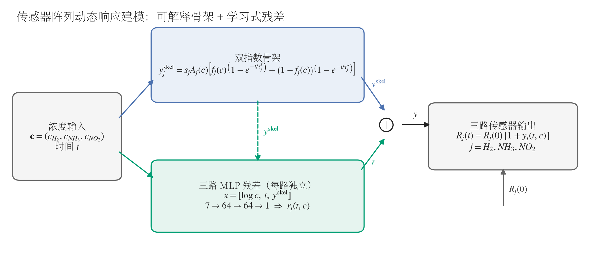

# 双指数骨架 + 三路独立 MLP 残差

本文件说明当前分支的唯一正式组合模型：三通道双指数响应骨架，加上三路完全独立的
MLP 学习的浓度—时间残差。62 折留一评估中，组合的曲线宏 nRMSE 为 1.48%，
明显优于纯双指数骨架的 3.30%；10 s 下游三气体宏中位绝对相对误差为 2.14%，
骨架为 4.99%。默认推荐 <code>mlp_per_gas.json</code>，<code>double.json</code>
保留作骨架对照，详见第 8 节和 [evaluation.md](evaluation.md)。

旧的一阶灰盒、低秩 B 样条残差（hybrid）、直接岭回归、TCN、均值曲线以及旧实验分支的代码都已从本分支删除；相关历史文档在同目录
<code>archive/</code> 中仅作归档。

*图 1：推理架构。浓度与时间先进入双指数骨架，骨架输出再与浓度、时间一起进入三路
独立 MLP 残差，二者相加后由 \(R_j(0)\) 还原绝对响应。*

参数化逐项解释、初值构造、联合拟合细节与最终参数读数见
[<code>double_exponential_analysis.md</code>](double_exponential_analysis.md)。

## 1. 建模对象

每次实验是在恒定浓度 \(\mathbf c=(c_{\mathrm H_2},c_{\mathrm{NH_3}},c_{\mathrm{NO_2}})\)
下的一次阶跃响应。三路传感器读数记为 \(R_j(t)\)，模型拟合相对响应

$$
y_j(t)=\frac{R_j(t)-R_j(0)}{R_j(0)},\qquad j=1,2,3.
$$

相对化去掉不同实验之间可达一个数量级的乘性基线差异；绝对响应由
\(R_j(t)=R_j(0)\,[1+y_j(t)]\) 还原，因此 \(R_j(0)\) 是显式输入，不由浓度预测。

## 2. 双指数骨架

对第 \(j\) 路传感器，

$$
y_j(t)=s_j A_j(\mathbf c)\left[
f_j(\mathbf c)\left(1-e^{-(t-d_j)_+/\tau^{\mathrm{fast}}_j(\mathbf c)}\right)
+(1-f_j(\mathbf c))\left(1-e^{-(t-d_j)_+/\tau^{\mathrm{slow}}_j(\mathbf c)}\right)
\right],
$$

其中 \((x)_+=\max(x,0)\)，\(s=(+1,+1,-1)\) 是由全部实验固定的响应方向，
\(A_j>0\) 是稳态幅度，\(d_j\in[0,2]\) s 是纯延迟，
\(0<\tau^{\mathrm{fast}}_j<\tau^{\mathrm{slow}}_j\)，\(f_j\in(0,1)\) 是快分量的权重。

浓度依赖用对数浓度的多项式参数化，令
\(u_k=\ln(c_k/c_k^{\mathrm{ref}})\)，参考浓度
\(c^{\mathrm{ref}}=(16000,30,6)\)（原始浓度单位）：

$$
\ln A_j=\sum_{|\alpha|\le 2}\beta_{j\alpha}\prod_k u_k^{\alpha_k},\qquad
\ln\tau^{\mathrm{fast}}_j=\sum_{|\alpha|\le 1}\gamma_{j\alpha}\prod_k u_k^{\alpha_k},
$$

$$
\ln(\tau^{\mathrm{slow}}_j-\tau^{\mathrm{fast}}_j)=\sum_{|\alpha|\le 1}\delta_{j\alpha}\prod_k u_k^{\alpha_k},
\qquad
\operatorname{logit} f_j=\sum_{|\alpha|\le 1}\eta_{j\alpha}\prod_k u_k^{\alpha_k}.
$$

每通道参数数为 \(10+4+4+4+1=23\)（增益二次 10、快时间常数一次 4、慢快差一次 4、
混合权重一次 4、延迟 1），三通道共 **69** 个参数。正参数用指数参数化，\(f_j\) 用
logistic 参数化，因此拟合过程中不会出现负幅度、负时间常数或越界混合权重。

## 3. 三路独立 MLP 残差

骨架预测记为 \(\hat y^{\mathrm{skel}}_j(\mathbf c,t)\)。每个气体通道各自学习残差

$$
r_j(\mathbf c,t)=y_j(t)-\hat y^{\mathrm{skel}}_j(\mathbf c,t).
$$

输入为七维：三个对数浓度、归一化时间，以及骨架在该点的三路预测

$$
x=\left(\ln\frac{c_{\mathrm H_2}}{c^{\mathrm{ref}}_{\mathrm H_2}},
\ln\frac{c_{\mathrm{NH_3}}}{c^{\mathrm{ref}}_{\mathrm{NH_3}}},
\ln\frac{c_{\mathrm{NO_2}}}{c^{\mathrm{ref}}_{\mathrm{NO_2}}},
\frac{t}{t_{\max}},
\hat y^{\mathrm{skel}}_{\mathrm H_2},
\hat y^{\mathrm{skel}}_{\mathrm{NH_3}},
\hat y^{\mathrm{skel}}_{\mathrm{NO_2}}\right).
$$

每路是 \(7\to64\to64\to1\)、<code>tanh</code> 激活的网络，输出标准化到训练集
均值 0、标准差 1；三路之间不共享任何权重。每路 4,737 个参数，三路合计 14,211 个。
把骨架输出作为特征，残差网络能区分“骨架已经拟合得较好的区段”和“骨架仍需修正的
区段”，而不必仅凭浓度和时间重新推断骨架形状。\(t_{\max}\) 固定为训练曲线的 60 s；
推断 5 s / 10 s 前缀时仍用同一个 \(t_{\max}\)，不把窗口末端重新当成 \(t_{\max}\)。

最终预测为

$$
\hat y_j(\mathbf c,t)=\hat y^{\mathrm{skel}}_j(\mathbf c,t)+\hat r_j(\mathbf c,t).
$$

训练使用 PyTorch：把训练折全部 \((\mathbf c,t)\) 样本转成张量，放到 CUDA/ROCm GPU
上，用 Adam 做全批训练，默认 600 轮、学习率 \(2\times10^{-3}\)、权重衰减
\(10^{-4}\)；三路损失取各自标准化 MSE 的平均。训练结束后权重拷回 NumPy，推理与
下游 MAP 都在 CPU 上完成。网络很小（三路合计约 1.4 万参数、训练样本约 1.8 万），
逐次前向的 GPU 传输开销会超过计算本身，因此只在训练阶段用 GPU。

三路独立网络固定 600 轮、没有早停；这是当前实现的一个训练协议限制，不能声称轮数
已经为每一折单独选优。

## 4. 拟合

1. **逐实验形状初值**：对每条实验、每路通道拟合一阶形式
   \(A(1-e^{-(t-d)_+/\tau})\)，得到 \((A,\tau,d)\)。这些拟合彼此独立，留一验证时可
   预先算好，再按折取训练子集。
2. **骨架初值**：用岭回归把 \(\ln A\)、\(\ln(\tau/2)\)、\(\ln(1.5\tau)\) 回归到浓度特征
   （后两者分别作为 \(\tau^{\mathrm{fast}}\) 与 \(\tau^{\mathrm{slow}}-\tau^{\mathrm{fast}}\) 的初值）；
   混合权重初值为 0.5（logit 0），延迟取逐实验中位数。
3. **联合拟合**：<code>scipy.optimize.least_squares</code>（TRF）同时优化 69 个参数。残差为
   三通道加权曲线误差加岭惩罚，通道权重 \(w_j=1/\overline{y_j^2}\) 再归一化到均值 1，
   使三路 nRMSE 等权；非截距系数加 \(\sqrt{10^{-3}}\) 的惩罚；延迟界 \([0,2]\) s。
4. **三路独立 MLP 残差**：固定已拟合骨架，用 PyTorch 在 GPU 上全批训练三个独立的
   \(7\to64\to64\to1\) 网络，固定 600 轮；<code>torch.set_num_threads(1)</code> 限制 CPU
   线程，避免小网络训练时 OpenMP 自旋占满 CPU。

## 5. 接口与持久化

~~~
from sensor_array import DoubleExponentialArrayModel, PerGasMLPDoubleExponentialModel

skeleton = DoubleExponentialArrayModel().fit(train_experiments)
model = PerGasMLPDoubleExponentialModel().fit(train_experiments, skeleton=skeleton)
relative = model.predict_relative(concentration, time)          # (N,T,3)
absolute = model.predict_response(concentration, time, initial) # (N,T,3)
model.save("sensor_array/artifacts/models/mlp_per_gas.json")
loaded = PerGasMLPDoubleExponentialModel.load(
    "sensor_array/artifacts/models/mlp_per_gas.json"
)
~~~

- <code>predict_relative</code> 输入浓度形状 (N,3)、时间形状 (T,)，输出 (N,T,3)；
  NO\(_2\) 通道为负。
- <code>predict_response</code> 额外接收初始读数 <code>initial</code>，形状 (N,3) 或 (3,)。
- JSON 保存骨架系数、三路 MLP 的标准化参数、全部权重与偏置，以及训练轮数；加载后
  无需重新拟合即可复现预测。
- <code>DoubleExponentialArrayModel.gain(concentration)</code> 与
  <code>time_constants(concentration)</code> 返回幅度、快/慢时间常数与混合权重，用于机理分析。

## 6. 设计取舍

- **双指数而不是单指数**：单指数在 NO\(_2\) 的起始段和后段之间存在系统偏差；
  第二个时间尺度给曲线一个快分量和一个慢分量，仍保持每个参数可解释。
- **三路独立而不是单一输出**：三路残差的量级、符号和可预测性不同，单一输出层在
  小样本下容易把三路混在一起；独立网络让每路只拟合自己的残差，三路合计 14.2k 参数。
- **MLP 残差而不是更大骨架**：骨架只有 69 个参数，负责可解释的稳态与时间尺度；
  残差网络负责骨架无法表达的浓度—时间交互。这样骨架仍可单独用于外推与机理分析，
  残差可以关闭或替换。
- **不用文件编号作为输入**：避免模型学习采集顺序；NH\(_3\) 浓度与文件顺序高度混淆，
  文件编号一旦进入输入，留一验证会高估泛化。
- **相对响应**：见第 1 节；绝对响应需要 \(R(0)\)，不把基线漂移混进浓度模型。

## 7. 限制

- 62 条实验、每个浓度组合 1 条，没有重复；留一误差包含实验间漂移，是“对未见实验”
  的保守估计。
- NH\(_3\) 浓度与采集顺序完全混淆（相关系数约 0.976），NH\(_3\) 的增益只能解释为
  “该采集顺序下的等效增益”。
- H\(_2\)=32000 只有 4 条且都在 NO\(_2\)=2，H\(_2\) 高端与 NO\(_2\) 的交互没有数据支撑。
- MLP 是单 seed 训练，固定 600 轮、没有早停；没有 seed 方差，也没有逐折选轮数。
- 下游似然使用训练折 in-sample 残差尺度，模型自报的 \(\sigma_{\mathrm{model}}\) 不是独立
  验证得到的噪声尺度。
- 区间校准（P4）只用 50 条开发集拟合分位数；12 条锁定测试只作描述性复核，
  不是独立盲测。
- 当前模型只用三种气体；不对第四种气体做任何声称。

## 8. 评估结论

62 折留一实验的结果（曲线宏 nRMSE / 10 s 下游三气体宏中位绝对相对误差 /
5 s 下游宏中位）：

| 模型 | 曲线宏 | 10 s 下游宏 | 5 s 下游宏 |
|---|---:|---:|---:|
| 双指数骨架 | 3.30% | 4.99% | 7.42% |
| 三路独立 MLP + 双指数 | **1.48%** | **2.14%** | **2.96%** |

三路独立相对骨架：曲线宏 59/62 折改善（中位 −1.80 百分点，Wilcoxon
p = 1.36e−11），10 s 下游宏 47/62（中位 −2.14，p = 3.93e−7），5 s 宏
45/62（中位 −3.14，p = 2.50e−6）。分气体曲线同样全部下降：H\(_2\) 5.17→2.02%、
NH\(_3\) 1.69→1.01%、NO\(_2\) 3.04→1.41%；10 s 下游 H\(_2\) 5.46→1.59%、
NH\(_3\) 2.46→1.26%、NO\(_2\) 5.76→3.79%。

因此 **<code>mlp_per_gas.json</code> 是当前默认模型**，<code>double.json</code>
保留骨架对照。需要保留的限制是：三路独立是单 seed、固定 600 轮、无早停，并且
同时改变了容量与训练方式；不能用 12 条锁定测试调参。

## 9. 区间校准

P4 的区间校准在 62 折折外估计上完成。10 s 原始 Laplace 90% 区间的开发集覆盖只有
32.0% / 30.0% / 6.0%（H\(_2\) / NH\(_3\) / NO\(_2\)）；用开发集 50 条拟合全局共形分位数后，
覆盖为 92.0%，中位相对宽度 3.5% / 3.4% / 8.7%，锁定 12 条为 91.7%–100%。NH\(_3\)
档位共形没有更窄（3.9% / 5.4% / 9.6%），采集块共形开发覆盖只有 84.0%。因此全局
共形是当前默认，分组共形只作诊断；详见 [evaluation.md](evaluation.md) 第 6 节。校准
只调整区间，不改变点估计，也没有重做停止策略或剖面似然。
